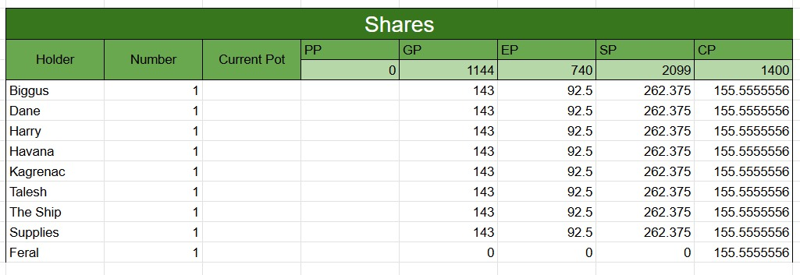

# Party Tracker Sources - 2026-09-12

## Provenance

- Maitland supplied four screenshots on 2026-09-12 and identified them as "current party tracked stuff". The original image files are preserved below, unchanged.
- [Confirmed] This is an import of the current tracker, not a claim that every acquisition, allocation or ship modification happened during today's session. The screenshots contain no visible source date or workbook URL.
- Quantities and labels are transcribed into [Party Loot](../Character/Party%20Loot.md#current-party-tracker---imported-2026-09-12), the [Party Skyship](../Codex/Places/Party%20Skyship%20-%202026-08-29.md#current-ship-tracker---imported-2026-09-12) and [Sending Stones](../Codex/Items/Party%20Sending%20Stones.md). Blank cells and question marks remain unknown rather than zero.
- Source character names are retained. `Dane` likely means Dain and `Talesh` likely means Taleesh [Inferred; To verify]. `Biggus`, `Havana` and `Feral` are not silently merged with the existing [Table Roster](../Codex/Lore/Table%20Roster.md).
- Source screenshots serve as the reference visuals for this tracker import; no newly imagined scene is required.

## Photo 1 - Shares

## Photo 2 - Balloon Ship Stats And Inventory

## Photo 3 - Sending Stones

## Photo 4 - Balloon Ship Deck

## Related Entries

- [Session 2026-09-12](./2026-09-12.md)
- [Party Loot](../Character/Party%20Loot.md)
- [Party Skyship](../Codex/Places/Party%20Skyship%20-%202026-08-29.md)
- [Party Sending Stones](../Codex/Items/Party%20Sending%20Stones.md)
