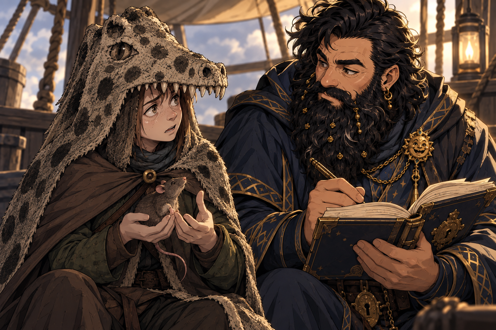

# Session - 2026-09-12

## What Happened Last Time

- [Character-only] Dain acquired [Dwarven Half Plate](../Codex/Items/Dwarven%20Half%20Plate.md), described as `+2 AC`; its exact rules and whether he equipped it remain [To verify].
- [Party] The party acquired five [Magic Mouth scrolls](../Codex/Items/Magic%20Mouth%20Scrolls.md). [Character-only] Dain named `Skywrite` and `Pyrotechnics` as future acquisition goals; neither is owned or known yet.
- [Party] In [Moradin's chamber](../Codex/Places/Moradins%20Chamber%20-%20Ola%20Dung%20Lot.md), worshippers handled hot metal at a shared-wall forge without apparent burns. [Taleesh](../Codex/Characters/Brother%20Taleesh.md) completed the ritual without showing pain, earning Dain's respect; the recorded result `18` still needs its tracker meaning confirmed.
- [Party] An [azer](../Codex/Characters/Azer%20in%20Moradins%20Forge.md) briefly appeared in the forge. [Character-only] Dain then performed the ritual: the rod cooled, he grew hotter, his skin gained a bronze sheen, and he felt guilt about neglecting the Truthammer forge.
- [Character-only] Dain explicitly accepted his [azer connection](../Codex/Lore/Azer%20Spark%20and%20Truthhammer%20Fire%20Portal.md). The accepted account establishes fire-plane magic in Dain and a portal beneath Truthammer opened by his earlier forge incident. Exact abilities and the portal's present condition remain [To verify].
- [Party] The party departed [Ola Dung Lot](../Codex/Places/Ola%20Dung%20Lot.md), in the [Samryn Torsten](../Codex/Lore/Samryn%20Torsten.md) area, aboard its [balloon-like skyship](../Codex/Places/Party%20Skyship%20-%202026-08-29.md), heading south. Two [crymeria attackers](../Codex/Characters/Crymeria%20Attackers%20-%202026-08-29.md) attacked; Taleesh descended by rope toward one, and the party destroyed both.
- [Character-only] Dain acquired a [Flying Broom](../Codex/Items/Flying%20Broom.md) after the fight. Its source and rules are unrecorded; Taleesh's return aboard and the party's post-combat resources are also [To verify].

## Open Points

- [Party] [To verify] First establish Taleesh's position, whether everyone is aboard, ship damage, injuries and any post-fight rest. No recovery or resource reset is assumed.
- [Character-only] [To verify] Confirm current HP, spell slots, prepared spells, armour worn, Breastplate charges, and the broom's command word, capacity and flight rules.
- [Party] [Open] Continue the captive-recovery and southwestern-warning missions: identify the raided settlements, cult/Yuan-ti involvement, rescue window and next destination. Confirm whether the commander's introduction letter was obtained before departure.
- [Character-only] [Open] Explore the accepted azer connection and forge duty without assuming new powers or that the whole party knows Dain's private history.
- [Party] [Open] Assign the five Magic Mouth scrolls and confirm their carrier; copying one into Dain's spellbook has not been established. Ask [Harry](../Codex/Characters/Hammerton%20Harry%20Drizddon.md) what he learned from the [Coal Mine Puppet](../Codex/Items/Coal%20Mine%20Puppet.md), last recorded in rat form on his belt.
- [Party] [Open] Eventually retrieve Taleesh's [Sauna Jacket](../Codex/Items/Sauna%20Pelt.md), still his gift and property, from the town where it was left. Exact town and storage location remain [To verify].

## Get Into Character

These are optional prompts, not actions already taken or new canon.

- Start with care disguised as fussing: account for Taleesh and the crew before experimenting with the broom.
- Dain can respect Taleesh's courage without understanding his methods. A possible line: "Next time you leave by the bottom of the ship, do leave a forwarding address."
- Privately weigh the pull of the ancestral forge against bringing captives home. Dain wants the life his friend saved, and the Truthammer name, to produce kindness.
- Treat the flying broom as an invitation to curiosity: learn what it actually does before designing something magnificently unnecessary around it.
- Five Magic Mouth scrolls are five research temptations. Decide what to ask the party to reserve for study; do not assume ownership or transcription.

## Starting State

- Location: Last confirmed context is the southbound [party skyship](../Codex/Places/Party%20Skyship%20-%202026-08-29.md), after both attackers were destroyed. Exact position, altitude and Taleesh's recovery are [To verify].
- Immediate goal: Establish the post-combat situation, then continue the captive-recovery and southwestern-warning mission.
- Character: [Dain Truthammer](../Codex/Characters/Dain%20Truthammer.md), dwarf Conjuration Wizard 4; spell save DC `15`, spell attack `+7`, as last recorded in [Current State](../Character/Current%20State.md).
- Important active conditions/resources: Current HP and remaining slots are [To verify]. The archive's earlier full-HP/slot entries predate later fights. No new rest is recorded. Duration and mechanical effects of the forge heat, bronze sheen and guilt remain [To verify].
- Armour: [Breastplate of Balance](../Codex/Items/Breastplate%20of%20Balance.md) is the last confirmed equipped and attuned armour, with recorded AC `14`; ownership of the new half plate does not establish an equipment change or new AC.
- Key items: Dain owns the Flying Broom and Dwarven Half Plate; the party owns five Magic Mouth scrolls and the surviving Bag of Holding [carrier To verify]. See [Inventory](../Character/Inventory.md) and [Party Loot](../Character/Party%20Loot.md).
- Key relationship tensions: Dain respects Taleesh's ritual outlook; [Kagrenac](../Codex/Characters/The%20Astral%20Elf.md) has apologized over the armour accusation. [Dain's father](../Codex/Characters/Dains%20Father.md) offered personal welcome while retaining his boundaries on forge secrets and southern land claims; formal clan reinstatement is not established.

## Links

- Previous session: [Session 2026-08-29](./2026-08-29.md)
- Next session: TBD
- Current State: [Dain's Current State](../Character/Current%20State.md)
- Spellbook: [Spellbook](../Character/Spellbook.md)
- Relationships: [Relationships](../Character/Relationships.md)
- Timeline: [Timeline](../Character/Timeline.md)
- Open Threads: [Open Threads](../Codex/Lore/Open%20Threads.md)
- Table Roster: [Table Roster](../Codex/Lore/Table%20Roster.md)
- Current party tracker: [Four supplied screenshots and reconciled records](./2026-09-12-party-tracker.md)

## Summary

- During travel toward the next destination, Ollyander speaks the Law of the Maw to her beloved rat; Dain listens with interest and writes it down.
- Current party tracker imported: coin pot/shares, balloon ship stats and deck layout, hold and preserved materials, and sending-stone connections. Acquisition dates are not established by this import.

- Wizard 5 choices locked: **Major Image + Stinking Cloud**. Future spell research goals recorded; HP and edition-dependent details remain open.

## Live Notes (chronological)

- Awaiting the opening table update. Carry-forward context is the aftermath of the southbound skyship fight on 2026-08-29.
- **[Table-side source import]** Maitland supplies four tracker screenshots as "current party tracked stuff". Originals are preserved in the [tracker source pack](./2026-09-12-party-tracker.md); normalized records are in [Party Loot](../Character/Party%20Loot.md), [Party Skyship](../Codex/Places/Party%20Skyship%20-%202026-08-29.md) and [Party Sending Stones](../Codex/Items/Party%20Sending%20Stones.md). This is existing-state ingestion, not a new chronological acquisition, expenditure or message exchange.

- **[Table-side level-up decision]** Maitland locks in Stinking Cloud after favouring Major Image, completing the two Wizard 5 spellbook selections. He also requests goals to acquire Glyph of Warding and further spells suited to Dain. The approved direction is recorded as a [research shortlist](../Character/Spellbook.md#future-spell-acquisition-goals): Glyph of Warding, Tiny Servant, Nystul's Magic Aura, Blink and Phantom Steed. Existing Skywrite and Pyrotechnics goals continue; party Magic Mouth scroll allocation/copying remains open. No spellcasting or research completion is narrated.

- **[Table-side spell description]** Maitland supplies the complete mechanics for [Truthhammer’s Yellow Snow Coat](../Codex/Powers/Truthhammers%20Yellow%20Snow%20Coat.md): a 1st-level conjuration ritual, lasting 8 hours, with one consumed winter wolf urine flask per jacket, cold protection, social drawbacks and Keen Smell detection up to one mile. Exact wording is preserved in the linked spell entry. Its relationship to Taleesh's physical Sauna Jacket and Dain's learning/creation date remain unconfirmed; no casting or component expenditure is reported.

- **[Prompt]**

  ```text
  Ollyander is saying this to the rat she loves as we travel to the next destination, Dane writes this down finding it interesting
  ```

- **[Travel - Ollyander's account to the rat]** [Confirmed] Ollyander speaks the supplied [pact account and six laws](../Codex/Lore/Ollyanders%20Pact%20-%20Law%20of%20the%20Maw.md) to a rat she loves. Dain finds it interesting and writes it down. The account describes a primal telepathic encounter with Yeenoghu during violence and stress, an imposed pact experienced as instincts, and a threat of returning to the `Muddy Room` if a hunt is not completed. The original [screenshot](./2026-09-12/ollyander-pact-contract-source.jpg) and full transcription are preserved; no rat response, supernatural demonstration or arrival is narrated.
- [Character-only] Dain has heard and recorded this account. Its supernatural truth, precise meaning, and which other party members hear it remain [To verify]. The new rat is not identified with any previously recorded rat or the puppet.

## Character State Changes

- At startup no changes were recorded. Subsequently Wizard 5 and the two spellbook choices were locked in: PB `+2 → +3`, spell DC `15 → 16`, spell attack `+7 → +8`, CON save `+4 → +5`, Hit Dice maximum `4d6 → 5d6`, and maximum slots `4 / 3 → 4 / 3 / 2`. HP, prepared list and edition-dependent features remain [To verify]. No rest or resource refresh is recorded.
- Tracker reconciliation only: no personal coin payout, rope transfer, healing, ammunition expenditure or sending-stone use is established by the screenshots.

- [Character-only] Dain records Ollyander's pact account during onward travel. No resource expenditure or rest completion is reported.

## New Canon / Important Discoveries

- [Party] Current [coin pot](../Character/Party%20Loot.md#coin-pot-and-shares): `0 pp`, `1144 gp`, `740 ep`, `2099 sp`, `1400 cp`. Displayed allocations split GP/EP/SP eight ways and CP nine ways; intent and payout status are [To verify].
- [Party] The [skyship tracker](../Codex/Places/Party%20Skyship%20-%202026-08-29.md#current-ship-tracker---imported-2026-09-12) records bonus-action piloting, magic-user thrust, tactical speed `50 ft`, overmap travel `3 hexes/day`, and size `5x5` [units To verify]. It identifies a `3d10` ballista with a `90-degree` arc and `20` bolts; range and loading remain unknown.
- [Party] Shared holdings now include the documented hold supplies, Chest of Preserving materials (including four chimera eggs and a damaged flame organ), navigation equipment and Rogue Trader Warrant. See [Party Loot](../Character/Party%20Loot.md#current-party-tracker---imported-2026-09-12).
- [Party] [Sending-stone register](../Codex/Items/Party%20Sending%20Stones.md): Kagrenac / Dwarf General, plus Kagrenac / unknown partner for the stone from a Bag of Holding taken from Yuan-Ti spies. The spies are not yet identified with the earlier traders.

- [Confirmed] Ollyander loves the rat she is addressing; the user uses she/her. [Character-only] Dain hears the Law of the Maw and records it. See the [pact record](../Codex/Lore/Ollyanders%20Pact%20-%20Law%20of%20the%20Maw.md) for the source wording and knowledge boundaries.

## Open Threads

- Carry forward the priorities under Open Points and the persistent [Open Threads](../Codex/Lore/Open%20Threads.md); no thread is newly resolved at startup.
- Tracker follow-up: confirm holder aliases, the eight/nine-way share difference, duplicate chain rows, rope quantity/ownership, beer-barrel overlap, ballista rules, warrant authority, spy-stone partner and Bag of Holding provenance.

- Level-up follow-up: confirm HP baseline/increase, 2014/2024 rules and prepared spells. Find sources and copying opportunities for the [spell research goals](../Character/Spellbook.md#future-spell-acquisition-goals).

- Yellow Snow Coat follow-up: establish the relationship between the supplied spell and the physical Sauna Jacket, and Dain's learning/creation date. The spell specifies light armor; its fit over Dain's medium armor is unrecorded.

- New thread: understand the reported Yeenoghu pact, the `Muddy Room`, the rat's identity, and what choice Ollyander has in following the laws. Destination and other listeners remain unconfirmed.

## Images

- Existing continuity: [29 August scene images](./2026-08-29.md#images).
- At startup no new visual beat had been established. The later pact conversation is documented below.
- Four original tracker images are embedded in the [source pack](./2026-09-12-party-tracker.md). The ship deck plan and sending-stone register also serve as the corresponding Codex reference visuals.

### Ollyander's Pact Account During Travel



- Original evidence: [user-supplied pact screenshot](./2026-09-12/ollyander-pact-contract-source.jpg); [full transcription](../Codex/Lore/Ollyanders%20Pact%20-%20Law%20of%20the%20Maw.md#source-transcription).
- Generated with the built-in image tool using [Ollyander's portrait](../Codex/Characters/Ollyander_portrait-v2.png) and [Dain's portrait](../Codex/Characters/Dain_Truthammer_portrait_v3.png) as identity references. The skyship background carries forward existing travel context; the exact staging, rat appearance and lighting are illustrative rather than newly confirmed facts.

<details>
<summary>Scene generation prompt</summary>

Create one landscape campaign journal scene illustration. Use provided images only as character identity/costume references, reference1 Ollyander, reference2 Dain Truthammer. Kinetic Shonen Fantasy Anime style: clean modern fantasy anime, beautiful visible line art, expressive acting, readable silhouettes, smooth cel shaded color, high contrast cinematic lighting; no text or watermark, no photorealism. Quiet but compelling medium close two-person composition during travel. Small adult female hobbit-like Ollyander wears the enormous spotted reptile-head hood and hide mantle exactly as reference, pale skin, straight fawn brown hair, expressive tired wide eyes. She is gently addressing a little ordinary beloved rat cradled in her hands, thoughtful and intimate. Nearby Dain, sturdy adult male dwarf with black beard and ornate dark blue scholarly robes and golden clasp matching reference2, listens with fascinated serious curiosity, pen poised while writing in his open notebook. The notebook marks are indistinct, no readable generated writing. The conversation concerns a harsh pact of hunger, but ONLY depict a conversation; no demon manifestation, attack, magical contract, coercion effects, gore, rat transformation or rat speaking. Tight composition with softly blurred wood and rope background suggesting the established balloon skyship underway, no new identifiable destination or landscape. Skyship setting is continuity illustration, not a new plot event. Keep both people adult, distinct correct identities, and rat small ordinary non magical. Ollyander is talking, not reading: no book in her hands. No extra characters or animals.

</details>
