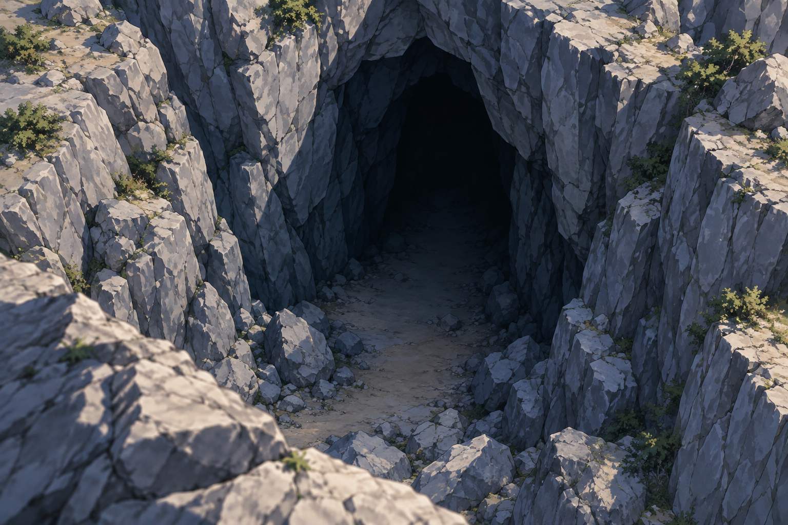
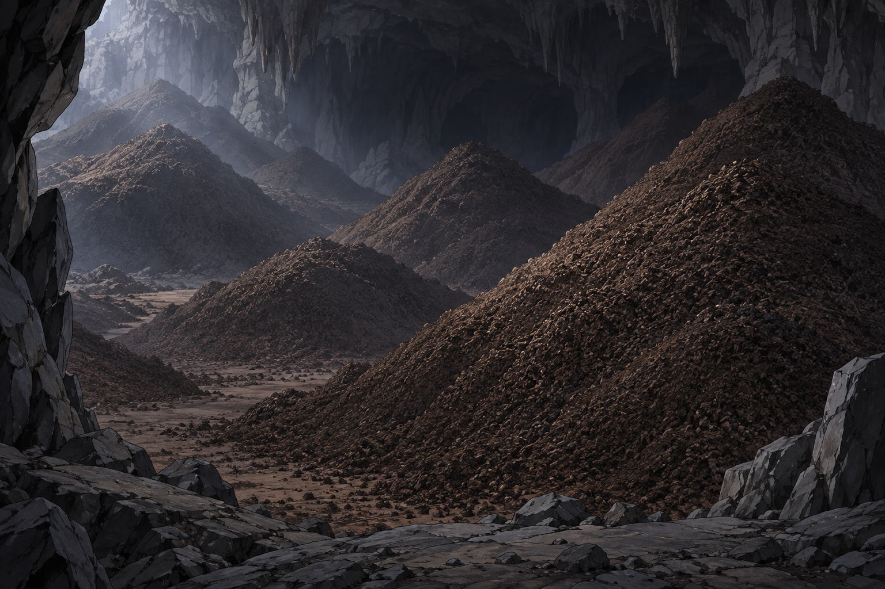
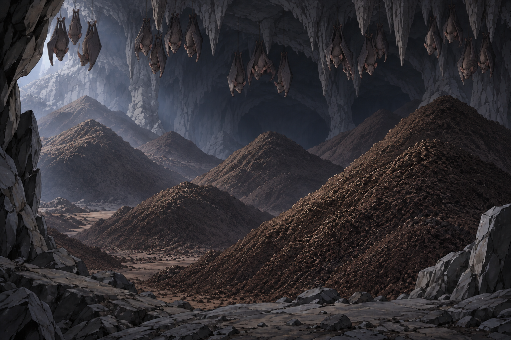
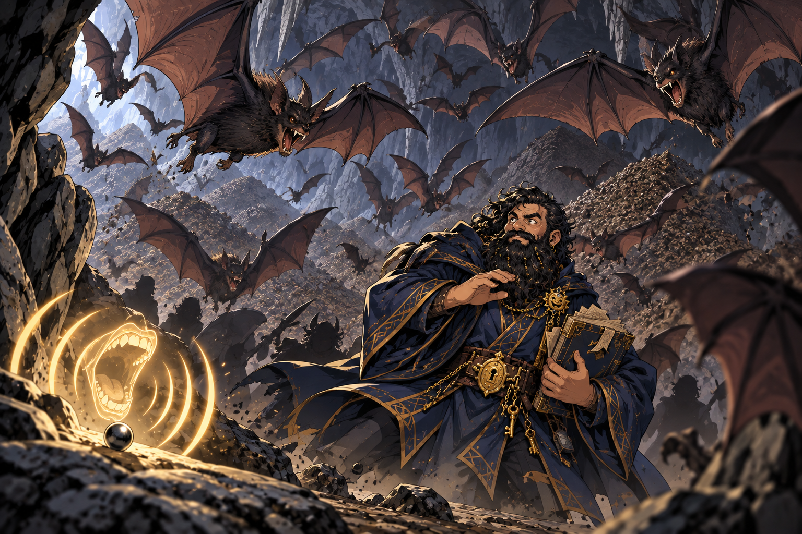
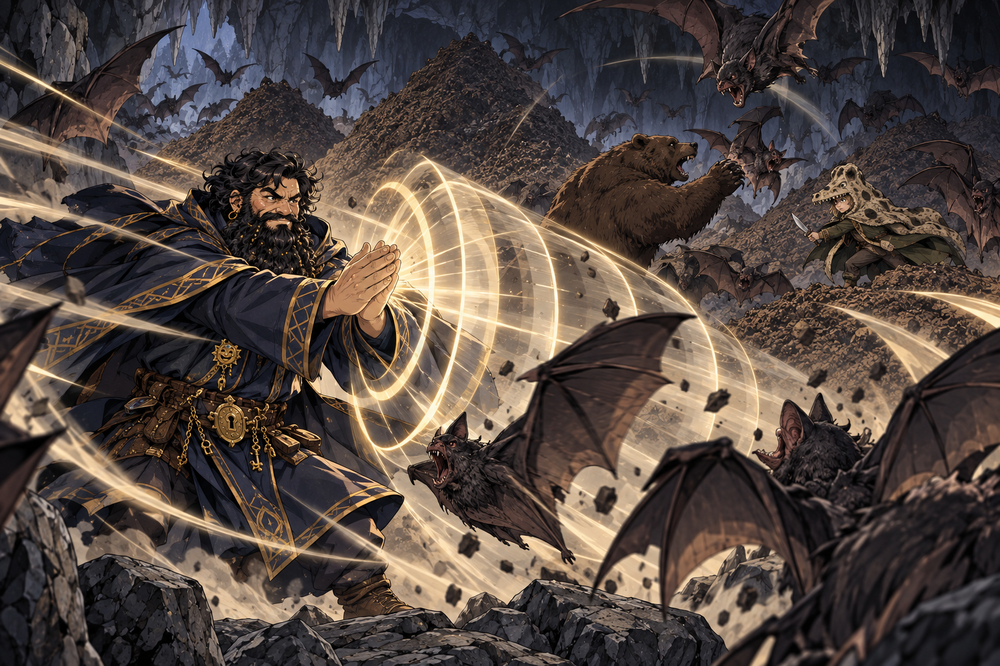
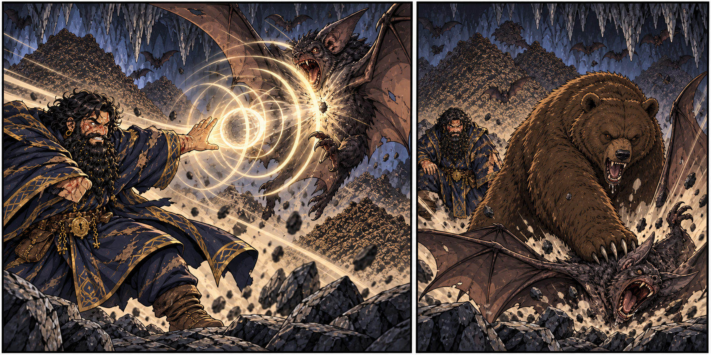
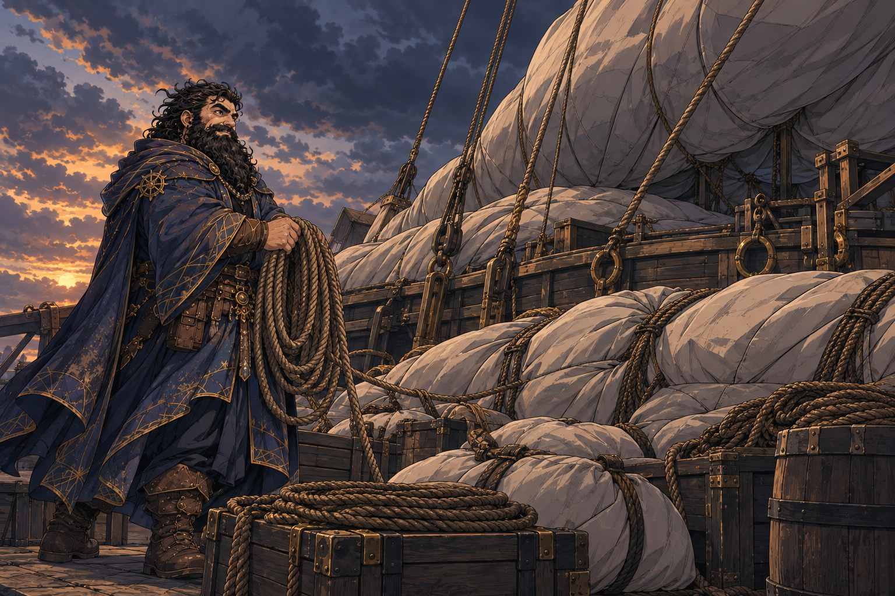

# Session - 2026-09-12

## What Happened Last Time

- [Character-only] Dain acquired [Dwarven Half Plate](../Codex/Items/Dwarven%20Half%20Plate.md), described as `+2 AC`; its exact rules and whether he equipped it remain [To verify].
- [Party] The party acquired five [Magic Mouth scrolls](../Codex/Items/Magic%20Mouth%20Scrolls.md). [Character-only] Dain named `Skywrite` and `Pyrotechnics` as future acquisition goals; neither is owned or known yet.
- [Party] In [Moradin's chamber](../Codex/Places/Moradins%20Chamber%20-%20Ola%20Dung%20Lot.md), worshippers handled hot metal at a shared-wall forge without apparent burns. [Taleesh](../Codex/Characters/Brother%20Taleesh.md) completed the ritual without showing pain, earning Dain's respect; the recorded result `18` still needs its tracker meaning confirmed.
- [Party] An [azer](../Codex/Characters/Azer%20in%20Moradins%20Forge.md) briefly appeared in the forge. [Character-only] Dain then performed the ritual: the rod cooled, he grew hotter, his skin gained a bronze sheen, and he felt guilt about neglecting the Truthammer forge.
- [Character-only] Dain explicitly accepted his [azer connection](../Codex/Lore/Azer%20Spark%20and%20Truthhammer%20Fire%20Portal.md). The accepted account establishes fire-plane magic in Dain and a portal beneath Truthammer opened by his earlier forge incident. Exact abilities and the portal's present condition remain [To verify].
- [Party] The party departed [Ola Dung Lot](../Codex/Places/Ola%20Dung%20Lot.md), in the [Samryn Torsten](../Codex/Lore/Samryn%20Torsten.md) area, aboard its [balloon-like skyship](../Codex/Places/Party%20Skyship%20-%202026-08-29.md), heading south. Two [crymeria attackers](../Codex/Characters/Crymeria%20Attackers%20-%202026-08-29.md) attacked; Taleesh descended by rope toward one, and the party destroyed both.
- [Character-only] Dain acquired a [Flying Broom](../Codex/Items/Flying%20Broom.md) after the fight. Its source and rules are unrecorded; Taleesh's return aboard and the party's post-combat resources are also [To verify].

## Open Points

- [Party] [To verify] First establish Taleesh's position, whether everyone is aboard, ship damage, injuries and any post-fight rest. No recovery or resource reset is assumed.
- [Character-only] [To verify] Confirm current HP, spell slots, prepared spells, armour worn, Breastplate charges, and the broom's command word, capacity and flight rules.
- [Party] [Open] Continue the captive-recovery and southwestern-warning missions: identify the raided settlements, cult/Yuan-ti involvement, rescue window and next destination. Confirm whether the commander's introduction letter was obtained before departure.
- [Character-only] [Open] Explore the accepted azer connection and forge duty without assuming new powers or that the whole party knows Dain's private history.
- [Party] [Open] Assign the five Magic Mouth scrolls and confirm their carrier; copying one into Dain's spellbook has not been established. Ask [Harry](../Codex/Characters/Hammerton%20Harry%20Drizddon.md) what he learned from the [Coal Mine Puppet](../Codex/Items/Coal%20Mine%20Puppet.md), last recorded in rat form on his belt.
- [Party] [Open] Eventually retrieve Taleesh's [Sauna Jacket](../Codex/Items/Sauna%20Pelt.md), still his gift and property, from the town where it was left. Exact town and storage location remain [To verify].

## Get Into Character

These are optional prompts, not actions already taken or new canon.

- Start with care disguised as fussing: account for Taleesh and the crew before experimenting with the broom.
- Dain can respect Taleesh's courage without understanding his methods. A possible line: "Next time you leave by the bottom of the ship, do leave a forwarding address."
- Privately weigh the pull of the ancestral forge against bringing captives home. Dain wants the life his friend saved, and the Truthammer name, to produce kindness.
- Treat the flying broom as an invitation to curiosity: learn what it actually does before designing something magnificently unnecessary around it.
- Five Magic Mouth scrolls are five research temptations. Decide what to ask the party to reserve for study; do not assume ownership or transcription.

## Starting State

- Location: Last confirmed context is the southbound [party skyship](../Codex/Places/Party%20Skyship%20-%202026-08-29.md), after both attackers were destroyed. Exact position, altitude and Taleesh's recovery are [To verify].
- Immediate goal: Establish the post-combat situation, then continue the captive-recovery and southwestern-warning mission.
- Character: [Dain Truthammer](../Codex/Characters/Dain%20Truthammer.md), dwarf Conjuration Wizard 4; spell save DC `15`, spell attack `+7`, as last recorded in [Current State](../Character/Current%20State.md).
- Important active conditions/resources: Current HP and remaining slots are [To verify]. The archive's earlier full-HP/slot entries predate later fights. No new rest is recorded. Duration and mechanical effects of the forge heat, bronze sheen and guilt remain [To verify].
- Armour: [Breastplate of Balance](../Codex/Items/Breastplate%20of%20Balance.md) is the last confirmed equipped and attuned armour, with recorded AC `14`; ownership of the new half plate does not establish an equipment change or new AC.
- Key items: Dain owns the Flying Broom and Dwarven Half Plate; the party owns five Magic Mouth scrolls and the surviving Bag of Holding [carrier To verify]. See [Inventory](../Character/Inventory.md) and [Party Loot](../Character/Party%20Loot.md).
- Key relationship tensions: Dain respects Taleesh's ritual outlook; [Kagrenac](../Codex/Characters/The%20Astral%20Elf.md) has apologized over the armour accusation. [Dain's father](../Codex/Characters/Dains%20Father.md) offered personal welcome while retaining his boundaries on forge secrets and southern land claims; formal clan reinstatement is not established.

## Links

- Previous session: [Session 2026-08-29](./2026-08-29.md)
- Next session: TBD
- Current State: [Dain's Current State](../Character/Current%20State.md)
- Spellbook: [Spellbook](../Character/Spellbook.md)
- Relationships: [Relationships](../Character/Relationships.md)
- Timeline: [Timeline](../Character/Timeline.md)
- Open Threads: [Open Threads](../Codex/Lore/Open%20Threads.md)
- Table Roster: [Table Roster](../Codex/Lore/Table%20Roster.md)
- Current party tracker: [Four supplied screenshots and reconciled records](./2026-09-12-party-tracker.md)

## Summary

- During travel toward the next destination, Ollyander speaks the Law of the Maw to her beloved rat; Dain listens with interest and writes it down.
- Current party tracker imported: coin pot/shares, balloon ship stats and deck layout, hold and preserved materials, and sending-stone connections. Acquisition dates are not established by this import.

- Wizard 5 choices locked: **Major Image + Stinking Cloud**. Future spell research goals recorded; HP and edition-dependent details remain open.

- Dain spots a walk-in [crevasse](../Codex/Places/Guano-Scented%20Crevasse%20-%202026-09-12.md) on a natural 20 / Investigation 30. The smell of bat droppings while hovering over it draws the party's interest as a possible useful material.

- The party now sees an open cavern containing giant piles of bat guano, more than they have ever seen. No collection is reported.

- The party spots **20 giant bats**, reported at the table as **CR 1/4 each**. Their reaction and any combat remain unreported.

- Stu casts Speak with Animals and asks a bat about treasure; the bat reports none. An incoming bat triggers the entrance Magic Mouth, which starts screaming; the bats begin swarming the party in response.

- Dain casts Thunderclap, hurting three bat groups for 8 damage; Stu turns into a bear, and Ollyander fights one swarm at the far end of the cave. Ollyander is confirmed as the one who fell from the cave roof; consequences remain unrecorded. Maitland describes the scene as "chaos, chaos managed"; exact resolution remains unreported.
- Dain drops to **3 HP**; his thunder Chromatic Orb damages the alpha bat, which Stu then finishes in bear form.
- The party continues toward an unidentified tower, then stops to pack down the transport ahead of forecast heavy winds overnight.


## Live Notes (chronological)

- Awaiting the opening table update. Carry-forward context is the aftermath of the southbound skyship fight on 2026-08-29.
- **[Table-side source import]** Maitland supplies four tracker screenshots as "current party tracked stuff". Originals are preserved in the [tracker source pack](./2026-09-12-party-tracker.md); normalized records are in [Party Loot](../Character/Party%20Loot.md), [Party Skyship](../Codex/Places/Party%20Skyship%20-%202026-08-29.md) and [Party Sending Stones](../Codex/Items/Party%20Sending%20Stones.md). This is existing-state ingestion, not a new chronological acquisition, expenditure or message exchange.

- **[Table-side level-up decision]** Maitland locks in Stinking Cloud after favouring Major Image, completing the two Wizard 5 spellbook selections. He also requests goals to acquire Glyph of Warding and further spells suited to Dain. The approved direction is recorded as a [research shortlist](../Character/Spellbook.md#future-spell-acquisition-goals): Glyph of Warding, Tiny Servant, Nystul's Magic Aura, Blink and Phantom Steed. Existing Skywrite and Pyrotechnics goals continue; party Magic Mouth scroll allocation/copying remains open. No spellcasting or research completion is narrated.

- **[Table-side spell description]** Maitland supplies the complete mechanics for [Truthhammer’s Yellow Snow Coat](../Codex/Powers/Truthhammers%20Yellow%20Snow%20Coat.md): a 1st-level conjuration ritual, lasting 8 hours, with one consumed winter wolf urine flask per jacket, cold protection, social drawbacks and Keen Smell detection up to one mile. Exact wording is preserved in the linked spell entry. Its relationship to Taleesh's physical Sauna Jacket and Dain's learning/creation date remain unconfirmed; no casting or component expenditure is reported.

- **[Prompt]**

  ```text
  Ollyander is saying this to the rat she loves as we travel to the next destination, Dane writes this down finding it interesting
  ```

- **[Travel - Ollyander's account to the rat]** [Confirmed] Ollyander speaks the supplied [pact account and six laws](../Codex/Lore/Ollyanders%20Pact%20-%20Law%20of%20the%20Maw.md) to a rat she loves. Dain finds it interesting and writes it down. The account describes a primal telepathic encounter with Yeenoghu during violence and stress, an imposed pact experienced as instincts, and a threat of returning to the `Muddy Room` if a hunt is not completed. The original [screenshot](./2026-09-12/ollyander-pact-contract-source.jpg) and full transcription are preserved; no rat response, supernatural demonstration or arrival is narrated.
- [Character-only] Dain has heard and recorded this account. Its supernatural truth, precise meaning, and which other party members hear it remain [To verify]. The new rat is not identified with any previously recorded rat or the puppet.

- **[Prompt]**

  ```text
  Oleander learns the rats name Goarsqueek
  ```

- **[Goarsqueek named]** [Confirmed] Oleander learns that her beloved rat is named [Goarsqueek](../Codex/Characters/Goarsqueek.md). How she learns the name and whether Dain or anyone else also hears it are unrecorded.

- **[Prompt]**

  ```text
  Dain rolls a natural 20 for 30 investigation and spots a cravarsse big enough to walk in. Hovering over it, the smell of bat shit. We know that could be useful.
  ```

- **[Crevasse discovery]** [Confirmed] Dain rolls a natural `20`, for total Investigation `30`, and spots a [crevasse big enough to walk into](../Codex/Places/Guano-Scented%20Crevasse%20-%202026-09-12.md). [Party] While hovering above it, the smell of bat droppings is noticed; the party recognizes possible usefulness. No entry or collection is reported. The precise hovering subject/platform, location and check modifiers remain unrecorded.

- **[Prompt]**

  ```text
  Before entering the cave, Dain drops a ball bearing from his bag and casts magic mouth on it, telling it to scream into the cave and tell us if something enters behind us
  ```

- **[Ball-bearing alarm]** [Confirmed] Before entering, Dain drops one bearing from his bag and casts [Magic Mouth on it](../Codex/Items/Cave%20Alarm%20Ball%20Bearing.md). His intended alarm screams into the cave to warn if something enters behind the party. Exact trigger/message wording and repeat setting are unrecorded; no alarm activation or entry is narrated.
- **[Resource accounting]** [Inferred; assumption stated to user] Treat this as one Magic Mouth scroll used because no transcription is recorded: five before this cast, four provisionally remaining. The casting source was not explicit. No spell slot or separate material cost is deducted under that assumption. One bearing is deployed, not consumed; other bearings remain uncounted.

- **[Prompt]**

  ```text
  We see an open cavern with more batshit than we’ve ever seen, giant piles of shit, more than we’ve ever seen
  ```

- **[Open cavern - enormous guano piles]** [Party] [Confirmed] The party sees an open cavern containing giant piles of bat droppings, described as more than they have ever seen. This visually confirms substantial guano deposits beyond the earlier odor clue. No bats or other inhabitants, exact quantity, collection, alarm activation or resource expenditure are reported.

- **[Prompt]**

  ```text
  We spot 20 giant bats with 1/4 CR
  ```

- **[Giant bats spotted]** [Party] [Confirmed] The party spots [20 giant bats](../Codex/Characters/Giant%20Bats%20-%20Guano%20Cavern.md) in the open guano cavern. [Table-side detail] CR `1/4` each. Positions, behavior, awareness and hostility are unrecorded; no initiative, attack, damage or XP award is reported.

- **[Prompt]**

  ```text
  Dain encourages Olly to explore the cave a bit further to see if there’s anything in the cave
  ```

- **[Encouraging Olly to explore]** [Confirmed] Dain encourages [Olly / Oleander](../Codex/Characters/Ollyander.md) to explore farther into the [cave](../Codex/Places/Guano-Scented%20Crevasse%20-%202026-09-12.md) and see what else is there. This records Dain's encouragement; Olly's answer, movement and discoveries have not yet been reported. The last observed encounter remains 20 giant bats, with no reaction or combat reported.

- **[Prompt]**

  ```text
  Stu casts speak with animals and asks a bat if there’s any treasure. No treasure.
  A bat flies in and triggers the mouth at the entrance, and it begins screaming
  ```

- **[Treasure question]** [Confirmed] Stu casts Speak with Animals and asks a bat whether there is treasure. The reported answer is **no treasure**. Treat this as the bat's answer, not an exhaustive search result. Stu's character identity, casting method, resource use and whether the answer is relayed aloud are unrecorded.
- **[Entrance alarm triggered]** [Party] [Confirmed] A bat flies in, triggering the [Magic Mouth bearing](../Codex/Items/Cave%20Alarm%20Ball%20Bearing.md) at the entrance. The mouth begins screaming. The incoming bat is not confirmed additional to the 20 initially spotted. This is activation of the existing spell, not a newly reported casting.

- **[Prompt]**

  ```text
  Bats begin to swarm us in response
  ```

- **[Bats swarm the party]** [Party] [Confirmed] The bats begin swarming the party in response to the screaming entrance alarm. No initiative roll, attack roll, hit, damage, imposed condition, defeat or escape is reported. `Swarm` describes their behavior here, not a replacement monster stat block.

- **[Prompt]**

  ```text
  Dain thunderclaps hurting 3 groups of bats for 8 damage, Stu turns into a bear, Ollyander is at the end of the cave fighting one swarm, fell from the roof- chaos, chaos managed
  ```

- **[Thunderclap]** [Party] [Confirmed] Dain casts Thunderclap, hurting **three groups of bats for 8 damage**. Preserve the reported grouping and damage; individual bat HP, saving throws, allocation within each group and casualties are unrecorded. Thunderclap is a cantrip, so no Dain spell slot is deducted.
- **[Bear transformation]** [Party] [Confirmed] [Stu](../Codex/Characters/Stu.md) turns into a bear. Bear type, transformation method, resource cost and any subsequent attack remain unrecorded.
- **[Olly at the far end]** [Party] [Confirmed] [Ollyander](../Codex/Characters/Ollyander.md) is at the end of the cave fighting one swarm. Her route and any damage are unrecorded. The phrase **"fell from the roof"** does not clearly identify who or what fell; do not assign fall damage or a condition.
- **[Scene assessment]** Maitland describes **"chaos, chaos managed"**. Record that assessment without treating it as confirmation that every bat is defeated or that combat has ended.

- **[Prompt]**

  ```text
  Olly
  ```

- **[Clarification - roof fall]** [Party] [Confirmed] Maitland clarifies that Ollyander was the one who fell from the cave roof. Fall height, cause, damage and resulting conditions remain unrecorded.

- **[Prompt]**

  ```text
  Dain gets pretty beat up to 3hp but finally chromatic orb thunder damages the alpha bat, and then Stu in beat form finishes it off
  ```

- **[Dain badly wounded; alpha defeated]** [Party] [Confirmed] Dain is badly beaten down to **3 HP**, then damages the alpha bat with **Chromatic Orb (thunder)**. Stu in bear form finishes the alpha off. Orb damage, slot level/resource source and the remaining bats' fate are unrecorded.
- **[Wording]** "beat form" is read as "bear form" in continuity with Stu's confirmed transformation.

- **[Prompt]**

  ```text
  Tell me about truthammers custom spells, we’re now travelling towards the tower but stopping and packing down the transport so we can weather the storm at night with heavy winds forecasted
  ```

- **[Tower-bound travel; storm preparations]** [Party] [Confirmed] The party is travelling toward **the tower**, then stops and begins packing down the transport to weather the storm overnight, with heavy winds forecast. The tower identity, stopping place and packing method are unrecorded. This establishes onward travel after the cave, without resolving every remaining bat or confirming guano collection.
- **[Resources]** No healing, completed rest or custom spell casting is reported. Dain's last confirmed HP remains **3**.

## Character State Changes

- At startup no changes were recorded. Subsequently Wizard 5 and the two spellbook choices were locked in: PB `+2 → +3`, spell DC `15 → 16`, spell attack `+7 → +8`, CON save `+4 → +5`, Hit Dice maximum `4d6 → 5d6`, and maximum slots `4 / 3 → 4 / 3 / 2`. HP, prepared list and edition-dependent features remain [To verify]. No rest or resource refresh is recorded.
- Tracker reconciliation only: no personal coin payout, rope transfer, healing, ammunition expenditure or sending-stone use is established by the screenshots.

- [Character-only] Dain records Ollyander's pact account during onward travel. No resource expenditure or rest completion is reported.

- Latest position/context: hovering over the newly spotted crevasse during travel [who/what is hovering unspecified]. No descent, entry, harvested component or resource expenditure is recorded. The reported roll total is preserved without changing Dain's base Investigation modifier.

- Dain deploys one [alarm bearing](../Codex/Items/Cave%20Alarm%20Ball%20Bearing.md) before entering. Magic Mouth scroll balance is provisionally `5 → 4` under the stated scroll-use assumption; actual casting source remains to verify.

- Latest view: the open cavern and enormous bat-guano heaps. The deposits are observed in the environment; none is added to inventory without a collection action.

- Current encounter pressure: bats swarming the party in response to the screaming Magic Mouth. No damage or mechanical condition is recorded; Dain's resources remain as previously tracked. Stu's Speak with Animals expenditure is unrecorded.

- Dain: Thunderclap cantrip used; three bat groups hurt for reported 8 damage, no spell slot spent. Stu: now bear form. Ollyander: fighting one swarm at the cave's far end. Party HP, fall consequences and final encounter outcome remain unrecorded.

- [Confirmed latest HP] Dain is at **3 HP**. Chromatic Orb casting and thunder damage are confirmed; damage amount and casting resource are unrecorded. No healing is reported.

- [Confirmed travel update] Now stopped along the route to the tower, packing down the transport for overnight storm weather. No completed rest, recovery or custom spell use is recorded; Dain remains last recorded at 3 HP.

## New Canon / Important Discoveries

- [Party] Current [coin pot](../Character/Party%20Loot.md#coin-pot-and-shares): `0 pp`, `1144 gp`, `740 ep`, `2099 sp`, `1400 cp`. Displayed allocations split GP/EP/SP eight ways and CP nine ways; intent and payout status are [To verify].
- [Party] The [skyship tracker](../Codex/Places/Party%20Skyship%20-%202026-08-29.md#current-ship-tracker---imported-2026-09-12) records bonus-action piloting, magic-user thrust, tactical speed `50 ft`, overmap travel `3 hexes/day`, and size `5x5` [units To verify]. It identifies a `3d10` ballista with a `90-degree` arc and `20` bolts; range and loading remain unknown.
- [Party] Shared holdings now include the documented hold supplies, Chest of Preserving materials (including four chimera eggs and a damaged flame organ), navigation equipment and Rogue Trader Warrant. See [Party Loot](../Character/Party%20Loot.md#current-party-tracker---imported-2026-09-12).
- [Party] [Sending-stone register](../Codex/Items/Party%20Sending%20Stones.md): Kagrenac / Dwarf General, plus Kagrenac / unknown partner for the stone from a Bag of Holding taken from Yuan-Ti spies. The spies are not yet identified with the earlier traders.

- [Confirmed] Ollyander loves the rat she is addressing; the user uses she/her. [Character-only] Dain hears the Law of the Maw and records it. See the [pact record](../Codex/Lore/Ollyanders%20Pact%20-%20Law%20of%20the%20Maw.md) for the source wording and knowledge boundaries.

- [Confirmed] Oleander now knows her rat's name: [Goarsqueek](../Codex/Characters/Goarsqueek.md). Knowledge of the name has not yet been explicitly extended to Dain or the whole party.

- [Party] New location: a [walk-in crevasse smelling of bat droppings](../Codex/Places/Guano-Scented%20Crevasse%20-%202026-09-12.md). Potential usefulness is recognized; the interior and accessible deposits are unconfirmed.

- [Confirmed] Dain casts Magic Mouth onto a dropped bearing, intending a warning if something enters the cave behind the party.

- [Party] The [crevasse/cave](../Codex/Places/Guano-Scented%20Crevasse%20-%202026-09-12.md) opens to a cavern with giant guano piles, exceeding any the party has previously seen. The guano deposit is now visually confirmed; its producers and exact amount remain unknown.

- [Party] **20 giant bats** are now observed in the cavern. Reported table rating: **CR 1/4 each**. This reveals inhabitants; it does not establish combat.

- [Reported answer] The bat tells Stu there is no treasure. [Party] The entrance alarm accepts an incoming bat as a trigger; its scream provokes the bats to swarm the party.

- [Party] Combat actions are now confirmed: Thunderclap damage, Stu's bear transformation, and Ollyander fighting at the far end. Maitland subsequently confirms Ollyander fell from the cave roof; fall consequences remain unrecorded.

## Open Threads

- Carry forward the priorities under Open Points and the persistent [Open Threads](../Codex/Lore/Open%20Threads.md); no thread is newly resolved at startup.
- Tracker follow-up: confirm holder aliases, the eight/nine-way share difference, duplicate chain rows, rope quantity/ownership, beer-barrel overlap, ballista rules, warrant authority, spy-stone partner and Bag of Holding provenance.

- Level-up follow-up: confirm HP baseline/increase, 2014/2024 rules and prepared spells. Find sources and copying opportunities for the [spell research goals](../Character/Spellbook.md#future-spell-acquisition-goals).

- Yellow Snow Coat follow-up: establish the relationship between the supplied spell and the physical Sauna Jacket, and Dain's learning/creation date. The spell specifies light armor; its fit over Dain's medium armor is unrecorded.

- New thread: understand the reported Yeenoghu pact, the `Muddy Room`, the rat's identity, and what choice Ollyander has in following the laws. Destination and other listeners remain unconfirmed.

- Rat-name question resolved: Oleander learns **Goarsqueek**. Other questions about the rat's nature, history and communication remain open.

- New crevasse thread: decide whether to investigate the entrance or gather material; neither action has been taken. Establish the hovering platform/position and exact location if needed.

- Alarm follow-up: track trigger events and eventual retrieval. Exact recorded warning, repeat setting and casting source remain unrecorded.

- Cavern follow-up: inspect the enormous guano deposits and surroundings, decide whether to gather anything, and track the bearing alarm. No inhabitants or trigger event have been revealed.

- Giant-bat follow-up: establish whether the bats notice or react to the party and what the party does next. No combat result or guano collection is reported.

- Dain has encouraged Olly to explore farther. Await her response and any subsequent discoveries; no exploration result is assumed.

- Immediate follow-up: record the party's response to the swarming bats, whether the screaming stops, and any initiative or damage. Exact active count and positions are unresolved.

- Combat follow-up: Ollyander's fall height and any fall damage, bear-form mechanics, bat casualties/remaining groups, party injuries and whether "chaos managed" means a completed encounter.

- Latest combat follow-up: alpha defeated by Stu after Dain's thunder Chromatic Orb; Dain at 3 HP. Record recovery, Orb expenditure and remaining bats.

- Storm stop: identify the destination tower and shelter arrangements; record transport pack-down completion, weather, and any rest/recovery. Neither custom shelter nor coat is assumed cast.

## Images

- Existing continuity: [29 August scene images](./2026-08-29.md#images).
- At startup no new visual beat had been established. The later pact conversation is documented below.
- Four original tracker images are embedded in the [source pack](./2026-09-12-party-tracker.md). The ship deck plan and sending-stone register also serve as the corresponding Codex reference visuals.

### Ollyander's Pact Account During Travel


- Original evidence: [user-supplied pact screenshot](./2026-09-12/ollyander-pact-contract-source.jpg); [full transcription](../Codex/Lore/Ollyanders%20Pact%20-%20Law%20of%20the%20Maw.md#source-transcription).
- Generated with the built-in image tool using [Ollyander's portrait](../Codex/Characters/Ollyander_portrait-v2.png) and [Dain's portrait](../Codex/Characters/Dain_Truthammer_portrait_v3.png) as identity references. The skyship background carries forward existing travel context; the exact staging, rat appearance and lighting are illustrative rather than newly confirmed facts.

<details>
<summary>Scene generation prompt</summary>

Create one landscape campaign journal scene illustration. Use provided images only as character identity/costume references, reference1 Ollyander, reference2 Dain Truthammer. Kinetic Shonen Fantasy Anime style: clean modern fantasy anime, beautiful visible line art, expressive acting, readable silhouettes, smooth cel shaded color, high contrast cinematic lighting; no text or watermark, no photorealism. Quiet but compelling medium close two-person composition during travel. Small adult female hobbit-like Ollyander wears the enormous spotted reptile-head hood and hide mantle exactly as reference, pale skin, straight fawn brown hair, expressive tired wide eyes. She is gently addressing a little ordinary beloved rat cradled in her hands, thoughtful and intimate. Nearby Dain, sturdy adult male dwarf with black beard and ornate dark blue scholarly robes and golden clasp matching reference2, listens with fascinated serious curiosity, pen poised while writing in his open notebook. The notebook marks are indistinct, no readable generated writing. The conversation concerns a harsh pact of hunger, but ONLY depict a conversation; no demon manifestation, attack, magical contract, coercion effects, gore, rat transformation or rat speaking. Tight composition with softly blurred wood and rope background suggesting the established balloon skyship underway, no new identifiable destination or landscape. Skyship setting is continuity illustration, not a new plot event. Keep both people adult, distinct correct identities, and rat small ordinary non magical. Ollyander is talking, not reading: no book in her hands. No extra characters or animals.

</details>

### Walk-In Crevasse Discovery



- Generated scene reference for Dain's Investigation 30 discovery. Exact geography and lighting are illustrative. [Built-in generation prompt and saved image](./2026-09-12/crevasse-image-notes.md).

### Magic Mouth Alarm Before Cave Entry


- [Alarm record](../Codex/Items/Cave%20Alarm%20Ball%20Bearing.md). Built-in image generation using Dain and crevasse references; [saved image and full prompt](./2026-09-12/alarm-image-notes.md). Visual staging and spell glow are illustrative; no alarm activation is shown.

### Open Cavern And Giant Guano Piles



- Scene panel of the reported reveal. Exact layout, scale and lighting are illustrative. [Built-in generation prompt and saved image](./2026-09-12/guano-cavern-image-notes.md).

### Giant Bats Revealed



- User-confirmed count: **20**, **CR 1/4 each**. Illustration is not a tactical map or census and does not establish roosting, sleep or awareness. [Built-in generation prompt and saved asset](./2026-09-12/giant-bats-image-notes.md).

### Screaming Alarm And Swarming Bats



- Scene illustration of the alarm consequence. Precise positions and poses are illustrative, with no hit or damage established. [Built-in generation prompt and saved asset](./2026-09-12/bat-swarm-image-notes.md).

### Chaos, Chaos Managed



- Scene illustration with established character/cavern references. Bear appearance, combat poses and effect shapes are illustrative; no fall, killing blow or bear attack outcome is established. [Built-in generation prompt and saved asset](./2026-09-12/chaos-managed-image-notes.md).

### Thunder Orb And The Alpha's Defeat



- Built-in scene illustration; exact injuries, poses and attack mechanics are illustrative. [Saved asset and full generation prompt](./2026-09-12/alpha-bat-image-notes.md).

### Packing Down Before The Storm



- Built-in illustration; packing arrangement and weather appearance are illustrative. [Saved asset and generation prompt](./2026-09-12/storm-pack-down-image-notes.md).
