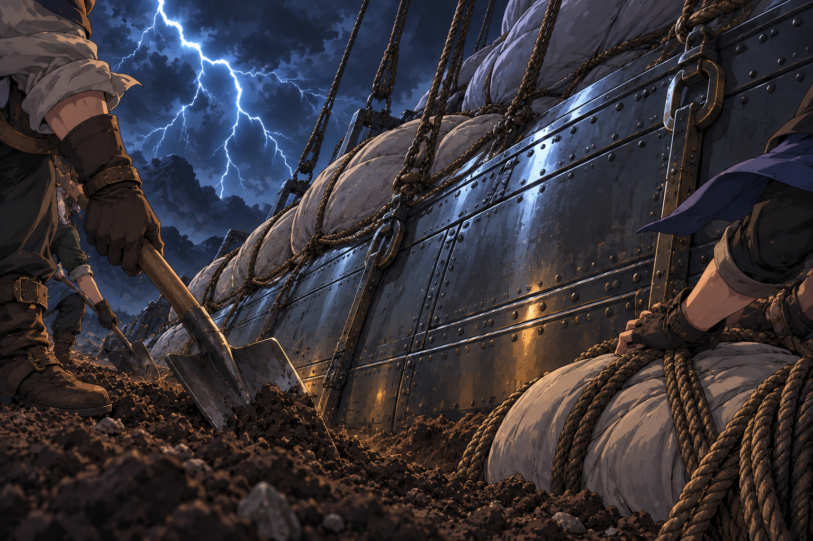
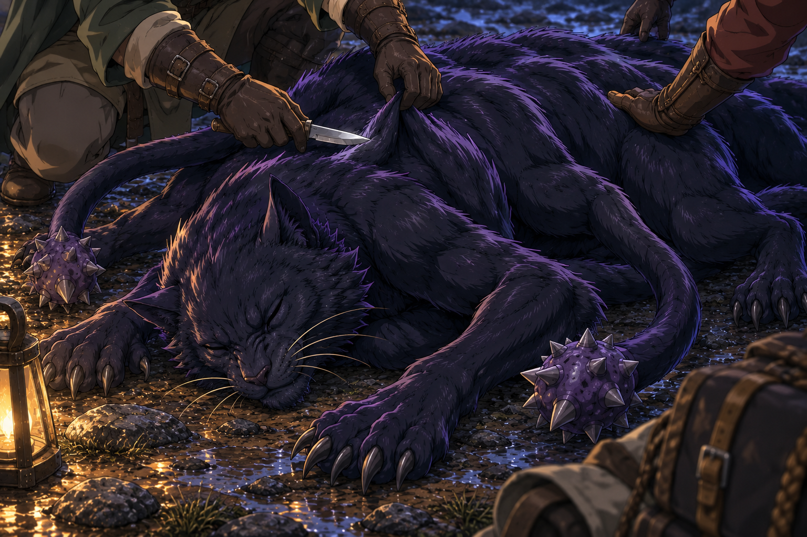
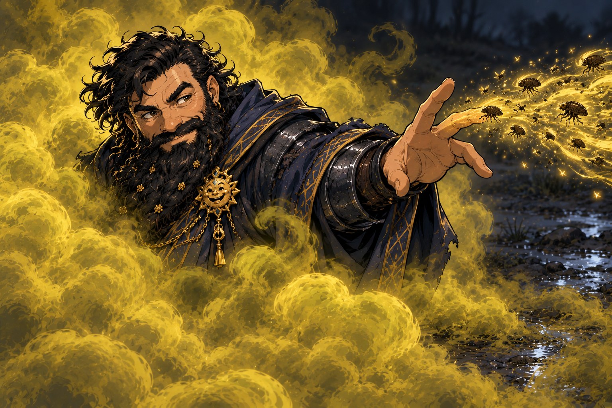
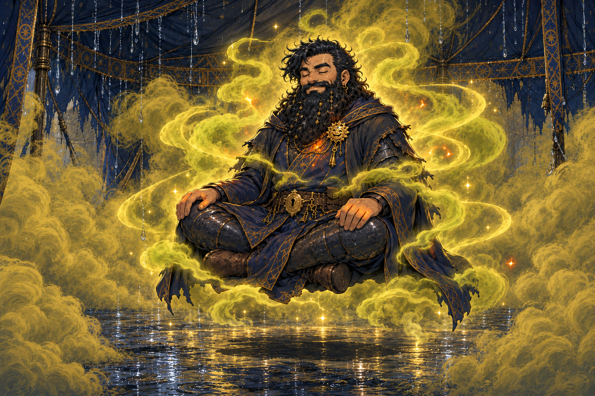
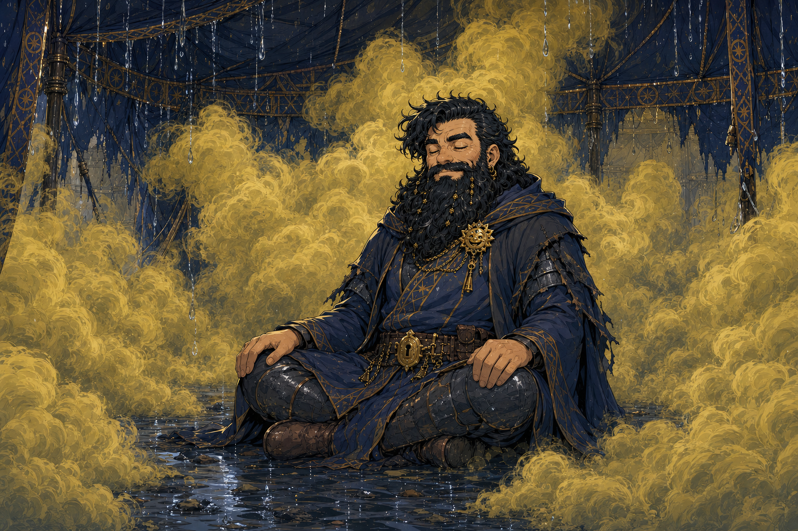
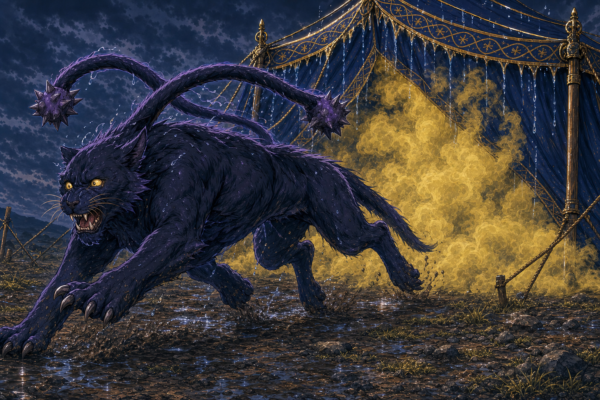
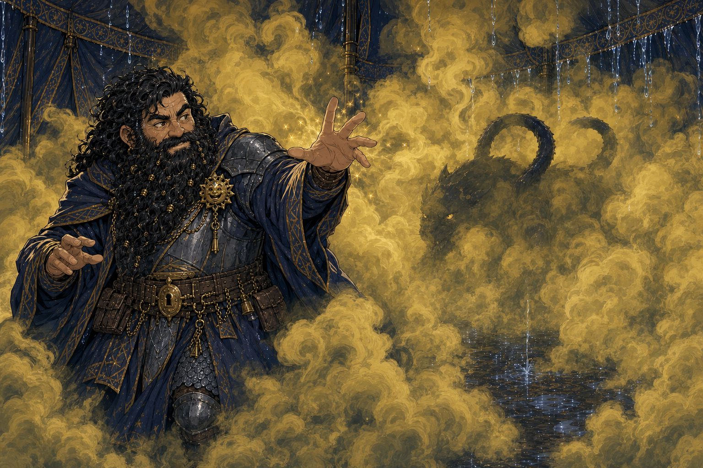
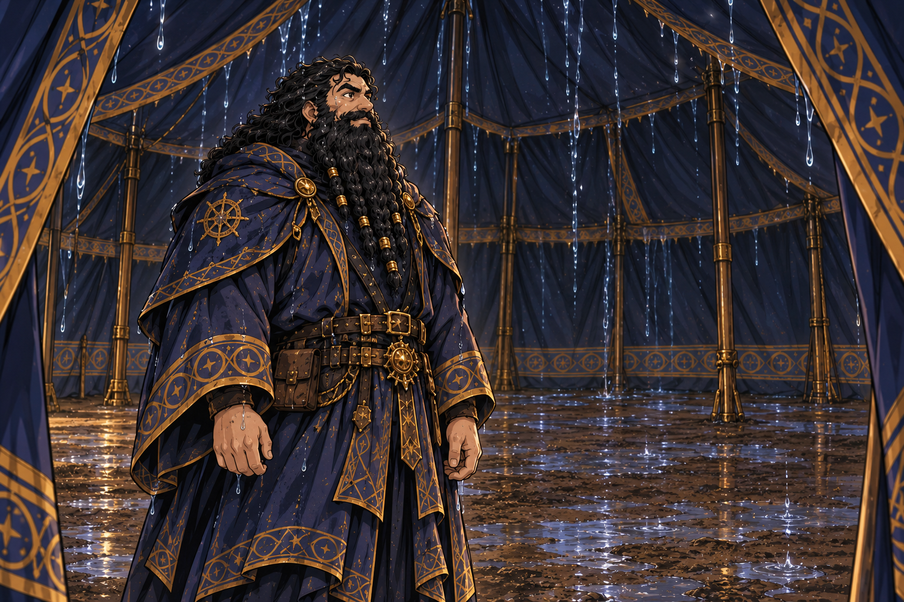
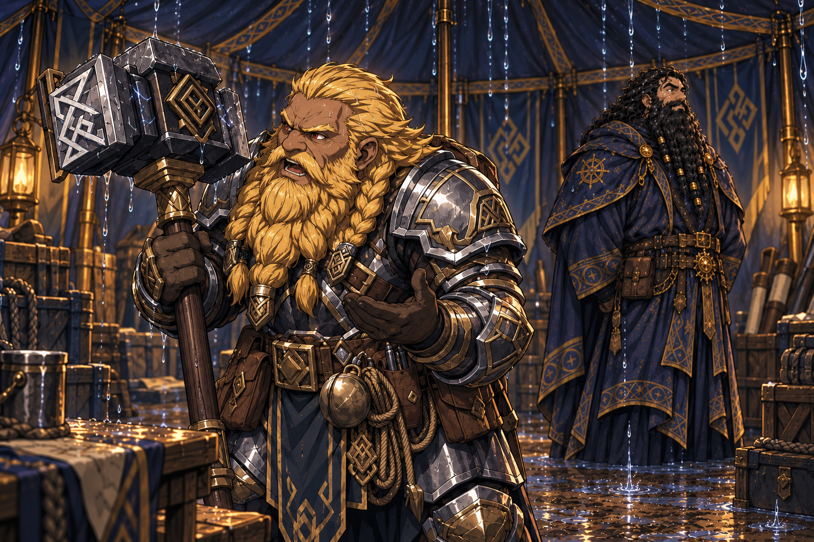

# Session - 2026-10-03

## What Happened Last Time
- [Party] The party found an open cavern with enormous guano heaps and **20 giant bats**, reported table-side as CR 1/4 each.
- [Party] Dain's [Magic Mouth bearing](../Codex/Items/Cave%20Alarm%20Ball%20Bearing.md) screamed when a bat entered; the bats then swarmed the party. Stu's Speak with Animals conversation had produced the answer "no treasure."
- [Party] Dain used Thunderclap against three bat groups for 8 damage. [Ollyander](../Codex/Characters/Ollyander.md) fought a swarm at the cave's far end and fell from the roof; her fall consequences remain unrecorded.
- [Party] Dain dropped to **3 HP**, then damaged the alpha bat with thunder Chromatic Orb. [Stu](../Codex/Characters/Stu.md), in bear form, finished it off. Remaining bats and precise encounter totals are unrecorded.
- [Party] The party continued toward **the tower**, then stopped to pack down its transport ahead of forecast heavy winds overnight. The tower and stopping place are unidentified.
- [Party] Nobody had a tent available, so Dain spent **one 3rd-level slot** to summon a massive **30-foot [Leaky Tent](../Codex/Powers/Truthammer%20Leaky%20Tent.md)**, lasting 8 hours under its recorded mechanics.
- [Character-only] A failed attempt to learn Magic Mouth consumed a scroll; **3 [scrolls](../Codex/Items/Magic%20Mouth%20Scrolls.md) remain**, and Magic Mouth is still unlearned.
- [Character-only] Dain continued to **Wizard 5**, choosing **Major Image + Stinking Cloud**. He also recorded Oleander's [Law of the Maw account](../Codex/Lore/Ollyanders%20Pact%20-%20Law%20of%20the%20Maw.md); Oleander learned her beloved rat's name, [Goarsqueek](../Codex/Characters/Goarsqueek.md), though Dain's knowledge of the name is unconfirmed.

## Open Points
- [Confirmed opening clarification] The long rest was **interrupted**, but Dain healed to **28 HP**. [To verify] Interruption cause/duration, healing source and any spell-slot, Hit Dice or other rest recovery.
- [To verify] Confirm Dain's Wizard 5 maximum HP, prepared spells, remaining slots and Hit Dice. The known 3rd-level tent expenditure does not establish an exact remaining total.
- [Party] [Open] Record the storm's outcome, transport condition, other tent occupants and remaining duration. Dain is now confirmed inside the active tent; Wet applies under the custom spell.
- [Party] [Open] Identify the destination tower and continue the route. No arrival has been reported.
- [Party] [Open] Confirm Olly's condition after the roof fall and any cave follow-up: guano collection, remaining bats, and alarm-bearing retrieval.
- [Character-only] [Open] Decide whether to retry Magic Mouth transcription with one of the three remaining scrolls. The earlier attempt's roll, elapsed time and gold/material costs remain unrecorded.
- [Character-only] [Open] Pursue [spell acquisition goals](../Character/Spellbook.md#future-spell-acquisition-goals), led by Glyph of Warding; these are research targets, not learned spells.

## Get Into Character
These are optional prompts, not actions already taken or new canon.
- Suggested attitude: "Thirty feet of shelter. Every inch honest about the leaks."
- Treat the failed Magic Mouth attempt as a research question: what did the scroll's trigger magic reveal, and what would Dain change on a retry?
- Keep Major Image and Stinking Cloud in mind for misdirection once preparation and resources are settled.
- Consider asking Olly about her pact account and her rat, using only what Dain actually heard.
- Let the Truthammer name stand for kindness: the party needed shelter, and Dain supplied his peculiar version.

## Starting State
- Location: The last recorded stopping place on the route to an unidentified tower, beside the transport being packed down for overnight heavy winds. [To verify exact site and elapsed in-world time]
- Immediate goal: Establish the outcome of the storm stop and recovery, then continue toward the tower while carrying forward the captive-rescue and southwestern-warning mission.
- Character: Dain Truthammer, dwarf **Wizard 5 / School of Conjuration**, INT 20, proficiency +3, spell save DC **16**, spell attack **+8**.
- HP: **28** [Confirmed opening clarification on 2026-10-03], increased from the prior recorded 3 HP. Long rest interrupted; maximum HP, healing source and other rest benefits remain [To verify].
- Spell slots: Maximum **4 / 3 / 2**. One 3rd-level slot spent on Leaky Tent; current remaining slots [To verify]. Chromatic Orb's casting resource is unresolved.
- Shelter: A 30-foot Leaky Tent was active when the previous log ended. Its 8-hour duration, immobility, AC 10 and HP 5 follow the recorded base mechanics; no upcast durability change is established. Occupants and resumed duration remain [To verify].
- Tent effects: Everything entering becomes Wet under the custom spell: fire resistance, cold/lightning vulnerability, ending after drying for 10 minutes or taking one of those damage types. No new occupant entry is assumed at startup.
- Scrolls: **3 Magic Mouth scrolls** with Dain; failed copying recorded, spell unlearned.
- Spells: **Major Image + Stinking Cloud** chosen at level 5. Prepared status and table edition remain [To verify].
- Key items: [Flying Broom](../Codex/Items/Flying%20Broom.md), [Dwarven Half Plate](../Codex/Items/Dwarven%20Half%20Plate.md) and the [Breastplate of Balance](../Codex/Items/Breastplate%20of%20Balance.md). **Dwarven Half Plate is confirmed equipped** in the opening clarification; exact AC and broom rules remain [To verify].
- Currency: The prior tracker allocated the "Dane" row **143 gp, 92.5 ep, 262.375 sp and 155.5555556 cp**; actual payout and copying expenses are unconfirmed. See [Inventory](../Character/Inventory.md) and [Party Loot](../Character/Party%20Loot.md).
- Relationships: Dain listened to and recorded Olly's pact account with interest. His repaired trust with Kagrenac, respect for Taleesh, and desire to restore the Truthammer name through kindness remain relevant. See [Relationships](../Character/Relationships.md).
- State boundary: The real-world session date does not establish elapsed in-world time, a completed rest, tent expiry, healing or arrival.

## Links
- Previous session: [Session - 2026-09-12](./2026-09-12.md)
- Next session: TBD
- [Current State](../Character/Current%20State.md)
- [Inventory](../Character/Inventory.md)
- [Spellbook](../Character/Spellbook.md)
- [Relationships](../Character/Relationships.md)
- [Timeline](../Character/Timeline.md)
- [Open Threads](../Codex/Lore/Open%20Threads.md)

## Summary
- The party stays for **two five-hour breaks: ten hours in total**. [Jiminy](../Codex/Characters/Jiminy.md) mines very proficiently in the first stretch and finds **six more gems during the second**. Truthammer praises his skill; Harry gives Dain one of the earlier [crystals capable of storing one 1st-level spell](../Codex/Items/Spell-Storing%20Crystals%20-%202026-10-03.md). The first yield, combined total and allocation of the new six remain unreported.
- Norhan's [Hammerton Harry Drizddon](../Codex/Characters/Hammerton%20Harry%20Drizddon.md) finds a [special gem commonly associated with spell storing](../Codex/Items/Special%20Gem%20Found%20by%20Harry.md). Exact identity, abilities, stored spells and whether it is included in the earlier 5,000 gp gem value remain unreported.
- The creatures' trail leads to an [unnamed cave](../Codex/Places/Creature-Trail%20Cave%20-%202026-10-03.md), where the party finds **precious gems worth 5,000 gp in total**. This follows nightfall with rain stopped, wind/thunder/lightning continuing, and burial of the **metal airship** begun. Burial completion, gem details, collection and distribution remain unreported.
- The party **defeats the displacer beasts**, then immediately begins harvesting hides and other parts/materials. **750 XP** is awarded; whether this is per character or a party total remains unreported. Harvest yields, quantities and storage are not yet established.
- Dain hears Jack call that Ollyander needs help, dismisses Leaky Tent with a finger-click, briefly puts his head outside Stinking Cloud to cast **Infestation** at an enemy, then returns into the gas. The tent is gone; the cloud remains on his return. Infestation's target details, save, damage and other result remain unreported.
- The long rest at the storm stop was interrupted; Dain nevertheless healed from the prior recorded 3 HP to **28 HP**. Other rest benefits remain unrecorded.
- Dain's tent meditation continues: a DM-requested **d100 yields 39**, and a **Constitution save of 18 passes**. He considers Leaky Tent together with Stinking Cloud and, privately, the subtle emotion of a father's disappointment. The later picture request identifies the meditator as **Dane/Dain**, resolving the earlier Voltaire wording in context. The d100 outcome and save purpose remain unreported.

- Battle begins while Dain is unaware inside Leaky Tent. A **displacer beast** enters and misses him twice, becoming Wet under the custom spell. Dain casts **Stinking Cloud**, and the beast runs away because of the smell. Later party victory resolves the encounter; Dain stays last recorded at **28 HP**.

## Live Notes (chronological)
- [Table-side startup] Maitland starts a new session on 2026-10-03. The archive resumes from the final confirmed events of 2026-09-12; opening rest/recovery and scene details remain to verify.

- **[Prompt]**

  ```text
  Long rest was interrupted but healed to 28hp
  ```

- **[Interrupted rest; healing confirmed]** [Character-only] [Confirmed] The long rest was interrupted, but Dain healed to **28 HP**, replacing the prior recorded 3 HP. The interruption's cause/duration, healing source and spell-slot, Hit Dice or other recovery are unrecorded. Do not infer a completed long rest or a resource reset from the HP update.

- **[Prompt]**

  ```text
  Dain is in leaky tent as battle begins, so he’s not aware of a battle beginning
  ```

- **[Battle begins; Dain unaware]** [Confirmed] Battle begins while Dain is **inside the Leaky Tent**. Dain is **unaware** of the battle's beginning. This records the encounter's start separately from his character knowledge; opponents, positions, initiative, attacks and the point at which Dain notices remain unrecorded.
- **[Tent effect]** [Derived from confirmed location and recorded custom mechanics] Dain is **Wet** inside the Leaky Tent: resistance to fire damage and vulnerability to cold/lightning damage. No damage or drying that would end Wet is reported in this beat. HP remains **28**. Unawareness alone does not record a table ruling on surprise or initiative.

- **[Prompt]**

  ```text
  Note Dane is wearing a Dwarven half plate btw.
Can you check if we can connect to my dnd beyond via API, could help bridge the gap between what I use and this
  ```

- **[Armour clarification]** [Character-only] [Confirmed] Dain is wearing **Dwarven Half Plate**. This confirms his current equipment; it does not establish a new armour change during combat. Exact AC remains to verify from the previously supplied `+2 AC` wording.
- **[Table-side integration request]** Maitland asks about connecting D&D Beyond to the archive. No account connection or character write is made. Published support provides [PDF export](https://dndbeyond-support.wizards.com/hc/en-us/articles/7747238449556-Export-Sheet); [Avrae documentation](https://avrae.readthedocs.io/en/latest/ddb.html) describes account linking and private-character import. [D&D Beyond's staff API guidance](https://www.dndbeyond.com/forums/d-d-beyond-general/d-d-beyond-feedback/148262-can-i-use-the-api-for-free) says there is no public API; this older statement does not establish every current internal capability.
- **[Local read-access probe, 2026-10-03]** Candidate character ID `164465751` is inferred solely from the existing PDF filename, not a supplied character URL. The legacy character-service v5 GET returned HTTP 403; the public character page returned HTML but did not verify Dain's identity or current stats. The actual character URL remains requested; no API connection is established.

- **[Table-side sheet link confirmed]** Maitland supplies `https://www.dndbeyond.com/characters/164465751`, confirming the character ID previously inferred from the baseline PDF filename. This records the external sheet's location; it does not import or change character stats.
- **[Read-access result for the confirmed sheet]** The public page returns HTTP 200 with a JavaScript character-sheet shell and no verified character data. The [current public application bundle](https://media.dndbeyond.com/character-app/static/js/main.e74b450e.js) still configures `https://character-service.dndbeyond.com/character/v5`. An anonymous GET to `https://character-service.dndbeyond.com/character/v5/character/164465751?includeCustomItems=true` returns HTTP 403 JSON with `success: false` and `serverMessage: "Unauthorized Access Attempt."` The service is referenced by the current app; the failed request does not establish that it has been removed or that Dain's sheet is private. No authenticated connection, account write or live stat import is made.
- **[Connector lookup]** Plugin-directory searches for D&D Beyond and Avrae return no relevant connector. Search results are not exhaustive. [PDF export](https://dndbeyond-support.wizards.com/hc/en-us/articles/7747238449556-Export-Sheet) remains a documented way to refresh the archive; automatic API access remains unestablished.

- **[Prompt]**

  ```text
  Norhans character seeks shelter in the leaky tent, and immediately starts arguing with her talking hammer
  ```

- **[Shelter and hammer argument]** [Confirmed] Norhan's character seeks shelter inside [Leaky Tent](../Codex/Powers/Truthammer%20Leaky%20Tent.md) and immediately begins arguing with her [talking hammer](../Codex/Items/Harrys%20Talking%20Hammer.md). The argument's words, subject and outcome are unreported.
- **[Roster clarification]** Maitland confirms Norhan is still playing [Hammerton Harry Drizddon](../Codex/Characters/Hammerton%20Harry%20Drizddon.md). The original narration's she/her wording is preserved; no different character is introduced.
- **[Tent effects and knowledge]** [Derived from recorded custom mechanics] Harry and the hammer become **Wet** inside the tent: fire resistance and cold/lightning vulnerability, ending after 10 minutes of drying or taking any one of those damage types. This does not establish an attack or expenditure. Dain remains last confirmed at **28 HP and unaware battle has begun**; whether he notices or hears the argument is unreported.

- [Table-side publishing setup] Maitland authorises new adventure-log captions and generated images to [Discord's THe thread](https://discord.com/channels/958554312185884723/1497086827365142530), under #when-dnd in Goblin Time 69! The native app is signed in; webhook/integration controls are absent from the inspected settings. The active-session workflow therefore uses the app, with committed captions and delivery receipts. Dain and Harry's existing images were already shared by Maitland and will not be duplicated. See [publishing workflow](../.agents/discord/README.md). This is administration, not an in-world action.
- [Table-side delivery verified] The [opening tent recap](https://discord.com/channels/958554312185884723/1497086827365142530/1555768895921717391) was sent through the native app and read back in the target thread. The caption adds context beneath the existing scene images; no duplicate image was uploaded. New-image uploading through the app will be verified with the next scene. Publisher checks passed eight offline tests; no live webhook is configured.

- **[Prompt]**

  ```text
  We are being attacked by displacer beasts
  ```

- **[Attackers identified]** [Table-side] [Confirmed] The party is being attacked by [displacer beasts](../Codex/Characters/Displacer%20Beasts%20-%20Storm%20Camp.md) in the active storm-stop encounter. The user reports multiple beasts without an exact count. No individual attack, hit, damage, initiative result, party movement or creature mechanics are supplied.
- **[Dain's knowledge and resources]** Dain remains last confirmed inside Leaky Tent, **unaware battle has begun**, at **28 HP**, wearing Dwarven Half Plate and Wet under the tent's custom mechanics. This identifies the attackers for the archive; it does not establish that Dain sees, hears or recognises them. The cause of the interrupted rest remains unconfirmed.
- [Table-side delivery verified] The [displacer-beast caption and scene image](https://discord.com/channels/958554312185884723/1497086827365142530/1555770997817217128) were posted together through the native Discord app and verified in THe after the upload completed. No further in-world event is established by publishing.

- **[Prompt]**

  ```text
  A displacer beast comes into my tent and attacks twice, but rolls less than my ac and misses twice
  ```

- **[Beast enters; two misses]** [Confirmed] One [displacer beast](../Codex/Characters/Displacer%20Beasts%20-%20Storm%20Camp.md) enters Dain's Leaky Tent and attacks him twice. Both attack rolls are below his AC; **both attacks miss**. Dain takes no damage from these attacks and remains at **28 HP**, wearing Dwarven Half Plate. Exact attack totals and AC are unreported. No Dain action, reaction, spell or resource use is reported.
- **[Derived awareness]** The direct hostile attacks inside his tent alert Dain to the immediate threat, advancing the earlier unawareness at battle onset. This does not establish recognition of the creature's name, the number or positions of other attackers, initiative or a surprise ruling.
- **[Tent effect on the attacker]** [Derived from confirmed entry and recorded custom mechanics] The beast immediately becomes **Wet**: fire resistance and cold/lightning vulnerability. Wet lasts until 10 minutes of drying or taking fire, cold or lightning damage. The two missed attacks do not remove it. Dain's own Wet effect remains recorded; no ending event is reported.
- [Table-side delivery verified] The [two-misses caption and scene image](https://discord.com/channels/958554312185884723/1497086827365142530/1555773163181318154) were posted together through the native Discord app and verified in THe with the image fully rendered. Publishing adds no in-world event.

- **[Prompt]**

  ```text
  Dane for his turn casts Stinking Cloud and fills the tent with a horrid gas
  ```

- **[Stinking Cloud in Leaky Tent]** [Confirmed] On his turn, Dain casts [Stinking Cloud](../Codex/Powers/Stinking%20Cloud.md), filling the tent with horrid gas. Dain, Harry and the entering beast were last confirmed inside; no subsequent movement, saving throw, retching, Poisoned condition or other reaction is reported.
- **[Casting state]** [Derived from published mechanics] Dain uses his action and begins **concentration, up to 1 minute**. Standard Wizard 5 casting spends **one 3rd-level slot**; this deduction is derived, since the user does not specify a different casting source. The earlier tent expenditure and interrupted rest do not establish an exact remaining slot total. HP stays last confirmed at **28**; no new damage is reported.
- **[Cloud rules; outcomes pending]** The standard spell creates a **20-foot-radius**, heavily obscured cloud with **DC 16 Constitution saves** based on Dain's recorded DC. Saves occur at the start of affected creatures' turns, not immediately on this cast. The spell can affect Dain and Harry as well as the beast, subject to applicable exceptions. [2014](https://www.dndbeyond.com/spells/2265-stinking-cloud) requires a creature to be completely inside and spends its action retching on failure; [2024](https://www.dndbeyond.com/spells/2619091-stinking-cloud) applies Poisoned and blocks actions and Bonus Actions for that turn. Tom's version, actual saves, positioning and indoor wind effect remain to verify. No wind dispersal or duration expiry is assumed from the forecast.
- **[Wet unchanged]** [Derived from recorded custom mechanics] Stinking Cloud deals no damage, so this cast does not end the recorded Wet effects on Dain, Harry, the hammer or the beast. No poison resistance or immunity is conferred by Wet.
- [Table-side delivery verified] The [Stinking Cloud caption and scene image](https://discord.com/channels/958554312185884723/1497086827365142530/1555774902366249020) were posted together through the native Discord app and verified in THe with the image fully rendered. Publishing adds no in-world result or saving throw.

- **[Prompt]**

  ```text
  It’s 2014
  ```

- **[Rules clarification - 2014]** [Confirmed] Maitland confirms **2014**, resolving the active Stinking Cloud edition question. A creature completely inside the cloud at turn start makes a **DC 16 Constitution save against poison**; failure spends its action retching. Movement, Bonus Actions and reactions remain available under normal requirements; the spell does not impose Poisoned. Creatures immune to poison or needing no breath automatically succeed. [2014 spell](https://www.dndbeyond.com/spells/2265-stinking-cloud), [Sage Advice](https://www.dndbeyond.com/sources/dnd/sac/sage-advice-compendium).
- **[State unchanged by clarification]** No new cast, saving throw, damage, movement or elapsed turn is reported. HP remains **28**, concentration and Wet stay recorded, and prior resource expenditure is unchanged. No new visual beat or Discord post is created by this rules clarification.

- **[Prompt]**

  ```text
  The creature ran away because it smells so bad
  ```

- **[Beast flees the stench]** [Confirmed] The displacer beast that entered Dain's tent **runs away because of the smell** after Stinking Cloud fills the shelter. This establishes that creature's retreat and the reported reason. Its route, distance, final position relative to the tent/cloud/camp and subsequent actions remain unreported.
- **[Outcome boundaries]** No saving throw result, retching, damage, Dash or Disengage action, opportunity attack or Frightened condition is supplied. Record this as the beast's narrated response to the stench, not an automatic flight rule for Stinking Cloud. The fate of the other displacer beasts and the battle's overall outcome remain unreported.
- **[Dain's state and knowledge]** HP remains last confirmed at **28**; no new Dain action or resource use is reported. Concentration and Wet remain recorded, with no dismissal, expiry, drying or ending damage reported. The retreat is table-side information; whether Dain notices it through the heavily obscured gas remains unreported.
- **[Discord delivery verified]** The retreat caption and scene image were posted to the authorised **THe** adventure thread through the signed-in Discord desktop app. The final message ID, matching caption and rendered image were verified: [Discord post](https://discord.com/channels/958554312185884723/1497086827365142530/1555779876676440144).

- **[Prompt]**

  ```text
  Dane for his turn sits down in his gas cloud and meditates
  ```

- **[Meditation in the cloud]** [Confirmed] On his turn, Dain **sits down inside his Stinking Cloud and meditates**, in Leaky Tent. His seated posture and meditation are now established; no new attack, spell or other activity is reported.
- **[Mechanical result unreported]** The action ruling and any turn-start Stinking Cloud saving throw remain unreported. No healing, resource recovery, damage or new expenditure is recorded. HP remains last confirmed at **28**; concentration and Wet remain recorded without an ending event. Do not assign a completed rest, Dodge, Ready, immunity or successful save from the narrated meditation.
- **[Discord delivery verified]** The meditation caption and scene image were posted to the authorised **THe** adventure thread through the signed-in Discord desktop app. The final message ID, matching caption and rendered image were verified: [Discord post](https://discord.com/channels/958554312185884723/1497086827365142530/1555782313822912573).

- **[Table-side integration]** Maitland supplies a Discord webhook for the ongoing adventure feed. The credential is saved only in ignored local configuration; live authentication verifies the authorised server and #when-dnd parent channel. The configured post-commit publisher now targets THe directly, with the native app retained as a fallback. A short recap is queued to verify the first live send; this setup adds no in-world event or character-state change.
- **[Webhook delivery verified]** The local post-commit hook automatically publishes the [current-session recap](https://discord.com/channels/958554312185884723/1497086827365142530/1555796612998234236) to THe. The API response and subsequent message readback verify the destination, webhook and exact caption; delivery history is archived. Eight offline publisher tests pass. No new in-world event or character-state change is established; the next new scene will verify the first live webhook image upload.

- **[Credential storage correction]** Maitland requests remembering the webhook for future sessions without storing it in the repository. The credential is moved to Windows Credential Manager for the current Windows user on this computer, and its repository `.env` entry is removed. A fresh publisher process retrieves it and verifies the authorised destination. Twelve offline tests pass, including exclusion of repository `.env` credentials. Only the nonsecret storage location is saved in the reminder; this technical change adds no in-world event or Discord post.

- **[Prompt]**

  ```text
  Voltaire continues to meditate, thinking about the combination of the leaky tent and the smelly gas.
  I rolled a d100 39 at dm request.
  I rolled 18 and passed my con save.
  I’m also meditating on the subtle emotion of a fathers disappointment as well
  ```

- **[Continuing meditation]** [Confirmed narration; actor to verify] The meditator continues considering the combination of [Leaky Tent](../Codex/Powers/Truthammer%20Leaky%20Tent.md) and the smelly [Stinking Cloud](../Codex/Powers/Stinking%20Cloud.md). Maitland names **Voltaire** here; the immediately preceding tent meditation was Dain's. Preserve the wording without treating it as a confirmed character replacement or Voltaire's arrival.
- **[DM-requested roll]** [Table-side] **d100 = 39**, rolled at the DM's request. Its purpose, table and resulting ruling are unreported; no spell discovery, wild-magic effect or other outcome is assigned.
- **[Constitution save]** [Table-side] **18, passed**, as reported by Maitland. The saving character and exact purpose remain to verify alongside the name clarification. Do not silently turn this into a concentration check, general gas immunity or a rest benefit.
- **[Private reflection]** [Character-only] The meditation also considers **the subtle emotion of a father's disappointment**. This is an inward theme, not a newly established judgment, presence, dialogue or vision from a father, and no new spell mechanics are established.
- **[State boundary]** No damage, healing, new casting, resource recovery, concentration ending or overall battle outcome is reported. Dain remains last confirmed at **28 HP**, seated inside the cloud with Wet recorded; the new save is not assigned to him until the character wording is clarified.
- **[Webhook image delivery verified]** The party-facing meditation caption and environmental tent/gas illustration are automatically posted to [THe](https://discord.com/channels/958554312185884723/1497086827365142530/1555800651194310718). The publisher verifies the response and subsequent message readback against the exact caption, destination, webhook and `tent-and-gas-meditation.png` attachment name and size (**2,538,092 bytes**); delivery history is archived. This is the first verified live webhook image upload. The private paternal-disappointment reflection and unresolved character attribution are omitted from the public caption.

- **[Prompt — scene illustration and wording question]**

  ```text
  Do a picture of Dane meditating in the tent, glowing and starting to float, glowing with an aura of stink
  Add a subtle motif to his fire half breed backstory thing
  Also tell me about the wording of the tent spell, can I dismiss it without an action
  ```

- **[Meditator identified in context]** Maitland now names **Dane/Dain** for the continuing tent meditation. The earlier Voltaire wording is retained in its original prompt; this latest identification resolves the scene's name ambiguity in context. The previously reported **d100 39** and **passed Constitution save, 18** are now associated with Dain; their exact purposes and the d100 outcome remain unreported.
- **[Requested visual portrayal]** Dain is illustrated meditating, glowing and just beginning to float inside Leaky Tent, surrounded by a luminous stink aura. Subtle copper-bronze highlights and faint ember-orange accents nod to his accepted [Azer connection](../Codex/Lore/Azer%20Spark%20and%20Truthhammer%20Fire%20Portal.md). These are requested image details; no flight speed, new spell, mechanical aura benefit, fire damage or DM result for the d100 is established by the artwork.
- **[Table-side dismissal question]** The [saved tent mechanics](../Codex/Powers/Truthammer%20Leaky%20Tent.md#dismissal-wording) list **8 hours**, without a concentration or dismissal clause. They establish neither free dismissal nor an action cost; Tom's ruling or fuller custom spell wording is needed. The 2014 rule permits ending concentration at any time without an action, so Dain can end Stinking Cloud that way. No dismissal of either spell is narrated.
- **[Illustration delivery verified]** The requested floating/stink-aura illustration and party-facing caption are posted to [THe](https://discord.com/channels/958554312185884723/1497086827365142530/1555806539216986173). The publisher's response and separate readback match the exact caption, destination, webhook and `dain-floating-in-stink-aura.png` attachment (**3,139,477 bytes**). The confirmed receipt is archived; no private paternal reflection or forge-origin details are disclosed in the caption.

- **[Prompt]**

  ```text
  Truthammer hears Jack call out and say Ollyander needs help. Truthammer hears, and dismisses the tent in a click of his fingers, puts his head out of the stink cloud and casts infestation at the enemy.
  Then he returns to the safety of the stink.
  ```

- **[Call for Ollyander]** [Confirmed; Dain hears] Jack calls out that [Ollyander](../Codex/Characters/Ollyander.md) needs help. Dain hears the call and responds. Preserve **Jack** as the narrated caller; the roster links Jackson/Jackbo to Brother Taleesh, but the exact in-world speaker wording is not supplied. No Olly HP, injury or precise position is reported.
- **[Finger-click dismissal]** [Confirmed table use] Dain **dismisses Leaky Tent with a click of his fingers**. This casting of the tent ends. The latest played event establishes dismissal here, superseding the earlier absence of a demonstrated dismissal; exact action cost and a general spell clause are not separately reported.
- **[Infestation from the cloud's edge]** [Confirmed] Dain puts his **head outside Stinking Cloud**, casts **Infestation at the enemy**, then **returns into the stink**. Target identity, distance, saving throw, damage and any further effect are unreported. No target defeat or help successfully reaching Olly is established yet.
- **[Resources and continuing gas]** Infestation is a [known cantrip](../Character/Spellbook.md#cantrips-on-sheet), so no spell slot is spent on that cast [Derived]. The cloud is present when Dain returns; no end to his concentration, wind dispersal, new damage or healing is reported. HP remains last confirmed at **28**. Wet remains recorded because tent dismissal alone is not one of its stated ending conditions. His reference to the gas's "safety" does not establish a new immunity or protective aura.
- **[Discord delivery verified]** The call-for-help response caption and Infestation casting scene are posted to [THe](https://discord.com/channels/958554312185884723/1497086827365142530/1555808077825966080). The publisher verifies the response and separate message readback against the exact caption, thread, webhook and `dain-casts-infestation-from-stink.png` attachment (**2,615,532 bytes**). The confirmed delivery receipt is archived.

- **[Prompt]**

  ```text
  The party defeats the creatures and they immediately begin extracting parts and materials from them like their hides.
We get 750xp
  ```

- **[Victory]** [Party] [Confirmed] The party defeats the displacer beasts, resolving the storm-camp encounter. Exact creature count, final blows and individual spell outcomes remain unreported; the victory does not establish Infestation's result or Olly's post-fight condition.
- **[Harvest begins]** [Party] [Confirmed] The party immediately begins extracting hides and other unspecified parts/materials from the defeated creatures. See [Party Loot](../Character/Party%20Loot.md#displacer-beast-harvest---2026-10-03). This is work in progress: successful yields, quantities, condition, holders, storage and values remain unreported.
- **[XP award]** [Table-side] [Confirmed] **750 XP** is awarded. [To verify] Per-character award or party total to split; Dain's cumulative XP is not recorded, so no personal increment or new total is assigned yet.
- **[Post-fight state]** Dain's HP remains last confirmed at **28**. Leaky Tent was already dismissed. Stinking Cloud was present on his preceding return into the gas; its duration/concentration or dispersal at the harvest beat is unreported. Wet remains recorded without a reported ending event. No new healing, completed rest or recovered spell slots is established.
- **[Discord delivery verified]** The victory/harvest caption and aftermath image are posted to [THe](https://discord.com/channels/958554312185884723/1497086827365142530/1555814887689687102). The publisher verifies the response and separate message readback against the exact caption, thread, webhook and `displacer-beast-harvest.png` attachment (**2,611,552 bytes**). The confirmed delivery receipt is archived.

- **[Prompt]**

  ```text
  We survived to the night, and it’s no longer raining. But it’s windy and there’s thunder and lightning. We begin to bury the metal airship and want to track where these creatures have gone
  ```

- **[Night weather]** [Party] [Confirmed] The party survives **into night** at the storm stop. It is no longer raining, but there is wind, thunder and lightning. This does not establish a completed overnight rest, sunrise, an exact wind speed or a lightning strike on the party or ship.
- **[Airship burial begins]** [Party] [Confirmed] The party begins burying the **metal airship**. [Inferred identification] This is the established [party skyship](../Codex/Places/Party%20Skyship%20-%202026-08-29.md) being packed down at the storm stop. The latest metal description takes precedence over older wooden-hull artwork. Method, burial extent/completion, cargo access, damage and retrieval plan remain unreported.
- **[Tracking intention]** [Party] [Confirmed intention] The party wants to track **where these creatures have gone**. The preceding encounter involved displacer beasts, but this wording does not establish surviving escapees, a newly found trail or a lair. The intended creatures, direction, tracker, roll and result remain to verify; the earlier defeat remains recorded.
- **[Resources and conditions]** Dain's HP stays last confirmed at **28**. No new healing, spell use, damage, completed rest or recovery is reported. Rain ending alone does not establish 10 minutes of drying or an end to Wet. The tent is already dismissed; the current state of Stinking Cloud remains unreported. Harvest results and the allocation of the earlier 750 XP remain open.
- **[Discord delivery verified]** The night-weather/burial caption and metal-airship scene are posted to [THe](https://discord.com/channels/958554312185884723/1497086827365142530/1555817442620481620). The publisher verifies the response and separate message readback against the exact caption, thread, webhook and `metal-airship-burial-at-night.png` attachment (**2,735,112 bytes**). The confirmed delivery receipt is archived.

- **[Prompt]**

  ```text
  We find the cave where the creatures tracked to, and find 5000 gold worth of precious gems
  ```

- **[Tracking destination found]** [Party] [Confirmed] The party finds the [cave where the creatures' trail leads](../Codex/Places/Creature-Trail%20Cave%20-%202026-10-03.md), advancing the preceding tracking intention to a confirmed destination. The cave's name, precise location, route and tracking roll are unreported. This does not establish which creatures escaped or whether the cave is an occupied lair.
- **[Precious gems discovered]** [Party] [Confirmed] The party finds **precious gems worth 5,000 gp in total** in the cave. Record this as a gem find in [Party Loot](../Character/Party%20Loot.md#precious-gems---creature-trail-cave---2026-10-03). Gem types, number, individual values, weight, collection, carrier, storage and distribution remain unreported; no personal share or coin payout is assigned.
- **[Continuity]** Dain's HP stays last confirmed at **28**; no new damage, healing, spell expenditure or rest recovery is reported. The airship burial's completion and the earlier harvest yields/750 XP allocation remain open. This cave is not identified as the earlier guano cavern or destination tower.
- **[Discord delivery verified]** The cave/gem discovery caption and treasure-reveal image are posted to [THe](https://discord.com/channels/958554312185884723/1497086827365142530/1555820054740860938). The publisher verifies the response and separate message readback against the exact caption, thread, webhook and `creature-trail-cave-gems.png` attachment (**2,123,683 bytes**). The confirmed delivery receipt is archived.

- **[Prompt]**

  ```text
  Norhan finds a special gem which is commonly associated with spell storing
  ```

- **[Special gem found]** [Confirmed table narration] Norhan finds **one special gem**, described as **commonly associated with spell storing**. [Established roster attribution] Norhan is playing [Hammerton Harry Drizddon](../Codex/Characters/Hammerton%20Harry%20Drizddon.md), so the in-world finder is recorded as Harry. [Scene continuity] The find follows the current cave/gem discovery. See [the item record](../Codex/Items/Special%20Gem%20Found%20by%20Harry.md).
- **[Association, properties unconfirmed]** The spell-storing association is supplied by Maitland; it does not identify an official item or establish that this particular gem has been tested. Exact name/type, capacity, stored spells, charges, attunement, activation and value remain unreported. Who recognizes the association and whether Dain learns of the find are unreported.
- **[Treasure accounting]** Harry is the finder; ownership, retention and storage remain unreported. Whether the special gem is part of the preceding **5,000 gp** gem find or additional to it is unknown; no additional value or personal share is assigned. Dain's HP stays last confirmed **28**, with no new spell use, damage, healing or rest recovery reported.
- **[Discord delivery verified]** Harry's special-gem discovery caption and illustration are posted to [THe](https://discord.com/channels/958554312185884723/1497086827365142530/1555821905477636106). The publisher verifies the response and separate message readback against the exact caption, thread, webhook and `harry-special-gem-find.png` attachment (**2,406,986 bytes**). The confirmed delivery receipt is archived.

- **[Prompt]**

  ```text
  Norhan puts a leash on Jiminy who begins mining in a 5 hour break, and is very proficient. Truthammer exclaims that he knew he wasn’t just all talk.
  The crystals the Jiminy finds can store 1 level 1 spell. She gives me one.
  ```

- **[Leash and mining break]** [Confirmed] Norhan puts a leash on [Jiminy](../Codex/Characters/Jiminy.md), who begins mining during a **five-hour break** and is **very proficient**. [Established roster attribution] Norhan is playing Harry. Exact identity/form, tools, mining modifier and total yield remain unreported.
- **[Truthammer's response]** [Confirmed indirect dialogue] Dain exclaims that he knew Jiminy was not just all talk. This is praise for his demonstrated mining; no numerical trust/respect change is assigned.
- **[Crystal capacity and gift]** [Confirmed] The crystals Jiminy finds can each store **one 1st-level spell**. Harry gives Dain **one crystal**, now recorded in his [Inventory](../Character/Inventory.md#magic-items) and the [crystal Codex page](../Codex/Items/Spell-Storing%20Crystals%20-%202026-10-03.md). No current stored spell, loading, release, attunement, reuse or value is reported.
- **[Time and resources]** A five-hour mining break is reported; no short/long rest recovery, healing, Hit Dice use or new spell expenditure is reported. Dain stays last confirmed at **28 HP**. [Derived duration] The earlier Stinking Cloud lasts at most one minute and cannot persist through this break; no recast is reported. Drying conditions or a Wet-ending event remain unreported.
- **[Discord delivery verified]** Jiminy's mining, Truthammer's praise and Harry's crystal gift are posted with the scene illustration to [THe](https://discord.com/channels/958554312185884723/1497086827365142530/1555825419104686100). The publisher verifies the response and separate message readback against the exact caption, thread, webhook and `dain-spell-storing-crystal-gift.png` attachment (**2,732,128 bytes**). The confirmed delivery receipt is archived.

- **[Prompt]**

  ```text
  We stay another 5 hours and jiminy mines another 6 gems
  ```

- **[Extended stay and new yield]** [Confirmed] The party stays **another five hours**, and Jiminy mines **six additional gems**. [Derived arithmetic] The two reported five-hour stretches total **ten hours**; this is six new gems, not a six-gem cumulative total.
- **[Mining ledger]** The initial batch's quantity remains unreported, so the combined yield is not assigned an exact count. [Inferred continuity] The new gems follow the same crystal-mining operation; no new type or changed capacity is stated. The earlier crystals' confirmed capacity remains one 1st-level spell each.
- **[Holdings and recovery]** Dain still has **one confirmed gifted crystal**. No allocation, holder, sale value, loading or use is reported for the new six. No sleep, completed rest, HP change or resource recovery is reported; Dain stays last confirmed at **28 HP**.

## Character State Changes
- [Confirmed party yield] Jiminy mines **six more gems** during an additional five-hour stay, bringing the reported break to ten hours. Their distribution is unreported; Dain's personal crystal count stays **one**. No rest recovery is assigned.
- [Confirmed acquisition] Harry gives Dain **one spell-storing crystal**, mined by Jiminy during the five-hour break. Capacity: **one 1st-level spell**. Current contents, charging/casting rules and attunement remain unreported. No healing, slot recovery, Hit Dice use or completed rest is reported.
- [Confirmed table discovery] Norhan / Harry finds a special gem commonly associated with spell storing. Its powers and any transfer to Dain remain unreported; no new Dain item, spell or resource change is recorded. Inclusion in the earlier 5,000 gp total is unresolved.
- [Confirmed latest discovery] The party reaches the creatures' tracking destination, an unnamed cave, and finds **5,000 gp worth of precious gems**. Collection, carrier and shares remain unreported. Dain's HP is last confirmed **28**, with no new resource change reported.
- [Confirmed latest scene] Night at the storm stop: **rain has stopped; wind, thunder and lightning remain**. The party begins burying the metal airship and intends to track the creatures. No completed burial, successful tracking, new recovery or damage is reported; Dain remains last confirmed at **28 HP** and Wet has no reported ending event.
- [Confirmed latest beat] The **displacer-beast encounter is won** and harvesting begins. **750 XP awarded**, with per-character versus shared scope unreported. Dain remains last confirmed at **28 HP**; no completed harvest items, personal XP increment, healing or rest recovery are assigned. The cloud's current state is unreported; Wet remains recorded.
- [Confirmed latest action] **Leaky Tent is dismissed** by finger-click. Dain casts **Infestation** at an enemy from the cloud's edge and returns into the gas. [Derived cantrip] No slot spent. HP remains last confirmed **28**; Stinking Cloud and Wet remain recorded. Target result and separate dismissal action cost remain unreported.
- [Contextual clarification] The ongoing meditator is **Dane/Dain**, as named in the new picture request; the earlier **passed Constitution save, 18** is associated with him. Its exact purpose remains unreported. The requested glowing/float/stink-aura depiction grants no recorded new mechanics. HP remains last confirmed at **28**; no spell ending or new expenditure is reported.
- [Table-side; actor to verify] A **Constitution save of 18 passes** during the continuing meditation report, which names Voltaire. Dain's HP and resources remain as last confirmed; save attribution and purpose remain pending.
- [Confirmed] Dain's recorded HP changes **3 → 28**. Long rest interrupted; other recovery remains unconfirmed. Three Magic Mouth scrolls remain recorded, and no new scroll use or casting is reported.

- [Confirmed location; earlier knowledge] Dain is inside the active tent and was unaware when battle began. [Derived custom effect] Wet applies from the recorded tent mechanics; no new damage or expenditure is reported.

- [Confirmed equipment] Dwarven Half Plate is worn; Breastplate of Balance is no longer the current worn armour. Exact AC and any attunement change remain unrecorded.
- [Confirmed shelter entry; derived condition] Harry and her talking hammer are inside Leaky Tent and become Wet. No Dain damage, casting, expenditure or awareness change is reported.
- [Confirmed encounter clarification] Attackers are displacer beasts. No new Dain damage, action, expenditure or awareness change is reported; HP remains last confirmed at 28.
- [Confirmed subsequent attacks] One beast enters the tent and misses Dain twice. HP remains **28**, with no reported action or resource use. [Derived awareness] Dain is now aware of the immediate threat; [Derived custom effect] the entering beast is Wet.
- [Confirmed subsequent cast] Dain casts Stinking Cloud inside Leaky Tent. [Derived] Action used, concentration active up to 1 minute, one 3rd-level slot spent under standard casting; remaining slots unknown. HP stays **28** and Wet persists. No saving throw or new Poisoned condition is recorded.
- [Confirmed subsequent clarification] **2014 rules** apply. Failed Stinking Cloud saves spend the action retching, without imposing Poisoned or preventing movement, Bonus Actions or reactions. No save outcome is recorded.
- [Confirmed subsequent retreat] The beast runs away because of the stench. No Dain damage or expenditure is reported; HP stays **28**, concentration and Wet remain recorded. Dain's awareness of the retreat through the cloud is unreported.
- [Confirmed subsequent turn] Dain sits down and meditates in his gas cloud. HP remains **28**, with no reported healing, damage, new expenditure or end to concentration/Wet. Mechanical action and cloud save outcome remain unreported.

## New Canon / Important Discoveries
- [Confirmed] The party extends its stay by five hours, and Jiminy mines **six additional gems**. First-batch quantity and combined yield remain unreported.
- [Confirmed] Jiminy is leashed by Norhan / Harry and proves very proficient at mining during a five-hour break. The crystals he finds can each store **one 1st-level spell**; Dain receives one from Harry.
- [Confirmed description] A special gem found by Norhan's Harry is **commonly associated with spell storing**. Exact item identity and functional properties remain unconfirmed; the finder is established without assigning ownership or a new value.
- [Party] [Confirmed] The tracking destination is an [unnamed cave](../Codex/Places/Creature-Trail%20Cave%20-%202026-10-03.md), containing **precious gems with a stated total value of 5,000 gp**. No gem types, quantities, collection or distribution are established yet.
- [Party] [Confirmed] The party is alive into night; rain stops while wind, thunder and lightning remain. Burial of the **metal airship begins**. The material clarification supersedes older wooden-hull art, not the recorded balloon-like design or ship tracker.
- [Party] [Earlier confirmed intention] The party wants to track where the creatures have gone; the later report establishes a cave as the tracking destination. Surviving creature counts and whether it is an occupied lair remain unreported.
- [Party] [Confirmed] The party defeats the displacer beasts and immediately begins harvesting hides and other unspecified materials. [Table-side] **750 XP** awarded, with allocation scope unreported. Completed yields and quantities remain to verify.
- [Confirmed table use] Dain can dismiss the active tent by a finger-click in this scene. A general action cost or formal dismissal clause has not been supplied. Dain hears Jack's report that Ollyander needs help; her exact condition remains unreported.
- [Confirmed] The rest was interrupted and Dain healed to 28 HP; cause and wider rest outcome remain unrecorded.
- [Confirmed] Harry is now inside Leaky Tent, arguing with her talking hammer. [Derived] Wet applies to Harry and the hammer; no new Dain action, damage, resource use or battle awareness is established.
- [Table-side] [Confirmed] [Displacer beasts](../Codex/Characters/Displacer%20Beasts%20-%20Storm%20Camp.md) are attacking the party. Exact count, individual actions, location relative to the tent, stat block and Dain's knowledge of their identity remain unreported.
- [Confirmed subsequent event] One beast enters Dain's tent and attacks him twice, missing both times. [Derived] The attack alerts Dain, and the tent makes the beast Wet. The wider encounter and recognition of the creature's identity remain unreported.
- [Confirmed] Dain fills the tent with Stinking Cloud on his turn. The later clarification confirms **2014**; occupant saves and effects remain pending.
- [Confirmed earlier response] The beast runs away because the gas smells so bad. That retreat alone established no mechanical fear effect, failed save or defeat; the subsequent victory report now resolves the encounter.

## Open Threads
- Mining yield: **second five-hour stretch = six additional gems; combined break = ten hours**. Record the first yield, new gem holders/distribution/value and any rest benefits when reported. Dain currently has one confirmed gifted crystal.
- Spell-storing crystals: **capacity and Dain's receipt of one are confirmed**. Record the stored spell, loading/release rules, reuse, attunement and remaining yield when learned. Jiminy's identity/control and the crystals' relation to Harry's initial special gem remain to verify; no value is added to the 5,000 gp gem total.
- Special gem: record its exact name/type and any confirmed storage capacity, stored spells, attunement or activation when learned. Harry is the finder; establish retention/ownership, who recognizes its association, Dain's awareness and whether its value is included in the earlier 5,000 gp gem total.
- Night camp and ship burial: rain has stopped, but wind, thunder and lightning remain. Record burial method, completion, ship/cargo condition, access and how the party will retrieve the transport. No completed overnight rest is reported.
- Tracking destination resolved: the party finds the cave where the creatures tracked to. Record its identity, route details, contents and any further occupants as learned; no occupied lair or surviving creature count is established.
- Gem find: **5,000 gp total value** in precious gems. Record types, count, individual values, weight, collection, carrier, storage and eventual distribution or sale. No personal share or coin payout is established.
- Meditation follow-up: the new picture request identifies **Dane/Dain** as the meditator, resolving the prior name question in context. Record the DM's result for **d100 39** and the exact purpose of Dain's **passed Constitution save, 18**. Keep the father's-disappointment reflection character-private. The requested floating aura is an illustration, without an established new spell or flight mechanic.
- Tent dismissal: **completed by finger-click in the latest narration**. Preserve that table use; a formal general clause and exact action cost remain unreported. The tent is no longer active.
- Carry forward: interruption cause/duration and any remaining rest benefits, later storm outcome, tower identity and travel, Olly's fall consequences, former tent occupants' positions, transport condition, Magic Mouth research, and spell acquisition goals. HP recovery to 28 and tent dismissal are confirmed; the latest weather is dry, windy and thunderous.
- Wider mission: recover captives from cult-raided settlements and warn the humans in the southwest. See [persistent threads](../Codex/Lore/Open%20Threads.md).

- Resolved encounter; harvest follow-up: the party has defeated the displacer beasts. Record successful hides/parts, quantities, condition, holders, storage and values as harvesting proceeds; no completed stock is added yet.
- XP allocation: **750 XP** awarded. Confirm whether each character receives 750 or this is a party total to split; Dain's cumulative XP is also unreported.
- Infestation and Olly's follow-up: the battle is won, but the enemy's identity, save, damage and other spell result remain unreported. Record Olly's post-fight condition and whether Dain's response helped her; victory does not establish her HP or recovery.
- Stinking Cloud and Wet: **2014 is confirmed**. [Derived duration] The earlier cloud lasts at most one minute and cannot persist through the five-hour mining break; no recast is reported. The five-hour break does not report drying conditions or a Wet-ending event. The earlier **passed Constitution save of 18** retains its unreported purpose.
- Displacer-beast details: total count, final blows, individual actions and table-specific creature mechanics remain unreported despite the confirmed victory. Any link to the rest interruption and the prior Wet effect's ending remain unreported.
- Hammer argument: record what Harry and the hammer say and whether Dain hears it. The hammer's name, abilities and connection to the earlier protesting hammer remain [To verify].

## Images

### Jiminy's Six More Gems


- Exactly six gems represent the new batch. Shape/color, rock placement and lighting are illustrative; they establish no gem species, ownership, contents or new function. [Built-in imagegen prompt and references](./2026-10-03/jiminy-six-gems-image-notes.md).

### A Crystal For Truthammer


- The gift and one-spell capacity are confirmed. The image uses Dain and Harry's established appearances; crystal appearance, handling, expressions and cave lighting are illustrative. No spell is being loaded or released. Jiminy's appearance is not supplied by the illustration. [Built-in imagegen prompt and references](./2026-10-03/spell-storing-crystal-image-notes.md).

### Harry's Intriguing Gem Find


- The illustration preserves Harry's portrait and the cave scene. Gem color/cut/size, pose, handling and expression are visual choices; they establish no gem species, identification, activation, stored spell, attunement or ownership. [Built-in imagegen prompt and references](./2026-10-03/harry-special-gem-image-notes.md).

### Precious Gems At The End Of The Trail


- Confirmed cave discovery and **5,000 gp total gem value**. Cave layout, gem colors/cuts/grouping, lighting and the cropped adventurer gesture are illustrative; the picture does not establish exact gem types or count, collection, a named finder, magical properties or cave occupants. [Built-in imagegen prompt](./2026-10-03/creature-trail-cave-gems-image-notes.md).

### Burying The Metal Airship At Night



- The image follows the confirmed metal construction and burial beginning, with no rain. Cropped hands, tools, packing arrangement, hull details, lighting and partial trench are illustrative; no depth, completion, damage or named digger is established. No discovered track, escaped creature or lair is depicted. [Built-in imagegen prompt and reference](./2026-10-03/metal-airship-burial-image-notes.md).

### Victory And The Harvest



- Confirmed victory and start of harvesting. The close crop shows one representative body and unnamed hands; it establishes no total creature count, named harvester, completed yield or item quantity. Tools, lighting and anatomy follow the scene reference as illustration. The dismissed tent is absent, and the cloud's area stays outside the frame. [Built-in imagegen prompt and reference](./2026-10-03/displacer-beast-harvest-image-notes.md).

### A Brief Excursion From The Stink



- Confirmed action sequence: the tent is dismissed, Dain exposes his head to cast Infestation at an enemy, then returns into the gas. The illustration captures the casting instant; the caller, Olly and target remain outside the frame. Hand pose, visible parasites, light and terrain are illustrative, without establishing a hit, damage, movement distance or a protective gas effect. [Built-in imagegen prompt and references](./2026-10-03/infestation-from-stink-image-notes.md).

### Enlightenment, Unfortunately Fragrant



- Requested scene illustration: Dain begins to float and glow in foul gas, with a subtle motif for his Azer connection. Height, aura, glow and ember placement are visual choices; this does not establish a newly learned spell or mechanical flight benefit. Built-in imagegen preserves his canonical portrait, half plate and prior meditation scene. [Final prompt and references](./2026-10-03/dain-floating-meditation-image-notes.md).

### Leaks And Lingering Stench


- The tent/gas combination is the focus of the continuing meditation. This environmental crop leaves every occupant outside the frame, without deciding the Dain/Voltaire attribution or suggesting anyone departed. Framing, gas shapes and light are illustrative; no new spell, reaction, protective effect or paternal vision is established. Generated with the built-in imagegen fallback after the repository API reported exhausted credits. [Final prompt and references](./2026-10-03/tent-and-gas-meditation-image-notes.md).

### Meditation In The Stench



- Sitting and meditating in the gas are confirmed. Exact pose, expression, framing and gas shape are illustrative; the image establishes no saving throw, immunity, rest benefit, healing or new spell. [Prompt and references](./2026-10-03/dain-meditation-image-notes.md).

### The Beast Flees The Stench



- Confirmed retreat because of the smell. Exit framing, distance, pose, expression and gas at the opening are illustrative; no final destination, failed save, Frightened condition, damage, Dain observation or overall encounter outcome is established. [Prompt and references](./2026-10-03/displacer-beast-retreat-image-notes.md).

### Stinking Cloud Fills Leaky Tent



- Confirmed cast and gas-filled tent. Pose, spell sparks, cloud shape, creature silhouette and layout are illustrative; no failed save, retching, Poisoned condition, damage or movement is established. [Prompt and continuity references](./2026-10-03/stinking-cloud-image-notes.md).

### Two Misses Inside The Tent


- Confirmed beat: one beast enters and misses Dain twice. Strikes, poses, framing and layout are illustrative; no new Dain action, reaction, casting, injury or tent damage is established. [Generation prompt and references](./2026-10-03/displacer-beast-misses-image-notes.md).

### Displacer Beasts At The Storm Camp


- Scene illustration of the confirmed attacker reveal. The crop, anatomy, pose, displacement outlines, weather and exterior position are illustrative; no exact creature count, attack result, damage or Dain awareness is established. [Generation prompt and continuity reference](./2026-10-03/displacer-beast-image-notes.md).


- Existing continuity image from 2026-09-12, reused for the resume point. Exact layout is illustrative. [Original prompt and provenance](./2026-09-12/leaky-tent-image-notes.md). No new visual event is established at startup.


### Dain Inside The Tent, Unaware



- Built-in scene illustration preserves Dain's knowledge boundary; pose and layout are illustrative. [Saved asset and generation prompt](./2026-10-03/dain-unaware-image-notes.md).

### Harry And Her Talking Hammer



- Confirmed beat: Harry seeks shelter and immediately starts arguing with her hammer. Harry's pose, gesture and the hammer's depicted design are illustrative. Dain's battle awareness is unchanged from the last confirmed report. [References and generation prompt](./2026-10-03/harry-hammer-image-notes.md).
