# Session - 2026-10-10

## What Happened Last Time
Previous session: **2026-10-03, seven days before this table date**. This interval does not establish elapsed in-world time.

- [Party] The storm-stop long rest was interrupted, but Dain healed from 3 to **28 HP**. His **[Dwarven Half Plate](../Codex/Items/Dwarven%20Half%20Plate.md)** was confirmed worn; other rest recovery remains unreported.
- [Party] A [displacer beast](../Codex/Characters/Displacer%20Beasts%20-%20Storm%20Camp.md) entered [Leaky Tent](../Codex/Powers/Truthammer%20Leaky%20Tent.md) and missed Dain twice. Dain filled the tent with [Stinking Cloud](../Codex/Powers/Stinking%20Cloud.md), and the beast fled the smell.
- [Confirmed; Dain hears] Jack called that [Ollyander](../Codex/Characters/Ollyander.md) needed help. Dain dismissed the tent with a finger-click, cast Infestation from the cloud's edge, and returned into the gas. Olly's condition and the spell's result remain unreported.
- [Party] The party defeated the beasts and began harvesting hides and other materials. **750 XP** was awarded [Table-side]; whether this is per character or a shared total, and the successful harvest yields, remain open.
- [Party] Rain stopped, but wind, thunder and lightning continued. Burial of the [metal airship](../Codex/Places/Party%20Skyship%20-%202026-08-29.md) began. The creatures' trail led to an [unnamed cave](../Codex/Places/Creature-Trail%20Cave%20-%202026-10-03.md) containing **5,000 gp worth of precious gems**; collection and shares remain unreported.
- [Confirmed] [Jiminy](../Codex/Characters/Jiminy.md) mined during two five-hour breaks, finding **six additional gems in the second stretch**. Dain now holds **[two spell-storing stones](../Codex/Items/Spell-Storing%20Crystals%20-%202026-10-03.md#current-holdings)**, each able to store one 1st-level spell: one contains **Cure Wounds**, loaded by Matt / [Kagrenac](../Codex/Characters/The%20Astral%20Elf.md); Dain will choose the other spell later.
- [Confirmed] During resumed airship travel, Dain **learned Magic Mouth and used all three remaining scrolls, leaving zero**. He continued refining Leaky Tent while using Stinking Cloud. [Character-only] His father's disappointment remained a private focus; no revised spell mechanics were established.

## Open Points
- [Player reminder] **Next session, or when heading back to [Dain's father](../Codex/Characters/Dains%20Father.md), remind Maitland to head to the dark forest north of the last town the party visited, which the townspeople warned them about.** [To verify] Town/forest names, exact route and what the warning concerned. See [persistent reminder](../Codex/Lore/Open%20Threads.md#visit-the-northern-dark-forest).
- [To verify] Confirm current HP, maximum HP, remaining slots/Hit Dice, prepared spells and any completed rest since the last scene. **28 HP is the last confirmed value**, not a refreshed total.
- [Open] Choose the second stone's 1st-level spell and confirm loading/release costs, eligible users, reuse and attunement with Tom. Stored Cure Wounds has not been released and is not a learned wizard spell.
- [Party] [Open] Identify the destination tower, current route and ship condition. Resumed travel is confirmed; arrival, current weather and the burial/retrieval process remain unreported.
- [Character-only] [Open] Record any approved result of Leaky Tent research. The meditation's **d100 39** and **passed Constitution save 18** remain unexplained; floating/glowing artwork grants no new mechanics.
- [Party] [Open] Reconcile gem holders/shares, first mining yield, harvested materials, the 750 XP award, Olly's condition and Taleesh's return aboard.
- [To verify] Confirm whether **Wet** ended through drying or qualifying elemental damage. The old battle cloud expired within its maximum duration; later research use is recorded without a current casting total or duration.

## Get Into Character
These are optional prompts, not actions already taken or new canon.

- Suggested attitude: "A roof that leaks, a cloud that stinks, and now a mouth that talks. Research is proceeding beautifully."
- Consider what the second stone should do for the party before choosing its spell; the first already holds healing.
- Ask Kagrenac about the demonstrated loading and how the healing stone is released, rather than assuming its rules.
- [Character-only] Let the thought of [Dain's father](../Codex/Characters/Dains%20Father.md) color the research: what would make Dain proud of it, even if his father never approved?
- Keep kindness and clever misdirection at the heart of the Truthammer name. [Garl Glittergold](../Codex/Lore/Garl%20Glittergold.md) needn't demand a sensible invention.

## Starting State
- Location: **Aboard the operating metal airship during travel**, at the final recorded scene of 2026-10-03. Exact position, elapsed in-world time and current weather [To verify].
- Immediate goal: Resume the journey toward the unidentified tower and carry forward the captive-recovery and southwestern-warning mission. No tower arrival is recorded.
- Character: **Dain Truthammer, dwarf Wizard 5 / School of Conjuration**, INT 20, proficiency +3, spell save DC **16**, spell attack **+8**. **2014 rules** were confirmed on 2026-10-03; unresolved sheet-specific features remain to verify.
- HP: **28 last confirmed**. Maximum HP, temporary HP and subsequent changes [To verify].
- Resources: Maximum slots **4 / 3 / 2**, maximum Hit Dice **5d6**; remaining slots/Hit Dice, Arcane Recovery use and prepared list [To verify]. No recovery is assumed from the ten-hour mining stay or the real-world date.
- Spells and scrolls: **Magic Mouth learned; 0 scrolls remain**. Wizard 5 choices **Major Image + Stinking Cloud** remain recorded; Magic Mouth preparation/copying costs are unreported. See [Spellbook](../Character/Spellbook.md).
- Stones: **Two**, capacity one 1st-level spell each. **One: Cure Wounds. Other: spell choice pending.** No release, healing or attunement is assumed.
- Armour/items: **Dwarven Half Plate worn**, exact AC [To verify]. [Flying Broom](../Codex/Items/Flying%20Broom.md) owned, rules/use unconfirmed. [Breastplate of Balance](../Codex/Items/Breastplate%20of%20Balance.md) owned, not worn; last confirmed attuned, current charges/storage open.
- Effects/research: Leaky Tent **dismissed**; no new casting or approved revision is reported. Wet has no recorded ending event. Later Stinking Cloud use during research is confirmed, with current concentration/exposure [To verify].
- Money/loot: No personal gem payout or current purse is established. See [Inventory](../Character/Inventory.md) and [Party Loot](../Character/Party%20Loot.md).
- Relationships: Kagrenac loaded the healing stone; Dain praised Jiminy's mining. Paternal reflection stays [Character-only]. See [Relationships](../Character/Relationships.md).
- State boundary: Startup records no new in-world action, resource recovery, travel outcome or mechanical ruling.

## Links
- Previous session: [Session - 2026-10-03](./2026-10-03.md)
- Next session: TBD
- [Current State](../Character/Current%20State.md)
- [Inventory](../Character/Inventory.md)
- [Spellbook](../Character/Spellbook.md)
- [Relationships](../Character/Relationships.md)
- [Timeline](../Character/Timeline.md)
- [Table Roster](../Codex/Lore/Table%20Roster.md)
- [Open Threads](../Codex/Lore/Open%20Threads.md)

## Summary

- [Latest Taleesh attack] **[Brother Taleesh](../Codex/Characters/Brother%20Taleesh.md) slips out beneath a tent, stabs a goblin twice with daggers and “jellyfies” it. Reported goblin HP/result: −19.** Target/tent identity, rolls and per-hit damage remain unreported. [Camp scene](../Codex/Places/Organised%20Goblin%20Camp%20-%202026-10-10.md#taleeshs-tent-exit-and-two-dagger-strikes---2026-10-10).

- [Latest movement and discovery] **Dain runs back toward the bottleneck on the party's approach route and spots goblins emerging from a wall crack to flank the gang. He realises they have been tricked.** “Smart little gobbies.” Arrival, distance, goblin count/identities and the party's response remain unreported. [Camp](../Codex/Places/Organised%20Goblin%20Camp%20-%202026-10-10.md#bottleneck-and-wall-crack-flank---2026-10-10).

- [Latest casting and concentration change] **Dain casts [Expeditious Retreat](../Codex/Powers/Expeditious%20Retreat.md) and drops concentration on [Suggestion](../Codex/Powers/Suggestion.md) on the smarter goblin captive.** Suggestion ends; Expeditious Retreat is now the concentration spell under the standard 2014 effect. No actual movement, Dash, dismount, goblin reaction or physical release is reported. [Official spell](https://www.dndbeyond.com/spells/2088-expeditious-retreat).

- [Latest Dain spell and tent damage] **Dain shoots [Chromatic Orb](../Codex/Powers/Chromatic%20Orb.md) through the fire pit into the main tent, blasting a hole through its front and back.** The route and both holes are confirmed. Roll/damage/type, casting level/resource, occupants and further effects are unreported. The new table photo is archived unchanged as an unkeyed reference.

- [Latest confirmed death] **The same [goblin](../Codex/Characters/Grenade-Throwing%20Goblin%20-%202026-10-10.md) that threw the grenade throws a javelin at [Kagrenac's owl](../Codex/Characters/Kagrenacs%20Owl.md) and kills it.** The owl is dead; its earlier flank order has no reported execution before the fatal strike. Attack roll/damage, exact position, body disposition and Kagrenac's reaction are unreported.

- [Latest attack and Dain damage] **One [goblin](../Codex/Characters/Grenade-Throwing%20Goblin%20-%202026-10-10.md) comes and throws a [fragmentation grenade](../Codex/Items/Fragmentation%20Grenade%20-%202026-10-10.md) at the ground group. Dain Truthammer takes 11 damage.** Current HP, damage type, save/roll, other party effects and attacker identity remain unreported.

- [Latest aerial movement and order] **[Kagrenac](../Codex/Characters/The%20Astral%20Elf.md) drives the [blimp](../Codex/Places/Party%20Skyship%20-%202026-08-29.md) toward the middle of the [camp](../Codex/Places/Organised%20Goblin%20Camp%20-%202026-10-10.md) and commands [his owl](../Codex/Characters/Kagrenacs%20Owl.md) to flank.** Kagrenac is now the confirmed pilot for this movement. Arrival, owl target/response, exact geometry and any attack remain unreported. A new table photo is archived unchanged.

- [Latest dropped-goblin outcome] **The flanking goblin falls, hits a rock and turns into goop, wrapping into the rock.** This follows Tona's drop in front of the fire pit. The material/change is confirmed as narrated; death/survival, cause, numerical damage, completed absorption and the camp's response remain unreported.

- [Latest camp warning] **Dain counts down and threatens hellfire unless the goblins reveal themselves for negotiations. At zero, Tona in bird form picks up a goblin flanking the party and drops it in front of the goblins' fire pit as a warning.** The earlier no-violence guarantee remains in the chronology. Tona's identity, the dropped goblin's condition and the camp's response remain unreported; no actual hellfire attack is supplied.

- [Latest camp movement] **The visible goblin suddenly dashes behind a tent and disappears from view.** Its identity, destination beyond the tent and motive are unreported. This is reported loss of sight, without a supplied spell, stealth roll, alarm or verbal answer to Dain's peaceful announcement.

- [Latest camp entrance] **The ground group enters the goblin camp: Dain riding bear-form Stu, with Harry and Yuckie, backed by Tina as a giant eagle after Kagrenac's Polymorph. Dain casts Minor Illusion and makes a booming announcement asking the camp's goblins to come out for discussion, guaranteeing no violence. “The truth needs liberation.”** The “epic America firepower” comparison describes the entrance's scale and theatre; goblin response, negotiations and any attack are unreported.

- [Latest travel and captive interaction] **Yuckie, Harry, Dain and Stu take the ground route; Dain rides Stu in bear form. The others go by blimp. Dain's Suggestion on the smarter captive succeeds:** “you must do as I say and be silent.” **Harry intimidates the other captive:** “ That brother, brothers fam, you better listen to them very carefully.” Her roll, outcome and the goblin's response are unreported.

- [Party] [Stu](../Codex/Characters/Stu.md), in **brown-bear form**, works on a [white-wolf cloak](../Codex/Items/Stus%20White%20Wolf%20Cloak.md) while standing in the balloon carriage with [Kagrenac](../Codex/Characters/The%20Astral%20Elf.md) and [Christina](../Codex/Characters/Christina.md).
- [Confirmed clarification] Matt is the moon elf; Christina is the companion Stu originally arrived with. The requested thought-bubble image previews Stu wearing the cloak, without establishing that it is finished.
- [Party] The party camps near a [river](../Codex/Places/Riverside%20Camp%20-%202026-10-10.md). Dain puts up [Leaky Tent](../Codex/Powers/Truthammer%20Leaky%20Tent.md#current-riverside-casting---2026-10-10) and spends the narrated long rest going between his tent and the river, frolicking and enjoying himself.
- [Party] [Hammerton Harry Drizddon](../Codex/Characters/Hammerton%20Harry%20Drizddon.md) asks for a gold-sifting tool. Still frolicking, Dain conjures [one for her](../Codex/Items/Conjured%20Gold%20Sifter%20-%202026-10-10.md) with a flick. Harry begins searching for gold, then takes out her hammer and strikes the water and rocks to no effect.
- [Confirmed posture; Character-only research] Dain lies on the riverbank, with the river flowing over one side of him, and continues developing a spell inspired by a father's subtle disappointment washing over someone. [Research remains idea-stage](../Codex/Brainstorm/Powers/Paternal%20Disappointment%20Spell%20Research.md); no completed spell or mechanical effect is established.
- [Party] In the middle of the night, a loud sound from the [Chest of Preservation](../Codex/Items/Chest%20of%20Preservation.md) dropping over the balloon carriage's side alerts the party to [two goblins already inside](../Codex/Characters/Goblin%20Intruders%20-%202026-10-10.md). Initiative is called; Dain's actual table result is **7**, explicitly corrected by Maitland.
- [Party] The goblins jump off the carriage; **two clouds of darkness** appear and the goblins disappear into them. [Brother Taleesh](../Codex/Characters/Brother%20Taleesh.md) jumps down into the farther cloud and swings blindly: **natural 1, simply a miss, with no further consequence to him**.
- [Confirmed Dain response and awareness] Dain startles at the sound while "sleep drowning" at the riverbank. **Unaware of any enemies, he gets up and returns to his Leaky Tent to sleep.** The broader party's alarm does not establish enemy knowledge for him.
- [Broader party encounter; Dain unaware] [Hammerton Harry Drizddon](../Codex/Characters/Hammerton%20Harry%20Drizddon.md) dashes/runs to the black cloud and casts [Thunderwave](../Codex/Powers/Thunderwave.md) at a goblin. **The goblin is pushed out of the darkness, and another patch of darkness disappears.** Damage, saves, exact push distance and the disappearance's cause are unreported.
- [Broader party encounter; Dain unaware] [Brother Taleesh](../Codex/Characters/Brother%20Taleesh.md) tries to grapple the goblins but fails to catch them. **Both goblins keep running into the distance with the [chest](../Codex/Items/Chest%20of%20Preservation.md).** Its recovery and the final encounter outcome remain unreported.
- [Broader party encounter; Dain unaware] [Stu](../Codex/Characters/Stu.md), the established brown bear, chases the fleeing goblins. [Kagrenac](../Codex/Characters/The%20Astral%20Elf.md) puts both to sleep; **they fall dramatically to the ground, with the chest causing a dramatic slide through the dirt**. The sleep method, duration, damage, chest control and recovery are unreported.

- [Broader party encounter; Dain unaware] [Brother Taleesh](../Codex/Characters/Brother%20Taleesh.md) runs up and puts [manacles](../Codex/Items/Manacles%20-%20Goblin%20Restraint%20-%202026-10-10.md) on both goblins while they sleep, restraining them. No waking or chest recovery is reported.

- [Broader party encounter; Dain asleep] [Yuckie the Goblin](../Codex/Characters/Yuckie%20the%20Goblin.md) finishes running up to the sleeping intruders. The party surrounds them and waits for them to wake. **“Nightmare nightmare nightmare.”** Meanwhile, Truthammer sleeps **“like a legend, really manly.”** No waking or chest recovery is reported.

- [Binding clarification; Dain asleep] The two goblin prisoners are now **cuffed together at both hands and feet, conjoined through their restraints**. The party's waiting scene continues; no waking or chest recovery is supplied.

- [Latest broader party action; Dain asleep] **[Hammerton Harry Drizddon](../Codex/Characters/Hammerton%20Harry%20Drizddon.md) runs up to the cuffed goblins and smashes their fingers.** Their shared hand-and-foot bindings remain the last confirmed configuration. The prisoners were last asleep before this strike; damage, injury extent, waking and reaction afterward are unreported.

- [Confirmed Dain clarification] **Truthammer remains innocent** in the goblin-prisoner scene. He is separately asleep in Leaky Tent, unaware of the enemies or Harry's action.

- [Latest broader party dialogue; Dain asleep] **[Hammerton Harry Drizddon](../Codex/Characters/Hammerton%20Harry%20Drizddon.md) says: “they shall be punished for their sins. They trying to feed their family? Punished.”** This is Harry's statement, not confirmation of the goblins' motive or family circumstances. Truthammer remains innocent, asleep and unaware.

- [Latest broader scene; confirmed direction] **Four [flying snakes](../Codex/Characters/Flying%20Snakes%20-%202026-10-10.md) approach the party, with [cliffs behind them](../Codex/Places/Unnamed%20Cliffs%20-%202026-10-10.md).** Their intent, distance and the party's response are unreported. No new Dain waking or awareness is supplied.

- [Latest broader party action] [Yuckie the Goblin](../Codex/Characters/Yuckie%20the%20Goblin.md) starts dragging the two linked prisoners back toward the [balloon cabin](../Codex/Places/Party%20Skyship%20-%202026-08-29.md). They remain cuffed together at hands and feet; arrival and their waking/reaction are unreported. Dain remains separately asleep and innocent.

- [Latest chest return attempt] [Harry](../Codex/Characters/Hammerton%20Harry%20Drizddon.md) starts dragging the [Chest of Preserving](../Codex/Items/Chest%20of%20Preservation.md) back toward the balloon. An arrow from **150 feet**, direction unknown, glances off her armour; she continues trying to drag it back. Arrival and the arrow's source remain open.

- [Latest Dain scene] [Brother Taleesh](../Codex/Characters/Brother%20Taleesh.md) runs into Leaky Tent, wakes Dain, shares the hand-grasp meme with him and brings him into the battle. Dain is now awake and participating; his earlier separate sleep is superseded. No new roll, attack, spell or numerical recovery is reported.

- [Latest broader encounter] **[Stu](../Codex/Characters/Stu.md), still a brown bear, is surrounded by six snakes and takes a critical hit.** Maitland clarifies **about 15 damage total; breakdown still unclear** after initially reporting 2 piercing and 10 poison. Stu is fine; current HP and any poison condition are unreported. The earlier four-snake approach remains a preceding event, with the relationship between the counts open.

- [Latest snake actions and retreat] The earlier about-15 damage came from **two of the six snakes**. The other four act next: one further attack deals **1 piercing + 7 poison = 8 damage** to Stu in context, while **the other three fly toward the party retreating to the balloon, about 100 feet away**. [Derived] Stu's reported damage across the sequence is about 23; exact HP and his condition after the additional hit are unreported. No arrival or boarding is established.

- [Latest Stu outcome] [Stu](../Codex/Characters/Stu.md) starts **“covering” the snakes**; they fall, **two die**, and **one remains at Stu**. The exact method, rolls and damage are unreported. The other three snakes were last reported flying toward the retreating party; no new result is supplied for them.

- [Latest owl command] [Kagrenac](../Codex/Characters/The%20Astral%20Elf.md) commands [his owl](../Codex/Characters/Kagrenacs%20Owl.md) toward the **three snakes flying toward the retreating party**. Only the direction is reported; the owl's response and any effect on the snakes remain open.

- [Latest spell attempt] [Kagrenac](../Codex/Characters/The%20Astral%20Elf.md) casts **[Fire Bolt](../Codex/Powers/Fire%20Bolt.md)** at the snakes in the distance, and **fails**. No roll, precise cause, individual target, hit or damage is reported; the owl's response remains open.

- [Latest prisoner movement] [Yuckie](../Codex/Characters/Yuckie%20the%20Goblin.md) **continues pulling the two [goblin prisoners](../Codex/Characters/Goblin%20Intruders%20-%202026-10-10.md) toward the [balloon](../Codex/Places/Party%20Skyship%20-%202026-08-29.md)**. Their shared hand-and-foot bindings remain last confirmed; arrival, boarding and waking/reaction remain unreported.

- [Latest arrow hit] [Christina](../Codex/Characters/Christina.md) fires an arrow, with **17** reported. The hit snake **bursts, rips apart and is pierced to the ground**. Maitland identifies it as **the one remaining beside [Stu](../Codex/Characters/Stu.md)**. [Derived local count] The two earlier deaths plus this destruction leave **all three local snakes down**; the three airborne pursuers remain unresolved.

- [Latest Dain action] **Dain clicks his fingers, dismisses [Leaky Tent](../Codex/Powers/Truthammer%20Leaky%20Tent.md#current-riverside-casting---2026-10-10) in a plume of steam, emerges yelling, tries unsuccessfully to pick up [Brother Taleesh](../Codex/Characters/Brother%20Taleesh.md), then runs 25 feet and does nothing further.** The healing-pod-on-Namek comparison is dramatic framing; no healing or transformation is established.

- [Latest round and party state] **Round 7: [Harry](../Codex/Characters/Hammerton%20Harry%20Drizddon.md) continues dragging the [Chest of Preserving](../Codex/Items/Chest%20of%20Preservation.md) toward the balloon, and both [goblin prisoners](../Codex/Characters/Goblin%20Intruders%20-%202026-10-10.md) are still alive.** Chest arrival/loading and prisoner waking/reaction remain unreported.

- [Latest Taleesh action] **[Brother Taleesh](../Codex/Characters/Brother%20Taleesh.md) conducts a perimeter sweep, then goes to check out an [unnamed gorge](../Codex/Places/Unnamed%20Gorge%20-%202026-10-10.md).** [Taleesh belief] He vaguely suspects the earlier arrow came from there; no confirmed firing direction, shooter or investigation finding is reported.

- [Latest stated aims] Dain wants captive leverage to learn why the [snake people](../Codex/Factions/Snake%20People.md) organise goblins—the main mission. Kagrenac wants to fly the blimp and use [guano in the Bag of Holding](../Codex/Items/Guano%20in%20the%20Bag%20of%20Holding%20-%202026-10-10.md) to “blow them up”. Both remain intentions; target, execution and captive reply are unreported.

- [Latest ground discovery] **[Brother Taleesh](../Codex/Characters/Brother%20Taleesh.md) stumbles upon the [goblin camp](../Codex/Places/Organised%20Goblin%20Camp%20-%202026-10-10.md), and the next tabletop map comes into play.** The attached map photo is archived; its key, tactical details and Taleesh's further observations remain unreported.

## Live Notes (chronological)
- [Table-side startup] Maitland opens the 2026-10-10 session. The archive resumes from Dain's airship study at the end of 2026-10-03; no new in-world events, elapsed time or recovery are established at startup.
- [Table-side reminder; prior warning recalled] Maitland asks for a reminder next session or when heading back to Daddy's to head to **the dark forest north of the last town the party was in**, which the townspeople warned them about. This records the supplied recollection and future intent; it does not establish a new warning, departure or arrival. The town's identity and the warning's exact content remain [To verify].

- **[Prompt]**

  ```text
  Stu the brown bear is working on a white wolf cloak, standing in the balloon carriage. With the Matt, and Christina.
  ```

- [Party] [Confirmed scene] Stu stands in the balloon carriage, in **brown-bear form**, working on a **white-wolf cloak**, with Matt and Christina aboard. The cloak is in progress; completion, properties and crafting costs are unreported.
- [Table-side illustration request] "Also generate him like thinking what he will look like wearing in like a think bubble". The image therefore includes Stu's imagined finished outfit inside a thought bubble; the artwork does not establish a completed cloak or an in-world view of his thoughts.
- **[Prompt / companion clarification]**

  ```text
  Matt = the moon elf and Christina is who Stu rocked up with originally
  ```

- [Confirmed user clarification] The established roster maps Matt's moon elf to Kagrenac. Christina is the companion Stu originally arrived with; the date, place, circumstances and her appearance remain unreported.

- **[Prompt]**

  ```text
  The party is camping near a river; Truthammer puts his leaky tent up, and spends the long rest going between his tent and the river, frolicking. Enjoying himself.
  ```

- [Party] [Confirmed] The party is now camping near an unnamed river. Dain puts up his Leaky Tent and spends the long-rest scene moving between tent and river, frolicking and enjoying himself.
- [State boundary] This is a new tent deployment after the storm-stop tent's dismissal. Spell level, slot versus ritual use, elapsed duration and any later dismissal or expiry are unreported.
- [Rest boundary] Maitland narrates a long rest and Dain's enjoyment. Current HP, recovered spell slots/Hit Dice and any other rest benefits are not supplied; no numerical reset is assigned.
- [Table-side workflow question] Maitland asks whether last session's Discord webhook posting rule was made durable in AGENTS.md. The existing rule is verified, the saved webhook authenticates for THe in #when-dnd, and the local posting hook is enabled. This administrative check is excluded from the story caption.

- [Table-side naming preference] Maitland asks that in-world references using real-world player names be rendered with the corresponding character names. The established roster resolves Norhan to Hammerton Harry Drizddon. Verbatim prompts remain source evidence; polished narration and Discord captions use character names.
- **[Prompt]**

  ```text
  Norhan asks Truthammer for a sift thing to search for gold in the river and Truthammer while frolicking flicks and conjures her one, and she begins searching for gold. She gets her hammer out and smashes at the water and rocks to no effect
  ```

- [Party] [Confirmed] Hammerton Harry Drizddon asks Dain Truthammer for a gold-sifting tool. Dain flicks and conjures her one while frolicking; Harry begins searching the river for gold.
- [Party] [Confirmed] Harry then gets her hammer out and strikes the water and rocks **to no effect**. This reports the hammer attempt's result; the separate gold-sifting yield is unreported.
- [State boundary] Conjuration is confirmed, but the feature/spell, resource cost, tool material/shape and duration are unreported. No gold acquisition, gold total, damage roll or broken rock is assigned. The hammer is not specifically identified as the talking hammer or the sheet-listed +2 weapon.

- **[Prompt]**

  ```text
  Truthammer lies on the riverbank , half the river flowing on half his side, while he thinks about a spell that resembles a fathers disappointment washing over him, continuing to develop a spell with that type of emotional damage, subtle
  ```

- [Party-visible posture] [Confirmed] Dain lies along the riverbank, with river water flowing over one side of him.
- [Character-only] [Confirmed research] Dain continues developing a spell around the subtle feeling of a father's disappointment washing over him. The intended emotional damage is a research theme, not an established mechanical effect. [Research notes](../Codex/Brainstorm/Powers/Paternal%20Disappointment%20Spell%20Research.md).
- [State boundary] No completed spell, casting, target, damage, condition, resource cost or approved spell wording is reported. This does not establish a present action or reaction by Dain's father, or party knowledge of Dain's private inspiration.

- **[Prompt]**

  ```text
  In the middle of the night, the party is alerted to two goblins ceeeping up on them already in the carriage of the balloon. The reason we’re alerted to them, is the chest of preservation got dropped over the side of the carriage making a big sound. Roll initiative
  ```

- [Party] [Confirmed] In the middle of the night, two goblins are already inside the balloon carriage, creeping up on the party. The Chest of Preservation is dropped over the carriage's side, making a loud sound that alerts the party.
- [Combat opening; superseded assistant result] Initiative is called. The assistant mistakes the dramatic call for a request to roll and generates **6** using `secrets.randbelow(20) + 1`. This was never a reported table result. Maitland later supplies **Dain initiative 7** and clarifies that he always rolls in person; the generated 6 is superseded.
- [State boundary] The dropper, landing location, drop height, chest/cargo condition and recovery are unreported. Dain's precise position, who was asleep/on watch, surprise rulings, initiative for other actors and any first-round action remain unreported. No attack, damage, spent resource, chest loss or rest failure/recovery is assigned.
- [Item identification] The earlier ship tracker lists a **Chest of Preserving**. It is likely the chest named in this scene [Inferred identification]; exact identity remains [To verify]. The previous contents ledger is retained without declaring anything broken, lost or spoiled.

- **[Prompt]**

  ```text
  The goblins jump off the carriage, and two clouds of darkness appear, which the goblins disappear into. Jack jumps down into the further away cloud of darkness, and swings blindly. Natural 1.
  Dain rolled 7 initiative btw, I was just saying that for effect . I will always roll irl
  Nothing happens to Jack just misses
  ```

- [Party] [Confirmed] The two goblins jump off the carriage. Two clouds of darkness appear, and the goblins disappear into them.
- [Party] [Confirmed] Brother Taleesh, resolving the player shorthand Jack through the Jackson / Jackbo roster entry, jumps down into the farther cloud and swings blindly.
- [Reported attack result] **Natural 1**. Maitland explicitly confirms Taleesh **just misses and nothing else happens to him**. No injury, fall consequence, fumble, dropped weapon or other penalty is assigned.
- [Retcon; actual initiative] **Dain initiative 7**, reported from the real table. The earlier assistant-generated 6 is superseded. No separate raw-die breakdown is inferred from the reported initiative result.
- [Table-side durable preference] Maitland always rolls in person. Dramatic dice calls are narration; record supplied results instead of generating any dice. This is saved in AGENTS.md and excluded from the story caption.
- [State boundary] Cloud source, caster, spell identity, size, duration and special vision effects remain unreported. Disappearing into darkness establishes concealment in this scene, not teleportation or a completed escape. Taleesh's precise target/attack form, distances, jump height, other initiative results and later actions remain unreported. No Dain action or resource change, goblin damage or chest recovery is supplied.

- **[Prompt]**

  ```text
  Truthammer is startled by the sound, but also was sleep drowning. He’s not aware of any enemies so just gets up off the riverbank and goes back to his tent to sleep.
  ```

- [Confirmed Dain response] Dain is startled by the sound while "sleep drowning" at the riverbank. He gets up and returns to his already erected [Leaky Tent](../Codex/Powers/Truthammer%20Leaky%20Tent.md#current-riverside-casting---2026-10-10) to sleep.
- [Character-only awareness] **Dain is unaware of any enemies.** The broader party's alarm and encounter record do not establish that he knows about the goblins, darkness clouds or Taleesh's attack.
- [State boundary] "Sleep drowning" is Maitland's supplied narration, without a reported mechanical injury or consequence. No drowning/suffocation damage, save, exhaustion, new condition, tent casting, resource expenditure or completed rest recovery is assigned. Dain's reported initiative remains **7**; his next awareness change or action awaits narration.

- **[Prompt]**

  ```text
  Norhan dashes and runs over to the black cloud, and thunder waves the goblin. It gets pushed out of the darkness, and another patch of darkness disappeared
  ```

- [Broader party encounter] [Confirmed] Hammerton Harry Drizddon, resolving Norhan through the roster, dashes/runs over to the black cloud and casts Thunderwave at a goblin.
- [Confirmed outcomes] **The goblin is pushed out of the darkness. Another patch of darkness disappears.** Which initial cloud Harry approaches, which patch disappears, remaining cloud arrangement/count and the other goblin's current position are unreported.
- [State boundary] No save or damage roll, damage amount, exact push distance, injury, death, spell level/source, remaining slots or action/feature expenditure is supplied. The reported dash/run and cast are preserved without assigning Action Surge or reconstructing turn order. No cause for the darkness disappearing, named darkness spell or concentration failure is established.
- [Dain awareness continuity] His last reported action remains returning to Leaky Tent to sleep, **unaware of enemies**. This new party action supplies no change to his awareness, action, HP or resources. His supplied initiative remains **7**; no dice are generated.

- **[Prompt]**

  ```text
  Jack tries to grapple the goblins but misses, and the goblins keep running into the distance with the chest
  ```

- [Broader party encounter] [Confirmed] Brother Taleesh, resolving Jack through the established roster, tries to grapple the goblins but **fails to catch them**. No roll total, contested result, number of grapple attempts or additional consequence is reported. This is separate from his earlier natural-1 blind swing.
- [Confirmed current possession] **The two goblins keep running into the distance with the Chest of Preservation.** The party has not recovered it in this beat. This establishes the goblins carrying it away, without a reported pickup method or an exact recovery sequence after its earlier drop.
- [State boundary] Their route, distance, destination, current darkness arrangement, later pursuit, sight loss, completed escape and final outcome are unreported. Chest/cargo condition and contents remain unreported; the previous contents ledger is retained as history, not confirmed current party-accessible stock or confirmed destruction.
- [Dain continuity] His last reported action remains returning to Leaky Tent to sleep, **unaware of enemies**. No new awareness, action, HP/resource change or rest outcome is supplied; his reported initiative stays **7**. No dice are generated.

- **[Prompt]**

  ```text
  They are being chased by the bear, and then Matt puts them to sleep, they dramatically fall to the ground, the chest causing a dramatic slide through the dirt.
  ```

- [Broader party encounter] [Confirmed] The goblins are being chased by the bear, resolved in context to Stu's established brown-bear form. No new transformation, bear attack, damage or resource expenditure is supplied.
- [Confirmed attribution and outcome] Matt is resolved to Kagrenac through the roster. **Kagrenac puts both goblins to sleep. They fall dramatically to the ground; the chest causes a dramatic slide through the dirt.**
- [State boundary] Exact sleep method/spell/feature, level, rolls, resources and duration are unreported. Do not promote the wording into a confirmed cast of the named Sleep spell or add formal condition mechanics. The fall and dirt slide establish no injury, damage, broken/opened chest, spilled cargo or waking event.
- [Chest tracking] The chest was last carried by the goblins and is now part of the fall-and-slide scene. Its final resting position, grips/control and party recovery remain unreported; it is not returned to party inventory. The previous contents ledger is retained without zeroing quantities or asserting cargo condition.
- [Dain continuity] His last reported action remains returning to Leaky Tent to sleep, **unaware of enemies**. No new awareness, action, HP/resource change or rest outcome is supplied; initiative remains **7**. No dice are generated.

- **[Prompt]**

  ```text
  As they sleep, Taleesh runs up and puts manacles on them to restrain.
  ```

- [Broader party encounter; Dain unaware] [Confirmed] **Brother Taleesh runs up and puts manacles on both sleeping goblins to restrain them.** Both remain asleep during this reported action; no waking, injury or later prisoner handling is supplied.
- [Equipment boundary] The number/source of manacles, fastening arrangement, keys and escape mechanics remain unreported. Taleesh's recorded rusty manacles and the ship's prior listing of 10 are possible sources, not an established withdrawal. Record physical restraint without assigning the formal Restrained condition or deducting an assumed number from stock. [Manacles](../Codex/Items/Manacles%20-%20Goblin%20Restraint%20-%202026-10-10.md).
- [Continuity] Chest recovery/control remains unreported. Dain's last action remains returning to Leaky Tent to sleep, unaware of enemies; initiative stays **7**. No dice, HP/resource changes or rest recovery are assigned.

- **[Prompt]**

  ```text
  Emily who is playing lachlans original goblin character finishes running up to the goblins and then the party awaits for them to wake up surrounding the goblins.
  “Nightmare nightmare nightmare”
  Truthammer sleeps like a legend, really manly
  ```

- [Confirmed player attribution] Emily is playing Lachlan's original goblin character, resolved through the existing roster to **Yuckie the Goblin**. Current player: Emily; former player: Lachlan Pratt, who currently plays Ollyander. This establishes Yuckie's current presence without resolving the earlier possible vulture capture or inventing an intervening rescue/escape.
- [Broader party encounter; Dain asleep] Yuckie finishes running up to the goblins. **The party surrounds the two sleeping, manacled intruders and waits for them to wake.** Dain is separately asleep; the waiting group does not include him. No waking, prisoner response, new restraint or chest recovery is supplied.
- [Scene quote] **“Nightmare nightmare nightmare”** is recorded verbatim. Individual speaker/group attribution and any effect are unreported. No spell, nightmare dream, intimidation check or fear effect is assigned.
- [Confirmed Dain narration] **Truthammer sleeps like a legend, really manly.** His latest location remains Leaky Tent and his lack of enemy awareness is unchanged. This supplies sleep narration, not completed rest, resource recovery, a new condition or a stat change. Initiative remains **7**; no dice are generated.

- **[Prompt]**

  ```text
  They are now handcuffed together on both hands and feet, conjoined
  ```

- [Broader party encounter; confirmed binding clarification] **Both goblins are cuffed together on both hands and feet, conjoined through their restraints.** This establishes shared bindings at the hands and feet, beyond the earlier unspecified manacling. [Manacles](../Codex/Items/Manacles%20-%20Goblin%20Restraint%20-%202026-10-10.md).
- [State boundary] Equipment source/count, exact chain/cuff design, keys, escape rules and formal condition mechanics remain unreported. No actor is newly assigned to fastening or rearranging these bindings, and no inventory quantity is deducted.
- [Continuity] The latest waiting scene remains in place: the prisoners were asleep and surrounded; no waking, injury, prisoner response or chest recovery is supplied. Dain remains asleep in Leaky Tent and unaware of enemies; initiative stays **7**, with no new dice or resource change.

- **[Prompt]**

  ```text
  Norhan runs up to the cuffed goblins and smashes the goblins fingers
  ```

- [Broader party encounter; confirmed action] **[Hammerton Harry Drizddon](../Codex/Characters/Hammerton%20Harry%20Drizddon.md) runs up to the cuffed goblins and smashes their fingers.** The player name in the source resolves to Harry through the [roster](../Codex/Lore/Table%20Roster.md); current narration uses she/her.
- [Outcome boundary] The action is reported; exact implement, attack/damage rolls, numeric damage, injury extent, waking and prisoner reaction afterward are unreported. They were last asleep before this strike. No named sleep spell or automatic mechanical ending is assigned.
- [Continuity] Both goblins remain last confirmed cuffed together at both hands and feet; no release, chest recovery or inventory change is supplied. Yuckie is a separate party goblin, not a prisoner or target. Dain's last confirmed scene is asleep in Leaky Tent, unaware of enemies; initiative stays **7**, with no generated dice or resource change.

- **[Prompt]**

  ```text
  Truthammer remains innocent
  ```

- [Confirmed Dain clarification] **Truthammer remains innocent.** In the current prisoner scene, Dain is separately asleep in [Leaky Tent](../Codex/Powers/Truthammer%20Leaky%20Tent.md#current-riverside-casting---2026-10-10) and unaware of the enemies or Harry's finger strike. No involvement or approval of that action is established. [Dain](../Codex/Characters/Dain%20Truthammer.md).
- [Scope] This records the supplied innocence clarification for the current prisoner scene. No new waking, dialogue, roll or rest/resource result is supplied. The prisoners' damage and reaction after Harry's action remain unreported.
- [Archive] The innocence clarification was [posted to THe](https://discord.com/channels/958554312185884723/1497086827365142530/1558355436816699417). Publisher readback confirmed the caption and destination; the confirmed receipt is archived. This clarification supplies no new visual scene, so it is a text-only post.

- **[Prompt]**

  ```text
  Norhan says, “they shall be punished for their sins. They trying to feed their family? Punished.”
  ```

- [Broader party dialogue; confirmed speaker] **[Hammerton Harry Drizddon](../Codex/Characters/Hammerton%20Harry%20Drizddon.md) says: “they shall be punished for their sins. They trying to feed their family? Punished.”** The source's player name resolves to Harry; her words are preserved exactly.
- [Claim boundary] Punishment and “sins” are Harry's stated judgment. The question about feeding a family does not establish the goblins' motive, relatives or a confession. Whether they hear or respond to her words is unreported; this dialogue supplies no additional attack or punishment outcome.
- [Continuity] The prisoners remain last confirmed cuffed together at hands and feet; their damage, injury extent, waking and reaction after the preceding strike remain unreported. Truthammer remains innocent, separately asleep in Leaky Tent and unaware of enemies or Harry's actions. No new roll, resource change, release or chest recovery is supplied.

- **[Prompt]**

  ```text
  Four flying snakes come towards some cliffs which are behind the snakes
  ```

- [Broader scene; initial report] Four flying snakes are reported, with cliffs behind them. The initial wording leaves their direction unclear; the following clarification resolves it.
- **[Prompt / direction clarification]**

  ```text
  Approaching the party; cliffs behind them
  ```

- [Confirmed direction] **Four [flying snakes](../Codex/Characters/Flying%20Snakes%20-%202026-10-10.md) approach the party, with [cliffs behind them](../Codex/Places/Unnamed%20Cliffs%20-%202026-10-10.md).** This supersedes the initial direction ambiguity; no approach toward the cliffs is assigned.
- [Open outcomes] Intent, distance, altitude, precise cliff location, connection to the camp or goblins, attacks, initiative and party response are unreported. No published monster stat block, snake names, handler or owner is established.
- [Dain boundary] His last confirmed scene remains asleep in Leaky Tent, innocent and unaware of the goblin encounter. The new approach supplies no waking, observation, action or resource result for him. The goblin-prisoner and chest outcomes remain open.

- **[Prompt]**

  ```text
  Emily starts dragging the goblins back to the balloon cabin
  ```

- [Confirmed broader party action] **[Yuckie the Goblin](../Codex/Characters/Yuckie%20the%20Goblin.md) starts dragging the two goblin prisoners back toward the [balloon cabin](../Codex/Places/Party%20Skyship%20-%202026-08-29.md).** Emily resolves to Yuckie through the established roster. Yuckie is a separate party goblin, not either prisoner.
- [Current restraint and outcome] Both prisoners remain last confirmed cuffed together at hands and feet. The action begins their return trip; arrival, boarding, exact handling, checks, distance, speed and any prisoner waking/reaction remain unreported. Their last sleep report predates Harry's finger strike; continued sleep is not assumed.
- [Continuity] Chest control/recovery remains unresolved. Four flying snakes remain last reported approaching the party, with cliffs behind them; no snake response or outcome is supplied. Truthammer remains innocent, separately asleep in Leaky Tent and unaware of the enemies. No new roll, damage, resource change or equipment deduction is assigned.

- **[Prompt]**

  ```text
  Norhan starts dragging the chest of preserving back to the balloon, and an arrow from 150 feet in unknown direction glances off her armour. She continues to try and keep dragging it back
  ```

- [Confirmed broader party action] **[Hammerton Harry Drizddon](../Codex/Characters/Hammerton%20Harry%20Drizddon.md) starts dragging the [Chest of Preserving](../Codex/Items/Chest%20of%20Preservation.md) back toward the [balloon](../Codex/Places/Party%20Skyship%20-%202026-08-29.md).** Norhan resolves to Harry through the established roster. Harry now has hold of the chest; the earlier uncertainty about who handles it after the dirt slide is advanced. The pickup sequence, contents/condition and completed return remain unreported.
- [Confirmed arrow event] **An arrow from 150 feet away, in an unknown direction, glances off her armour.** Its shooter, weapon, bearing and precise contact point are unreported. This records the narrated glance; no attack roll, damage total, HP loss, armour damage or additional shot is supplied.
- [Confirmed continuing attempt] **Harry continues trying to drag the chest back.** No completed arrival, loading, transport check/speed or exact distance covered is established. The chest is not assigned to Dain's personal inventory and prior cargo quantities remain unchanged.
- [Continuity] Yuckie's return drag of the two cuffed prisoners remains last reported underway; their arrival and waking/reaction are still open. The four flying snakes remain last reported approaching the party with cliffs behind them; no connection to the arrow is established. Truthammer remains innocent, separately asleep in Leaky Tent and unaware of enemies; no new roll or resource change is supplied.

- **[Prompt]**

  ```text
  Jackson runs into the tent, wakes me up and does the hand grasp meme and brings me into the battle.
  ```

- [Confirmed wake-up and battle entry] **[Brother Taleesh](../Codex/Characters/Brother%20Taleesh.md) runs into [Leaky Tent](../Codex/Powers/Truthammer%20Leaky%20Tent.md#current-riverside-casting---2026-10-10), wakes [Dain Truthammer](../Codex/Characters/Dain%20Truthammer.md), shares the hand-grasp meme and brings him into the battle.** Jackson resolves to Taleesh; “me” resolves to Dain. This is a reported battle entry, not merely an attempt to fetch him.
- [Current Dain state] **Dain is now awake and in the battle.** This supersedes his separate sleep and lack of battle awareness. His knowledge of exact enemies, the unknown arrow source, earlier prisoner treatment and intervening events is unreported; no briefing is invented. The earlier innocence clarification remains a record of his absence from the prisoner abuse.
- [Derived from established custom rules] Taleesh's entry into the already erected tent applies **Wet**: fire resistance and cold/lightning vulnerability, lasting until the recorded drying or elemental-damage ending event. No ending event is reported for him or Dain. The handshake grants no mechanical bonus or named action.
- [Resource and scene continuity] No new initiative, roll, attack, spell, ki expenditure, damage, healing, completed long rest or numerical recovery is reported. **Dain initiative 7** remains the last supplied result, without assigning a new roll or turn order. Harry's chest return, Yuckie's prisoner return, prisoner waking/reaction and the four-snake approach remain unresolved; no tent dismissal or further attack is supplied.

- **[Prompt]**

  ```text
  Stuart the bear is surrounded by six snakes and gets critical hit by snakes. Two piercing damage and ten poison damage. And takes like 15 damage. He's fine.
  ```

- [Confirmed latest broader encounter] **[Stu](../Codex/Characters/Stu.md), in his established brown-bear form, is surrounded by six snakes and takes a critical snake hit.** “Stuart” resolves in this context to the same bear previously called Stu; player/full character identity remains unrecorded. The source supplies neither the attack roll nor the number of attacks or snakes that hit.
- [Initial damage report] The user supplies **2 piercing damage and 10 poison damage**, then **“like 15 damage.”** The component numbers sum to 12; no extra damage is invented and the critical damage is not doubled again. The following clarification settles the approximate total while leaving the split open.

- **[Prompt; damage clarification]**

  ```text
  About 15 total; breakdown still unclear
  ```

- [Confirmed damage clarification] **About 15 damage total**, with the piercing/poison breakdown still unclear, is the current record. The original 2/10 report remains preserved as source history rather than a settled allocation. No exact HP deduction or remaining HP can be calculated from this report.
- [Confirmed outcome] **He's fine.** Stu remains described as a brown bear; no Poisoned condition, resistance, immunity, healing, unconsciousness, ended transformation or counterattack is supplied.
- [Count and scene continuity] **Six snakes surround Stu now; four flying snakes approached the party earlier, with cliffs behind them.** Their relationship and any arrivals are unreported, as is whether all six fly. The report does not establish the encounter's total creature population or connect the snakes to the unknown arrow source. Dain remains awake and in battle after Taleesh fetches him; his exact observations/actions, Harry's chest arrival, Yuckie's prisoner arrival and prisoner waking remain open. No new Dain roll, resource expenditure or inventory change is assigned.

- **[Prompt]**

  ```text
  That was only two of the snakes. Four more snakes attack. One piercing and seven poison. The other three snakes fly towards the party retreating to the ballon which is like.. 100 feet away
  ```

- [Confirmed attribution clarification] **The preceding damage report was only two of the six snakes.** About 15 remains the preceding approximate total, with its piercing/poison split unclear. The critical-hit report is preserved; no per-snake allocation, extra criticals or attack rolls are invented.
- [Confirmed remaining group; context-resolved target] **The other four snakes act next.** One further attack supplies **1 piercing and 7 poison damage**, read in context as the next hit on [Stu](../Codex/Characters/Stu.md): **8 damage total** [Derived arithmetic]. The other three's subsequent flight is reported separately; no additional successful hits, miss results or criticals are assigned to them.
- [Confirmed flight and retreat] **The other three snakes fly toward the party, which is retreating toward the [balloon](../Codex/Places/Party%20Skyship%20-%202026-08-29.md), about 100 feet away.** Three are now explicitly flying. Specific party members, movement distances/speeds, flight altitude, targets, further hits, arrival and boarding remain unreported.
- [Derived damage ledger] **About 15 + 8 = about 23 reported damage across Stu's sequence.** This is an approximate accumulation, not an exact HP deduction, remaining-HP figure or new damage event. “He's fine” was confirmed before this additional hit; his subsequent condition, poison status, healing or ended form are unreported.
- [Continuity] These are the remaining four within the reported six, not new arrivals. How the earlier four-creature approach relates to this six-creature group remains open; the latest report does not establish flight capability for all six or the encounter's total population. The first two's present actions/positions are unreported. Dain remains awake and in battle; no personal move, new roll, spell or resource use is chosen for him. Harry's chest return, Yuckie's prisoner return and prisoner waking remain open; the retreat supplies no automatic completed transport or ship departure.

- **[Prompt]**

  ```text
  Stuart starts covering snakes. They fall. Die. Two snakes die. One left at Stuart.
  ```

- [Confirmed action wording and outcome] **[Stu](../Codex/Characters/Stu.md) starts “covering” the snakes. They fall; two snakes die; one is left at Stu.** Stuart resolves in context to the established brown bear. “Covering” is retained as supplied; no claw attack, bite, grapple, spell, smothering, crushing, covering material or other specific method is inferred.
- [Count and position] **Two snakes are dead and one remains at Stu.** This is the local outcome, not a claim that only one survives in the whole encounter. Which individual snakes die, their exact fall/positions and the remaining snake's next action are unreported. The other three remain last reported flying toward the party retreating to the balloon about 100 feet away; no new movement, hit, death or arrival is supplied for them.
- [Continuity and resources] The two deaths are confirmed without a roll, damage amount, resource cost, XP award, loot or harvest. Stu's earlier accumulated reported damage remains **about 23** [Derived from about 15 + 8]; current HP, condition, healing or form ending are unreported. Dain remains awake and in battle, with no new chosen action, IRL roll, spell or resource use. Actual party boarding, chest/prisoner return, prisoner waking and the arrow source remain open.

- **[Prompt]**

  ```text
  Matt the gay elf, the moon elf, commands his owl towards the snakes, the three snakes that are retreating to the party.
  ```

- [Confirmed character attribution and command] Matt resolves to **[Kagrenac](../Codex/Characters/The%20Astral%20Elf.md)** through the established roster. He commands **[his owl](../Codex/Characters/Kagrenacs%20Owl.md)** toward the three airborne snakes. The identifying words in the prompt are preserved verbatim; no real-world player attribute or new ancestry mechanic is inferred.
- [Direction in context] The targets are the **three snakes last reported flying toward the party, which is retreating toward the balloon**. The latest wording does not supply a reversed course or refer to the one remaining at Stu. Two snakes remain confirmed dead; no additional snake outcome is supplied.
- [Command only] The owl is already established. Its response, flight, arrival, action, target choice and effect remain unreported. No attack, Help action, advantage, hit, damage, summon, spell, control method, roll, turn or resource cost is assigned. Dain remains awake and in battle without a new chosen action; party boarding and cargo/prisoner return remain open.

- **[Prompt]**

  ```text
  The elf casts fire bolt at the snakes in the distance and fails
  ```

- [Confirmed cast and outcome] The elf resolves in the current scene to **[Kagrenac](../Codex/Characters/The%20Astral%20Elf.md)**. He casts **[Fire Bolt](../Codex/Powers/Fire%20Bolt.md)** at the snakes in the distance and **fails**. The spell is explicitly named; no attack roll, natural 1, exact failure cause, particular individual target, hit or damage is supplied.
- [Target context and continuity] The distant snakes are read in context as the three airborne pursuers previously targeted by the owl command. The plural description does not establish multiple Fire Bolt targets, an area effect or a measured range. No snake reaction, changed course, new death or outcome for the one at Stu is supplied. The owl's response remains unreported.
- [State and resources] Record the failed attempt without assigning a class, spell source, action economy, resource cost or new spell learned by Dain. Dain remains awake and in battle; his next action, numerical recovery, party boarding and cargo/prisoner return remain unreported.

- **[Prompt]**

  ```text
  Emily continues pulling the goblins to the balloon.
  ```

- [Confirmed character attribution and continued action] Emily resolves to **[Yuckie the Goblin](../Codex/Characters/Yuckie%20the%20Goblin.md)** through the current roster. Yuckie **continues pulling the same two goblin prisoners toward the balloon**, carrying forward his earlier return drag. He is separate from the two captives.
- [Continuity] The prisoners remain cuffed together at both hands and feet, without a reported change. Continued pulling supplies no measured distance, check, speed, new grip, arrival, boarding, waking/reaction, release or further injury. Their last confirmed sleep predates Harry's finger strike; continued sleep is not inferred.
- [State boundary] Dain remains awake and in battle after Taleesh fetches him. No new Dain observation/action, roll, resource use, chest return, owl response or snake outcome is supplied by this continued haul.

- **[Prompt]**

  ```text
  Christina fires arrow. 17. It, it like bursts as when it gets hit by this arrow. The snake bursts, rips apart. It gets pierced to the ground
  ```

- [Confirmed arrow hit and outcome] **[Christina](../Codex/Characters/Christina.md) fires an arrow; 17 is reported. The snake bursts, rips apart and is pierced to the ground.** Treat 17 as the supplied shot result, with raw-versus-modified roll unreported; no damage amount or critical is inferred. Christina's exact character/player identity, position, weapon, ammunition stock and any special arrow property remain unreported.

- **[Prompt]**

  ```text
  The one remaining beside Stu
  ```

- [Confirmed target clarification] Maitland identifies the destroyed snake as **the one remaining beside Stu**, in response to the target question. It is separate from the three that flew toward the retreating party.
- [Derived local count and continuity] **Two earlier deaths + this destruction = three local snakes down, with none remaining alive beside Stu in the reported group.** The three airborne pursuers' next outcome and the owl's response remain open. Stu's accumulated reported damage stays about 23; HP, condition, healing and form ending are unreported. Dain remains awake and in battle without a new action or resource use. No XP, loot, ammunition deduction, boarding or cargo/prisoner return is supplied.

- **[Prompt]**

  ```text
  Truthhammer emerges from the tent by clicking his fingers, disappearing the tent in a plume of steam, yells, tries to pick up Taleesh but was unable, emerges like Goku emerging from the healing pod on Namek, and then runs 25 feet and does nothing.
  ```

- [Confirmed Dain action] **Dain Truthammer clicks his fingers and the already erected Leaky Tent disappears in a plume of steam. He emerges yelling, tries to pick up Brother Taleesh but cannot, then runs 25 feet and does nothing further.** The supplied comparison is Goku emerging from the healing pod on Namek; it describes the entrance's drama, without introducing a pod, new location, healing or transformation.
- [Continuity] This supplies the departure/dismissal after Taleesh's earlier wake-up. It does not establish a second awakening, return, tent recast or extra intervening action. Taleesh is not picked up or carried; no roll, contest, injury, reaction or mechanical failure consequence is supplied. The yell's words and reason the lift fails are unreported.
- [State boundary] **The riverside tent is now dismissed.** Dain's reported movement is **25 feet**, with direction, route, terrain and exact endpoint unreported. No further action is chosen; do not assign Dash, Dodge, Ready, an attack or another spell. The click's action/resource cost remains unreported. Steam establishes no damage, drying, Wet ending, HP recovery or transformation. Initiative remains the last reported **7**; current HP and numerical resources stay unverified. The three local snakes remain down, three airborne snakes and owl response remain open, and prisoner/chest returns are not completed by this beat.

- **[Prompt]**

  ```text
  Norhan continues to drag the chest back to the balloon. It’s round 7, and two goblins are still alive
  ```

- [Confirmed attribution and continuing action] Norhan resolves to **Hammerton Harry Drizddon**. Harry **continues dragging the same Chest of Preserving back toward the balloon**. No measured progress, transport check, new arrow, injury, arrival or loading is reported.
- [Confirmed round and survival] **It is round 7, and both goblin prisoners are still alive.** This advances their survival record after Harry's preceding finger strike, without supplying HP, damage extent, waking/consciousness, reaction, dialogue, release or a change to their last confirmed shared hand-and-foot cuffs. They are the two intruders, separate from Yuckie.
- [State boundary] Round **7** is the latest reported encounter round, separate from Dain's last reported initiative **7**. No new initiative, complete turn order, prior-round reconstruction, exact elapsed time or automatic duration ending is inferred. Dain's latest personal action remains the steam dismissal, failed Taleesh lift and 25-foot run with nothing further. No numerical resource change, Wet ending, new snake outcome, owl response, completed prisoner return or chest-content result is supplied.

- **[Prompt]**

  ```text
  Taleesh does a perimeter sweep. He has a vague idea that the arrow came from the gorge. He goes and checks out the gorge
  ```

- [Confirmed Taleesh action] **Brother Taleesh does a perimeter sweep and goes to check out the gorge.** This records the investigation, without supplying a movement distance, precise route/position, skill check, sweep findings, descent, confrontation or resolved discovery.
- [Character-only; Taleesh belief] Taleesh has **a vague idea that the earlier arrow came from the gorge**. This is his suspicion, not a confirmed arrow bearing or shooter location. No announcement of the hunch to Dain or other party members is supplied. The earlier range remains the reported **150 feet**, with no new shot or range measurement.
- [Table-side source] The attached [table photo](./2026-10-10/perimeter-sweep-table-photo.jpg) is archived unchanged as context. Its grid, miniatures and coloured marks have no supplied legend, creature identities, scale, distances or confirmed gorge correspondence. It establishes no additional creatures, named positions, compass bearing, check result or map finding.
- [Continuity] The gorge's relation to the earlier snake cliffs, older guano-scented crevasse, riverside terrain and northern dark forest is unreported. Dain's latest personal action and unreported observations remain unchanged. Round **7** stays the last reported round, with no new turn/initiative or elapsed-time calculation. Both captives remain last confirmed alive; chest/prisoner arrival, remaining airborne snakes and owl response stay open. No damage, HP/resource change, ki/astral-arm use or Wet ending is supplied.

- **[Prompt]**

  ```text
  The bear runs back towards the goblins and snakes, the which are now near the goblins, and then Tina shoots another arrow at the snakes
  ```

- [Confirmed movement and proximity] **Stu, in his established brown-bear form, runs back toward the goblins and snakes; the snakes are now near the two captured goblins.** Movement toward them does not establish arrival, an attack, interception or a named Dash action. Yuckie remains a separate party goblin.
- [Confirmed arrow attempt] **Tina then shoots another arrow at the snakes.** The supplied name is retained because Tina's character/player identity and whether she is Christina remain [To verify]. No attack roll, individual target, hit/miss, damage or snake death is reported. The preceding **17** belongs to Christina's earlier shot at the last snake beside Stu; it is not reused.
- [Count continuity] The last remaining ledger is **three airborne pursuers**, now near the captives in context, and **three local snakes already down**. The new report does not independently recount the nearby snakes or establish a new group. No revival, extra arrival, new kill or completed encounter is supplied.
- [State boundary] Both captives remain last confirmed alive in round **7**, linked at hands and feet; waking/reaction, injuries and completed return remain unreported. Stu's about-23 cumulative damage ledger and unknown HP/condition stay unchanged. No prisoner attack, cargo loading, owl response, investigation finding, new Dain action, Wet ending, numerical resource change or round advancement is supplied.

- **[Prompt]**

  ```text
  Matt’s owl finds an organised goblin camp, and we wake our captured goblins up at the ballon. Truthammer asks the goblins in rhyme, “why are you organised, little goblins”
  ```

- [Confirmed owl discovery] **Kagrenac's owl finds an organised goblin camp.** Matt resolves through the roster to Kagrenac. This establishes the camp and its described organisation, without a location, distance/bearing, map, population, leader, faction, exact features, scouting roll or communication method.
- [Confirmed prisoner waking and location] **The party wakes the two captured goblins at the balloon.** Both captives are now awake and at the balloon, resolving their earlier unreported waking and return-to-balloon location. The individual waking actor/method, exact time, entry into the cabin/boarding and ship height remain unreported. Their shared hand-and-foot cuffs remain last confirmed; no release, rearrangement, injury recovery or healing is supplied. Yuckie remains a separate party goblin.
- [Confirmed Dain dialogue] **Dain Truthammer asks the goblins in rhyme, “why are you organised, little goblins”.** The supplied wording and rhyming delivery are preserved; no extra rhyming lines, language, spell, charm, intimidation/persuasion roll or mechanical effect is added. No goblin reply or other reaction is reported.
- [Knowledge and continuity] The prisoners' affiliation with this camp, its link to prior goblin camps, gorge/cliffs, the unknown archer, snakes or northern dark forest remain unreported. The owl's return and information relay are not established by the discovery. Dain asks about organisation, without a confirmed confession or explanation. The three airborne snakes, Tina's shot result/identity mapping, Stu's arrival, Harry's chest return and Taleesh's investigation remain open. No new round, initiative, HP/slot change, rest recovery, Wet ending, loot or XP is supplied.

- **[Prompt]**

  ```text
  Truthammer wants to use the goblins as leverage to figure out why they are being organized by the snake people (main mission), whilst Matt wants to fly the blimp and blow them up with the guano that’s in the bag of holding
  ```

- [Confirmed Dain intention] **Dain Truthammer wants to use the two captured goblins as leverage to discover why the snake people are organising goblins, described as the main mission.** Leverage method, person to pressure, bargain/threat, new dialogue, social roll and execution are unreported.
- [Confirmed mission context] **The snake people are supplied as the organisers; their purpose remains unanswered.** This is Maitland's mission context, not a reported captive confession. No named organiser, camp membership or relation to the earlier Yuan-ti report, flying snakes, unknown archer, gorge/cliffs or northern dark forest is established.
- [Confirmed Kagrenac intention] **Kagrenac wants to fly the blimp and “blow them up” with guano in the Bag of Holding.** Matt resolves through the roster to Kagrenac. The referent of “them” remains [To verify]. No piloting, boarding, takeoff, flight, guano retrieval/loading/release, ignition, explosion, hit, damage or death is reported; no explosive property or game mechanic is assigned.
- [Confirmed current holding] **Guano is in the Bag of Holding.** Amount/weight, source/earlier collection, bag identity and owner/carrier are unreported. This confirms present stock rather than a pickup or consumption event; it does not establish September cave harvesting or reconcile historically mentioned bags.
- [Intent and state boundary] No agreement, argument, chosen approach or relationship-score change is reported. Both captives remain awake at the balloon and last linked at hands and feet; their reply to Dain's preceding rhyme remains unreported. No new round, initiative, numerical HP/resources, Wet ending, rest recovery, cargo return or unresolved snake/arrow/gorge outcome is supplied.

- **[Prompt]**

  ```text
  Jack stumbles upon the next map, the goblin camp
  ```

- [Confirmed Taleesh discovery] **Brother Taleesh stumbles upon the goblin camp.** Jack resolves through the roster to Brother Taleesh. “Stumbles upon” is the supplied discovery wording, without a literal trip/fall, injury, skill roll, stealth result or confrontation.
- [Table-side map transition] **The next map is the goblin camp.** The [attached table photo](./2026-10-10/goblin-camp-next-map-table-photo.jpg) is preserved unchanged as the map reference. This is a tabletop transition, not a newly acquired in-world map item. The gridded mat, black oval/curving and hatched marks, red mark, green loops and miniatures have no supplied key, identities or scale; no buildings, fires, trees, defences, bridges, enemy numbers, north or distances are assigned from them.
- [Discovery scope] This develops the current [organised goblin camp](../Codex/Places/Organised%20Goblin%20Camp%20-%202026-10-10.md) thread after the owl's earlier discovery. Taleesh's exact route, position, entry, observations, detection by inhabitants and communication to the party remain unreported. His preceding gorge check does not establish a mapped gorge/camp connection or prove the earlier arrow came from the camp.
- [State boundary] No other party member's arrival, camp raid, blimp flight, guano handling/attack, captive answer, arrow-source finding, snake/shot result, chest return, new round, roll, resource change or Wet ending is supplied. Dain's leverage aim and Kagrenac's guano plan remain intentions; the two captives remain last awake at the balloon, linked at hands/feet.

- **[Prompt]**

  ```text
  Yuckie, Norhan and Truthammer and Stu go on foot, and the others go in blimp. I am riding Stu in bear form. I cast suggestion on the smart goblin and say you must do as I say and be silent. Success. Norhan intimidates the dumb one. “ That brother, brothers fam, you better listen to them very carefully.”
  ```

- [Confirmed travel split] **[Yuckie](../Codex/Characters/Yuckie%20the%20Goblin.md), [Harry](../Codex/Characters/Hammerton%20Harry%20Drizddon.md), Dain and [Stu](../Codex/Characters/Stu.md) take the ground route; the others go in the [blimp](../Codex/Places/Party%20Skyship%20-%202026-08-29.md). Dain rides Stu in bear form.** Norhan resolves to Harry; first-person casting/riding resolves to Dain. “On foot” describes the ground group, with Dain specifically mounted on Stu. The full blimp passenger list, pilot, boarding sequence, route, distance, height and arrival are unreported; no controlled-mount ruling, new saddle, carry capacity or speed is inferred.
- [Confirmed Dain casting and table outcome] **Dain casts [Suggestion](../Codex/Powers/Suggestion.md) on the “smart” captive and says, “you must do as I say and be silent”. Success is explicitly reported.** Record that table-resolved result without inventing a save roll, a follow-up order, captive reply, confession or universal obedience mechanic. Slot level/source/expenditure, duration, concentration state and ending are [To verify]; remaining numerical resources stay unknown.
- [Confirmed Harry intimidation attempt] **Harry intimidates the “dumb” captive with, “ That brother, brothers fam, you better listen to them very carefully.”** The action and exact quote are supplied; roll, mechanical success and the captive's reaction/compliance are unreported. “Brother”, “fam” and “them” are dialogue, without confirmed kinship or referents. No new strike or punishment is supplied.
- [Captive identity and handling] “Smart” and “dumb” distinguish the same two awake goblin captives, without names or ability scores. Yuckie remains a separate party goblin. Their shared hand-and-foot cuffs remain last confirmed. The preceding balloon location remains the last anchored location; their present transport arrangement, subsequent movement/boarding and exact position are unreported. No release, recuffing or injury recovery is inferred.
- [Chronology and remaining uncertainty] Dain's latest executed personal action is now the successful Suggestion while riding Stu, following the earlier rhyming question and leverage intention. The new travel report advances blimp travel beyond the preceding proposal; Kagrenac's piloting, attack target and guano handling/attack remain unconfirmed. No whole-party camp arrival, organiser's explanation, arrow/snake/shot outcome, chest return, new round/initiative, Wet ending, numerical HP recovery or relationship-score change is supplied.

- **[Prompt]**

  ```text
  As we walk in on the ground, backed up by a giant eagle which the moon elf polymorphic Tina into. Truthammer casts minor illusion and booming voice, an epic moment of a bear and the ground group backed up by air power, an epic moment. The minor illusion Truthammer announces we are entering, for the goblins on the camp to come out, as a Truthammer announces we need to discuss and the Truthammer guarantees no violence, we need to discuss with the group. The truth needs liberation. An epic America firepower moment.
  ```

- [Confirmed ground entry] **The ground group walks into the [goblin camp](../Codex/Places/Organised%20Goblin%20Camp%20-%202026-10-10.md).** The preceding group is [Yuckie](../Codex/Characters/Yuckie%20the%20Goblin.md), [Harry](../Codex/Characters/Hammerton%20Harry%20Drizddon.md), Dain and [Stu](../Codex/Characters/Stu.md), with Dain riding Stu in bear form. This advances their arrival beyond the preceding travel split. Exact route, entry point, movement distance/position and the blimp group's arrival/positions remain unreported.
- [Confirmed transformation and support] **[Kagrenac](../Codex/Characters/The%20Astral%20Elf.md), the moon elf, casts [Polymorph](../Codex/Powers/Polymorph.md) on [Tina](../Codex/Characters/Tina.md), turning her into a giant eagle that backs the ground group's entrance.** The supplied transformation is confirmed; it is Tina transformed, not an additional summoned eagle or Kagrenac's owl. Caster's precise position, casting level/source/expenditure, roll, duration/concentration/ending, giant-eagle HP/stat block, flight path/distance and any attack are unreported. Tina's character/player identity and whether Tina is Christina remain [To verify]; the supplied name stays unchanged.
- [Confirmed Dain spell and announcement] **Dain casts [Minor Illusion](../Codex/Powers/Minor%20Illusion.md) and uses a booming voice for an epic announcement.** He announces the group's entrance, calls the camp's goblins to come out, says the group needs to discuss matters, and **guarantees no violence**. **“The truth needs liberation.”** Apart from that exact supplied line, the call is recorded as paraphrased narration without inventing a longer speech.
- [Spell/knowledge boundary] Record the user-supplied Minor Illusion and booming delivery without assigning a second named spell, voice-volume/duration mechanic, illusory troops or damage. The cantrip is already on Dain's sheet; no newly learned spell, numerical resource cost, roll, extra Suggestion order or ended effect is supplied. Polymorph belongs to Kagrenac's action, not Dain's learned spell list.
- [Confirmed intention and style; outcome open] Dain's public guarantee applies to this call for discussion. It establishes his stated peaceful terms, without a binding party agreement, NPC acceptance, cancelled bombing plan or retroactive change to the prisoners' earlier treatment. The epic bear/ground-group/air-power and “America firepower” comparisons are cinematic emphasis, not literal America, modern weapons, flags, bomb drops, an attack or explosion. Camp occupants emerging, hearing/accepting the terms, dialogue, negotiations, social rolls, violence and an explanation of the snake people's organisation are unreported.
- [State boundary] The two captives remain last awake and linked at hands/feet after their preceding balloon location; new transport or camp arrival is unreported. Dain's earlier Suggestion success remains recorded, with duration/ending/resources open; Harry's prior intimidation outcome remains open. No snake/arrow/shot resolution, chest return, Wet ending, new round/initiative, numerical HP/resource recovery or relationship-score change is supplied.

- **[Prompt]**

  ```text
  The goblin visible suddenly dashes behind a tent and disappears from view
  ```

- [Confirmed camp movement] **The [visible goblin](../Codex/Characters/Visible%20Goblin%20at%20the%20Camp%20-%202026-10-10.md) suddenly dashes behind a tent in the [organised camp](../Codex/Places/Organised%20Goblin%20Camp%20-%202026-10-10.md) and disappears from view.** This supplies one visible goblin's movement after the preceding entrance/announcement, not a total camp population or an identified goblin.
- [Visibility boundary] Behind the tent is its last reported visible landmark. Its subsequent exact position, route, entering the tent versus continuing elsewhere, reappearance and observer-specific visibility are unreported. “Disappears from view” records loss of sight, without a named invisibility/teleportation effect or formal Hidden ruling.
- [Identity and motive boundary] Name, affiliation/role, HP/equipment, connection to the two captured goblins or Yuckie, and why it moves remain unreported. The chronology does not establish fear, rejection/acceptance of Dain's terms, an alarm, reinforcements, a trap or an attack. “Dashes” is the supplied movement wording; no named Dash action, speed/distance or roll is assigned.
- [Current state] Dain's latest personal action remains the Minor Illusion/booming peaceful announcement and no-violence guarantee. No new party action, spoken goblin reply, accepted agreement, violence, organisers' explanation, captive transport, aerial move, spell/effect ending, Wet ending, new round/initiative or numerical resource change is supplied.

- **[Prompt]**

  ```text
  Truthammer begins a count down and says if you don’t reveal for negotiations we will rain hellfire down upon you. The countdown reaches 0, and Tona in bird form picks up a goblin which was flanking us as a warning and picks it up, and the drops it in front the goblins fire pit
  ```

- [Confirmed latest Dain action] **Dain begins a countdown and says, “if you don’t reveal for negotiations we will rain hellfire down upon you”. The countdown reaches 0.** The starting number and elapsed time are unreported. “Hellfire” is the supplied threat, without a reported spell, guano use, bombardment or fire attack.
- [Confirmed physical warning] **[Tona](../Codex/Characters/Tona.md), in bird form, picks up a [goblin that was flanking the party](../Codex/Characters/Flanking%20Goblin%20at%20the%20Camp%20-%202026-10-10.md) and drops it in front of the goblins’ fire pit as a warning.** Both pickup and drop are reported actions. The drop is **in front of** the pit; falling into it, fire contact, damage, injury, death, survival and the goblin's subsequent condition are unreported. The fire pit is now a confirmed camp landmark; whether it is burning, its exact location and the drop's height/distance are unknown.
- [Identity boundaries] “Tona” is preserved as supplied; whether this means [Tina](../Codex/Characters/Tina.md), the giant eagle made through Kagrenac's Polymorph, remains [To verify]. The flanking goblin is not identified with the goblin that previously went behind the tent, either of the two linked captives or Yuckie. No new camp population total is derived. “Flanking” records the supplied position, without assigning advantage or a formal rule.
- [Promise and response] Dain's earlier public no-violence guarantee precedes this threat and physical warning. Both are preserved, without retroactively changing the promise or assigning a party/NPC agreement, moral consequence, intimidation result, camp reply or negotiation outcome. The snake people's organising purpose remains unknown.
- [Unchanged ledger] No new spell casting, numerical HP/resource recovery or expenditure, Wet ending, round/initiative change, captive transport, further flight/arrival, guano execution or previous snake/arrow resolution is supplied. The exact bird form, combat rolls/action costs and any related effect ending remain unreported.

- **[Prompt]**

  ```text
  The flanking goblins falls and hits a rock and turns into goop, wrapping into the rock.
  ```

- [Confirmed landing and change] **The [flanking goblin](../Codex/Characters/Flanking%20Goblin%20at%20the%20Camp%20-%202026-10-10.md) falls, hits a rock and turns into goop, wrapping into the rock.** This advances the same dropped goblin's outcome after Tona's warning; the supplied “goblins falls” is preserved verbatim, without deriving additional goblins or deaths.
- [Current outcome boundary] Impact with a rock and the change into goop are now reported, replacing the preceding unknown landing outcome. Preserve **“wrapping into the rock”** without reducing it to merely landing on the rock or inventing complete absorption, disappearance, a walking rock or the next action. The exact process, goop colour/composition, time and rock geometry remain unreported.
- [Unresolved explanation and mechanics] Whether the goblin is dead, alive, transformed, disguised or affected by a power remains [To verify]. No mimic, ooze species, illusion, spell, caster, faction link, numerical damage/HP, death count, roll or action/resource cost is established. Rock contact is not reported fire contact; the drop remains the preceding action in front of the fire pit.
- [Party and chronology boundary] No new Dain/Tona/other party action or reaction, camp reply, negotiation outcome, actual hellfire, guano attack, Wet ending, captive transport, spell ending or round/initiative change is supplied. Dain's countdown remains his latest personal action, and the earlier no-violence guarantee remains recorded. Tona's possible Tina alias and the goblin's relation to the tent goblin or captives are still unconfirmed.

- **[Prompt]**

  ```text
  Matt drives the blimp towards the middle of the camp, and commands his owl to flank
  ```

- [Confirmed piloting and movement] **Kagrenac drives the blimp toward the middle of the organised goblin camp.** Matt resolves to Kagrenac through the established roster. Piloting is now confirmed, superseding earlier uncertainty about who drives during the reported blimp travel. “Towards” reports movement toward the centre, without establishing arrival over/at it, landing, an attack run, exact route, altitude, speed or distance.
- [Confirmed command] **Kagrenac commands his established owl to flank.** Target, side/route, timing, actual flight/position, response and outcome are unreported. This is an issued order; no completed flanking, advantage, Help action, attack, familiar feature, new summoning, roll or resource cost is assigned. The owl is distinct from Tina's last giant-eagle form.
- [Attached table reference] The supplied [camp movement photo](./2026-10-10/goblin-camp-blimp-approach-table-photo.jpg) is saved unchanged. It shows the drawn tabletop with miniatures and a raised gridded platform; no map key, creature/miniature identification, grid scale, direction or numerical altitude is supplied. Physical staging alone does not prove centre arrival or the owl's response. The photo stays local and is not used as a player-appearance reference or posted to Discord.
- [Current boundaries] The earlier guano proposal remains unexecuted in the supplied account: this movement supplies no guano handling, release, ignition, explosion or actual hellfire. Named additional passengers, thrust provider, captive transport and chest return remain unreported. No new Dain action/reaction, goblin-goop resolution, camp reply, negotiation result, Wet ending, spell ending, numerical resource/HP change or round/initiative change is supplied.

- **[Prompt]**

  ```text
  One goblin comes and throws a fragmentation grenade at the ground group. Truthammer takes 11 damage
  ```

- [Confirmed incoming attack] **One goblin comes and throws a fragmentation grenade at the ground group. Dain Truthammer takes 11 damage.** This supplies one attacker and one grenade throw, without a camp population total or an identified individual.
- [Damage ledger] Record **11 damage taken** as supplied. Current HP immediately before/after the hit, temporary-HP handling, damage type/components, attack/save/roll, radius/range, detonation detail and mitigation are unreported. **28 HP** is the last supplied total from 2026-10-03, before the later riverside rest; no completed-rest recovery or current total is assumed. The current state now marks HP [To verify] after this hit.
- [Group and identity boundary] The ground group was last Dain riding bear-form Stu with Harry and Yuckie. Their other damage, saves, reactions and conditions remain unreported. No dismount, prone/unconscious state, wound detail, gear loss or new party action is invented. The attacker is not identified with Yuckie, either captive, the previously visible tent goblin or the rock/goop goblin.
- [Weapon and chronology] “Fragmentation grenade” is the user's supplied in-world weapon label, now confirmed for this attack. No generic stat block, real-world model, construction, fuse, fixed damage rule, source/faction, remaining ammunition or recovered loot is inferred. The attack follows Kagrenac's blimp movement/owl order and the earlier negotiation warning; motive and collective camp policy are unreported.
- [Unchanged/open effects] Dain's earlier no-violence guarantee/countdown, Kagrenac's movement and pending owl response, goop/rock mystery and captive state stay recorded. No retaliation, actual hellfire, guano execution, concentration roll/result, spell ending, Wet ending, new round/initiative, slot/item expenditure or further numerical recovery is supplied.

- **[Prompt]**

  ```text
  The same goblin throws a javelin at Matt’s owl and kills it
  ```

- [Confirmed attack and death] **The same goblin that threw the fragmentation grenade now throws a javelin at Kagrenac's owl and kills it.** Matt resolves to Kagrenac through the table roster. This is the established owl, distinct from Tina's giant-eagle form.
- [Identity and chronology] The grenade thrower and javelin thrower are explicitly the same attacker. Its name and relation to the tent goblin, rock/goop flanker, either captive or Yuckie remain unknown. The earlier owl flank command has no reported execution before death; the owl is now dead.
- [Unreported details] Attack roll, range, numerical damage/type, exact owl position and body disposition are unreported. Familiar identity, magical disappearance, resummoning and Kagrenac's reaction/retaliation are not supplied. Blimp arrival, ongoing-effect outcomes and Dain's HP after the preceding 11 damage remain open; no new party resource, damage total or round is supplied.

- **[Prompt]**

  ```text
  Dain shoots chromatic orb through the fire pit into the main tent and blast a hole through the front and the back of the main tent
  ```

- [Confirmed casting and object damage] **Dain shoots Chromatic Orb through the fire pit into the main tent and blasts a hole through its front and back.** This follows the grenade thrower's javelin killing Kagrenac's owl. The main tent and the two damaged walls are now supplied landmarks/outcomes.
- [Mechanics and effect boundary] Attack roll, numerical damage, chosen damage type, casting level and resource source are unreported. The spell is already known; no new learning, exact slot/Magic Initiate deduction or generic penetration/property rule is inferred. Pit fire state, tent occupants/contents, hits on creatures, ignition, collapse and camp/party reactions are unreported.
- [Continuity and photo] Dain was last riding bear-form Stu; no dismount or new position is supplied. His earlier no-violence guarantee and subsequent countdown remain in the chronology, without a supplied motive or negotiation result for this shot. The attached tabletop photo is preserved unchanged; drawn marks, miniatures, the pointed area and grid have no supplied key, dimensions, scale or exact spell geometry. No new HP, other ongoing-effect outcome, casualty or round is reported.

- **[Prompt]**

  ```text
  Dain casts expeditious retreat and drops concentration on suggestion on the goblin
  ```

- [Confirmed casting and ending] **Dain casts Expeditious Retreat and drops concentration on Suggestion on the goblin.** The established Suggestion target is the smarter of the two linked captives; that spell ends now. This follows the Chromatic Orb through the fire pit and both main-tent walls.
- [Derived standard 2014 effect] Expeditious Retreat is a self-targeted concentration spell, up to 10 minutes, providing Dash options at casting and on later Bonus Actions. The tracker now records concentration on Expeditious Retreat. This describes the standard effect, not a supplied completed Dash or a numeric speed change. [Official spell](https://www.dndbeyond.com/spells/2088-expeditious-retreat).
- [Unreported action and resource boundaries] Actual movement/distance/destination, Dash, dismount, casting level/source/expenditure and later ending are unreported. Dain was last riding Stu; no bear movement or buff is supplied. Expeditious Retreat was absent from the prior listed spells, so record the confirmed cast without inventing learning, inscription, preparation or a scroll/item source.
- [Captive and continuity boundary] Dropping Suggestion ends its magical instruction; it supplies no captive speech, reaction, confession, escape or physical release. Shared hand/foot cuffs remain last confirmed. Their precise current transport/location, HP/injury extent and the snake people's purpose stay open. Dain's HP after the earlier 11 damage, Wet and other actors' spells/forms have no new supplied change; no round or dice result is invented.

- **[Prompt]**

  ```text
  Dain runs back towards the bottleneck of where they came back, and realises the goblins are coming out of a crack and they have tricked the gang, flanking and coming out of the crack at the wall. Smart little gobbies
  ```

- [Confirmed movement and discovery] **Dain runs back toward the bottleneck on the route the party came from. He realises goblins emerging from a crack in the wall have tricked the gang and are flanking them.** This follows his Expeditious Retreat cast and explicit ending of Suggestion on the smarter captive.
- [Dain knowledge] The crack, the emerging goblins and their flanking move are now observed by Dain. Whether he alerts others, what the rest of the party sees, and the goblins' detailed plan/leadership remain unreported. **“Smart little gobbies”** is the supplied table commentary, without an invented spoken line.
- [Movement and identity boundary] Running is now supplied and supersedes Dain's preceding mounted posture. The transition off Stu, distance, formal Dash/action use, bottleneck arrival or escape, and Stu's own next movement/location are unreported. Goblins are plural but their count and identities are unreported; none is automatically identified with a captive, Yuckie or an earlier attacker.
- [Terrain, mechanics and photo] The bottleneck belongs to the approach route, and goblins emerge from a wall crack; exact geometry, dimensions, material, passage beyond it and relation to the earlier gorge/cliffs are unreported. The attached photo is archived unchanged as an unkeyed table reference, without inferred miniature identities, scale, north or die result. The narrated flank supplies no advantage ruling, attack, new roll, round, damage or resource cost. Expeditious Retreat remains the last confirmed concentration; Suggestion is ended.

- **[Prompt]**

  ```text
  Jack sneaks out of the tent by going under it, and stabs the goblin twice with daggers and jellyfies it. It was on -19
  ```

- [Confirmed Taleesh action] **Brother Taleesh sneaks out of the tent by going underneath it, stabs one goblin twice with daggers, and “jellyfies” it.** Jack resolves to Brother Taleesh through the roster. This follows Dain's run toward the approach bottleneck and discovery of the wall-crack flank.
- [Reported goblin figure] **−19** is supplied for the targeted goblin and recorded as reported HP/result. It is not an attack roll, 19 damage, Taleesh's HP, or a calculated starting total. Per-stab rolls/damage, previous HP and exact timing of the figure are unreported; no formal negative-HP/death mechanic is invented.
- [Identity and tent boundary] Target identity is unreported: no automatic match to the grenade/javelin thrower, wall-crack goblins, visible tent goblin, earlier rock/goop goblin, Yuckie or either captive. The tent is unnamed; no automatic match to the main damaged tent or dismissed Leaky Tent, invented entry beat, cut canvas, exit through the door, or precise position is supplied.
- [Outcome and continuity boundary] Preserve “jellyfies” as the supplied outcome, without assigning a spell, ooze creature, weapon enchantment, poison, anatomical injury or connection to the earlier rock/goop event. No extra attack, stealth/Hide roll, surprise/advantage ruling, loot/body handling, ki/astral arms, Taleesh damage/Wet ending, Dain action/resource/concentration change or new round is reported. Who else observes or responds remains unreported.

## Character State Changes

- [Latest broader party discovery] Taleesh finds the goblin camp as the next map comes into play. His exact position, route, entry, observations and communication to others are unreported. Dain's current action/intent, captive state, guano stock, numerical resources and Wet remain unchanged; no party-wide movement, raid or new round is inferred.

- [Current intentions] Dain wants the two awake captives as leverage to learn why the snake people organise goblins. Kagrenac wants a blimp/guano attack; no execution, agreement or relationship change is reported.
- [Confirmed shared holding] [Guano is in the Bag of Holding](../Codex/Items/Guano%20in%20the%20Bag%20of%20Holding%20-%202026-10-10.md), with amount, provenance and owner/carrier [To verify]. [Party Loot](../Character/Party%20Loot.md#guano-in-the-bag-of-holding---2026-10-10) records stock without an invented pickup, consumption, weight, Dain ownership or bag merger.
- [Mechanical continuity] Dain's latest executed dialogue remains the preceding rhyme. Round 7 and initiative 7 remain separate last-reported facts; no numerical resources, Wet ending or other encounter outcome changes.

- [Latest Taleesh movement and investigation] Taleesh sweeps the perimeter and goes to investigate the unnamed gorge. [Taleesh belief] He vaguely suspects the earlier arrow came from there; no confirmed source, discovery, roll, measured distance, new round, resource use or Wet ending is reported.
- [Latest confirmed encounter state] **Round 7; both goblin prisoners remain alive. Harry continues dragging the chest toward the balloon.** Arrival/loading, prisoner waking/reaction, HP/injury extent and exact movement remain open. Shared hand-and-foot cuffs remain last confirmed; no new roll, resource change, arrow or Dain action is supplied.
- [Latest confirmed Dain action] Leaky Tent is **dismissed by a finger-click in a plume of steam**. Dain emerges yelling, fails to pick up Taleesh, runs **25 feet** and does nothing further. Taleesh is not moved by the attempted lift. Dismissal/lift costs, roll, direction and endpoint are unreported; the dramatic comparison establishes no healing or transformation. No Wet ending, numerical HP/resource change or new initiative is supplied.
- [Earlier cloak-making scene] Stu is a **brown bear**, standing in the balloon carriage and working on a white-wolf cloak. Kagrenac and Christina are aboard with him. The cloak's completion and any crafting costs remain unreported.
- [Earlier cloak-making scene] No Dain HP, spell expenditure, rest recovery, item transfer or arrival was reported by that scene.
- [Earlier camp deployment] Dain's location is the riverside camp. His Leaky Tent was put up anew for the long-rest scene; its casting mode and level are unreported. The later finger-click dismissal ends this deployment.
- [Recorded custom mechanics] Tent entry immediately applies Wet, which lasts until its recorded drying or elemental-damage ending event. No such ending is reported in this scene.
- [Confirmed narration] Dain spends the long rest frolicking between tent and river and enjoys himself. HP remains **28 last confirmed before this rest**; current HP and recovered resources remain [To verify].
- [Confirmed] Dain conjures a gold-sifting tool for Harry, who receives and uses it to search the river. No spell slot, resource cost, permanence or ownership beyond this scene is established.
- [Confirmed] Harry takes out her hammer and strikes water and rocks with no effect. No injury, gold find or successful rock-breaking is reported.
- [Earlier posture; Character-only research] Dain lies on the riverbank with the current flowing over one side, continuing subtle paternal-disappointment spell research. No learned/prepared spell, HP change, spell expenditure or additional rest recovery is assigned.
- [Confirmed encounter opening; corrected initiative] The party is alerted to two goblins already inside the balloon carriage. **Dain initiative 7**, supplied by Maitland, supersedes the assistant-generated 6. Other initiative/order, surprise, exact rest completion/interruption and current HP/resources remain unreported.
- [Confirmed chest event] The Chest of Preservation is dropped over the side with a loud sound. Its current landing location, condition, contents and recovery are unknown; no quantity or ownership change is assigned to the previous loot ledger.
- [Confirmed earlier actions] Both goblins leave the carriage by jumping off and disappear into two clouds of darkness. Taleesh jumps into the farther cloud and misses a blind swing on a natural 1; **nothing else happens to him**, as explicitly reported. No damage, further consequence or Dain resource use is assigned.
- [Confirmed preceding Dain action] Dain was at the riverbank "sleep drowning" when the sound startled him. **He is unaware of any enemies and returns to his Leaky Tent to sleep.** No new HP, condition, casting or recovered resource is supplied.
- [Confirmed earlier party action] Harry dashes/runs to the black cloud and casts Thunderwave at a goblin, pushing it out of the darkness. Another patch disappears; damage, saves, resource expenditure, current cloud arrangement and the other goblin's position at that point remain unreported. No Dain awareness change is supplied.
- [Confirmed earlier party action and possession] Taleesh's grapple attempt fails; the two goblins continue running into the distance with the chest. At that point it is being carried away by them, with recovery pending. No new roll, injury, damage, Dain awareness or resource change is supplied.
- [Confirmed preceding outcome] Stu chases in brown-bear form. Kagrenac puts both goblins to sleep; they dramatically fall to the ground, with the chest causing a dramatic dirt slide. Sleep method/duration, damage, final chest control/recovery and current resources are unreported. Dain's last action/awareness is unchanged.
- [Confirmed preceding outcome] Taleesh manacles both goblins while they sleep, restraining them. No waking, chest recovery, new Dain awareness or resource change is supplied. Manacle source/count and mechanics remain unreported.
- [Confirmed preceding scene] Yuckie reaches the goblins and the party surrounds the sleeping prisoners, waiting for them to wake. Dain is separately asleep, described as sleeping like a legend, really manly; he remains unaware of enemies. No numerical resources, rest completion, prisoner response or chest recovery are supplied by that scene.

- [Confirmed latest binding state] Both prisoners are linked together by cuffs at both hands and feet. The shared hand/foot connection is now confirmed; fine chain/cuff details and equipment source/count remain open.
- [Confirmed latest action; outcome unreported] Harry runs up and smashes the cuffed goblins' fingers. Their last sleep report predates this strike; exact implement, rolls, damage, injury extent, waking and reaction afterward are open. No numerical resources, chest recovery, equipment deduction or Dain awareness change is supplied.

- [Confirmed latest Dain clarification] Truthammer remains innocent in the prisoner scene, separately asleep and unaware. His initiative remains **7**; no participation, waking or numerical resource change is supplied.

- [Confirmed latest dialogue] Harry states that the goblins shall be punished for their sins and raises feeding their family in her question. This adds her reported words, with no confirmed motive, prisoner response or further punishment. Dain remains asleep, innocent and unaware.

- [Confirmed latest broader scene] Four flying snakes approach the party, with cliffs behind them. No attack, damage, party action, new initiative result or resource change is supplied; Dain's last confirmed sleep remains the current record.

- [Confirmed latest movement begins] Yuckie starts dragging both linked prisoners back toward the balloon cabin. Their hand/foot cuffs remain in place; arrival, waking/reaction, chest recovery and transport mechanics are unreported. Dain's separate sleep and innocence remain the current record.

- [Confirmed latest chest handling] Harry starts dragging the Chest of Preserving toward the balloon and continues trying after an arrow from 150 feet, unknown direction, glances off her armour. She now handles the chest; completed return, contents/condition, attack roll, damage and shooter identity remain unreported. Dain's sleep and resources are unchanged.

- [Confirmed latest Dain state] Taleesh wakes Dain, shares the hand-grasp meme and brings him into the battle. Dain is awake and participating; prior sleep/unawareness notes are historical. [Derived] Taleesh is Wet from tent entry; no ending, numerical recovery or new resource use is reported.

- [Confirmed latest Stu state] Stu is surrounded by six snakes, takes a critical snake hit for **about 15 damage total**, and is fine in brown-bear form. The initial 2 piercing / 10 poison report is preserved; the final split and current HP remain unreported. No poison condition or ended form is assigned. Dain remains awake and in battle.

- [Confirmed latest snake actions] The preceding about-15 damage belongs to two snakes. The remaining four act: Stu takes another **1 piercing + 7 poison = 8**, in context; the other three fly toward the party retreating to the balloon about 100 feet away. [Derived] About 23 cumulative reported damage; current HP and condition after the added hit remain unreported. No completed boarding, chest/prisoner return or Dain resource change is supplied.

- [Confirmed latest snake outcome] Two snakes fall and die after Stu starts “covering” them; **one remains at Stu**. The other three's last reported flight toward the retreating party remains a separate open situation. No mechanical attack method, damage number, resource expenditure, XP or loot is supplied.

- [Confirmed latest command] Kagrenac directs his established owl toward the three airborne snakes approaching the retreating party. No owl response, new snake result, HP change or resource expenditure is reported.

- [Confirmed latest spell attempt] Kagrenac casts Fire Bolt at the distant snakes and fails. No hit, damage, resource expenditure or owl response is reported; the two dead snakes and one at Stu remain the local count.

- [Confirmed continued return] Yuckie keeps pulling both linked goblin prisoners toward the balloon. The return remains underway; no completed boarding, prisoner response or resource cost is supplied.

- [Confirmed latest local clearance] Christina's arrow destroys the last snake beside Stu: reported shot result 17, bursting/ripping apart and pierced to the ground. [Derived] All three local snakes are down; the three airborne snakes remain unresolved. No new Stu damage, healing or resource cost is reported.

- [Confirmed latest movement/proximity] Stu runs back toward the two captured goblins and the remaining snakes, which are now near the captives. Arrival/contact is unreported. Tina fires another arrow at the snakes; result and identity mapping remain unreported. Three local snakes stay down; the contextual three airborne snakes have no new death or damage result. No numerical resource or condition change is supplied.

- [Confirmed current prisoner state] Both captured goblins are **awake and at the balloon**, woken by the party; their shared hand/foot cuffs remain last confirmed. Individual waking method, exact cabin boarding, reply, injury extent and resources are unreported.
- [Confirmed latest Dain action] Dain asks the captives in rhyme, **“why are you organised, little goblins”**. No answer, social roll, spell or numerical resource change is supplied.

- [Confirmed, 2026-10-10] Dain now rides Stu in bear form with the ground group (Yuckie, Harry, Dain and Stu); the others travel by blimp. Exact route/arrival, passenger roster, pilot and captive transport remain unreported.
- [Confirmed casting/outcome] Dain casts Suggestion successfully on the smarter captive with the reported command. Slot level/source/expenditure, duration, concentration and ending remain [To verify]; no remaining slot number is invented. Harry's separate intimidation outcome is pending. Shared captive hand/foot cuffs remain last confirmed.

- [Confirmed arrival and latest Dain action] Dain enters the goblin camp riding bear-form Stu with Harry and Yuckie, casts Minor Illusion and delivers the booming peaceful announcement. He publicly guarantees no violence and seeks discussion. Goblin response and spell details remain unreported.
- [Confirmed party transformation] Kagrenac's Polymorph turns Tina into a giant eagle backing the entrance. Form HP/stats, duration/concentration/ending and casting resources remain unknown; no new Dain spell knowledge, attack or numerical recovery is inferred. Existing Suggestion, Wet, prisoner restraints and unresolved resource records remain as last supplied.

- [Confirmed broader camp visibility] The visible goblin moves behind a tent and is no longer in view. Exact position/route and observer are unreported. Dain's latest personal action and public peaceful guarantee remain the preceding announcement; no numerical resources, conditions or party action change is supplied.

- [Confirmed latest dialogue] Dain's countdown reaches zero after his threat of hellfire unless the goblins reveal themselves for negotiations. This supersedes the peaceful entrance announcement as his latest personal action; the earlier no-violence guarantee remains recorded.
- [Confirmed broader action] Tona in bird form lifts the flanking goblin and drops it in front of the fire pit as a warning. No condition/damage result, camp response or numerical resource change is reported. Tona's possible Tina alias remains unconfirmed.

- [Confirmed dropped-goblin outcome] The flanking goblin now **hits a rock and turns into goop, wrapping into the rock**. Landing/change supersedes the preceding unknown impact; numerical damage, HP, death/survival and cause remain unreported. No party resource/condition change is supplied.

- [Confirmed party vehicle movement] Kagrenac is now confirmed driving the blimp toward the camp's middle. Centre arrival, altitude/speed, thrust provider and passenger details remain open; ship stock and resources have no reported change.
- [Confirmed owl order] Kagrenac orders his owl to flank. The owl's response/position, target and any mechanical effect remain unreported. No new Dain personal action or numerical ledger change is supplied.

- [Confirmed Dain damage] **Dain takes 11 damage from the goblin's fragmentation-grenade attack.** Current HP is now [To verify after the hit]. The old 28 is retained as the last supplied pre-session baseline, not silently carried forward as current or reduced to an invented total. Damage type, temp HP, other party damage and any condition/concentration change are unreported.

- [Confirmed owl death] **Kagrenac's owl is killed by a javelin from the same goblin that threw the grenade.** The owl's current status is dead; its previous flank order remains history without a reported completed action. Kagrenac's reaction and any magical/body consequence are unreported. Dain's damage/HP record has no new change.

- [Confirmed Dain spell use] **Chromatic Orb is cast through the fire pit into the main tent, leaving a hole through its front and back.** Damage type/roll, casting level and slot versus Magic Initiate use remain [To verify]; current remaining resources stay unknown. Dain's HP after the earlier 11 damage and other recorded conditions have no new reported change.

- [Confirmed] **Suggestion on the smarter captive ends when Dain drops concentration.** [Derived standard 2014 effect] Current concentration is **Expeditious Retreat**, just cast. Slot/source/expenditure, actual movement/Dash and later ending remain unreported; recorded numeric resources/HP and the last shared hand/foot cuffs have no supplied change. [Official spell](https://www.dndbeyond.com/spells/2088-expeditious-retreat).

- [Latest personal movement/knowledge] **Dain is now running back toward the approach-route bottleneck and sees goblins emerging from a wall crack to flank the gang.** This supersedes his earlier riding posture; the transition off Stu and Stu's next action/location are unreported. Movement total, formal Dash, endpoint, new HP/resource/condition changes and any concentration ending are unreported. [Expeditious Retreat](../Codex/Powers/Expeditious%20Retreat.md) remains current concentration; Suggestion remains ended.

- [Latest broader party action] **Taleesh emerges underneath a tent and stabs a goblin twice with daggers, “jellyfying” it; reported goblin HP/result is −19.** No Taleesh HP, ki, Wet ending, formal stealth/attack roll or new inventory deduction is supplied. Dain's run toward the bottleneck, Expeditious Retreat concentration, ended Suggestion and current-HP uncertainty have no supplied change.

## New Canon / Important Discoveries

- [Confirmed discovery and table context] Taleesh stumbles upon the [goblin camp](../Codex/Places/Organised%20Goblin%20Camp%20-%202026-10-10.md); the next map is supplied in a [table photo](./2026-10-10/goblin-camp-next-map-table-photo.jpg). No key, miniature identities, measured terrain or confirmed arrow/camp connection is supplied.

- [Confirmed user-supplied mission context] [Snake people](../Codex/Factions/Snake%20People.md) organise goblins; discovering why is described as the main mission. Their proper identity, purpose and relation to the older Yuan-ti mission are unreported. No confession or camp affiliation is established.
- [Confirmed current holding and intentions] Guano is in the Bag of Holding. Dain's captive-leverage aim and Kagrenac's proposed flight/guano attack remain intentions; no explosive ruling, operation or outcome is supplied.

- [Confirmed place and action] An unnamed gorge is now mentioned as the place Taleesh investigates after a perimeter sweep. His vague suspicion of it as the arrow source remains belief; no confirmed shooter, bearing, discovery or identification with earlier landmarks is established.
- [Confirmed round and survival] The current encounter is reported as **round 7**, and **both captured goblins are still alive**. This confirms survival through this update, without establishing recovered health, consciousness, a new turn order or the finger strike's damage.
- [Confirmed latest tent use] Dain dismisses this riverside Leaky Tent with a finger-click, and it vanishes in a plume of steam. This played dismissal adds no universal action-cost ruling or revised spell text. Steam and the healing-pod simile establish no heat damage, drying, recovery, transformation or new spell.
- [Confirmed arrow and target] Christina fires an arrow and destroys the snake remaining beside Stu. The supplied 17 is not a damage figure. Her shot establishes no specific weapon type, special ammunition, class or current position.
- [Confirmed continuing action] Yuckie's prisoner haul continues toward the balloon with the same two captives and shared hand/foot bindings. This advances the reported action without confirming arrival or waking.
- [Confirmed named spell attempt] **Kagrenac attempts Fire Bolt in the current encounter, unsuccessfully.** This records the named cast, without establishing his spell source/class, a particular attack roll, individual target or a new Dain spell.
- [Confirmed owl direction] Kagrenac's owl is involved in the current encounter through his command toward the three airborne pursuers. Its next action and mechanical nature remain unreported; the existing owl does not establish a new summoning or named familiar feature.
- [Confirmed deaths and local survivor] **Two snakes die; one remains at Stu.** This advances the local encounter without resolving the three airborne pursuers, party boarding or exact “covering” action mechanics.
- [Confirmed attack attribution and pursuit] The earlier damage report involved two of the six snakes. The remaining four supply one further 1-piercing/7-poison hit in Stu's context, and three fly toward the retreating party. The balloon is **about 100 feet away**; the party's arrival or boarding is not reported.
- [Confirmed latest snake encounter] Six snakes surround Stu and a critical hit damages him; he is fine. Maitland confirms **about 15 total**, with the breakdown unresolved. This is distinct source information from the earlier report of four flying snakes approaching; no extra arrivals or flight capability for all six are established.
- [Confirmed battle entry] Dain's latest state is **awake and in the battle**, brought there by Taleesh after the meme handshake. The earlier goblin-prisoner events are not automatically granted as Dain knowledge.
- [Confirmed arrow and ongoing return] An arrow from 150 feet in an unknown direction glances off Harry's armour while she drags the chest toward the balloon. Harry continues the attempt; no shooter, bearing, damage or completed transport is established.
- [Confirmed return begins] Yuckie starts dragging the two goblin prisoners toward the balloon cabin. This establishes the actor, action and intended destination; it supplies no completed arrival or boarding.
- [Confirmed new creatures and landmark] Exactly **four flying snakes** approach the party; cliffs are behind them. Flight direction is confirmed by the user's clarification. Their appearance, behavior, mechanics and the cliffs' identity/location remain open.
- [Confirmed Harry dialogue] Harry says: **“they shall be punished for their sins. They trying to feed their family? Punished.”** These are her words and judgment; the goblins' actual motive and family circumstances remain unconfirmed.
- [Confirmed Dain clarification] **Truthammer remains innocent** during the current prisoner scene. Harry's action belongs to the broader party record and does not establish Dain's participation, awareness or approval.
- [Latest broader party action; Dain asleep] Harry runs up and smashes the cuffed goblins' fingers. Their damage, injury extent, waking and reaction afterward are unreported; continued sleep is not assumed. Their shared hand/foot restraints and Dain's separate sleep remain the last confirmed states.
- [Binding clarification] The two goblins are now cuffed **together**, at **both hands and feet**, conjoined through their restraints. This clarifies their current shared configuration without supplying a stock withdrawal, escape DC or formal condition ruling.
- [Confirmed current player] Emily plays Yuckie the Goblin, Lachlan's original goblin character. Yuckie is confirmed present at the sleeping-prisoner scene; earlier possible capture/return details remain open. [Roster](../Codex/Lore/Table%20Roster.md).
- [Broader party encounter; Dain asleep] The party surrounds the sleeping, manacled goblins and waits for them to wake. The supplied “Nightmare nightmare nightmare” quote has no assigned speaker or mechanical effect.
- [Broader party encounter; Dain unaware] Taleesh restrains both sleeping goblins with manacles. Source/count, exact arrangement, keys and mechanical effects remain unreported; no waking or chest recovery is established.
- [Broader party encounter; Dain unaware] Both goblins are asleep and have fallen to the ground after Kagrenac puts them to sleep during Stu's chase. The chest causes a dramatic dirt slide; no recovery or cargo damage is established.
- [Broader party encounter; Dain unaware] Both goblins are running away with the chest after Taleesh fails to grapple them. No completed escape, later pursuit or chest/cargo damage is established.
- [Broader party encounter; Dain unaware] Harry's reported Thunderwave pushes one goblin out of darkness. Another patch of darkness disappears; its cause is not established as concentration failure or any other named mechanism.
- [Confirmed knowledge boundary] Dain hears the night-time sound but **does not know of any enemies**. His return to the tent supplies his response; the broader party's encounter knowledge is not automatically shared with him.
- [Party] [Confirmed] Two clouds of darkness appear after the goblins jump off the carriage, and the goblins disappear into them. Their source and mechanics are not established as a named spell.
- [Confirmed ruling] Taleesh's reported natural 1 in the farther cloud is **only a miss, with no further consequence to him**.
- [Table result correction] Dain's actual initiative is **7**. The assistant-generated 6 was not an IRL table roll.
- [Party] [Confirmed] Exactly **two goblins** are already in the balloon carriage at the night alarm. The noise of the Chest of Preservation dropping over its side alerts the party; initiative is called. Their names, affiliation, statistics and connection to earlier goblins are unreported.
- [Character-only] [Confirmed] Dain's current spell-research goal is subtle emotional damage resembling a father's disappointment washing over someone. Research activity and intent are established; the spell's name and mechanics remain idea-stage.
- [Party] [Confirmed] Harry begins river gold prospecting using a tool Dain conjures for her. Her subsequent hammer strikes have no effect; gold-sifting yield remains unreported.
- [Party] [Confirmed] The party camps near a river; Dain puts up Leaky Tent and enjoys a long-rest scene of frolicking between the tent and river. The river's identity and relation to earlier camps are unreported.
- [Party] [Confirmed] Stu is working on a **white-wolf cloak** in the balloon carriage. Its source, properties and completion are unreported.
- [Confirmed user clarification] **Matt = the moon elf**, mapped by the established roster to Kagrenac. This resolves the table label; it supplies no new ancestry or class mechanics.
- [Confirmed user clarification] **Christina originally arrived with Stu** and is aboard with him in this scene. Her appearance, table role, arrival date and arrival place remain unreported.
- [Party] [Confirmed user recollection] Townspeople warned the party about **a dark forest to the north of the last town they visited**. [To verify] The town/forest names, exact warning and when it was heard. The reported warning is established; the forest's actual dangers are not independently established.

- [Broader encounter; Confirmed] The snakes are now near the two goblin prisoners. Stu runs back toward that group, then Tina shoots another arrow at the snakes. [To verify] Tina's identity/link to Christina and the new shot's roll, target and outcome. The earlier 17 is separate.

- [Broader party discovery; Confirmed] [Kagrenac's owl](../Codex/Characters/Kagrenacs%20Owl.md) finds [an organised goblin camp](../Codex/Places/Organised%20Goblin%20Camp%20-%202026-10-10.md). Location, leader, strength, reason for organisation and links to the prisoners remain unreported.
- [Confirmed] The party wakes both captured goblins **at the balloon**; Dain questions their organisation in rhyme, with the supplied quote preserved. No reply is reported.

- [Confirmed] The party splits travel between the ground group (Yuckie, Harry, Dain riding bear-form Stu) and the others in the blimp.
- [Confirmed] Dain's Suggestion on the “smart” captive succeeds with “you must do as I say and be silent”. Harry separately intimidates the “dumb” captive with the supplied warning; her outcome is unreported. The descriptors distinguish the existing two captives and establish no new identities, kinship, confession or explanation of the snake people's purpose.

- The ground group now enters the organised goblin camp, backed by giant-eagle Tina following Kagrenac's Polymorph.
- Dain's Minor Illusion and booming announcement call the camp's goblins out to discuss matters with a public no-violence guarantee: **“The truth needs liberation.”** This is an executed announcement; no goblin response, accepted agreement, discussion outcome, attack or organisers' explanation is supplied.
- Tina is now indexed under her supplied name, with her character/player identity and Christina alias still unconfirmed. The eagle is her transformed form, distinct from Kagrenac's owl.

- [Confirmed] One goblin is reported visible at the camp, then suddenly dashes behind a tent and disappears from view. This confirms the reported goblin and tent landmark without an identity, population count, magical disappearance, motive or verbal reply.

- [Confirmed] The camp has a goblins' fire pit, and a goblin was flanking the party. Tona in bird form picks it up and drops it in front of the pit at the end of Dain's countdown. Exact identities, pit position/fire state and subsequent condition/reaction are unreported.
- [Confirmed] Dain publicly threatens hellfire to bring the goblins out for negotiations after his earlier no-violence guarantee. The threat is executed dialogue; an actual hellfire attack and a negotiated response are not reported.

- [Confirmed] The dropped flanking goblin hits a rock, turns into goop and wraps into that rock. The rock is a newly reported contact landmark, without a creature identity, magical nature or keyed map position. Cause and death/survival remain unknown.

- [Confirmed] Kagrenac pilots the blimp toward the middle of the organised camp and commands his owl to flank. This resolves the pilot for the latest movement, without confirming centre arrival, completed flanking or a guano/fire attack.

- [Confirmed] A goblin attacks the ground group with a fragmentation grenade; Dain takes **11 damage**. This establishes the reported weapon/attack and damage taken, without a grenade stat block, attacker identity, additional casualties or a recovered item.

- [Confirmed] **The grenade thrower also throws the javelin that kills Kagrenac's owl.** This resolves equality of those two attackers and the owl's death, without naming the goblin or establishing a familiar feature, body disappearance or camp-wide policy.

- [Confirmed] The camp has a **main tent**. Dain's Chromatic Orb passes through the fire pit into it and blasts through both the front and back. This is the supplied outcome of this cast; occupants, contents, ignition and broader destruction are unreported.

- [Confirmed] Dain casts **Expeditious Retreat** and explicitly ends his Suggestion concentration on the smarter captive. The cast is established without a new learning/preparation event. The ending resolves the preceding open current-Suggestion status; the captive's subsequent behaviour is unreported.

- [Confirmed; Dain observes] **The party's approach route has a bottleneck, and goblins are emerging from a crack in a wall to flank the gang. Dain realises they have tricked the group.** Count, identities, detailed tactics, what lies beyond the crack and any connection to the gorge/cliffs are unreported. The [new table photo](./2026-10-10/bottleneck-wall-crack-table-photo.jpg) is unkeyed.

- [Confirmed attack/outcome] Taleesh exits under a tent and gives one goblin two dagger stabs, “jellyfying” it. **−19** is the reported goblin HP/result, with earlier HP, exact timing and attack damage unreported. The target/tent are unidentified; no connection to the earlier goblin wrapping as goop into a rock is established.

## Open Threads

- [Camp discovery at ground level] [Taleesh has found the camp](../Codex/Lore/Open%20Threads.md#organised-goblin-camp-and-dains-question). Record his actual observations, map key, position/entry and any communication when supplied. The organiser's purpose, captive reply and arrow source remain open; the two earlier plans have no reported execution.

- [Main mission; current aims] [Why are the snake people organising goblins?](../Codex/Lore/Open%20Threads.md#organised-goblin-camp-and-dains-question) Dain wants captive leverage; Kagrenac wants to fly the blimp and use guano to “blow them up”. Record the actual captive reply, leverage method, attack target, party choice and any executed actions when supplied.
- [Guano stock] [Current guano](../Codex/Items/Guano%20in%20the%20Bag%20of%20Holding%20-%202026-10-10.md) is in the Bag of Holding; amount, source, bag identity and access are [To verify].

- [Latest discovery and unanswered question] [Kagrenac's owl](../Codex/Characters/Kagrenacs%20Owl.md) finds [an organised goblin camp](../Codex/Places/Organised%20Goblin%20Camp%20-%202026-10-10.md). The two captives are awake at the balloon, and Dain has asked why they are organised. Record their actual answer, camp details and any affiliation when supplied. [Follow-up](../Codex/Lore/Open%20Threads.md#organised-goblin-camp-and-dains-question).

- [Latest snake proximity; new shot pending] [Stu](../Codex/Characters/Stu.md) runs back toward the [captives](../Codex/Characters/Goblin%20Intruders%20-%202026-10-10.md) and the [snakes now near them](../Codex/Characters/Flying%20Snakes%20-%202026-10-10.md). Record Tina's actual shot result/target and character-name mapping when supplied; no arrival, hit, new death or captive response is inferred. [Snake follow-up](../Codex/Lore/Open%20Threads.md#four-flying-snakes-and-the-cliffs).
- [Active gorge investigation] [Arrow source](../Codex/Lore/Open%20Threads.md#arrow-glances-off-harrys-armour): Taleesh goes to check the gorge after a perimeter sweep, following his own vague hunch. Record actual checks/findings, shooter evidence or communicated knowledge when supplied; preserve uncertainty and the photo's unmapped grid/miniatures.
- [Round 7; captives alive; chest return ongoing] [Balloon goblin encounter](../Codex/Lore/Open%20Threads.md#goblins-in-the-balloon-carriage): both captives remain alive and Harry's chest haul continues toward the balloon. Record actual arrival/loading, HP, waking/reaction or later transport outcomes when supplied; no new arrow or completed return is inferred.
- [Latest Dain turn and dismissed tent] [Riverside rest and tent](../Codex/Lore/Open%20Threads.md#riverside-rest-and-leaky-tent): the tent's disappearance is now confirmed. Record dismissal cost, exact movement endpoint, current resources or a Wet ending only when supplied. Dain's 25-foot run establishes no balloon arrival, enemy interception or subsequent action.
- [Continued prisoner haul] [Encounter follow-up](../Codex/Lore/Open%20Threads.md#goblins-in-the-balloon-carriage): Yuckie continues pulling the two cuffed goblins toward the balloon. Record actual arrival/boarding, waking/reaction and any supplied transport result; the continued haul establishes none of those outcomes.
- [Open arrow source] [Arrow glances off Harry's armour](../Codex/Lore/Open%20Threads.md#arrow-glances-off-harrys-armour): preserve the reported **150 feet** and unconfirmed direction. Taleesh now investigates the gorge on a vague hunch. Record actual findings, shooter, later shots or supplied rolls/outcomes; no confirmed source or link to the snakes, cliffs or captives is established.
- [Local trio resolved; airborne pursuit open] [Snake encounter and retreat](../Codex/Lore/Open%20Threads.md#four-flying-snakes-and-the-cliffs): **Christina destroys the last snake beside Stu with her arrow, reported result 17**. [Derived] All three local snakes are down. The three airborne snakes and the owl's response remain unresolved; the failed Fire Bolt supplies no hit. Shot damage, raw-versus-modified 17, exact weapon and Stu's HP/condition remain open. Record actual boarding, cargo/prisoner return and later actions when supplied; Dain remains awake and in battle.
- [Dain now awake and in battle; both returns open] [Encounter follow-up](../Codex/Lore/Open%20Threads.md#goblins-in-the-balloon-carriage): Taleesh has fetched Dain from Leaky Tent. Yuckie's prisoner return and Harry's chest return remain underway without reported arrival/loading. Record Dain's actual observations/actions, prisoner waking/reaction, prior finger-strike outcomes and cargo condition when supplied; no new initiative is generated.
- [Active; Character-only] [Paternal-disappointment spell research](../Codex/Lore/Open%20Threads.md#paternal-disappointment-spell-research): preserve the subtle emotional goal and record approved wording or a reported result. Name, level, school, damage type/amount, targeting, saves, duration, components and any connection to Leaky Tent remain unreported.
- [Open] [Harry's river prospecting](../Codex/Lore/Open%20Threads.md#harrys-river-gold-search): record any later sifted yield, the conjured tool's source/duration and any further result.
- [Open] [Riverside rest and tent](../Codex/Lore/Open%20Threads.md#riverside-rest-and-leaky-tent): the riverside tent is now dismissed; record current resource totals, casting mode/level, elapsed duration, dismissal cost and any Wet ending when supplied. Establish the river's identity and route without equating it with an earlier campsite.
- [Open] [Stu's cloak-making](../Codex/Lore/Open%20Threads.md#stus-white-wolf-cloak-and-christina): record any reported progress or completion and identify the materials and properties. Christina's appearance and table role remain open.
- [Open reminder] [Visit the northern dark forest](../Codex/Lore/Open%20Threads.md#visit-the-northern-dark-forest): prompt Maitland **next session or when the party heads back to Dain's father**. Heading there remains future intent.
- Carry forward [airship research and journey](../Codex/Lore/Open%20Threads.md#current-live-focus---2026-10-10), the second stone's spell/use rules, and resource/loot reconciliation.
- Keep [future spell acquisition goals](../Character/Spellbook.md#future-spell-acquisition-goals), led by Glyph of Warding, as research goals rather than learned spells.

- [Advanced] [Camp and captive questioning](../Codex/Lore/Open%20Threads.md#organised-goblin-camp-and-dains-question): successful Suggestion is recorded historically and **now ends by Dain's explicit concentration drop** as he casts Expeditious Retreat. Later captive replies, Harry's intimidation outcome, casting resources/elapsed duration and captive handling remain unreported. The snake people's purpose and Kagrenac's guano target/execution stay open.

- [Advanced] [Camp and questioning](../Codex/Lore/Open%20Threads.md#organised-goblin-camp-and-dains-question): ground entry, Tina's eagle transformation/support and Dain's peaceful announcement are confirmed. Record camp occupants' response, actual discussion and any explanation; Dain's stated guarantee does not establish NPC or party agreement. Polymorph resources/duration/ending, exact aerial/ground positions and captive transport remain open.

- [Advanced] [Camp and questioning](../Codex/Lore/Open%20Threads.md#organised-goblin-camp-and-dains-question): the visible goblin is now out of view behind a tent. Record its actual route/position, reappearance, identity or reply when supplied. Why it moved and the response to Dain's peaceful offer remain open.

- [Active camp warning] Record the actual camp reply, any negotiations, the flanking goblin's condition and how Dain's earlier no-violence guarantee is handled after the countdown and bird-form warning. No damage, intimidation result or organisers' explanation is supplied yet. [Camp thread](../Codex/Lore/Open%20Threads.md#organised-goblin-camp-and-dains-question).
- [Identity to verify] Does the supplied name Tona refer to Tina in giant-eagle form? Preserve the names without a confirmed merge or additional party member until clarified. The dropped goblin's relation to the previously visible goblin and the two captives also remains unknown.

- [Active strange goblin outcome] Determine what the goop wrapping into the rock means, whether the goblin remains alive/present and what happens next. Cause, spell/creature identity, full absorption, numerical damage and any camp reply are unreported. [Camp thread](../Codex/Lore/Open%20Threads.md#organised-goblin-camp-and-dains-question).

- [Airship movement; owl outcome updated] Record the blimp's actual movement/arrival. The owl was killed by the grenade thrower's javelin after the flank order, with no reported execution of that order. Exact pre-hit owl position/target and body disposition remain unknown. [Camp thread](../Codex/Lore/Open%20Threads.md#organised-goblin-camp-and-dains-question).

- [Active grenade attack] Confirm Dain's HP after the 11 damage, the attacker's identity, any table-supplied damage type/roll and the rest of the ground group's effects. Record actual next party/camp actions and any ongoing-effect outcome. [Camp thread](../Codex/Lore/Open%20Threads.md#organised-goblin-camp-and-dains-question).

- [Confirmed owl death; follow-up open] Record Kagrenac's actual response, any reported body disposition and the attacker's next action. Familiar identity and any magical consequence remain unestablished. [Owl](../Codex/Characters/Kagrenacs%20Owl.md); [camp thread](../Codex/Lore/Open%20Threads.md#organised-goblin-camp-and-dains-question).

- [Main tent after the orb] Record what is revealed through the holes and the actual camp/party response. Confirm the orb's damage type/roll and resource used when supplied. No creature hit, tent fire/collapse or occupant count is established. [Camp thread](../Codex/Lore/Open%20Threads.md#organised-goblin-camp-and-dains-question).

- [Expeditious Retreat active; Suggestion ended] Record Dain's actual next move/Dash, any later concentration ending and the smarter captive's behaviour. No physical release or escape is established. Casting resource and acquisition/preparation remain [To verify]. [Spell](../Codex/Powers/Expeditious%20Retreat.md); [camp thread](../Codex/Lore/Open%20Threads.md#organised-goblin-camp-and-dains-question).

- [Latest flank discovery] [Camp follow-up](../Codex/Lore/Open%20Threads.md#organised-goblin-camp-and-dains-question): Dain runs toward the approach-route bottleneck and spots goblins emerging from the wall crack to flank the gang. Record the supplied goblin count/identities, route geometry, Dain's arrival or warning, and actual party/goblin response when given. No new attack, roll or flanking advantage is supplied.

- [Taleesh target/outcome] [Camp follow-up](../Codex/Lore/Open%20Threads.md#organised-goblin-camp-and-dains-question): identify the goblin and tent when supplied, and preserve the reported −19 HP/result without inventing attack damage or rules. Whether “jellyfies” is descriptive or a further physical change, its relation to the earlier rock/goop event, and any next response remain unreported.

## Images

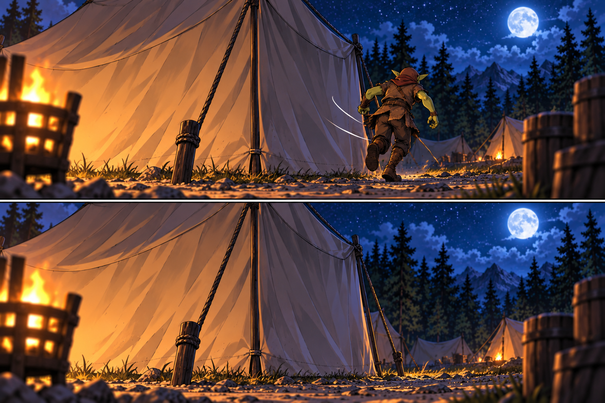

- The two panels show one goblin's sudden dash, then the tent blocking it from sight. Appearance, clothes, motion marks, camp shelter shapes/count, ropes, light and scenery are illustrative; route/position beyond the tent, motive, formal movement/stealth ruling and any reply remain unreported. [Prompt and inspection](./2026-10-10/goblin-behind-tent-image-notes.md).

- [Archive] The visible-goblin dash caption and scene were [posted to THe](https://discord.com/channels/958554312185884723/1497086827365142530/1558427574781091870). The publisher's response and separate message readback confirmed the exact caption, thread, attachment filename and **2,180,731-byte** image. The confirmed receipt is archived in the campaign delivery history.

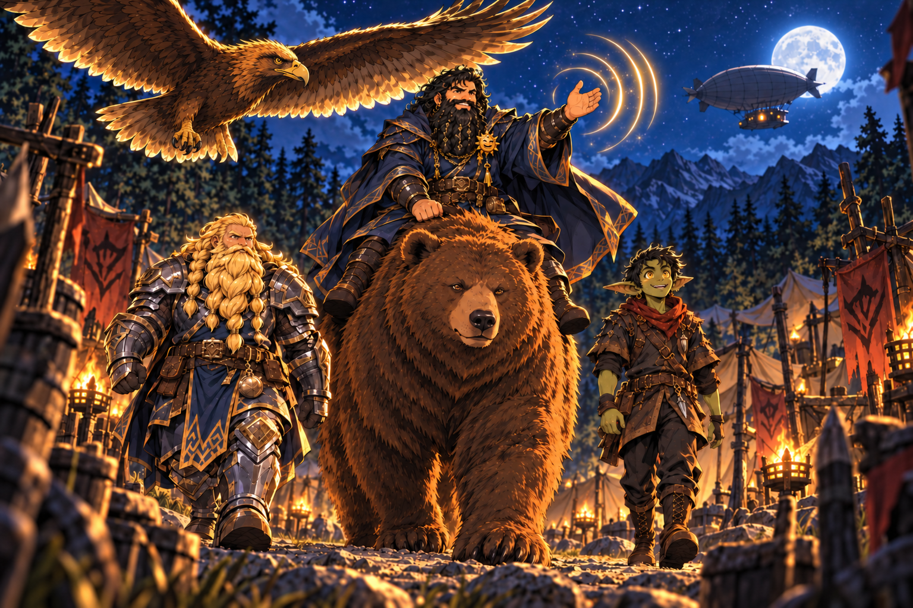

- Dain's Minor Illusion and booming entrance, no-violence guarantee and giant-eagle support follow the supplied scene. Tina is transformed by Kagrenac; the goblins' response is unreported. Poses, aura, feather colours, camp structures/banners/decorative symbols and aerial spacing are illustrative, with no map layout, faction emblem, spell mechanic, accepted agreement or attack established. [Prompt, references and eagle correction](./2026-10-10/bear-eagle-camp-entrance-image-notes.md).

- [Archive] The bear-and-giant-eagle peaceful entrance caption and scene were [posted to THe](https://discord.com/channels/958554312185884723/1497086827365142530/1558425482704453754). The publisher's response and separate message readback confirmed the exact caption, thread, attachment filename and **2,704,026-byte** image. The confirmed receipt is archived in the campaign delivery history.

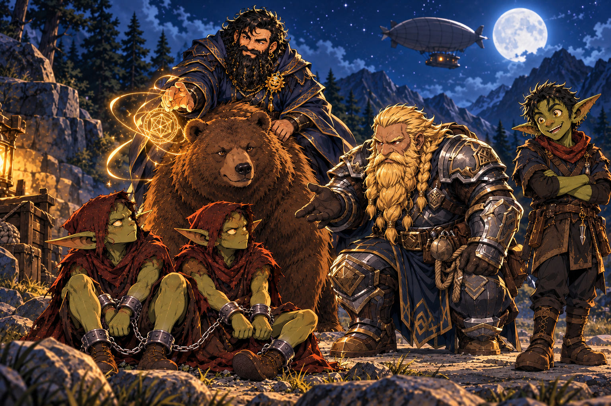

- Dain's Suggestion succeeds on the smarter captive; Harry delivers her warning to the other, with her outcome unreported. The background blimp represents the others' reported travel. Poses, cuffs, aura, terrain, lights, apparent height and detailed staging are illustrative; no precise positions, transport arrangement, camp layout, new order compliance, unlimited-obedience rule, resource total or intimidation outcome follows from the image. [Prompt, references and inspection](./2026-10-10/ground-route-suggestion-image-notes.md).

- [Archive] The ground-route, bear-ride and captive-command caption and scene were [posted to THe](https://discord.com/channels/958554312185884723/1497086827365142530/1558421734959358002). The publisher's response and separate message readback confirmed the exact caption, thread, attachment filename and **3,029,577-byte** image. The confirmed receipt is archived in the campaign delivery history.

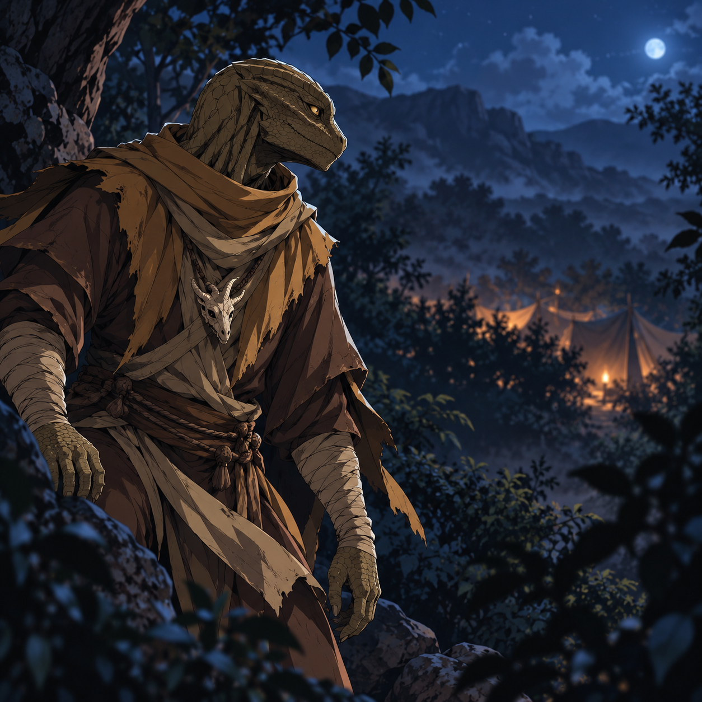

- Taleesh's discovery is confirmed; posture, gaze, vegetation, lighting and obscured shelter glimpses are illustrative. No map key, creature count, tactical layout, arrow-source clue, stealth/check result or further action is established. [Image notes](./2026-10-10/taleesh-goblin-camp-image-notes.md).
- [Archive] Taleesh's camp-discovery caption and generated scene were [posted to THe](https://discord.com/channels/958554312185884723/1497086827365142530/1558416680428900444). The publisher readback confirmed the exact caption, destination and PNG attachment; the confirmed receipt is archived. The source table photo was not posted.

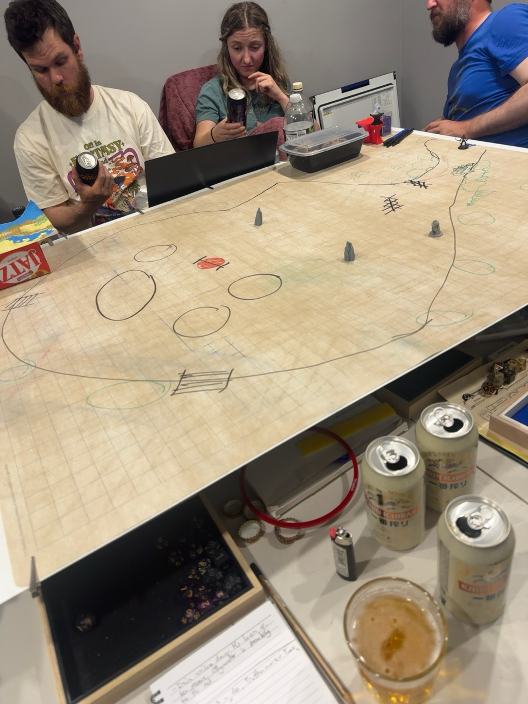

- [Table-side source] The supplied photograph is copied unchanged. Its marks and miniatures remain unlabelled; this is not a measured in-world map, item acquisition, enemy census or confirmed terrain legend. The table photo is retained in the local archive and excluded from imagegen references and the Discord upload.

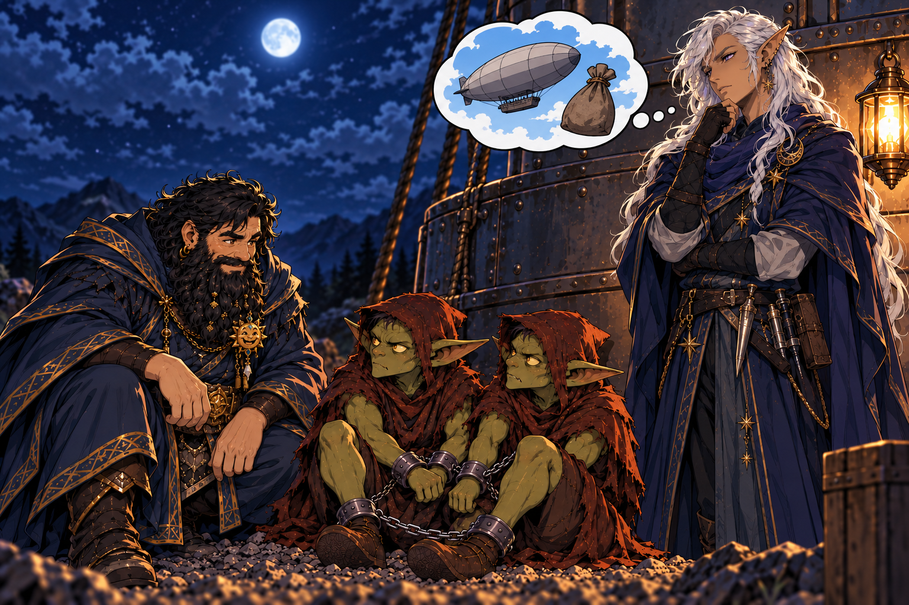

- The blimp and closed satchel occur only inside Kagrenac's thought bubble; this shows intention, with no flight, guano handling, target or explosion. Poses, clothes, light, carriage crop and fine cuffs are illustrative. No captive reply, injury recovery or agreed plan is established. [Image notes](./2026-10-10/dain-and-kagrenac-goblin-plans-image-notes.md).
- [Archive] The Dain-leverage/Kagrenac-guano caption and generated scene were [posted to THe](https://discord.com/channels/958554312185884723/1497086827365142530/1558413068004753459). The publisher's readback confirmed the exact caption, destination and image attachment; the confirmed delivery receipt is archived.

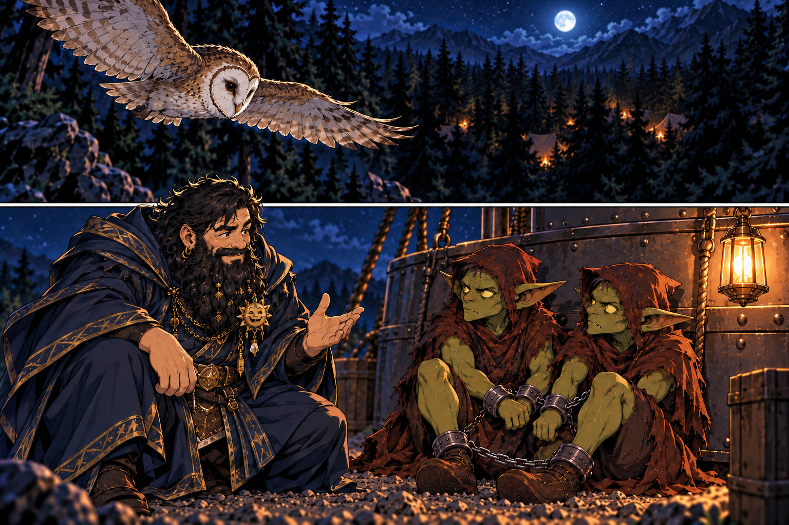

- The upper scouting view and lower balloon scene are separate locations. Camp shelter/light details, terrain, camera angles, poses, expressions and fine cuffs are illustrative. Both prisoners are awake, with no reported answer, healing, camp affiliation or exact boarding. The owl's route/relay/return remains unreported. [Prompt and references](./2026-10-10/owl-camp-and-rhyming-question-image-notes.md).
- [Archive] The owl-camp discovery, prisoner waking and Dain-question caption and generated image were [posted to THe](https://discord.com/channels/958554312185884723/1497086827365142530/1558406590724309103). The publisher readback confirmed the exact caption, destination and attachment; the delivery receipt is archived.

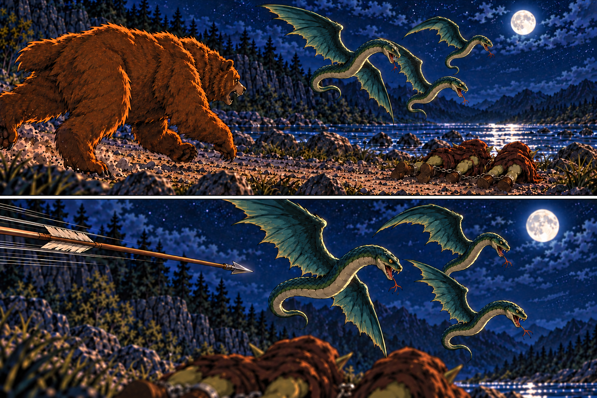

- Two sequential panels show Stu approaching, then one arrow in flight toward the same contextual remaining trio. No bear arrival, shot outcome, new death, prisoner waking/reaction or additional group is established. The shooter stays off-frame and Tina's identity/link to Christina remains unconfirmed. Terrain, camera distance, poses, fine restraints and arrow design are illustrative. [Prompt and references](./2026-10-10/stu-return-and-tina-arrow-image-notes.md).
- [Archive] Stu's return and Tina's arrow-attempt caption and generated image were [posted to THe](https://discord.com/channels/958554312185884723/1497086827365142530/1558402638675181609). The publisher readback confirmed the exact caption, destination and attachment; the delivery receipt is archived.
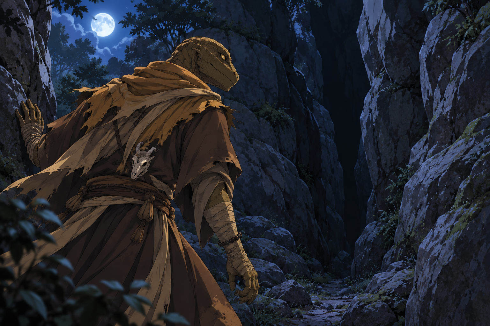

- Taleesh's attentive posture and the partially seen gorge illustrate investigation, not a successful discovery or cleared area. Rock shapes, scale, path, light, gaze and exact position are illustrative; no archer, trail, arrow, clue, climb, check result or confirmed firing direction is established. [Prompt and references](./2026-10-10/taleesh-gorge-image-notes.md).
- [Archive] Taleesh's sweep/gorge-investigation caption and generated image were [posted to THe](https://discord.com/channels/958554312185884723/1497086827365142530/1558398522263474226). Publisher readback confirmed the caption, destination and image attachment; the confirmed receipt is archived. The table photo and uncommunicated private hunch remain in the local archive.
- [Table-side] [Original table photo](./2026-10-10/perimeter-sweep-table-photo.jpg): retained unchanged as source context; miniature identities, drawn-feature meanings, grid scale and gorge correspondence are unreported. The photo is not used as a measured map or posted to Discord.

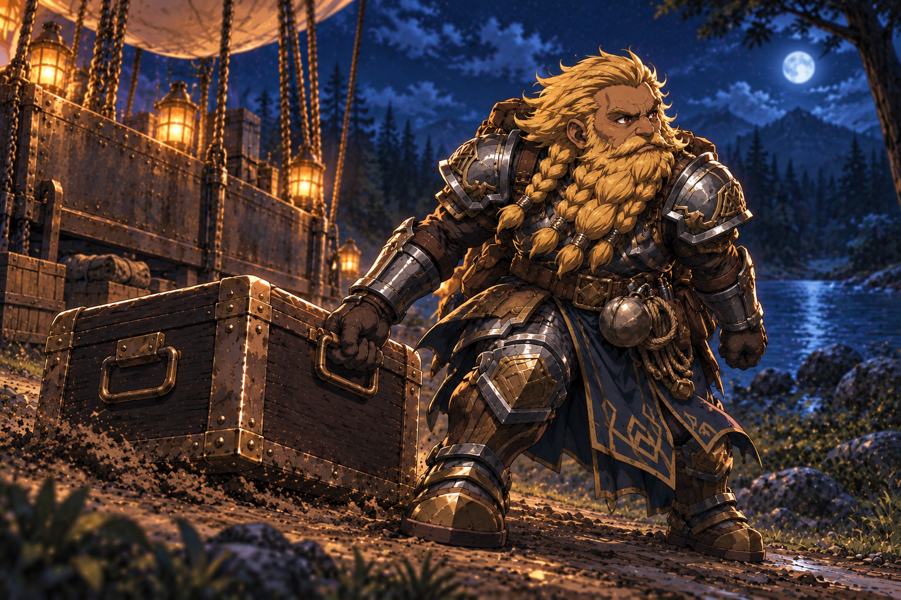

- Harry and the closed chest remain outside on the ongoing return attempt. Pose, grip, scuff, chest construction and balloon placement are illustrative; no measured progress, new arrow, arrival/loading or contents result is established. The two captives' confirmed survival is recorded in text; their off-frame consciousness and reaction remain open. [Prompt and references](./2026-10-10/round-seven-chest-return-image-notes.md).
- [Archive] The round-7 chest-haul caption, both captives' survival update and new image were [posted to THe](https://discord.com/channels/958554312185884723/1497086827365142530/1558395677254357024). Publisher readback confirmed the caption, destination and image attachment; the confirmed receipt is archived.

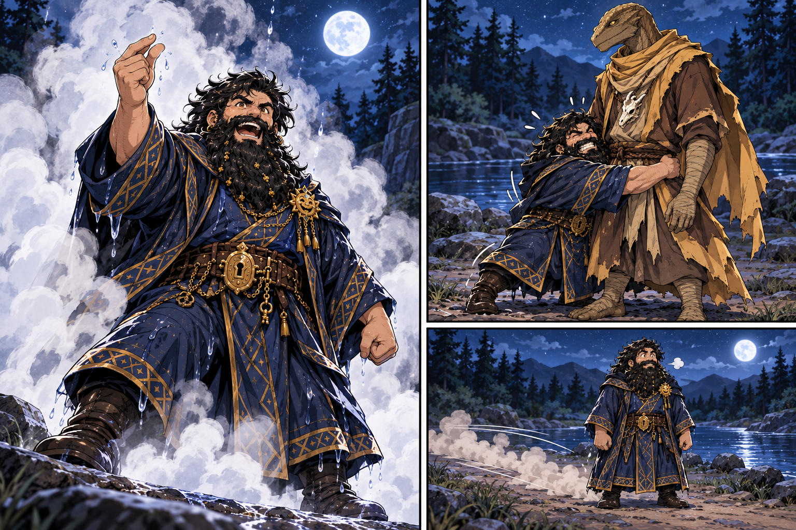

- Three consecutive panels illustrate the steam entrance, unsuccessful lift and idle endpoint after the run. Poses, grip, expressions, framing, steam shape, running trail and background are illustrative; no pod, transformation, healing, drying, damage, named action, exact map or extra party outcome is established. [Prompt and references](./2026-10-10/truthammer-steam-entrance-image-notes.md).
- [Archive] Truthammer's steam-entrance caption and three-panel comic were [posted to THe](https://discord.com/channels/958554312185884723/1497086827365142530/1558393345829507133). Publisher readback confirmed the caption, destination and image attachment; the confirmed receipt is archived.

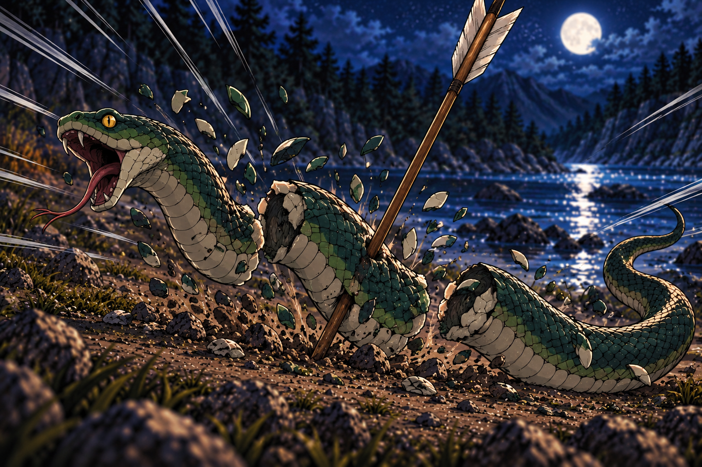

- The frame shows one victim's arrow-pinned destruction; Christina, Stu, the two earlier dead snakes and the three airborne snakes remain off-frame. Fragment arrangement, impact lines, arrow design/angle and terrain are illustrative. No damage number, critical, magical arrow property, flight capability, shooter appearance, exact position or extra victim is established. [Prompt and reference](./2026-10-10/christina-arrow-image-notes.md).
- [Archive] Christina's arrow-hit caption, clarified target and impact image were [posted to THe](https://discord.com/channels/958554312185884723/1497086827365142530/1558390039224786987). Publisher readback confirmed the caption, destination and image attachment; the confirmed receipt is archived.

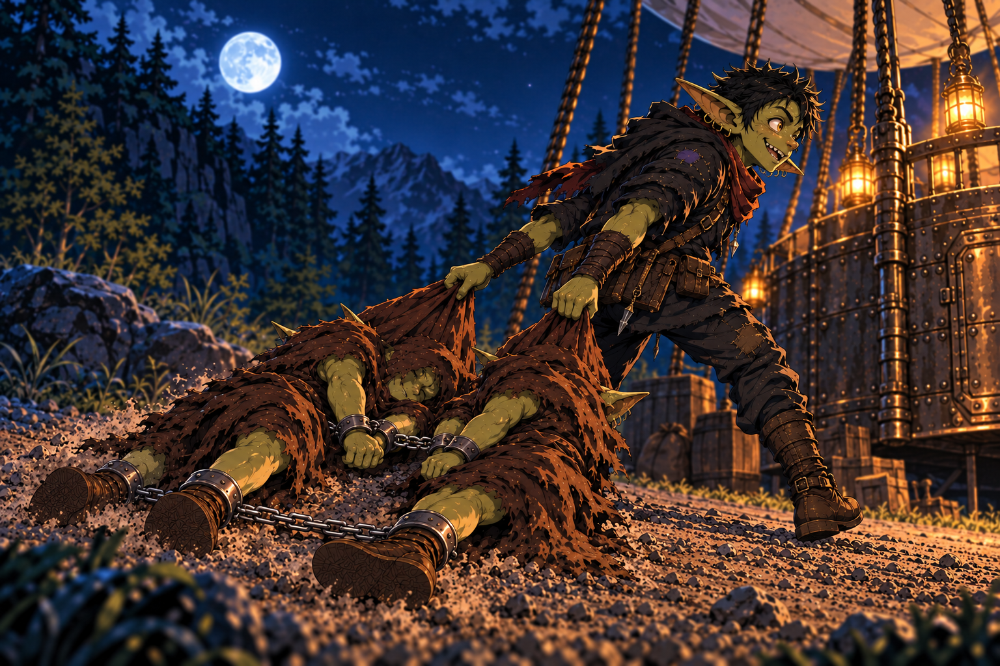

- The image supports the continued haul with one uncuffed Yuckie and two linked captives. Grip, body positions, clothing details, chain construction, apparent progress, dirt movement and cabin placement are illustrative. No measured distance, arrival, boarding, prisoner sleep/waking, new injury or mechanical check is established. [Prompt and references](./2026-10-10/yuckie-continued-pull-image-notes.md).
- [Archive] Yuckie's continued-haul caption and image were [posted to THe](https://discord.com/channels/958554312185884723/1497086827365142530/1558386952938717194). Publisher readback confirmed the caption, destination and image attachment; the confirmed receipt is archived.

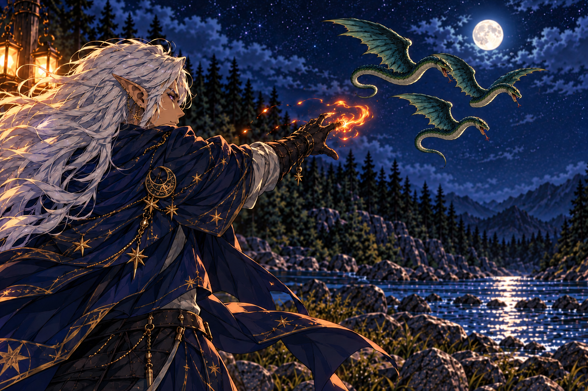

- The image stages the failed casting attempt through an illustrative small fire cue, without depicting contact or choosing a failure cause. Gesture, spell appearance, apparent distance, positions and surroundings are illustrative; no attack roll, measured range, multiple-target effect, snake reaction, damage or owl response is established. [Prompt and references](./2026-10-10/kagrenac-fire-bolt-image-notes.md).
- [Archive] Kagrenac's failed Fire Bolt caption and corrected three-snake image were [posted to THe](https://discord.com/channels/958554312185884723/1497086827365142530/1558384445923528734). Publisher readback confirmed the caption, destination and image attachment; the confirmed receipt is archived.

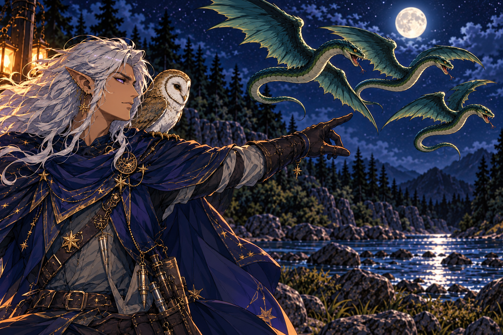

- The image stages Kagrenac's confirmed command, with the owl still perched and exactly three airborne targets. Gesture, perch, head orientation, costume details, creature appearance, apparent spacing, river and lighting are illustrative. No owl flight, attack, Help action, arrival, snake reaction, changed course, measured map or resource use is established. [Prompt and references](./2026-10-10/kagrenac-owl-command-image-notes.md).
- [Archive] Kagrenac's owl-command caption and image were [posted to THe](https://discord.com/channels/958554312185884723/1497086827365142530/1558381758125309963). Publisher readback confirmed the caption, destination and image attachment; the confirmed receipt is archived.

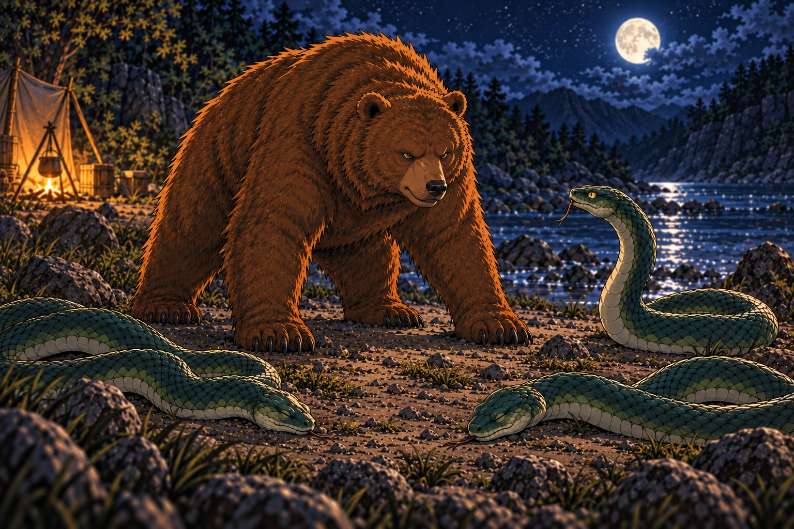

- The aftermath illustrates the confirmed local count: two dead, one remaining at Stu. The exact “covering” action is not depicted. Posture, contact-free staging, snake appearance, closed-eye death depiction, body placement, terrain and lighting are illustrative; no killing method, new attack, measured map, HP, condition, XP, loot or outcome for the three airborne snakes is established. [Prompt and references](./2026-10-10/stu-two-snakes-dead-image-notes.md).
- [Archive] Stu's two-deaths-and-one-remaining caption and aftermath image were [posted to THe](https://discord.com/channels/958554312185884723/1497086827365142530/1558378444151066656). Publisher readback confirmed the caption, destination and image attachment; the confirmed receipt is archived.

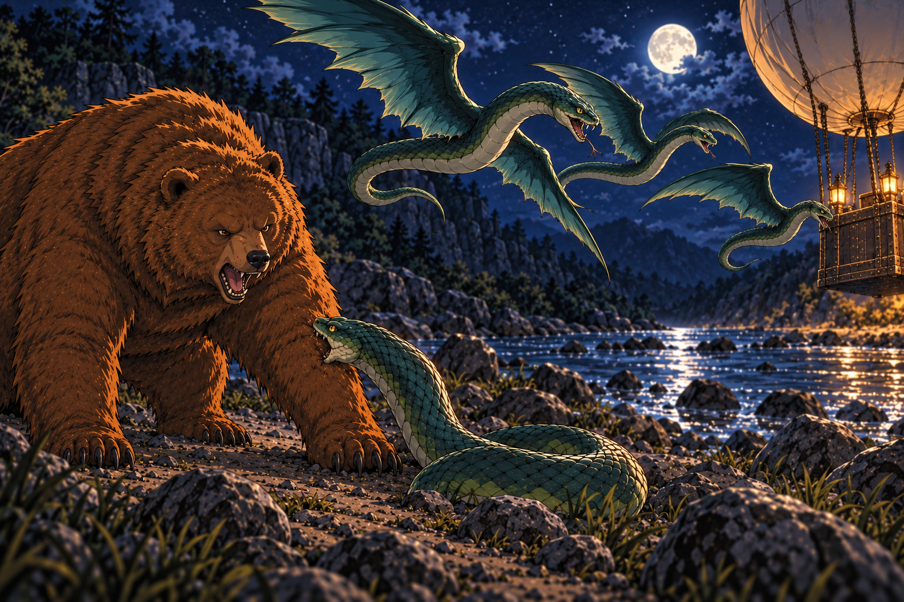

- The image shows the remaining four's reported split: one illustrative bite and three airborne pursuers. The earlier two snakes and specific party members are outside the frame. Appearance, contact point, impact styling, flight path, ship staging and apparent distance are illustrative; no extra hit, exact position, measured 100-foot map, post-hit condition or completed boarding is established. [Prompt and references](./2026-10-10/snake-followup-retreat-image-notes.md).
- [Archive] The two-plus-four clarification, added damage and three-snake pursuit caption and image were [posted to THe](https://discord.com/channels/958554312185884723/1497086827365142530/1558376214417117195). Publisher readback confirmed the caption, destination and image attachment; the confirmed receipt is archived.

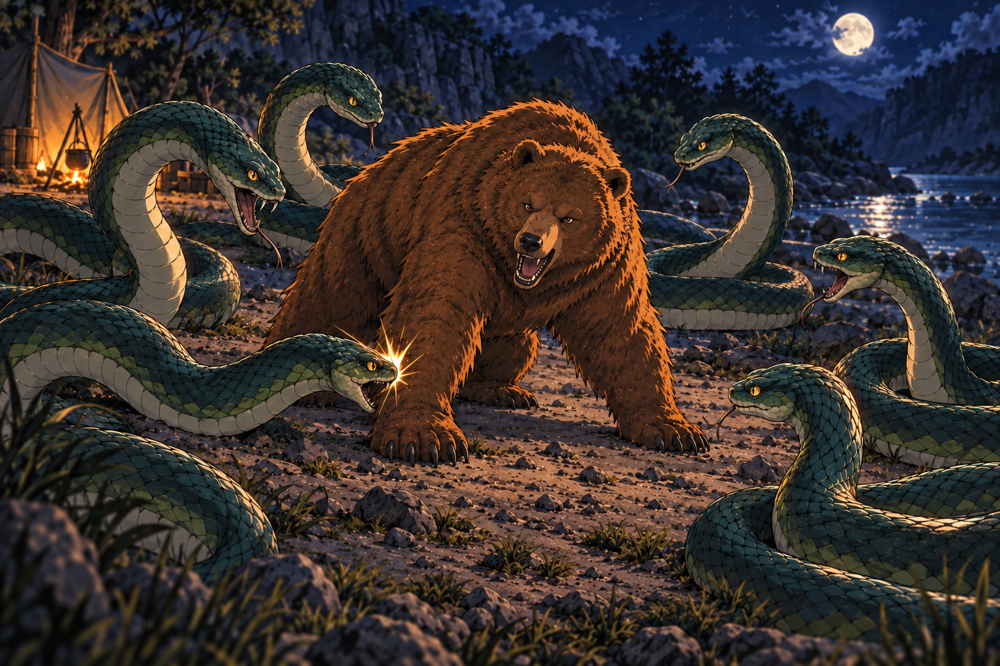

- The six surrounding snakes, critical hit and Stu being fine follow the narration. One illustrated bite contact, ground-level staging, creature appearance, poses, impact flash and lighting do not settle attack count, anatomy/flight capability, exact positions, HP, poison status, resistance or later actions. About 15 total damage is confirmed as approximate; the split remains unclear. [Prompt and references](./2026-10-10/stu-six-snakes-critical-image-notes.md).
- [Archive] Stu's six-snake critical-hit caption, clarified approximate damage and corrected scene image were [posted to THe](https://discord.com/channels/958554312185884723/1497086827365142530/1558373312193634416). Publisher readback confirmed the caption, destination and image attachment; the confirmed receipt is archived.

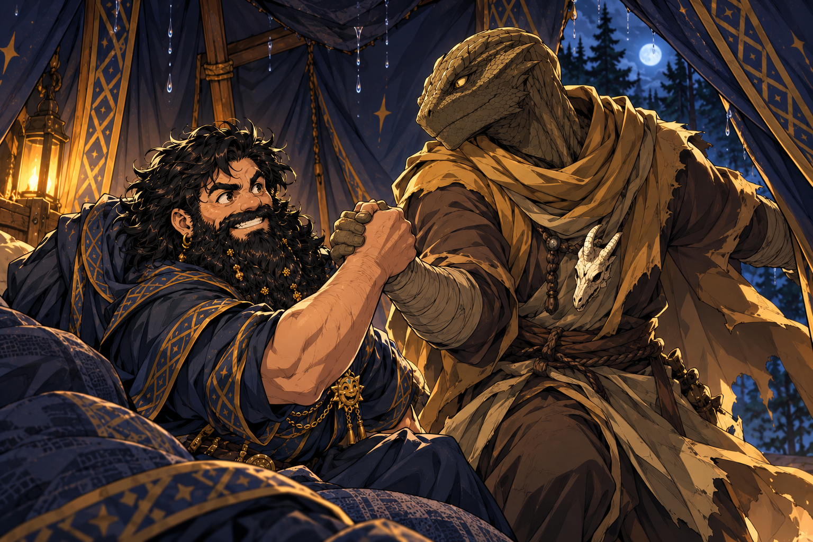

- The central clasp illustrates the reported meme gesture after Dain wakes. Expressions, arm position, sleeves, stance, tent details and lighting are illustrative; no strength increase, Help action, advantage, spell, astral-arm activation, attack, resource recovery or enemy layout is established. [Prompt and references](./2026-10-10/taleesh-wakeup-hand-grasp-image-notes.md).
- [Archive] Taleesh's wake-up, hand-grasp and battle-entry caption and image were [posted to THe](https://discord.com/channels/958554312185884723/1497086827365142530/1558369401932095488). Publisher readback confirmed the caption, destination and image attachment; the confirmed receipt is archived.

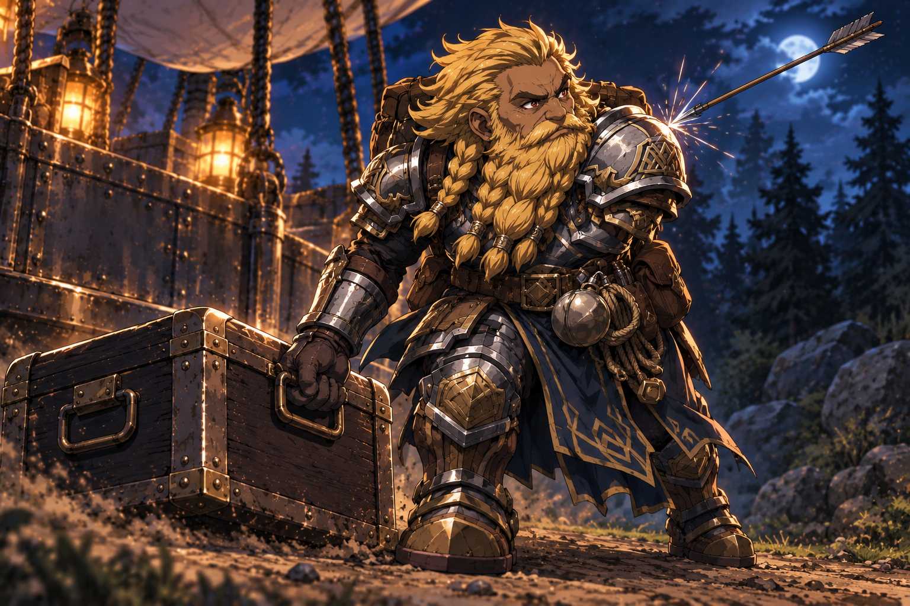

- Harry's pull, the armour glance and continuing attempt follow the reported scene. Grip, pose, chest construction, contact point, arrow deflection angle, terrain and ship placement are illustrative; they establish no firing direction, shooter, damage, arrival, loading, cargo condition or Dain awareness change. [Prompt and references](./2026-10-10/harry-chest-arrow-image-notes.md).
- [Archive] Harry's chest-return and arrow-glance caption and image were [posted to THe](https://discord.com/channels/958554312185884723/1497086827365142530/1558365645417218079). Publisher readback confirmed the caption, destination and image attachment; the confirmed receipt is archived.

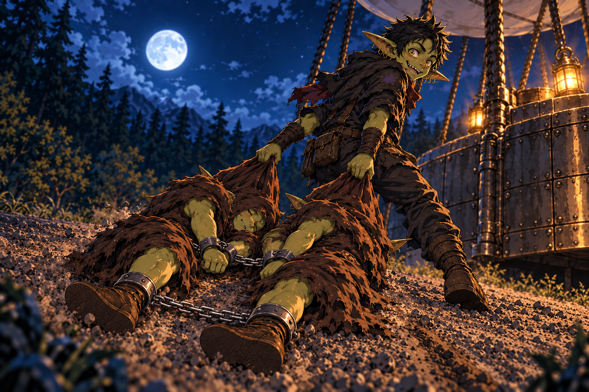

- Beginning of the return trip; Yuckie is distinct from the two prisoners and uncuffed. Grip, poses, dirt movement, fine cuff construction, distance, cabin placement and lighting are illustrative. Their downturned, partly concealed faces do not settle sleep/waking; no reaction, new injury, successful arrival, boarding, chest recovery, ship landing arrangement or Dain awareness change is established. [Prompt and references](./2026-10-10/yuckie-dragging-goblins-image-notes.md).
- [Archive] Yuckie's return-drag caption and image were [posted to THe](https://discord.com/channels/958554312185884723/1497086827365142530/1558363444711923773). Publisher readback confirmed the caption, destination and image attachment; the confirmed receipt is archived.

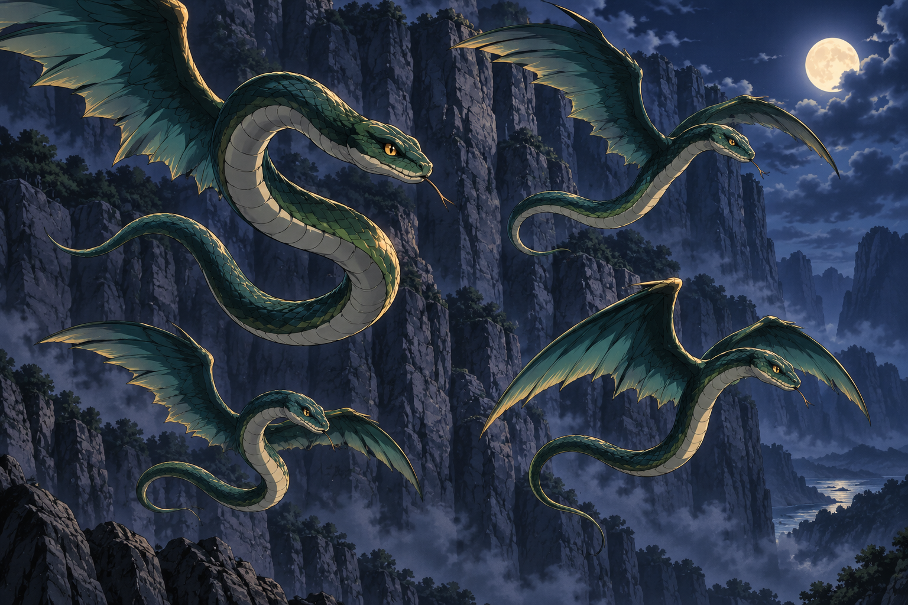

- Four distinct creatures and the cliff backdrop support the reported scene; the user has confirmed their approach toward the party. Creature design, angled poses, rock shapes, scale, vegetation, distant water, mist and moonlight are illustrative. No attack, named stat block, party action, new location arrival, northern-forest connection or Dain waking/awareness is established. [Prompt and clarification](./2026-10-10/flying-snakes-image-notes.md).
- [Archive] The four-snake approach caption and image were [posted to THe](https://discord.com/channels/958554312185884723/1497086827365142530/1558359734824730644). Publisher readback confirmed the caption, destination and image attachment; the confirmed receipt is archived.

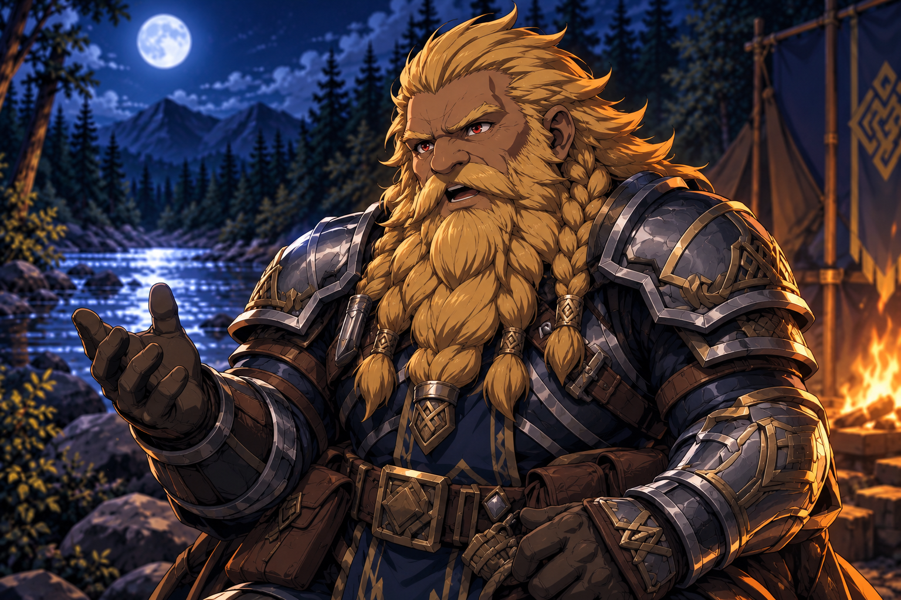

- Dialogue illustration: Harry's quoted statement is in the journal; the image contains no lettering. Gesture, expression, pose and camp staging are illustrative. The prisoners and Dain are outside the frame; no motive, family appearance, prisoner response, waking, new attack, divine approval or Dain involvement is established. [Prompt and references](./2026-10-10/harry-punishment-statement-image-notes.md).
- [Archive] Harry's quoted punishment statement and dialogue image were [posted to THe](https://discord.com/channels/958554312185884723/1497086827365142530/1558357527530577942). Publisher readback confirmed the caption, destination and image attachment; the confirmed receipt is archived.

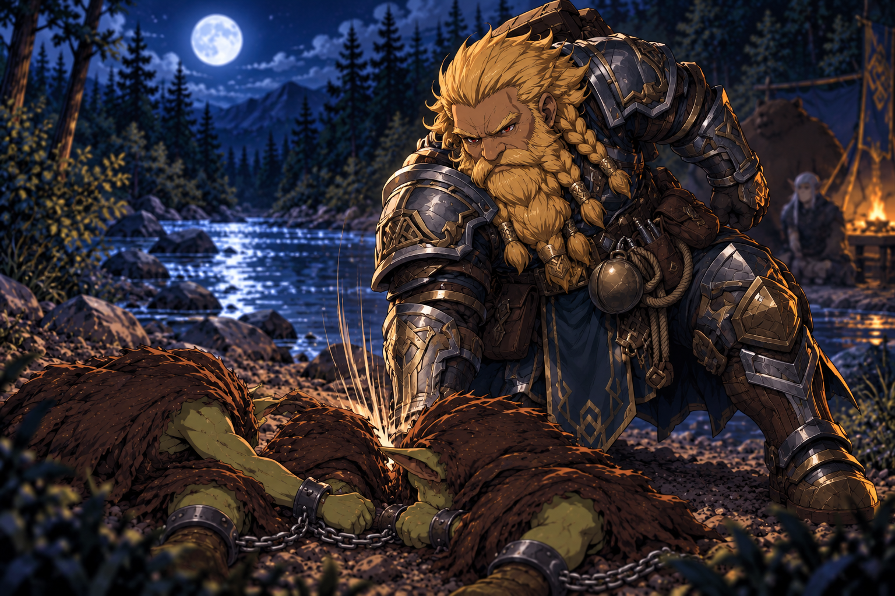

- New illustration of Harry's reported action. Pose, expression, motion marks, cuff details and camp layout are illustrative. The actual contact and any implement are obscured; no damage total, injury extent, waking/reaction, continued sleep, chest recovery or Dain awareness change is established. [Prompt and references](./2026-10-10/harry-prisoner-strike-image-notes.md).
- [Archive] Harry's finger-strike caption and image were [posted to THe](https://discord.com/channels/958554312185884723/1497086827365142530/1558354399686950954). Publisher readback confirmed the caption, destination and image attachment; the confirmed receipt is archived.

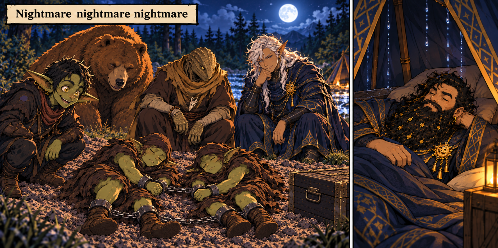

- Updated illustration of the confirmed shared hand/foot bindings. Exact cuff/link construction, poses and chest placement are illustrative; no stock deduction, formal condition mechanics, waking, injury, chest recovery or Dain awareness change is established. The previous illustrations remain earlier views. [Prompt and reference](./2026-10-10/conjoined-goblins-image-notes.md).
- [Archive] The shared hand/foot binding caption and edited image were [posted to THe](https://discord.com/channels/958554312185884723/1497086827365142530/1558351420888064031). Publisher readback confirmed the caption, destination and image attachment; the confirmed receipt is archived.

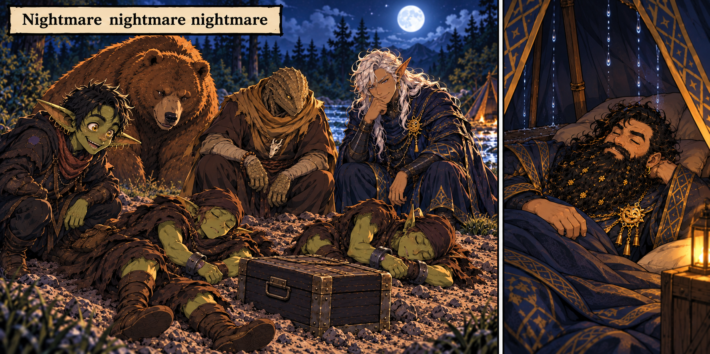

- Simultaneous scenes: the party waits around two sleeping prisoners; Dain sleeps separately. Individual positions/expressions, quote presentation, cuff arrangement, sleep pose, terrain and lighting are illustrative. No waking, spell, intimidation result, rescue history, chest recovery or Dain awareness change is established. [Prompt and references](./2026-10-10/nightmare-circle-image-notes.md).
- [Archive] The waiting-circle and legendary-sleep caption and image were [posted to THe](https://discord.com/channels/958554312185884723/1497086827365142530/1558348485894340608). Publisher readback confirmed the caption, destination and image attachment; the confirmed receipt is archived.

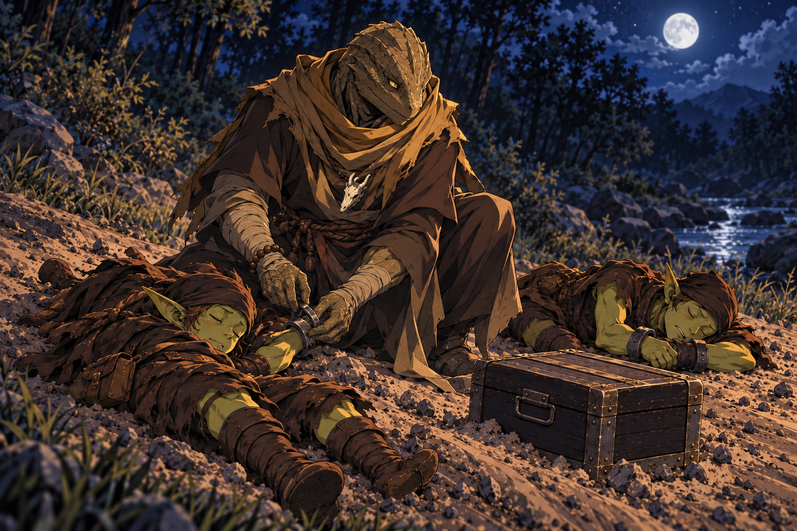

- Manacling both sleeping goblins follows the reported action. Cuff arrangement, poses, terrain, chest placement and lighting are illustrative; no formal condition mechanics, exact equipment withdrawal, waking, injury, chest recovery or Dain awareness change is established. [Prompt and references](./2026-10-10/manacles-image-notes.md).
- [Archive] Taleesh's manacling caption and image were [posted to THe](https://discord.com/channels/958554312185884723/1497086827365142530/1558345368863903754). Publisher readback confirmed the caption, destination and image attachment; the confirmed receipt is archived.

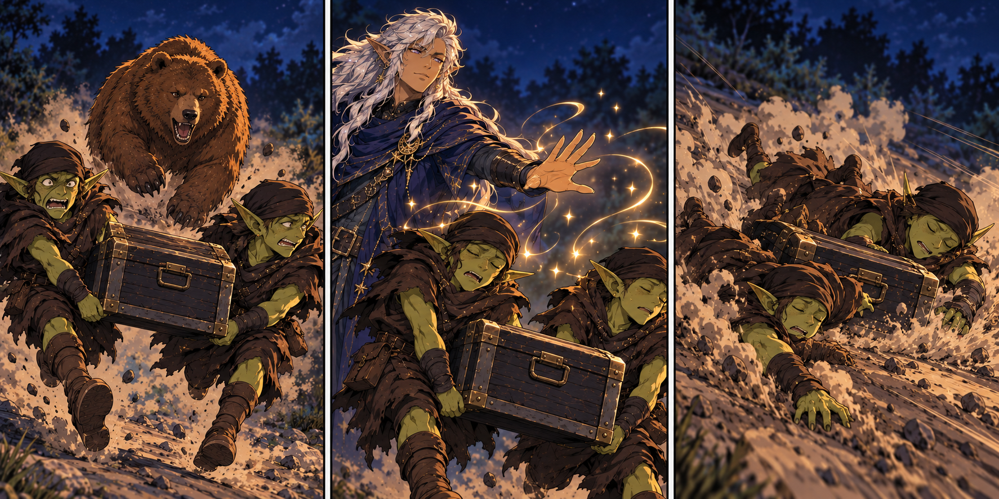

- Three consecutive moments, with two goblins and one chest repeated across time. Poses, spell visuals, grips, dust/furrow, terrain and lighting are illustrative; no named sleep spell, roll, duration, injury, damage, cargo loss, chest control/recovery or Dain awareness change is established. [Prompt and references](./2026-10-10/bear-chase-and-sleep-image-notes.md).
- [Archive] The bear-chase, sleeping-goblins and chest-slide caption and image were [posted to THe](https://discord.com/channels/958554312185884723/1497086827365142530/1558340797617803344). Publisher readback confirmed the caption, destination and image attachment; the confirmed receipt is archived.

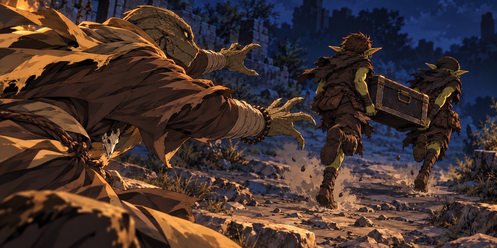

- The failed grapple and continued flight with the chest follow the reported scene. Pose, distance, carrying grips, terrain, background masonry and lighting are illustrative; no new roll, injury, grappled condition, later pursuit, completed escape, named destination, cargo damage or Dain awareness is established. [Prompt and references](./2026-10-10/taleesh-grapple-and-flight-image-notes.md).
- [Archive] The failed-grapple and goblin-flight caption and image were [posted to THe](https://discord.com/channels/958554312185884723/1497086827365142530/1558338544156676116). Publisher readback confirmed the caption, destination and image attachment; the confirmed receipt is archived.

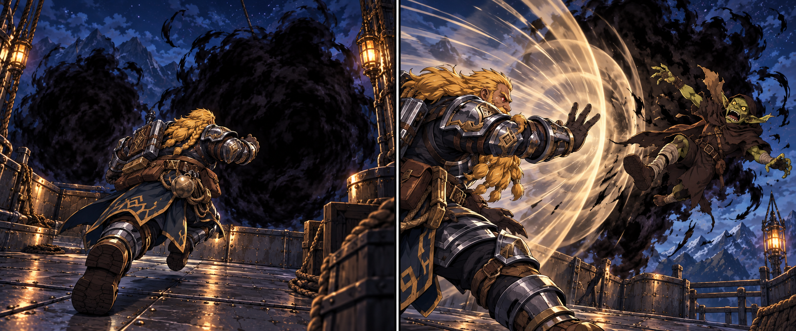

- The panels reconstruct the approach and push. Spell visuals, pose, cloud shape/spacing, deck/rail staging, terrain and lighting are illustrative; no measured distance, precise location, injury, save, damage, concentration failure, resource cost or Dain awareness change is established. The other patch's disappearance remains recorded without assigning a cause or mapped identity. [Prompt and references](./2026-10-10/harry-thunderwave-image-notes.md).
- [Archive] Harry's Thunderwave caption and image were [posted to THe](https://discord.com/channels/958554312185884723/1497086827365142530/1558336105718485002). Publisher readback confirmed the caption, destination and image attachment; the confirmed receipt is archived.

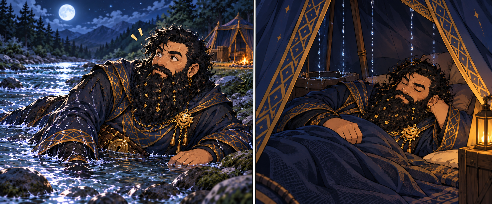

- The panels follow Dain's supplied response while preserving his lack of enemy awareness. Pose, moon phase, camp layout, lighting and furnishings are illustrative; no injury, drowning mechanics, new casting, new condition or rest recovery is established. [Prompt and references](./2026-10-10/dain-tent-return-image-notes.md).
- [Archive] The tent-return caption and image were [posted to THe](https://discord.com/channels/958554312185884723/1497086827365142530/1558334209263796246). Publisher readback confirmed the caption, destination and image attachment; the confirmed receipt is archived.

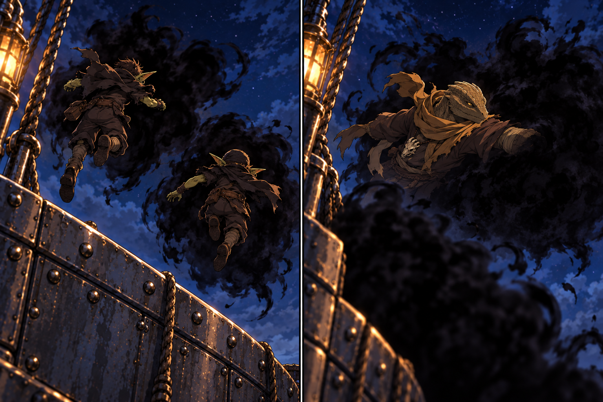

- The panels follow the reported actions and show no extra consequence from Taleesh's natural 1. Cloud shape/spacing, jump and swing poses, exact positions and Taleesh's visibility to the viewer are illustrative. The frame establishes no special vision, named spell, mechanical radius, height, specific attack weapon, astral-arm use, damage, fumble or completed escape. [Prompt and references](./2026-10-10/goblin-darkness-image-notes.md).
- [Archive] The darkness-pursuit caption, image and **Dain initiative 7 correction** were [posted to THe](https://discord.com/channels/958554312185884723/1497086827365142530/1558331932532678677). Readback confirmed the caption, destination and image attachment; the confirmed receipt is archived. The earlier delivered post remains preserved as history.

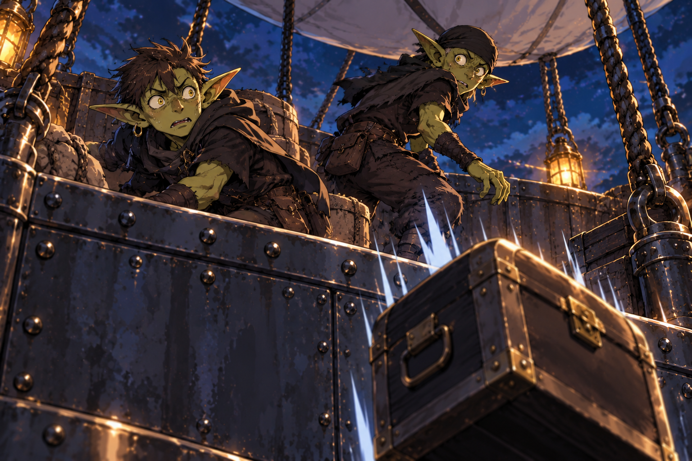

- The panel reconstructs the confirmed night-time intrusion and chest drop before any combat action. Goblin appearance/poses, chest construction, motion lines, rail angle, lighting and cargo placement are illustrative. The landing stays out of frame; no named dropper, damage, lost contents, ship height, surprise ruling or attack is established. [Prompt and references](./2026-10-10/night-goblin-alarm-image-notes.md).
- [Archive] The night-alarm caption and image were [posted to THe](https://discord.com/channels/958554312185884723/1497086827365142530/1558328862440685669). Readback confirmed the caption, destination and image attachment; the confirmed receipt is archived.

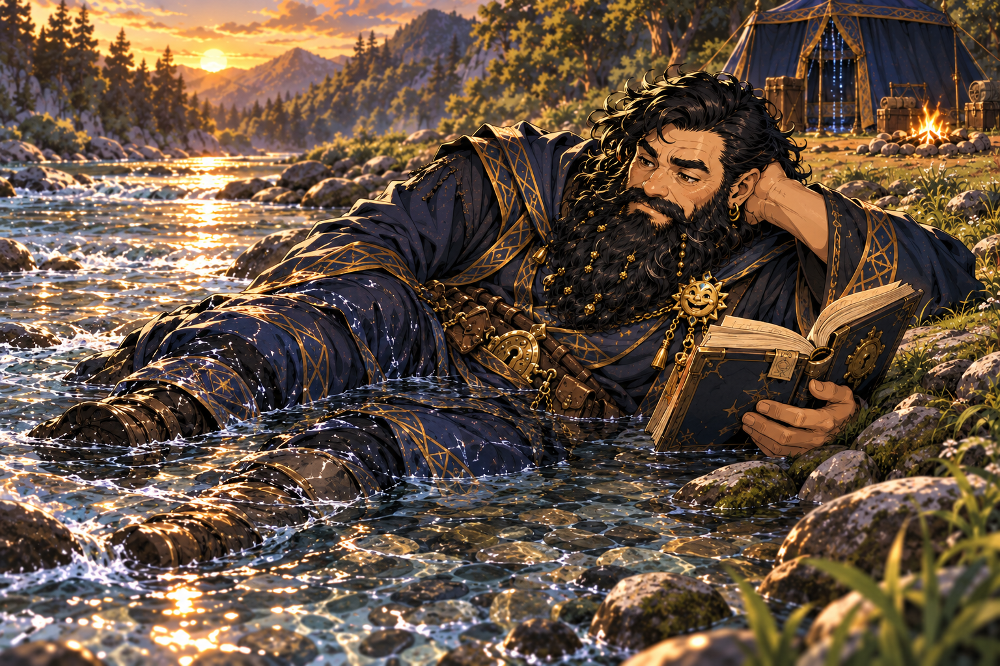

- The reclining riverside moment follows Maitland's narration. Expression, immersed areas, book handling, camp layout and sunset lighting are illustrative; no writing, completed spell, magical aura, damage, father appearance or resource recovery is established. [Prompt and references](./2026-10-10/riverbank-reflection-image-notes.md). The party-facing caption leaves the paternal inspiration private.
- [Archive] The riverside research caption and image were [posted to THe](https://discord.com/channels/958554312185884723/1497086827365142530/1558326713958793277). Readback confirmed the caption, destination and image attachment; the confirmed delivery receipt is archived. The paternal inspiration is excluded from the caption.

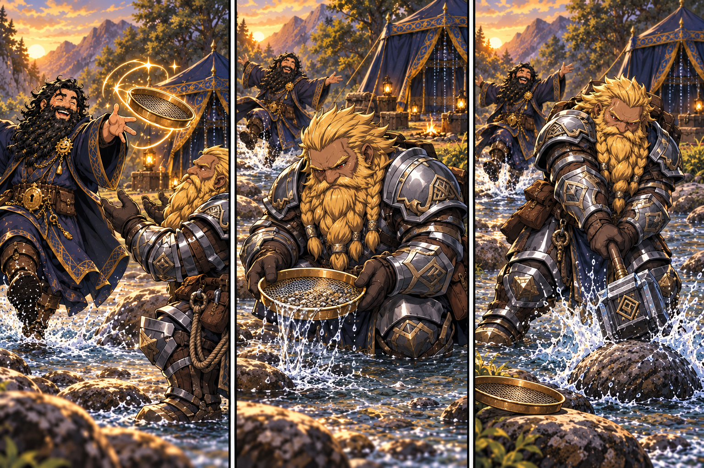

- The panels follow the confirmed order: conjure, search, hammer. Tool shape and golden rim, appearance sparks, positions, facial expressions, splashes, camp layout and light are illustrative. The image establishes no gold yield, valuable tool material, named spell, resource cost, broken rock or specific magical hammer. [Prompt and references](./2026-10-10/harry-river-prospecting-image-notes.md).
- [Archive] Harry's prospecting caption and image were [posted to THe](https://discord.com/channels/958554312185884723/1497086827365142530/1558324303164870676). The publisher readback confirmed the caption, destination and image attachment; the receipt is archived.

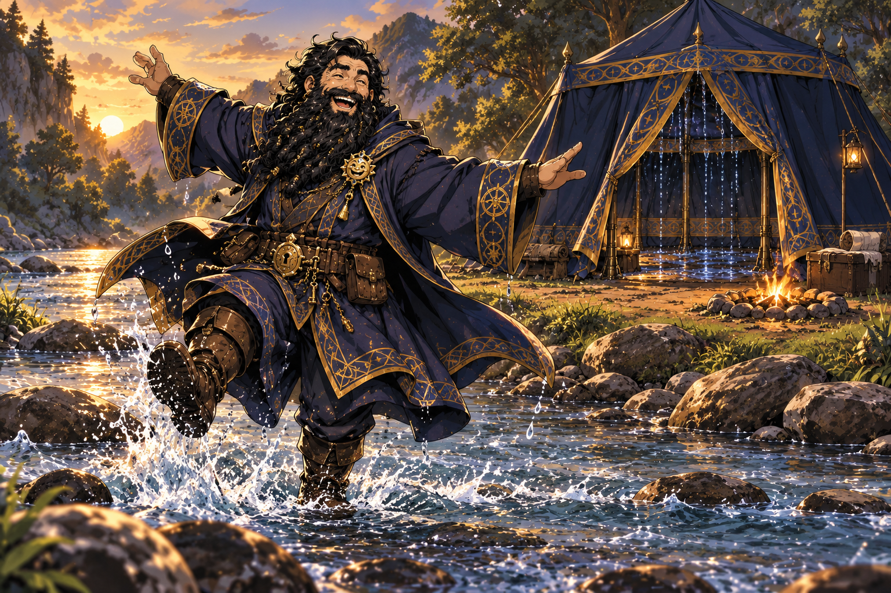

- The riverside camp, newly put-up tent and Dain's enjoyment follow Maitland's narration. Pose, shallow-water staging, sunset light, background terrain, camp equipment and tent proportions are illustrative; they establish no exact geography, time, weather, inventory, casting level or rest recovery. [Prompt and references](./2026-10-10/riverside-frolicking-image-notes.md).
- [Archive] The riverside story caption and image were [posted to THe](https://discord.com/channels/958554312185884723/1497086827365142530/1558321288777310268). The publisher readback confirmed the caption, destination and image attachment; the delivery receipt is archived.

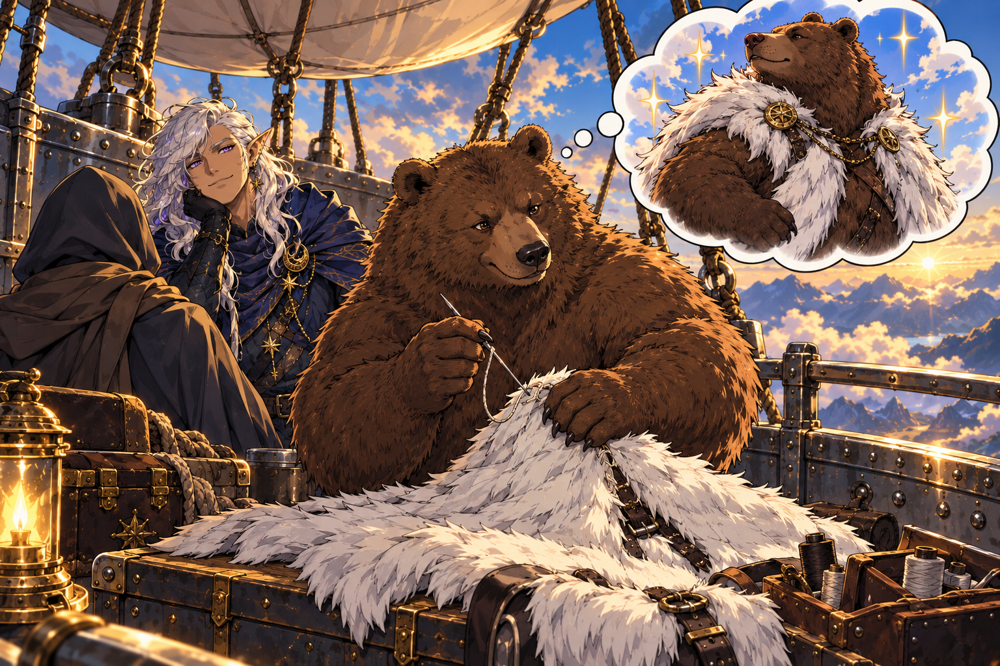

- Stu's brown-bear form, cloak-making and companions follow Maitland's scene and clarification. The thought bubble is the requested imagined outfit. Sewing tools, fittings, poses, Christina's hooded depiction, sky and light are illustrative; they establish no completed cloak, item properties, specific time or weather. [Prompt and references](./2026-10-10/stu-white-wolf-cloak-image-notes.md).

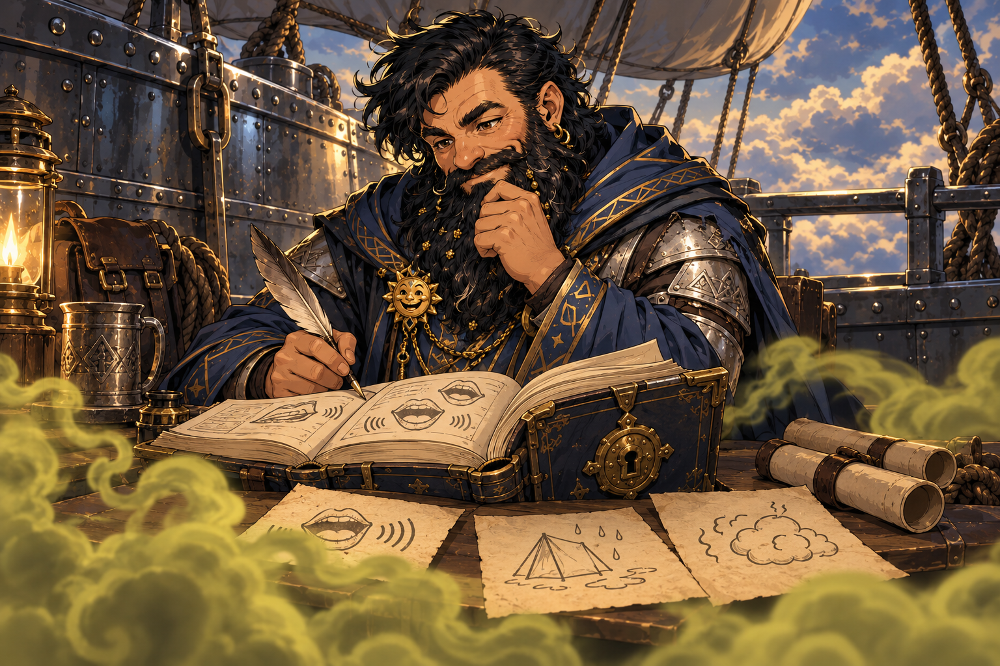

- Existing 2026-10-03 continuity reference, reused for the resume point. Framing, vapour and sketch details are illustrative; this establishes no new scene, spell effect or cloud duration. [Original image notes](./2026-10-03/magic-mouth-airship-research-image-notes.md).
- The older image remains the startup reference; the cloak-making image belongs to today's first reported live scene.
- [Archive] Stu's cloak-making caption and image were [posted to THe](https://discord.com/channels/958554312185884723/1497086827365142530/1558318109209927750). The publisher readback confirmed the caption, thread and image attachment; the receipt is archived in the campaign delivery history.

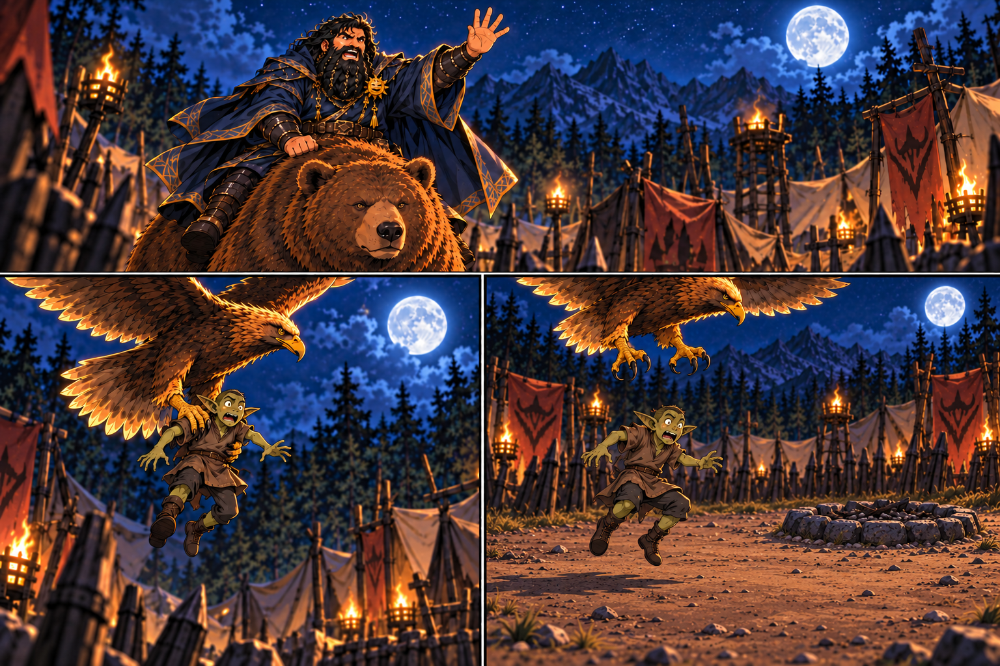

- Three consecutive panels show Dain's countdown, bird-form Tona lifting the flanking goblin, and release outside the pit before impact. Eagle appearance is an illustrative continuity choice; Tona's possible Tina alias remains unconfirmed. Drop height, poses, goblin expression/clothes, unlit pit, camp arrangement, banners/marks, braziers, light and scenery are illustrative. No damage, injury/death/survival, intimidation outcome, accepted negotiations, actual hellfire or discovered faction emblem is established. [Image notes](./2026-10-10/countdown-bird-form-warning-image-notes.md).

- Discord: [countdown and bird-form warning posted to THe](https://discord.com/channels/958554312185884723/1497086827365142530/1558431734939263066); exact caption, thread, webhook, attachment filename and byte size confirmed by publisher response and separate message readback. Post ID: `2026-10-10-038-countdown-bird-form-warning`; fingerprint: `8a513c2131bc13a0d363101534a34a83087f852c24efb0164b56a5c047c87dcd`.

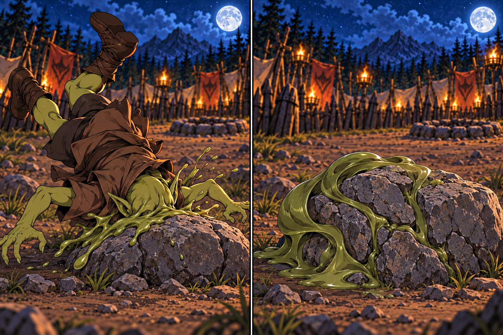

- Two consecutive panels show the same dropped goblin hitting a rock, then goop wrapping around and into its crevices. Colour/composition, impact pose/contact point, clothing fate, rock shape, flow, camp layout/banners/lights and exact absorption process are illustrative. No death/survival, damage number, complete disappearance, named spell/creature type or camp/party reaction is established. [Image notes](./2026-10-10/flanking-goblin-rock-goop-image-notes.md).

- Discord: [rock impact and goop change posted to THe](https://discord.com/channels/958554312185884723/1497086827365142530/1558433536036438127); exact caption, thread, webhook, attachment filename and byte size confirmed by publisher response and separate message readback. Post ID: `2026-10-10-039-flanking-goblin-rock-goop`; fingerprint: `2063583f781d2b2333de279743bccc36901d6d5288d9c437a4f4a1f81e4def18`.

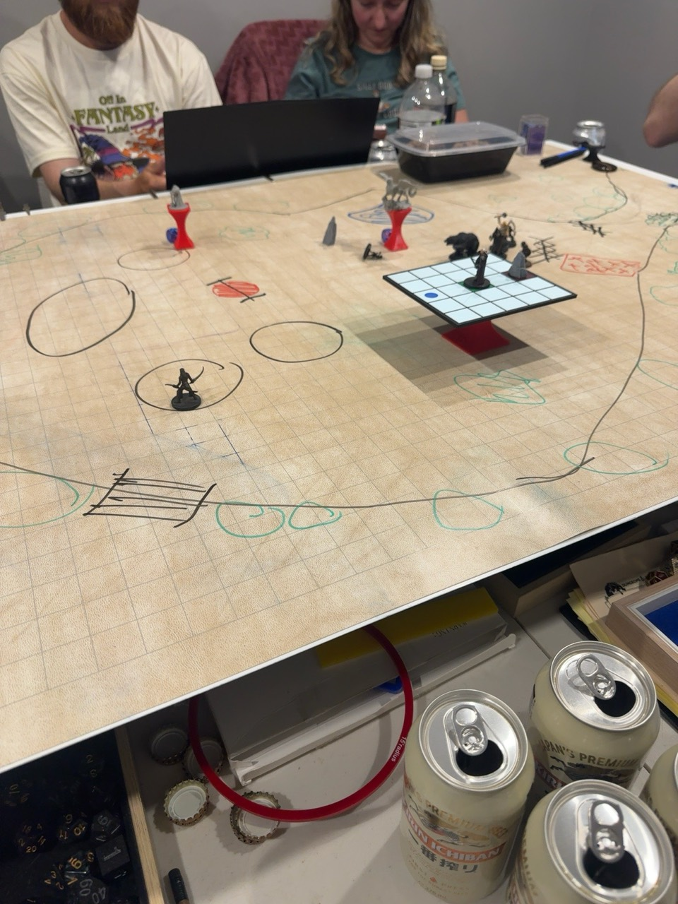

- Supplied table photo archived unchanged; drawn lines/ovals, miniatures and raised grid remain unkeyed, without assigned creature identities, scale, altitude, direction or proof of centre arrival/owl response. Local archive only; not posted to Discord or used as character likeness.

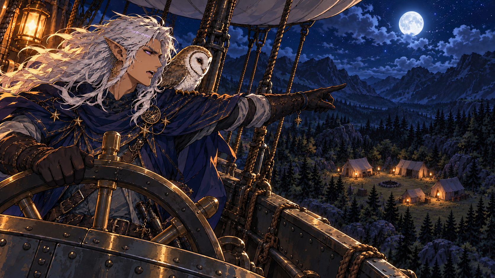

- Kagrenac pilots the metal blimp and gives the owl its order, with camp tents ahead. Owl perch, gestures, helm/ship crop, speed/altitude, camp arrangement/count, lanterns, unlit pit and scenery are illustrative. No centre arrival, actual owl flank/flight, target, Help/advantage, attack, spell, population count or camp reaction is established. [Image notes](./2026-10-10/kagrenac-blimp-owl-order-image-notes.md).

- Discord: [Kagrenac's blimp movement and owl command posted to THe](https://discord.com/channels/958554312185884723/1497086827365142530/1558436365035896862); exact caption, thread, webhook, attachment filename and byte size confirmed by publisher response and separate message readback. Post ID: `2026-10-10-040-kagrenac-blimp-camp-middle-owl-order`; fingerprint: `ef0d2b542a5f5a89c3cd8b99dcad022e43675a773eb01f4b407e476b78bc03a0`.

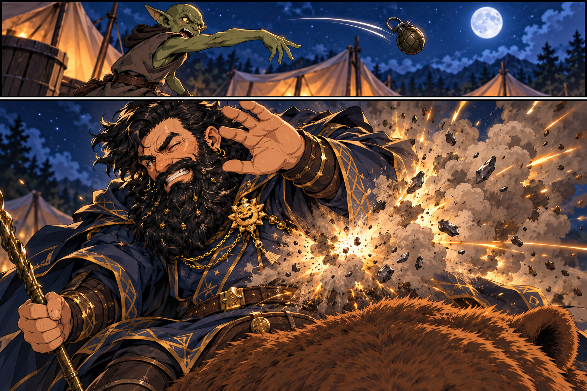

- Sequential panels show one anonymous goblin's grenade throw and Dain taking the reported 11 damage, still mounted on Stu. Attacker appearance, weapon design, fuse/detonation, blast size/fragments/light, Dain's recoil/hand pose, crop and camp scenery are illustrative. No damage type, save, other party damage, shield spell, dismount, injury detail, casualty, retaliation or current HP is established. [Image notes](./2026-10-10/goblin-grenade-dain-damage-image-notes.md).

- Discord: [goblin grenade and Dain's 11 damage posted to THe](https://discord.com/channels/958554312185884723/1497086827365142530/1558439078003740793); exact caption, thread, webhook, attachment filename and byte size confirmed by publisher response and separate message readback. Post ID: `2026-10-10-041-goblin-fragmentation-grenade-dain-hit`; fingerprint: `a5e078c8519a84dc9b749f8ccf0b381b4f8b426a0d786f0f259008cf6ae01e67`.

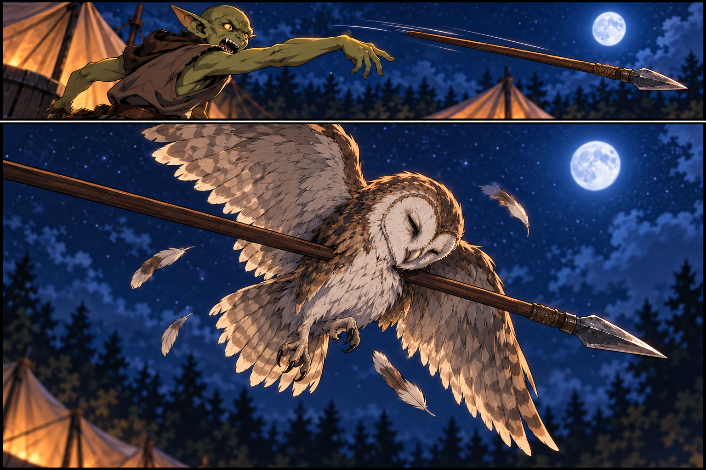

- Two sequential panels show the same goblin throwing one javelin and the established small brown-and-white owl killed by the strike. Attacker appearance, javelin design, owl flight/pose, impact placement, feathers and night/tent scenery are illustrative. Death and attacker continuity are supplied; range, numerical damage, exact location/body landing, familiar identity, magical disappearance and Kagrenac's reaction are unreported. [Image notes](./2026-10-10/goblin-javelin-owl-death-image-notes.md).

- Discord: [goblin javelin and owl death posted to THe](https://discord.com/channels/958554312185884723/1497086827365142530/1558441958655918190); exact caption, thread, webhook, attachment filename and byte size confirmed by publisher response and separate message readback. Post ID: `2026-10-10-042-goblin-javelin-kills-kagrenac-owl`; fingerprint: `23998f4ea2f94af6006c320ecff51465f3b69f4b3bf9d7d985ec0c5b2eba0a8b`.

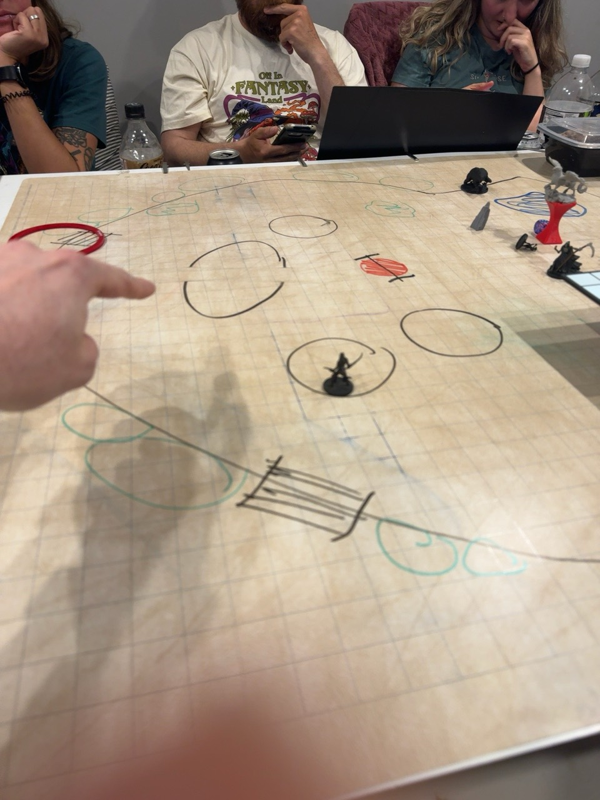

- Supplied tabletop photo saved unchanged. Drawn ovals/lines, red mark, miniatures, pointed area and raised pieces remain unkeyed; no grid scale, tent dimensions, identified miniature, exact range or spell path is inferred. The confirmed fire-pit route and front/back holes come from the narration.

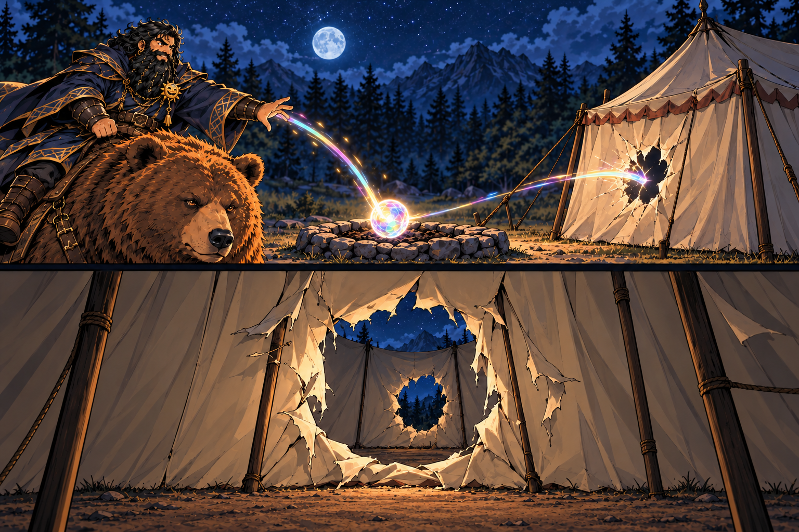

- Dain's shot through the fire pit and the main tent's front/back holes are supplied outcomes. His pose on Stu, prismatic color, curved trail, pit shape/unlit ash, tent construction, hole dimensions, cloth scraps and night scenery are illustrative. The view establishes no chosen damage type, general projectile rule, tent fire/collapse, occupant/contents count, creature damage or camp reaction. [Image notes](./2026-10-10/chromatic-orb-main-tent-image-notes.md).

- Discord: [Chromatic Orb through the main tent posted to THe](https://discord.com/channels/958554312185884723/1497086827365142530/1558444351514878134); exact caption, thread, webhook, attachment filename and byte size confirmed by publisher response and separate message readback. Post ID: `2026-10-10-043-dain-chromatic-orb-main-tent`; fingerprint: `3a06c7000458419936804430b1b98ad533912758696b66d511fdae2cdb4a88e3`.

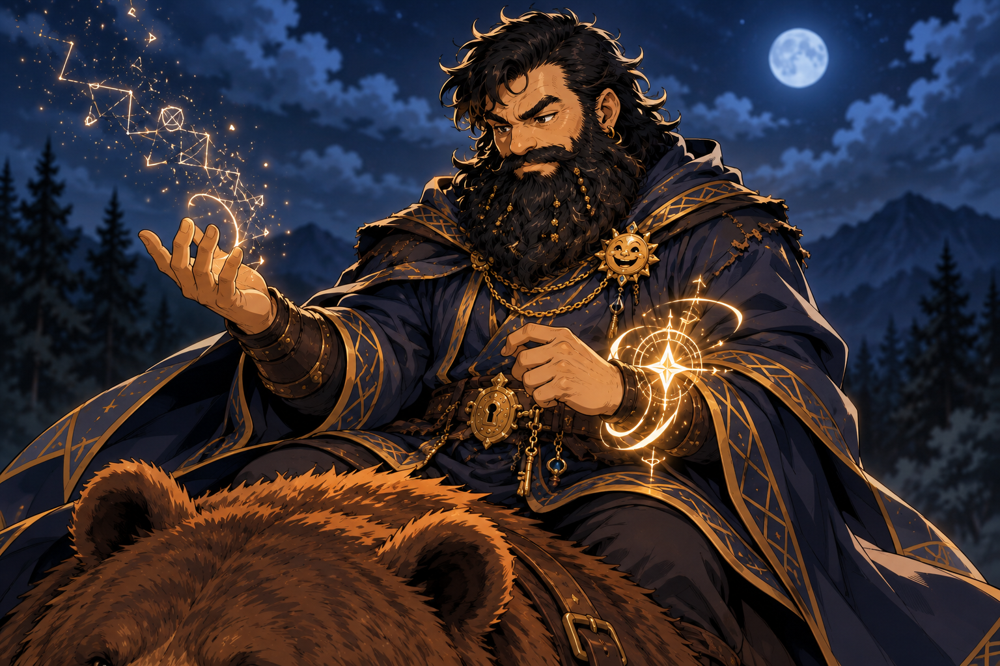

- Dain remains in his last supplied bear-mounted posture while the concentration change is shown through symbolic fading geometry and a self-directed wrist glyph. Pose, expression, magic colors/shape, clothes and night background are illustrative. The cast and Suggestion ending are supplied; no actual Dash, movement/dismount, bear buff, captive position/reaction or physical release is established. [Image notes](./2026-10-10/expeditious-retreat-concentration-image-notes.md).

- Discord: [Expeditious Retreat and Suggestion ending posted to THe](https://discord.com/channels/958554312185884723/1497086827365142530/1558447516482019393); exact caption, thread, webhook, attachment filename and byte size confirmed by publisher response and separate message readback. Post ID: `2026-10-10-044-expeditious-retreat-suggestion-ended`; fingerprint: `b680d4a3d170df57b8846921f6f568bf4ec7523d7d77f5d7a7cc5ecc1c27d57f`.

### Dain Spots The Wall Crack Flank

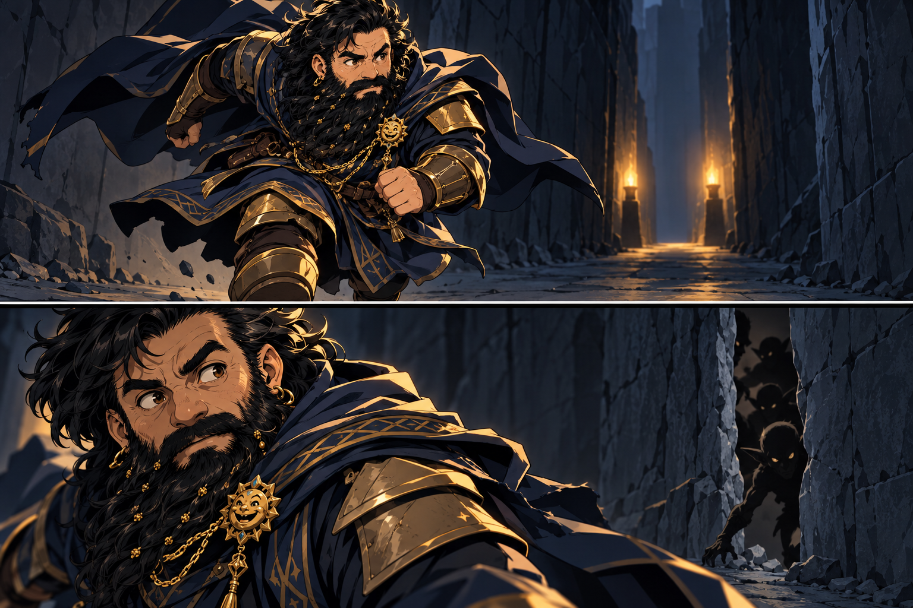

- Dain's run and discovery are confirmed. Wall material/height, torches, route geometry, expressions, timing and visible silhouette count are illustrative; the emerging goblins' identities and total remain unknown. No arrival, attack, formal Dash or automatic flanking advantage is established. [Image notes](./2026-10-10/bottleneck-wall-crack-image-notes.md).

- Discord: [Wall-crack flank discovery posted to THe](https://discord.com/channels/958554312185884723/1497086827365142530/1558451067942076611); exact caption, thread, webhook, attachment filename and byte size confirmed by publisher response and separate message readback. Post ID: `2026-10-10-045-bottleneck-wall-crack-flank`; fingerprint: `2892ddaa4c6e8cf5843942f2e5afc310acd5dc7b3b4babaf50dfe0ecccde2bbc`.

### Bottleneck And Wall Crack Table Photo

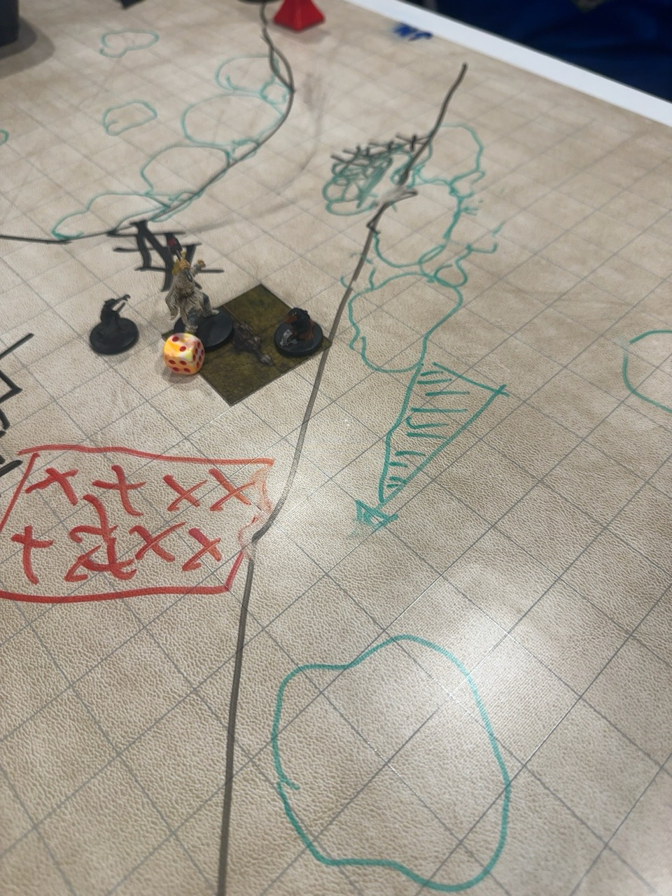

- Supplied photo copied unchanged. No scale, north, miniature identity, die result, count of emerging goblins or exact terrain positions are inferred.

### Taleesh's Tent Exit And Two Dagger Strikes

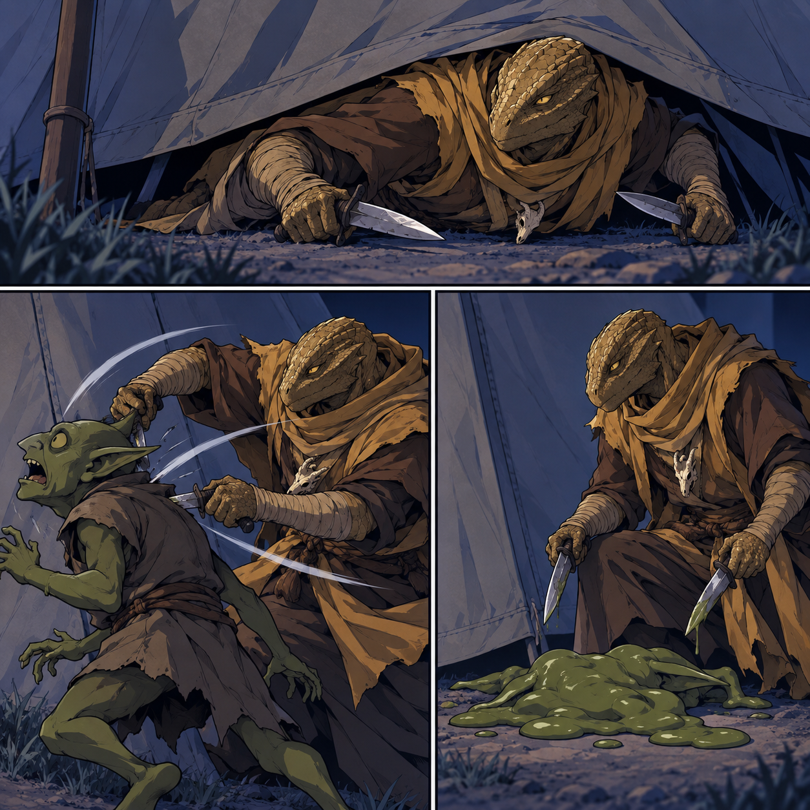

- Under-tent emergence, two dagger stabs and “jellyfies” are supplied; −19 is the reported goblin HP/result. Poses, canvas, placement, motion arcs and the green jelly-like aftermath are illustrative. Target/tent identity, precise physical transformation and attack mechanics remain unreported. [Image notes](./2026-10-10/taleesh-tent-exit-image-notes.md).

- Discord: [Taleesh's two-dagger scene posted to THe](https://discord.com/channels/958554312185884723/1497086827365142530/1558452863036948632); exact caption, thread, webhook, attachment filename and byte size confirmed by publisher response and separate message readback. Post ID: `2026-10-10-046-taleesh-tent-exit-two-daggers`; fingerprint: `40232d78aeddfb9d1411974cbc9f3ba6c923311520891706e638339dc43cfc7b`.
