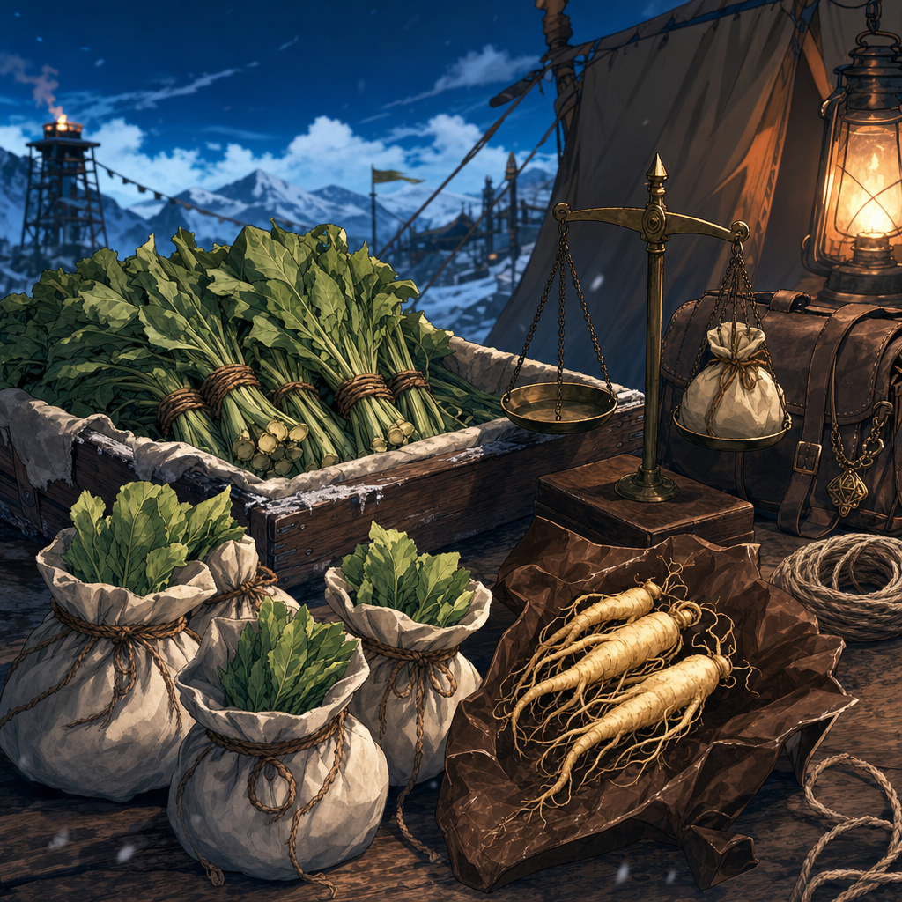

# Party Loot

## Source
- Shared party inventory and payments that are not Dain's personal gear.
- [To verify] Confirm which party member physically carries each item when it matters for weight, access, theft risk, or use in combat.

## Precious Gems - Creature-Trail Cave - 2026-10-03

- [Party] [Confirmed] The party finds **precious gems worth 5,000 gp in total** in the [cave reached by the creatures' trail](../Codex/Places/Creature-Trail%20Cave%20-%202026-10-03.md). [Session](../Adventures/2026-10-03.md)
- Status: **discovered**. Gem types, count, individual values, weight, collection, carrier, storage and distribution remain unreported.
- The stated **5,000 gp** is the gems' total value. No sale, coin payout or personal share is reported; the existing coin-pot snapshot below is not increased by this find.

## Mined Spell-Storing Crystals - 2026-10-03

- [Confirmed] Norhan's Harry leashes [Jiminy](../Codex/Characters/Jiminy.md), who mines very proficiently during a **five-hour break** and finds [crystals that each can store one 1st-level spell](../Codex/Items/Spell-Storing%20Crystals%20-%202026-10-03.md).
- [Confirmed distribution] Harry gives **one crystal to Dain**, now recorded in his [Inventory](./Inventory.md#magic-items). Total mined yield and holders of the remainder are unreported.
- [Confirmed second batch] The party stays **another five hours**, and Jiminy mines **six additional gems**. The two stretches total **ten hours** [Derived]. Initial yield and combined total remain unreported; the new six have no reported holder or allocation. They are tracked with the same mining operation by continuity, without assigning an individual gem type or extra value.
- [Latest confirmed holding] Dain acquires **another spell-storing stone**, bringing his count to **two**. Matt / Kagrenac loads **Cure Wounds into one**; Dain will choose the other spell later. The second stone's giver and source batch are unreported, so no quantity is deducted from the new six-gem batch. [Personal contents](../Codex/Items/Spell-Storing%20Crystals%20-%202026-10-03.md#current-holdings).
- No spell release is reported. Value and inclusion in the earlier **5,000 gp** find remain unreported; no extra treasure value or coin payout is assigned. [Session](../Adventures/2026-10-03.md)

## Special Gem Found By Harry - 2026-10-03

- [Confirmed table discovery; roster attribution] Norhan's [Hammerton Harry Drizddon](../Codex/Characters/Hammerton%20Harry%20Drizddon.md) finds **one special gem commonly associated with spell storing**. [Item record](../Codex/Items/Special%20Gem%20Found%20by%20Harry.md); [Session](../Adventures/2026-10-03.md)
- Finder: **Harry**. Retention, ownership and storage remain unreported; exact item identity, functional abilities and any stored spells are unconfirmed.
- Value is unreported. Whether it is included in the preceding **5,000 gp** gem find or is additional remains unknown; no extra value or personal share is assigned.

## Displacer-Beast Harvest - 2026-10-03

- [Party] [Confirmed] The party defeats the displacer beasts at the storm stop and immediately **begins harvesting hides and other unspecified parts/materials**. [Session](../Adventures/2026-10-03.md)
- [In progress] Successful yields, item names beyond hides, quantities, condition, values, holders and storage remain unreported. No completed hide or other material is added to the holdings below yet.
- [To verify] Record the actual harvest results and who carries them. Do not assume storage in the Chest of Preserving or ownership by Kagrenac or Dain.
- [Latest storage follow-up] The party later begins burying its **metal airship** at night. Whether any harvested material is stored aboard, and how existing cargo will remain accessible, are unreported. [Ship burial](../Codex/Places/Party%20Skyship%20-%202026-08-29.md#night-burial---2026-10-03)

## Current Party Tracker - Imported 2026-09-12

- [Party] [Confirmed] Current tracker supplied by Maitland; [original screenshots](../Adventures/2026-09-12-party-tracker.md). These are current recorded holdings and allocations, not newly narrated acquisitions or proof of distribution.
- Historical receipts below remain provenance; do not add the earlier `500 gp`, payments or other historical amounts to this current pot without reconciliation. An item absent from these screenshots is not thereby lost, spent or removed.

### Coin Pot And Shares

| PP | GP | EP | SP | CP |
| ---: | ---: | ---: | ---: | ---: |
| 0 | 1144 | 740 | 2099 | 1400 |

Holder labels and displayed precision follow Photo 1. Every holder has `Number = 1`; `Current Pot` cells and individual PP cells are blank.

| Holder as written | Number | GP | EP | SP | CP displayed |
| --- | ---: | ---: | ---: | ---: | ---: |
| Biggus | 1 | 143 | 92.5 | 262.375 | 155.5555556 |
| Dane | 1 | 143 | 92.5 | 262.375 | 155.5555556 |
| Harry | 1 | 143 | 92.5 | 262.375 | 155.5555556 |
| Havana | 1 | 143 | 92.5 | 262.375 | 155.5555556 |
| Kagrenac | 1 | 143 | 92.5 | 262.375 | 155.5555556 |
| Talesh | 1 | 143 | 92.5 | 262.375 | 155.5555556 |
| The Ship | 1 | 143 | 92.5 | 262.375 | 155.5555556 |
| Supplies | 1 | 143 | 92.5 | 262.375 | 155.5555556 |
| Feral | 1 | 0 | 0 | 0 | 155.5555556 |

- [Calculated from displayed values] GP, EP and SP divide across eight holders; CP divides across nine, including Feral. The repeating copper share is rounded for display. Whether this difference is intentional, and how fractional coins are settled, remain [To verify].
- [Inferred] `Dane` may be [Dain](../Codex/Characters/Dain%20Truthammer.md), and `Talesh` may be [Taleesh](../Codex/Characters/Brother%20Taleesh.md). Confirm before assigning personal currency. `The Ship` and `Supplies` are allocation labels, not additional characters.
- [To verify] Biggus, Havana and Feral's identities/player mappings, and whether any displayed share has actually been paid out. Dain's personal purse is not overwritten by this allocation table.

### Ship Hold

From Photo 2. A dash below means a blank source cell, not a zero or a confirmed absence. `Character` is the source column; it does not necessarily establish personal ownership.

| Item as shown | Count | Character | Notes |
| --- | --- | --- | --- |
| Spiked chain | 100 feet | Kagrenac | Possible duplicate of the other chain row below |
| Barrels | 2 | — | — |
| Block and Tackle | 4 | — | — |
| Books (empty) | 4 | — | — |
| Caltrops (bags) | 4 | — | — |
| Chain (feet) Spiked | 100 | — | Possible duplicate; do not sum to 200 feet |
| Chest | 1 | — | — |
| Flasks | 40 | — | — |
| Glass bottles | 40 | — | — |
| Grappling hooks | 4 | — | — |
| Incense - Spells | BULK (sure) | — | Exact quantity unrecorded |
| Manacles | 10 | — | — |
| Miner's picks - Stout dwar... | 4 | — | Source label is clipped; full descriptor [To verify] |
| Parchment (sheets) | 40 | — | — |
| Potion of Healing | 10 | — | Exact potion rules [To verify] |
| Sack | 10 | — | — |
| Silk Rope | 710 | — | Source note: "Extra 250 from first town"; unit and inclusion of the extra 250 [To verify] |
| Torch | 10 | — | — |

- [To verify] Reconcile the silk rope with Dain's earlier recorded `250 ft`; do not add 250 to 710 or count the same rope as both personal and ship stock without confirmation.
- [Party] The [deck plan](../Adventures/2026-09-12-party-tracker.md#photo-4---balloon-ship-deck) additionally labels `B. of Beer x 2` and `Barrel x 2`. Whether these are four distinct barrels or overlapping labels is [To verify].

### Chest Of Preserving

| Item as shown | Count | Character | Notes |
| --- | ---: | --- | --- |
| Chimera - Flame Organ | 1 | Kagrenac | Damaged |
| Chimera - Eggs | 4 | — | — |
| Ogre Blood - Vial | 3 | Kagrenac | — |
| White Dragon Blood Vial | 2 | Kagrenac | — |
| Manticore Eyes | 4 | Kagrenac | — |
| Manticore Venom Gland | 1 | Kagrenac | — |
| Manticore Venom - 1 unit | 1 | Kagrenac | — |

- [Party] [Confirmed] These materials are listed in the Chest of Preserving. Exact harvesting dates, sources, preservation mechanics, usable properties and egg viability remain [To verify]. The chimera labels do not by themselves prove these came from the 29 August attackers.

### Ship Equipment And Communications

- [Party] [Confirmed] The [ship tracker](../Codex/Places/Party%20Skyship%20-%202026-08-29.md#current-ship-tracker---imported-2026-09-12) lists a ballista with `20` bolts, an Orb of Navigation with note `Regional map - TH mountain`, a Rogue Trader Warrant and Navigator's Tools. Exact item mechanics and warrant authority remain [To verify].
- [Party] [Confirmed] The [Sending Stones register](../Codex/Items/Party%20Sending%20Stones.md) links Kagrenac to the Dwarf General and records another stone with Kagrenac, found in a Bag of Holding taken from Yuan-Ti spies, whose partner is unknown.

## Herbal Payment From Southern Human Traders
- Agreement: half now, half later for helping or escorting the [Southern Human Traders](../Codex/Factions/Southern%20Human%20Traders.md) after Dain's natural `20` Persuasion check. [Party] [Confirmed on 2026-05-03]
- Upfront payment received now:
  - [Burdock](../Codex/Items/Burdock.md) x10 oz, valued at `1 sp/oz` for `10 sp` total. [Party] [Confirmed]
  - [Ginseng](../Codex/Items/Ginseng.md) x2 oz, valued at `2 gp/oz` for `4 gp` total. [Party] [Confirmed]
- Upfront payment value: `5 gp` equivalent. [Party] [Confirmed]
- Later payment: second half remains owed. Exact contents, coin value, timing, and collection condition are [To verify].
- Addendum after the [Coal Mine Puppet](../Codex/Items/Coal%20Mine%20Puppet.md) reveal: Dain keeps the original deal but adds that, upon delivery, the traders owe the party five questions answered truthfully. [Party] [Confirmed on 2026-05-03]
- Current carrier: [To verify].

## Non-Material Claims
- Five truthful answers from the [Southern Human Traders](../Codex/Factions/Southern%20Human%20Traders.md), owed upon delivery after Dain defuses Hammerton / Dresden's push for more payment. [Party] [Confirmed]
- Draft 2026-05-30 puppet questions: chain of custody; what the puppet is; which coal mines it wants and what waits there; what happens if it is returned/destroyed/abandoned/stolen/kept away; and why it reacted to Dain praying to [Garl Glittergold](../Codex/Lore/Garl%20Glittergold.md), invoked [Kurtlemack](../Codex/Lore/Kurtlemack.md), and said "you." [Party] [To verify final wording asked in play]
- Delivery target: [To verify], likely connected to [Ola Dung Lot](../Codex/Places/Ola%20Dung%20Lot.md).
- Question holder / asker: [To verify].
- Enforcement: [To verify] whether this is honor-bound, magically binding, or merely negotiated.

## Stolen From Goblin Camp
- [Goblin Camp Chest](../Codex/Items/Goblin%20Camp%20Chest.md), stolen by the moon elf and fighter dwarf while the goblins were under the influence of the styx / sytxweed potion during the party's exit from the camp. [Party] [Confirmed on 2026-05-03] [To verify carrier, lock/trap status, and whether "moon elf" / "fighter dwarf" correspond to Kagrenac / Hammerton]
- `500 gp`, found when the moon elf and Norhan opened the [Goblin Camp Chest](../Codex/Items/Goblin%20Camp%20Chest.md). [Party] [Confirmed on 2026-05-03] [To verify carrier/split]
- [Mask of Changed Appearance](../Codex/Items/Mask%20of%20Changed%20Appearance.md), found in the [Goblin Camp Chest](../Codex/Items/Goblin%20Camp%20Chest.md). It has `3` charges; as a magical action the wearer can spend `1` charge to change their face's appearance, and the mask cannot be seen while the appearance is changed. [Party] [Confirmed on 2026-05-03] [To verify carrier, attunement, duration, and recharge]

## Dragon Remains Artisan Deal
- Six dragon corpses/remains in the [unnamed town](../Codex/Places/Unnamed%20Town%20-%202026-06-20.md). [Party] [Confirmed from 2026-06-20 notebook notes] [To verify dragon type, ownership, material condition, and exact usable parts]
- Town artisans have struck a deal with Truthhammer / Dain: they make equipment in exchange for the dragon material itself. [Party] [Confirmed from 2026-06-20 notebook notes] [To verify whether the equipment is for Dain, the party, the town, or named recipients; exact item list; delivery timing; and whether any material remains]

## Dice Table Silver And Stakes
- Dain provides [Dain's Seal](../Codex/Items/Dains%20Seal.md) to Harry / [Hammerton Harry Drizddon](../Codex/Characters/Hammerton%20Harry%20Drizddon.md) in exchange for `100 gp` worth of silver, then bets that silver in the dice game with [Brother Taleesh](../Codex/Characters/Brother%20Taleesh.md). [Party] [Confirmed from 2026-06-20 notebook notes] [To verify exact seal object, whether Harry is Hammerton, and whether the silver is personal, party, or table stake]
- Dain is unable to influence the dice and loses that betting round. [Party] [Confirmed from 2026-06-20 notebook notes]
- [Ollyander](../Codex/Characters/Ollyander.md) ends up winning. [Party] [Confirmed from 2026-06-20 notebook notes]
- A human/townsperson from before is involved in a trade with Ollyander worth `60 gp` in silver. [Party] [To verify direction of trade, current holder, whether this is the human who ran away, and whether it belongs in party loot or Ollyander's personal inventory]

## Ola Dung Lot Requisition
- [`Magic Mouth` Spell Scrolls](../Codex/Items/Magic%20Mouth%20Scrolls.md): `5` acquired on 2026-08-29; **3 now confirmed in Dain's possession** on 2026-09-12. This replaces the earlier provisional four after the [alarm cast](../Codex/Items/Cave%20Alarm%20Ball%20Bearing.md). Dain confirms a failed transcription consumed one scroll, explaining the reduction to three. Magic Mouth remains unlearned; no exact copying costs are recorded.

## Open Questions
- [To verify] Which party member carries the burdock and ginseng.
- [To verify] Whether any herb is consumed before the traders pay the second half.
- [To verify] Whether the later half matches the first half in value, contents, or both.
- [To verify] Which five truthful questions the party asks upon delivery.
- [To verify] Who carries the opened [Goblin Camp Chest](../Codex/Items/Goblin%20Camp%20Chest.md), who carries or splits the `500 gp`, who claims the [Mask of Changed Appearance](../Codex/Items/Mask%20of%20Changed%20Appearance.md), the mask's duration/recharge/attunement, and whether taking it creates future trouble with the goblins.
- [To verify] Exact artisan equipment order from the dragon remains and whether this creates shared party gear, Dain-specific gear, or town obligations.
- [To verify] Final dice-table accounting after the 2026-06-20 game: who holds [Dain's Seal](../Codex/Items/Dains%20Seal.md), who holds the `100 gp` worth of silver Dain bet, what Ollyander won, and how the human/townsperson's `60 gp` worth of silver was exchanged.
- [To verify] Whether the cave alarm used a scroll as assumed, and whether Dain reserves another for transcription after his confirmed failed attempt. Three remain; copying costs and roll are unrecorded.

## Related Entries
- [Burdock](../Codex/Items/Burdock.md)
- [Ginseng](../Codex/Items/Ginseng.md)
- [Southern Human Traders](../Codex/Factions/Southern%20Human%20Traders.md)
- [Ola Dung Lot](../Codex/Places/Ola%20Dung%20Lot.md)
- [Hammerton Harry Drizddon](../Codex/Characters/Hammerton%20Harry%20Drizddon.md)
- [Brother Taleesh](../Codex/Characters/Brother%20Taleesh.md)
- [Ollyander](../Codex/Characters/Ollyander.md)
- [Dain's Seal](../Codex/Items/Dains%20Seal.md)
- [Unnamed Town - 2026-06-20](../Codex/Places/Unnamed%20Town%20-%202026-06-20.md)
- [Coal Mine Puppet](../Codex/Items/Coal%20Mine%20Puppet.md)
- [Kurtlemack](../Codex/Lore/Kurtlemack.md)
- [Session 2026-05-03](../Adventures/2026-05-03.md)
- [Session 2026-06-20](../Adventures/2026-06-20.md)
- [Magic Mouth Scrolls](../Codex/Items/Magic%20Mouth%20Scrolls.md)
- [Session 2026-08-29](../Adventures/2026-08-29.md)
