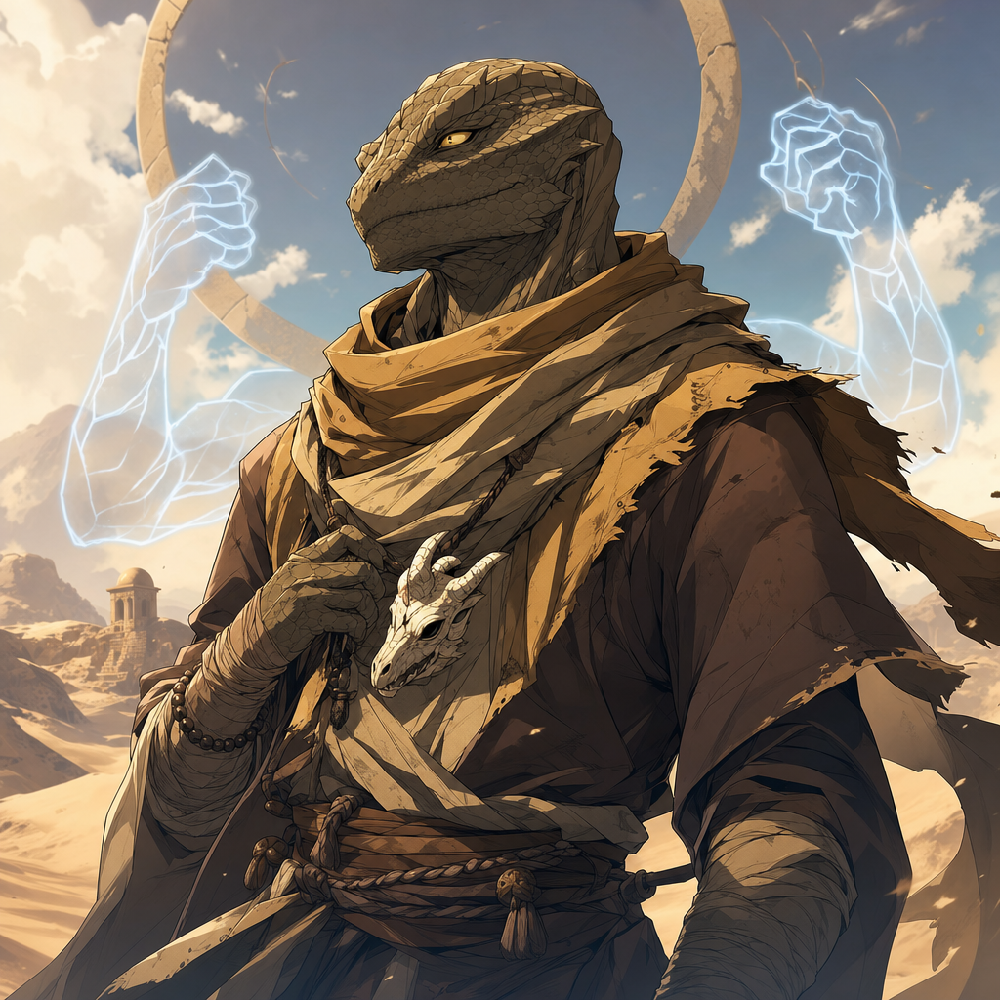

# Brother Taleesh

## One-Line Summary
Jackson's lizardfolk monk, a desert survivor called the Keeper of the Dunes, carrying a scorched goat-bone charm and deep distrust for elves and dwarves.

## Table Role
- Role: Player Character.
- Player: Jackson / Jack / Jackbo.
- DM: Tom.

## Status
- [Latest confirmed action, 2026-10-10] **Taleesh does a perimeter sweep and goes to check out the [unnamed gorge](../Places/Unnamed%20Gorge%20-%202026-10-10.md).** [Character-only; Belief] He has a vague idea that the earlier arrow came from there. No confirmed firing direction, shooter, finding, skill roll, movement distance, precise position, descent, confrontation or new resource use is supplied. No communication of the hunch to Dain or others is reported; Wet has no reported ending. [Session](../../Adventures/2026-10-10.md); [arrow follow-up](../Lore/Open%20Threads.md#arrow-glances-off-harrys-armour).
- [Latest confirmed interaction, 2026-10-10] **[Dain](./Dain%20Truthammer.md) emerges as Leaky Tent disappears in steam, yells and tries to pick up Taleesh but is unable. Dain then runs 25 feet and does nothing further.** Taleesh is not lifted/carried; his response, exact grip/position, roll and reason the attempt fails are unreported. No injury, forced movement, ki/astral-arm use, resource expenditure or Wet ending is assigned. [Session](../../Adventures/2026-10-10.md).
- [Preceding Taleesh wake-up, 2026-10-10] **Taleesh runs into [Leaky Tent](../Powers/Truthammer%20Leaky%20Tent.md#current-riverside-casting---2026-10-10), wakes [Dain](./Dain%20Truthammer.md), shares the hand-grasp meme and brings him into the battle.** Dain is now awake and participating. [Derived custom rule] Taleesh becomes **Wet** on entry: fire resistance, cold/lightning vulnerability; no ending is reported. No astral-arm activation, ki expenditure, roll or numerical resource change is supplied. [Session](../../Adventures/2026-10-10.md).
- [Later binding clarification, 2026-10-10] Both goblin prisoners are now **cuffed together at both hands and feet**, conjoined through their restraints. This follows Taleesh's initial manacling but assigns no new fastening/rearranging action to him or another named character. Source/count, fine cuff/chain details, keys and mechanics remain open; no waking or chest recovery is supplied. [Manacles](../Items/Manacles%20-%20Goblin%20Restraint%20-%202026-10-10.md).
- [Earlier party encounter; Dain unaware then] [Preceding Taleesh action, 2026-10-10] **Taleesh runs up and puts [manacles](../Items/Manacles%20-%20Goblin%20Restraint%20-%202026-10-10.md) on both sleeping [goblins](./Goblin%20Intruders%20-%202026-10-10.md), restraining them.** That action supplied no waking, injury or chest recovery. Source/count, fine cuff/chain details, keys and mechanics remain unreported; no formal Restrained condition, stock deduction or ki use is assigned. [Session](../../Adventures/2026-10-10.md); [encounter](../Lore/Open%20Threads.md#goblins-in-the-balloon-carriage).
- [Earlier Taleesh action, 2026-10-10] Taleesh tries to grapple the goblins but fails to catch them; they continue running with the chest at that point. No roll, number of attempts, injury or extra consequence is supplied.
- [Preceding party outcome, 2026-10-10] Stu chases in brown-bear form; Kagrenac puts both goblins to sleep. They fall dramatically, with the chest causing a dirt slide. [Session](../../Adventures/2026-10-10.md).
- [Party] [Confirmed earlier action, 2026-10-10] The goblins jump off the balloon carriage and disappear into two clouds of darkness. Brother Taleesh jumps down into the farther cloud and swings blindly, rolling a **natural 1**. Maitland explicitly confirms **he just misses; nothing else happens to him**. Attack form/weapon, exact target, position and cloud mechanics remain unreported. [Session](../../Adventures/2026-10-10.md).
- [Confirmed] Onboarded from user-provided backstory and sheet images on 2026-05-03.
- Source images: [charsheet1](../../Assets/Brother%20Taleesh/charsheet1.png), [charsheet2](../../Assets/Brother%20Taleesh/charsheet2.png).
- [Confirmed] Player: Jackson.
- [Confirmed] Player aliases from user roster: Jackson / Jackbo.
- Narration shorthand `Jack` is resolved through that roster entry in the 2026-10-10 blind-swing scene.
- [To verify] The sheet image appears to list player name `Jakabo`; user specified Jackson / Jackbo, so this Codex uses the user-provided roster.
- [Confirmed] Character name used by user and repo: Brother Taleesh.
- [To verify] The sheet image appears to spell the name `Brother Taal'esh`; keep `Brother Taleesh` until corrected.
- [Confirmed] Species/Race: Lizardfolk.
- [Confirmed] Class/Level: Monk 3.
- [Confirmed] Background: Ruined.
- [Confirmed] Alignment/faith notation on sheet: `TN (Fharlanghn)`.
- [Party] [Confirmed] In-world arrival at the forest camp was logged on 2026-05-03.
- [To verify] Why Brother Taleesh joins the current mountain-road mission and what he knows about it.

## Perimeter Sweep And Gorge Investigation - 2026-10-10

- The scene illustrates Taleesh investigating, following his vague hunch. Rock geometry, scale, path, gaze, posture and lighting are illustrative; no shooter, clue, successful check, cleared area, descent, new round or confirmed bearing is established. [Image notes](../../Adventures/2026-10-10/taleesh-gorge-image-notes.md).

## Truthammer's Failed Lift - 2026-10-10

- The middle panel illustrates the failed lift: Taleesh remains on both feet, while Dain strains. Pose, grip and expressions are illustrative; no successful lift, throw, fall, injury, reaction, roll, mechanical condition or astral arms is established. [Image notes](../../Adventures/2026-10-10/truthammer-steam-entrance-image-notes.md).

## Waking Truthammer And The Hand-Grasp - 2026-10-10

- Taleesh wakes Dain and brings him into the battle. The illustration freezes their clasp; pose, expression, arm emphasis and tent staging are illustrative. Only ordinary physical arms are shown; no astral arms, strength increase, Help action, advantage or resource recovery is established. [Image notes](../../Adventures/2026-10-10/taleesh-wakeup-hand-grasp-image-notes.md).

## Manacling The Sleeping Goblins - 2026-10-10

- The manacling is confirmed; cuff configuration, poses, chest placement and lighting are illustrative. Only ordinary arms are shown. No astral-arm activation, waking, injury, equipment count/source, formal condition mechanics or chest recovery is established. [Image notes](../../Adventures/2026-10-10/manacles-image-notes.md).

## Failed Grapple And Goblin Flight - 2026-10-10

- The grapple fails; no roll or additional consequence is reported. Two ordinary arms are shown without astral-arm activation. Poses, carrying grips, distance, terrain and background masonry are illustrative, with no new location, completed escape or Dain awareness established. [Image notes](../../Adventures/2026-10-10/taleesh-grapple-and-flight-image-notes.md).

## Blind Swing In The Farther Darkness Cloud - 2026-10-10

- Reported roll: **natural 1**. Explicit result: **Taleesh just misses; nothing else happens to him**.
- Face/clothing follow the portrait. Showing Taleesh at the cloud boundary is artistic presentation, not special vision. Exact stance, attack form, positions, distances and cloud properties remain unreported; no astral-arm activation, injury, falling mishap or additional resource use is established. [Image notes](../../Adventures/2026-10-10/goblin-darkness-image-notes.md).

## What Dain Knows
- [Party] Brother Taleesh has arrived at the party's forest camp by camel, approached with his scimitar at low ready, and answered Dain's challenge in Common as "just a fellow traveller."
- [Character-only] Dain invited him to join the camp.
- [Character-only] Dain reads Taleesh as standoffish and afraid, then stops and puts down his staff to reassure him. [Inferred]
- [Party] Dain sees Taleesh produce herbal items from [Taleesh's Herbal Stash](../Items/Taleeshs%20Herbal%20Stash.md) and offer comfrey, pigweed, and hedgehog mushroom. [To verify effects]
- [Party] Dain hears Taleesh offer goji leaves, saying the first one is free and that taking one will make the taker "feel like a god." [To verify actual effects]
- [Character-only] Dain refuses the goji leaves and says the Truthhammers do not alter themselves in such ways.
- [Party] Dain sees Taleesh spend 1 ki point and project ghostly astral arms from his shoulders without using them aggressively.
- [Character-only] Dain responds by telling [The Festival Of Completely Unnecessary Lanterns](../Lore/Truthammer%20Tales/The%20Festival%20Of%20Completely%20Unnecessary%20Lanterns.md), offering to make a lantern with Taleesh, and conjuring a warm cloak.
- [Party] Dain uses `Prestidigitation` and `Minor Conjuration` together to give Taleesh a warm cloak for the remainder of the night.
- [Party] Taleesh approaches and introduces himself to the party after Dain and the party agree to keep him warm if he joins them.
- [Party] Taleesh gives Dain one pound of hedgehog mushroom, and Dain begins hollowing it into a [Hedgehog Mushroom Lantern](../Items/Hedgehog%20Mushroom%20Lantern.md).
- [Character-only] Dain records `+17` respect toward Taleesh after the hedgehog mushroom gift and lantern-making start.
- [Character-only] Dain tracks `50%` trust with Taleesh as of 2026-05-03.
- [Character-only] Taleesh / Jackson gains `+3` respect as of 2026-05-03. [To verify respect direction]
- [Party] During the smoky cave encounter, Taleesh bites and strikes the [Werebear at Smoky Cave](./Werebear%20at%20Smoky%20Cave.md), then says "ouch." [To verify damage and whether the bite has any special consequence]
- [Party] During the same fight, the werebear swings a greataxe at Taleesh / Jackson, rolls a natural `1`, and loses the weapon onto the cave roof out of reach.
- [Party] On 2026-05-30, Taleesh gives Dain a good-quality large pelt and asks him to make it into always-warm leather.
- [Character-only] Dain accepts with creative freedom, constraints, and "his own spin," beginning the [Sauna Pelt](../Items/Sauna%20Pelt.md).
- [Party] On 2026-06-20, Taleesh invites Dain to play dice in a tavern before leaving.
- [Character-only] Dain concludes Taleesh cheated at dice and reduces respect by `-11`.
- [Party] Taleesh offers Dain weed, says "Brother Truthammer, it's just a little fun and games," tries to end the game after detecting Dain's counterplay, then fails Dain's `Suggestion` save to "Complete the game." [To verify exact motive, wording, final stakes, and party reaction]
- [Party] [To verify who overheard] During the 2026-07-11 long rest, Dain apologizes for his dice-game actions and says he meant to teach a moral lesson about virtue. Taleesh replies, "It's the Truthammer virtue, not Taleesh virtue."
- [Character-only] During the same long rest, Dain tells Taleesh that a friend helped him escape Truthhammer Mountain through these tunnels one hundred years ago and sacrificed himself to pursuing troopers.
- [Party] Dain completes the [Sauna Pelt / Sauna Jacket](../Items/Sauna%20Pelt.md) for Taleesh: always warm in cold environments, with wetness that makes the surrounding area smell like female white-wolf piss.
- [Party] Taleesh graciously accepts the completed Sauna Jacket and loves it. He remains its owner, but it was later left behind in a town; he and Dain intend to return eventually to retrieve it. The jacket makes the surrounding area smell like female white-wolf piss. [To verify exact town and storage location]
- [Character-only] The notebook records `+13` respect connected to Taleesh. [To verify direction and resulting total]
- [Party] On 2026-08-29, Taleesh succeeds at the metal-offering ritual at Moradin's shared-wall forge without showing pain. Dain had warned that Moradin protects believers and may not protect Taleesh. Taleesh's composure and desire for the experience itself produce a respect result of `18`. [To verify respect-tracker meaning, offering, retrieved object, concealed pain and unseen injury]
- [Party] Before leaving the immediate chamber scene in a surprised state, Taleesh tells Dain, “As the moon hits the eye, I’d like to go be a pizza pie.” [To verify meaning, destination and cause of surprise]
- [To verify] Whether Dain knows any of Taleesh's backstory, faith, tribal loss, monastery history, or distrust of dwarves and elves.

## What The Party Knows
- [Party] Brother Taleesh arrives by camel, secures the animal in a sheltered area, and crouches at the camp.
- [Party] Kagrenac addresses Taleesh in Draconic after casting `Thaumaturgy` on himself.
- [Party] Kagrenac then tells the party in Common that "a lizard has arrived," referring to Taleesh.
- [Character-only] Dain initially misunderstands that announcement as referring to Hammerton's severed lizard head rather than Taleesh, then realizes the mistake and booms "Who goes there?" with `Prestidigitation`.
- [Party] Taleesh approaches with scimitar at low ready and says, "Just a fellow traveller."
- [Party] Dain replies, "Ah, we're all travellers. Come join us."
- [Party] Dain stops approaching, puts down his staff, and says there is no need to be afraid.
- [Party] Dain claims that, if Taleesh has heard of the Truthhammers, he should know they are safe, respectable travellers.
- [Party] Taleesh reaches into his stash, produces herbal items, and asks whether the party needs comfrey, pigweed, or hedgehog mushroom.
- [Party] Taleesh offers goji leaves, says the first one is free, and claims they make the taker feel like a god.
- [Party] Dain refuses the goji leaves and suggests Kagrenac may be interested.
- [Party] Taleesh spends 1 ki point to project ghostly astral arms from his shoulders; the use is not aggressive.
- [Party] Dain tells a lantern story, conjures a warm cloak, offers to make a lantern with Taleesh, and confirms with the party that they will keep Taleesh warm if he joins them.
- [Party] Dain uses `Prestidigitation` and `Minor Conjuration` together to give Taleesh a warm cloak for the remainder of the night.
- [Party] Taleesh approaches and introduces himself to the party.
- [Party] Taleesh gives Dain one pound of hedgehog mushroom for lantern-making.
- [Party] Dain hollows the mushroom and begins creating the [Hedgehog Mushroom Lantern](../Items/Hedgehog%20Mushroom%20Lantern.md).
- [To verify] Whether the party knows Brother Taleesh's desert history or why he distrusts elves and dwarves.
- [To verify] Why Brother Taleesh joins the current mountain-road mission.

## Brother Taleesh's Own History
Knowledge boundary: player-provided backstory for Brother Taleesh; not established as known to Dain unless revealed in play.

- Hatched beneath the drifting shade of desert oases among nomadic lizardfolk who moved from water to water with goats and quiet stories.
- Elven fire destroyed his people, burning tents to ash and sand to glass.
- His mother pushed him behind a dune, but the blast buried him half-dead; when he escaped, his tribe and oasis were gone.
- The only remnant he found was a charred, cracked bone charm carved like a goat's head.
- He wandered the desert until he collapsed by a stone outcrop and woke in a monastery carved into the rock.
- The monks were harsh but honest, teaching him the desert's lessons: movement like wind, strikes like a serpent, and inner quiet.
- Dwarves later attacked the monastery, seeking gold rumored beneath it; Brother Taleesh fought until he fell.
- When he woke, the halls were silent, the dwarves had taken what they wanted, and any surviving monks were gone.
- He now walks the desert tribeless and monastery-less, trading in towns only when needed.
- He distrusts elves and dwarves because both have taken everything from him.
- He is ruined, but not broken. He endures.

## Description
- Age: 28.
- Height: 6'3".
- Weight: 165 lb.
- Eyes: Yellow.
- Skin: Scales.
- Hair: None.
- Visual anchors: desert-wrapped lizardfolk monk, sand-worn robes, calm but guarded bearing, scorched goat-bone charm, crescent-horizon motif, spectral astral arms when ki manifests.

## Personality
- Personality traits: Keeps emotions buried beneath calm scales, but they burn hot beneath the surface; sleeps lightly, waking at the faintest shift of wind or footstep.
- Ideal: Endurance. The desert teaches that survival is not strength, but stubbornness. He will not fall again.
- Bond: The desert is his only true home; he feels uneasy beneath roofs and walls.
- Flaw: He struggles to stay in one place; stillness feels like death creeping closer.

## Mechanical Snapshot
- AC: 17.
- HP: 24/24.
- Initiative: +9.
- Speed: 40 ft.; lizardfolk walk and swim speed noted.
- Proficiency Bonus: +2.
- Ki Save DC: 13.
- Hit Dice: 3d8 [Inferred from monk level; sheet shows total `3` and HP calculation `8+4+6`].
- Ability Scores: STR 11 (+0), DEX 18 (+4), CON 14 (+2), INT 11 (+0), WIS 16 (+3), CHA 13 (+1).
- Saving Throws: STR +2, DEX +6, CON +2, INT +0, WIS +3, CHA +1.
- Strongest skills visible on sheet: Acrobatics +6, Animal Handling +5, Insight +5, Perception +5, Stealth +6, Survival +5.
- Other visible skills include Arcana +0, Deception +1, History +0, Intimidation +1, Investigation +0, Medicine +3, Nature +0, Performance +1, Persuasion +1, Religion +0, Sleight of Hand +4.
- Passive Perception: 15.
- Comeliness: 9.

## Current Session Resource Notes
- 2026-10-10: Dain's failed lift and steam dismissal supply no Taleesh damage, resource change or Wet ending. The tent is now gone, but no recorded drying or elemental-damage ending event is reported. [Session](../../Adventures/2026-10-10.md).
- 2026-10-10: [Derived from the established Leaky Tent rules] Taleesh becomes **Wet** when he runs inside to wake Dain: fire resistance and cold/lightning vulnerability until the recorded drying or elemental-damage ending event. No ending, damage or numerical resource expenditure is reported. The handshake and battle entry establish no ki/astral-arm use. [Session](../../Adventures/2026-10-10.md).
- 2026-05-03: Spent 1 ki point to project ghostly astral arms from his shoulders during first contact at the forest camp. Remaining ki and exact active duration are [To verify].
- 2026-05-03: Has a warm cloak from Dain for the remainder of the night, created through `Prestidigitation` and `Minor Conjuration`. Whether it persists afterward is [To verify].

## Features And Tactics
- Ruined background feature: `Still Standing`, granting the Alert feat.
- Alert notes from sheet: initiative +5, cannot be surprised while conscious, and other creatures cannot gain advantage from being unseen.
- Lizardfolk features: Bite, Hungry Jaws, Hold Breath 15 minutes, Natural Armor, Nature's Intuition.
- Monk features: Unarmored Defense, Martial Arts, Ki, Flurry of Blows, Patient Defense, Step of the Wind, Dedicated Weapon, Unarmored Movement, Deflect Missiles, Ki-Fueled Attack.
- Subclass: Way of the Astral Self.
- Astral Arms: bonus action to summon spectral arms for 10 minutes using 1 ki; visible chosen creatures within 10 ft. make a Dexterity save or take damage; while active, he can use spectral arms for unarmed strikes with extra reach and may use Wisdom for certain Strength checks/saves and spectral-arm attacks. [To verify exact table wording]

## Attacks
- Scimitar: +6, `1d6+4` slashing.
- Dagger / Jambiya: +6, `1d4+4` piercing, range 20/60.
- Bite: +6, `1d6+4` bludgeoning.
- Spectral Arms / Unarmed Strike: +6, `1d4+4` force [To verify; sheet notation is partly obscured].

## Proficiencies And Gear
- Armor: none.
- Weapons: simple weapons and scimitars.
- Tools: Cartographer's Tools, Dice Set.
- Languages: Common, Dwarf, Goblin [To verify from sheet].
- Currency: 13 GP.
- Carried gear: Traveler's Clothes, pouch, scimitar, jambiya, dice set.
- Ruined background equipment: cracked hourglass, rusty manacles, half-empty bottle, hunting trap.
- Ruined trinket: [Taleesh's Bone Charm](../Items/Taleeshs%20Bone%20Charm.md).
- Foraged/trade goods on sheet: [Taleesh's Herbal Stash](../Items/Taleeshs%20Herbal%20Stash.md), including hedgehog mushroom, wild blackberry, pigweed, comfrey, sheep sorrel, and goji leaves with potent but addictive effects. [To verify quantities and rules]

## Allies And Organizations
- Fellow Travellers / Followers of Fharlanghn.
- Symbol: Crescent Horizon.
- [To verify] Whether this is a faith, order, loose fellowship, or current travel network.

## Relationship Hooks
- Dain is a dwarf, and Taleesh's backstory gives him reason to distrust dwarves. This should be handled as an active relationship tension, not ignored.
- [Hammerton Harry Drizddon](./Hammerton%20Harry%20Drizddon.md) is also a dwarf player character, so the tension is not only about Dain.
- Kagrenac is an Astral Elf, and Taleesh's tribe was destroyed by elven fire. This may create immediate friction if revealed.
- Taleesh's desert survival, monastery discipline, and astral arms give him a very different style of endurance from Dain's clever magical meddling.
- Dain may be drawn to the cracked bone charm, the crescent-horizon symbol, and the precise strangeness of astral arms.

## Notable Events
- 2026-05-03: Brother Taleesh onboarded into the Codex from Jackson's sheet images and backstory.
- 2026-05-03: Brother Taleesh arrives at the forest camp by camel, secures the camel in a sheltered area, and crouches while Kagrenac addresses him in Draconic; Hammerton Harry Drizddon is inspecting a severed lizard head at the time. [Session 2026-05-03](../../Adventures/2026-05-03.md)
- 2026-05-03: Kagrenac announces in Common that "a lizard has arrived," referring to Taleesh; Dain initially mistakes the announcement as referring to Hammerton's severed lizard head. [Session 2026-05-03](../../Adventures/2026-05-03.md)
- 2026-05-03: Dain realizes Taleesh is the arrival and uses `Prestidigitation` to boom, "Who goes there?" [Session 2026-05-03](../../Adventures/2026-05-03.md)
- 2026-05-03: Taleesh approaches with his scimitar at low ready and answers in Common, "Just a fellow traveller"; Dain replies, "Ah, we're all travellers. Come join us." [Session 2026-05-03](../../Adventures/2026-05-03.md)
- 2026-05-03: Dain reads Taleesh as standoffish and afraid, stops, puts down his staff, and reassures him through the Truthammer name. [Session 2026-05-03](../../Adventures/2026-05-03.md)
- 2026-05-03: Taleesh produces herbal items from his stash and asks whether the party needs comfrey, pigweed, or hedgehog mushroom. [Session 2026-05-03](../../Adventures/2026-05-03.md)
- 2026-05-03: Taleesh offers goji leaves with the promise of godlike feeling; Dain refuses and redirects the offer toward Kagrenac. [Session 2026-05-03](../../Adventures/2026-05-03.md)
- 2026-05-03: Taleesh spends 1 ki point to project ghostly astral arms without aggression; Dain answers with the lantern-festival story, conjures a warm cloak, secures a party promise to keep Taleesh warm, and Taleesh approaches to introduce himself. [Session 2026-05-03](../../Adventures/2026-05-03.md)
- 2026-05-03: Dain uses `Prestidigitation` and `Minor Conjuration` together to give Taleesh a warm cloak for the remainder of the night. [Session 2026-05-03](../../Adventures/2026-05-03.md)
- 2026-05-03: Taleesh gives Dain one pound of hedgehog mushroom, which Dain hollows out and begins turning into a [Hedgehog Mushroom Lantern](../Items/Hedgehog%20Mushroom%20Lantern.md). [Session 2026-05-03](../../Adventures/2026-05-03.md)
- 2026-05-03: Dain records `+17` respect toward Taleesh. [Session 2026-05-03](../../Adventures/2026-05-03.md)
- 2026-05-03: Dain's trust with Taleesh reaches `50%`, and Taleesh / Jackson gains `+3` respect. [Session 2026-05-03](../../Adventures/2026-05-03.md) [To verify respect direction]
- 2026-05-03: At the [Smoky Scratch-Marked Cave](../Places/Smoky%20Scratch-Marked%20Cave.md), Taleesh bites and strikes the [Werebear at Smoky Cave](./Werebear%20at%20Smoky%20Cave.md), then says "ouch." [Session 2026-05-03](../../Adventures/2026-05-03.md) [To verify damage]
- 2026-05-03: The werebear rolls a natural `1` while swinging its greataxe at Taleesh / Jackson; the weapon flies onto the cave roof out of the werebear's reach. [Session 2026-05-03](../../Adventures/2026-05-03.md)
- 2026-05-30: Taleesh provides Dain with a good-quality large pelt and asks for always-warm leather; Dain begins the [Sauna Pelt](../Items/Sauna%20Pelt.md) and reaches `84%` progress. [Session 2026-05-30](../../Adventures/2026-05-30.md)
- 2026-06-20: Taleesh invites Dain to dice in a tavern, cheats or appears to cheat, offers weed, and tries to end the game when Dain decides to anti-cheat; Dain responds with `Suggestion`: "Complete the game," Taleesh fails the save, and the game completes. [Session 2026-06-20](../../Adventures/2026-06-20.md) [To verify final accounting and fallout]
- 2026-07-11: During a long rest, Dain apologizes to Taleesh over the dice game, explains the intended moral lesson, reveals his century-old tunnel escape and friend's sacrifice, and finishes the [Sauna Pelt](../Items/Sauna%20Pelt.md). [Session 2026-07-11](../../Adventures/2026-07-11.md)
- 2026-07-11: Taleesh graciously accepts and loves the completed Sauna Jacket. He now carries/wears it, and its wetness makes the surrounding area smell like female white-wolf piss. [Session 2026-07-11](../../Adventures/2026-07-11.md)
- 2026-07-11: When a huge, bumpy brown-and-green [giant lake frog](./Giant%20Lake%20Frog%20-%202026-07-11.md) clamps its jaws around Ollyander, Taleesh immediately responds by slashing it while Dain freezes water around its mouth. [Session 2026-07-11](../../Adventures/2026-07-11.md) [To verify weapon, roll, and damage]
- 2026-07-11: Truthammer gate guards tell Taleesh he must wash because his Sauna Jacket smells like female white-wolf piss. Dain steps in, accepts responsibility for the smell, invokes Tharrd Harr, and successfully persuades the guards to let the party through. [Session 2026-07-11](../../Adventures/2026-07-11.md)
- 2026-08-29: User clarification establishes that Taleesh's Sauna Jacket was left behind in a town. It remains his gift and property, and Taleesh and Dain need to return eventually to retrieve it. Exact town and storage location are [To verify]. [Session 2026-08-29](../../Adventures/2026-08-29.md)
- 2026-08-29: Taleesh succeeds at Moradin's shared-forge ritual without showing pain despite Dain's warning that the god may not protect a nonbeliever. Taleesh's success and desire for the experience itself produce a respect result of `18`. [Session 2026-08-29](../../Adventures/2026-08-29.md) [To verify tracker meaning and any concealed injury]
- 2026-08-29: During the southbound skyship attack, Taleesh rapidly descends to the ground using rope from the hot-air balloon's `chest`, then `missiles down` toward one chimera-like attacker. The party destroys both creatures. [To verify exact chest, movement/attack mechanics, damage and return to the ship] [Session 2026-08-29](../../Adventures/2026-08-29.md)
- 2026-08-29: Taleesh gives Dain the surprised farewell, “As the moon hits the eye, I’d like to go be a pizza pie,” and leaves the immediate scene. [Session 2026-08-29](../../Adventures/2026-08-29.md) [To verify destination and meaning]

- 2026-10-10: Taleesh runs into Leaky Tent, wakes Dain, shares the hand-grasp meme and brings him into the battle. [Derived] His entry applies Wet; no ending or new numerical resource use is supplied. [Session](../../Adventures/2026-10-10.md).

- 2026-10-10: Dain unsuccessfully tries to pick up Taleesh after the finger-click steam entrance, then runs **25 feet** and does nothing further. Taleesh is not carried; no response, roll, forced movement, damage or ki use is reported. [Session](../../Adventures/2026-10-10.md).

- 2026-10-10: Taleesh conducts a **perimeter sweep** and goes to check out the **unnamed gorge**, vaguely suspecting the earlier arrow came from there. His hunch is unconfirmed; no finding, shooter, check result, communicated knowledge, ki use or Wet ending is reported. [Session](../../Adventures/2026-10-10.md).

## Related Entries
- [Unnamed gorge](../Places/Unnamed%20Gorge%20-%202026-10-10.md)
- [Arrow source follow-up](../Lore/Open%20Threads.md#arrow-glances-off-harrys-armour)
- [Relationships](../../Character/Relationships.md)
- [Open Threads](../Lore/Open%20Threads.md)
- [Taleesh's Bone Charm](../Items/Taleeshs%20Bone%20Charm.md)
- [Taleesh's Herbal Stash](../Items/Taleeshs%20Herbal%20Stash.md)
- [Hedgehog Mushroom Lantern](../Items/Hedgehog%20Mushroom%20Lantern.md)
- [Sauna Pelt](../Items/Sauna%20Pelt.md)
- [Kagrenac](./The%20Astral%20Elf.md)
- [Dain Truthammer](./Dain%20Truthammer.md)
