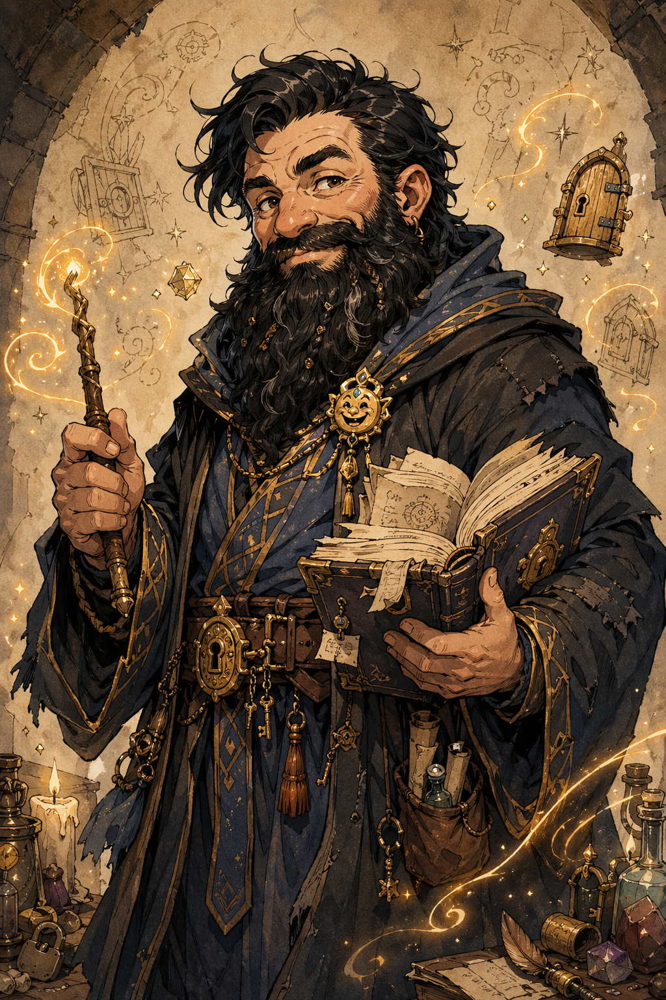

# Dain Truthammer

- The blimp and closed satchel occur only inside Kagrenac's thought bubble; this shows intention, with no flight, guano handling, target or explosion. Poses, clothes, light, carriage crop and fine cuffs are illustrative. No captive reply, injury recovery or agreed plan is established. [Image notes](../../Adventures/2026-10-10/dain-and-kagrenac-goblin-plans-image-notes.md).

- Camp layout and scene staging are illustrative. The two locations are shown in separate panels, without a route or confirmed adjacency. The captives are awake; their answer and camp affiliation remain unreported. No exact boarding, injury recovery or owl information relay is established. [Image notes](../../Adventures/2026-10-10/owl-camp-and-rhyming-question-image-notes.md).

- Preceding Dain scene: finger-click tent dismissal in steam, yelling emergence, failed Taleesh lift and a 25-foot run with nothing further. Consecutive panels, heroic framing, grip, expressions and running trail are illustrative; no healing, transformation, successful lift, Wet ending or named combat action is established. [Image notes](../../Adventures/2026-10-10/truthammer-steam-entrance-image-notes.md).

- Dain's preceding wake-up scene shows him awake and joining the battle after Taleesh fetches him. The clasp, expression, pose and framing are illustrative; no mechanical bonus, spell, attack or rest recovery was assigned by that gesture. [Image notes](../../Adventures/2026-10-10/taleesh-wakeup-hand-grasp-image-notes.md).

- Ground-group travel, Dain's bear ride and successful Suggestion follow the supplied beat. Harry's warning is reported; her roll/outcome and captive response remain open. Magic geometry, poses, fine cuffs, terrain, blimp height/design and lighting are illustrative. The staged captive placement establishes no transport arrangement, camp arrival, confession, unlimited-obedience mechanic or new damage/recovery. [Image notes](../../Adventures/2026-10-10/ground-route-suggestion-image-notes.md).

- Kagrenac's Polymorph makes Tina the giant eagle; Dain casts Minor Illusion and delivers the booming call for discussion, guaranteeing no violence. Camp response remains unreported. Poses, sound rings, plumage, camp shelters/banners/decorative devices, lights and aerial spacing are illustrative; no discovered faction emblem, tactical layout, accepted guarantee, resource ruling or attack is established. [Image notes](../../Adventures/2026-10-10/bear-eagle-camp-entrance-image-notes.md).

- Three consecutive panels show Dain's countdown, bird-form Tona lifting the flanking goblin, and release outside the pit before impact. Eagle appearance is an illustrative continuity choice; Tona's possible Tina alias remains unconfirmed. Drop height, poses, goblin expression/clothes, unlit pit, camp arrangement, banners/marks, braziers, light and scenery are illustrative. No damage, injury/death/survival, intimidation outcome, accepted negotiations, actual hellfire or discovered faction emblem is established. [Image notes](../../Adventures/2026-10-10/countdown-bird-form-warning-image-notes.md).

- Sequential panels show one anonymous goblin's grenade throw and Dain taking the reported 11 damage, still mounted on Stu. Attacker appearance, weapon design, fuse/detonation, blast size/fragments/light, Dain's recoil/hand pose, crop and camp scenery are illustrative. No damage type, save, other party damage, shield spell, dismount, injury detail, casualty, retaliation or current HP is established. [Image notes](../../Adventures/2026-10-10/goblin-grenade-dain-damage-image-notes.md).

- Dain's shot through the fire pit and the main tent's front/back holes are supplied outcomes. His pose on Stu, prismatic color, curved trail, pit shape/unlit ash, tent construction, hole dimensions, cloth scraps and night scenery are illustrative. The view establishes no chosen damage type, general projectile rule, tent fire/collapse, occupant/contents count, creature damage or camp reaction. [Image notes](../../Adventures/2026-10-10/chromatic-orb-main-tent-image-notes.md).

- Dain remains in his last supplied bear-mounted posture while the concentration change is shown through symbolic fading geometry and a self-directed wrist glyph. Pose, expression, magic colors/shape, clothes and night background are illustrative. The cast and Suggestion ending are supplied; no actual Dash, movement/dismount, bear buff, captive position/reaction or physical release is established. [Image notes](../../Adventures/2026-10-10/expeditious-retreat-concentration-image-notes.md).

## One-Line Summary
A dwarf wizard with the bearing of an honest magistrate and the soul of a delighted meddler, drawn to deception, strange magic, and the hidden usefulness of apparently silly spells.

## Table Role
- Role: Player Character.
- Player: Maitland / user.
- DM: Tom.

## Status

- [Latest personal movement/discovery, 2026-10-10] **Dain runs back toward the bottleneck on the party's approach route and realises goblins emerging from a wall crack have tricked and are flanking the gang.** His current movement is running; the transition off Stu, distance, formal Dash and arrival/escape remain unreported. Expeditious Retreat is the last confirmed concentration and Suggestion is ended; no new HP/resource change or attack is supplied. Count/identities and any warning to the others remain open. [Camp](../Places/Organised%20Goblin%20Camp%20-%202026-10-10.md#bottleneck-and-wall-crack-flank---2026-10-10); [session](../../Adventures/2026-10-10.md).

- [Preceding casting/concentration change, 2026-10-10] **Casts [Expeditious Retreat](../Powers/Expeditious%20Retreat.md) and drops concentration on [Suggestion](../Powers/Suggestion.md) on the smarter captive, ending it.** [Derived standard 2014 effect] Current concentration is Expeditious Retreat. The cast itself supplied no movement; the following beat records Dain running toward the approach bottleneck. Casting source/expenditure and captive reaction remain unreported; shared cuffs and Dain's HP question have no new change. [Official spell](https://www.dndbeyond.com/spells/2088-expeditious-retreat); [session](../../Adventures/2026-10-10.md).

- [Latest personal casting, 2026-10-10] **Dain shoots [Chromatic Orb](../Powers/Chromatic%20Orb.md) through the fire pit into the main tent, blasting a hole through its front and back.** The shot and both holes are confirmed. Type/roll/damage, casting level/resource, occupants and further effects remain unreported. HP after the preceding 11 grenade damage is still [To verify]. His earlier guarantee/countdown remain historical; no motive or negotiation outcome is assigned. [Session](../../Adventures/2026-10-10.md).

- [Latest confirmed personal damage, 2026-10-10] **A [goblin](./Grenade-Throwing%20Goblin%20-%202026-10-10.md) throws a [fragmentation grenade](../Items/Fragmentation%20Grenade%20-%202026-10-10.md) at the ground group; Dain takes 11 damage.** Current HP after the hit is [To verify]; 28 is the last supplied total before the later riverside rest. Type/save/roll, temp HP, other party damage, reaction, concentration outcome and any new condition remain unreported. No dismount, retaliation or new spell is supplied. [Session](../../Adventures/2026-10-10.md).

- [Preceding rock/goop outcome, 2026-10-10] **The dropped [flanking goblin](./Flanking%20Goblin%20at%20the%20Camp%20-%202026-10-10.md) hits a rock and turns into goop, wrapping into the rock.** Cause, death/survival, numerical damage and camp reply are unknown. No new Dain action or reaction is supplied; the countdown was his latest personal action at that preceding beat. His earlier no-violence guarantee stays recorded. [Session](../../Adventures/2026-10-10.md).

- [Earlier countdown, 2026-10-10] **Dain begins a countdown and threatens, “if you don’t reveal for negotiations we will rain hellfire down upon you”. The countdown reaches 0.** This follows his earlier no-violence guarantee; the promise and escalation both remain recorded. No actual hellfire spell, guano use or bombing is supplied. [Session](../../Adventures/2026-10-10.md).
- [Preceding bird-form drop, before the impact, 2026-10-10] **[Tona](./Tona.md) in bird form lifts the [flanking goblin](./Flanking%20Goblin%20at%20the%20Camp%20-%202026-10-10.md) and drops it in front of the fire pit as a warning.** Tona's identity, the goblin's condition and the camp's response remain unreported. No attack roll, damage, intimidation outcome, organisers' explanation, Wet ending or numerical resource change is assigned.

- [Preceding camp movement, before the countdown, 2026-10-10] **The visible [camp goblin](./Visible%20Goblin%20at%20the%20Camp%20-%202026-10-10.md) suddenly dashes behind a tent and disappears from view.** Exact observer, further position/route, identity and motive remain unreported. No new Dain action/reaction is supplied; his preceding Minor Illusion/booming announcement and no-violence guarantee remain his latest personal action and stated terms. The movement establishes no spoken reply, accepted/rejected peace offer, alarm or attack. [Session](../../Adventures/2026-10-10.md).

- [Preceding confirmed camp announcement, 2026-10-10] **Dain enters the [goblin camp](../Places/Organised%20Goblin%20Camp%20-%202026-10-10.md) riding bear-form [Stu](./Stu.md), with Harry and Yuckie on foot and [Tina](./Tina.md) as giant-eagle support after Kagrenac's [Polymorph](../Powers/Polymorph.md). Dain casts [Minor Illusion](../Powers/Minor%20Illusion.md) and makes a booming announcement, calling the camp's goblins out to discuss matters and guaranteeing no violence. “The truth needs liberation.”** Camp response, acceptance and discussion outcome remain unreported. The guarantee is Dain's stated term, with no automatic party/NPC agreement or cancelled guano proposal. The entries below describe preceding actions; no numerical recovery, Wet ending, later captive response or ended Suggestion is supplied. [Session](../../Adventures/2026-10-10.md).

- [Preceding confirmed action and travel, 2026-10-10] **Dain rides [Stu](./Stu.md) in bear form with the ground group (Yuckie, Harry, Dain and Stu); the others go by blimp. He casts [Suggestion](../Powers/Suggestion.md) on the “smart” [goblin captive](./Goblin%20Intruders%20-%202026-10-10.md) and says, “you must do as I say and be silent”. Success is reported.** Casting level/source/expenditure, duration, concentration state, ending and subsequent instruction/response are unreported. Harry's separate intimidation of the other captive has no supplied roll/outcome. Exact route, arrival, mount mechanics and captive transport remain open. [Session](../../Adventures/2026-10-10.md).
- [Chronology] The entries below describe preceding beats. Suggestion now supersedes the rhyme as Dain's latest executed dialogue/action; no explanation of the organisers, numerical recovery, Wet ending or relationship-score change is supplied.

- [Preceding confirmed intention, 2026-10-10] **Dain wants the two captives as leverage to learn why the [snake people](../Factions/Snake%20People.md) organise goblins—the main mission.** Leverage method, person to pressure, new dialogue, bargain/threat, social roll and execution are unreported. [Kagrenac](./The%20Astral%20Elf.md) separately wants a blimp/guano attack; no party choice, argument or relationship-score change is supplied. Dain's preceding rhyme remains his latest executed dialogue, with no captive answer. [Session](../../Adventures/2026-10-10.md).

- [Preceding confirmed Dain dialogue, 2026-10-10] **At the [balloon](../Places/Party%20Skyship%20-%202026-08-29.md), after the party wakes both [goblin captives](./Goblin%20Intruders%20-%202026-10-10.md), Dain asks in rhyme, “why are you organised, little goblins”.** No answer, extra verse, language, spell, social roll or effect is supplied. [Kagrenac's owl](./Kagrenacs%20Owl.md) finds an [organised goblin camp](../Places/Organised%20Goblin%20Camp%20-%202026-10-10.md) in the broader report; its link to the captives and how Dain receives that information are unreported. No numerical resource, Wet or initiative change is supplied. [Session](../../Adventures/2026-10-10.md).
- [Preceding confirmed Dain action, 2026-10-10] **Dain clicks his fingers and [Leaky Tent](../Powers/Truthammer%20Leaky%20Tent.md#current-riverside-casting---2026-10-10) disappears in a plume of steam. He emerges yelling, tries unsuccessfully to pick up [Brother Taleesh](./Brother%20Taleesh.md), then runs 25 feet and does nothing further.** The Goku/Namek healing-pod comparison describes the drama, not a pod, healing or transformation. The tent is now dismissed; Taleesh is not lifted/carried. Yell wording, lift failure reason, roll, action/resource costs and exact movement direction/endpoint are unreported. No drying, Wet ending, HP recovery or new initiative is supplied; **7** remains the last reported initiative. [Session](../../Adventures/2026-10-10.md).
- [Preceding Dain wake-up, 2026-10-10] **[Brother Taleesh](./Brother%20Taleesh.md) runs into [Leaky Tent](../Powers/Truthammer%20Leaky%20Tent.md#current-riverside-casting---2026-10-10), wakes Dain, shares the hand-grasp meme and brings him into the battle. Dain is now awake and participating.** This supersedes the earlier sleep and lack of battle awareness. Exact targets, observations, briefing and knowledge of the preceding prisoner scene remain unreported. No new roll, attack, spell or numerical recovery was supplied by this wake-up; initiative **7** remains only the last reported result. [Session](../../Adventures/2026-10-10.md).
- [Preceding innocence clarification, 2026-10-10] **Truthammer remains innocent** in the goblin-prisoner scene. He was separately asleep and unaware of Harry's finger strike then; his later wake-up establishes no participation in or approval of the earlier action. [Session](../../Adventures/2026-10-10.md).
- [Latest broader encounter; Dain asleep, 2026-10-10] [Harry](./Hammerton%20Harry%20Drizddon.md) runs up to the cuffed [goblins](./Goblin%20Intruders%20-%202026-10-10.md) and smashes their fingers. They remain last confirmed linked at hands and feet and were last asleep before the strike; damage, injury extent, waking and reaction afterward are unreported. Dain remains separately asleep and unaware. [Session](../../Adventures/2026-10-10.md).
- [Preceding sleep scene, 2026-10-10] **Dain sleeps “like a legend, really manly”** in Leaky Tent after returning there, unaware of enemies at that point. Taleesh's wake-up supersedes this state; no completed rest or numerical recovery is supplied. [Session](../../Adventures/2026-10-10.md).
- [Preceding broader encounter; Dain asleep, 2026-10-10] [Yuckie](./Yuckie%20the%20Goblin.md) finishes running up. The party surrounds the sleeping, manacled intruders and waits for them to wake. **“Nightmare nightmare nightmare”** is supplied without an individual speaker or effect. Dain is separately asleep; initiative stays **7**. That scene supplies no waking or chest recovery.
- [Preceding broader encounter; Dain unaware, 2026-10-10] Stu chases in brown-bear form; Kagrenac puts both goblins to sleep and they fall with the chest causing a dirt slide. Taleesh then manacles both while they sleep. No additional Dain awareness or resource change is supplied.
- [Earlier broader encounter; Dain unaware, 2026-10-10] [Harry](./Hammerton%20Harry%20Drizddon.md) dashes/runs to the black cloud and casts [Thunderwave](../Powers/Thunderwave.md) at a goblin, pushing it out of darkness. Another patch disappears. This supplies no change to Dain's last reported action of returning to his tent to sleep, **unaware of enemies**; initiative remains **7**. [Session](../../Adventures/2026-10-10.md).
- [Confirmed preceding Dain action, 2026-10-10] Dain is startled by the sound while "sleep drowning" at the [riverbank](../Places/Riverside%20Camp%20-%202026-10-10.md). **Unaware of any enemies, he gets up and returns to his [Leaky Tent](../Powers/Truthammer%20Leaky%20Tent.md#current-riverside-casting---2026-10-10) to sleep.** No drowning damage, new condition, resource use or completed rest recovery is reported. [Session](../../Adventures/2026-10-10.md).
- [Broader encounter context; Dain unaware, 2026-10-10] The [two goblins](./Goblin%20Intruders%20-%202026-10-10.md) jump off the carriage and disappear into two clouds of darkness. [Brother Taleesh](./Brother%20Taleesh.md) jumps into the farther one and misses a blind swing on a natural 1, with no further consequence to him. **Dain initiative 7**, supplied from the real table, supersedes the assistant-generated 6 without granting enemy awareness. Other turn order, cloud mechanics, chest recovery and current rest/resources remain unreported. [Session](../../Adventures/2026-10-10.md).
- [Confirmed, 2026-10-10] Dain lies at the riverbank with the river flowing over one side of him. [Character-only] He continues developing a subtle emotional spell inspired by a father's disappointment washing over someone. This is research, with no completed spell, casting or mechanical damage established. [Research notes](../Brainstorm/Powers/Paternal%20Disappointment%20Spell%20Research.md); [session](../../Adventures/2026-10-10.md).
- [Party] [Confirmed, 2026-10-10] Still frolicking at the river, Dain answers [Harry's](./Hammerton%20Harry%20Drizddon.md) request by flicking and conjuring [a gold-sifting tool](../Items/Conjured%20Gold%20Sifter%20-%202026-10-10.md) for her. The feature/spell, resource cost and duration are unreported. [Session](../../Adventures/2026-10-10.md).
- [Party] [Confirmed, 2026-10-10] Dain is at the party's [riverside camp](../Places/Riverside%20Camp%20-%202026-10-10.md). He puts up Leaky Tent and spends the narrated long rest moving between his tent and the river, frolicking and enjoying himself. Casting level/mode and recovered resources are unreported. [Session](../../Adventures/2026-10-10.md).
- [Prior airship update on 2026-10-03] Dain travels aboard the airship and **learns Magic Mouth from scrolls**, using up all three remaining copies. He continues Leaky Tent refinement while using Stinking Cloud. [Character-only] His father's disappointment is a focus of reflection in that scene. No revised spell, HP change or rest recovery is reported there. [Spellbook](../../Character/Spellbook.md#2nd-level-spells-learned-in-play); [Session](../../Adventures/2026-10-03.md).
- [Confirmed] Baseline imported from [Dicfuc_164465751.pdf](../../Dicfuc_164465751.pdf) on 2026-04-18.
- [Confirmed] Mechanically a level 5 dwarf wizard with Sage background and School of Conjuration subclass.
- [Confirmed] Alignment confirmed by user as `Chaotic Good` on 2026-04-18.
- [Confirmed] [Garl Glittergold](../Lore/Garl%20Glittergold.md) was chosen as Dain's deity on 2026-04-18.
- [Confirmed] Current location established on 2026-04-18 as the coastline near the Iron Shore Tribes.
- [Confirmed] Dain received the `Ghostly Form Tattoo` reward after the harpy fight; this was corrected on 2026-05-03 to clarify that Kagrenac did not receive it.
- [Confirmed] Dain received the [Breastplate of Balance](../Items/Breastplate%20of%20Balance.md) when the party killed the harpies; user confirmation recorded 2026-07-11.
- [Confirmed by user on 2026-07-11] Dain is proficient/trained in medium armor.
- [DM-private] [Character-only] [Confirmed] Dain is considered an outcast from [Truthammer mountain](../Places/Truthhammer%20Mountains.md) because of his faith in [Garl Glittergold](../Lore/Garl%20Glittergold.md).
- [To verify] Weight, Temp HP, and prepared-spell markings remain unsettled.
- [Confirmed from 2026-05-30 shared session] Dain took Resilient: Constitution at Wizard 4, raising CON from `13` to `14` and CON save to `+4`.
- [Confirmed from 2026-05-30 shared session] Level-up picks include Shape Water, Web, and Rope Trick.
- [To verify] Exact max HP after level 4 and Resilient: Constitution; `29` is the likely value under normal retroactive CON handling.
- [Confirmed by user from DM] Dain and/or the Truthhammers have a half-Azer connection; exact scope and implications are [To verify].
- [Party] [Confirmed on 2026-07-11] Current live scene: at the end of the hidden tunnel after a long rest, facing Kagrenac's accusation that Dain murdered a dwarf.

## What The Character Knows

- [Confirmed personal observation, 2026-10-10] **Goblins emerge from a crack in a wall to flank the gang; Dain realises the goblins have tricked the group as he runs back toward the approach-route bottleneck.** Count, identities, detailed plan, what lies beyond the crack and whether Dain shares this discovery are unreported. The wall is not identified with the earlier gorge/cliffs. [Camp discovery](../Places/Organised%20Goblin%20Camp%20-%202026-10-10.md#bottleneck-and-wall-crack-flank---2026-10-10); [session](../../Adventures/2026-10-10.md).

- [Latest personal interaction, 2026-10-10] Dain publicly announces the ground group's camp entry with Minor Illusion and a booming voice, asks the goblins to come out for discussion and guarantees no violence: **“The truth needs liberation.”** No reply, revealed motive, confirmed captive affiliation or accepted negotiation is supplied. The ground group is backed by Tina in giant-eagle form, transformed by Kagrenac. [Session](../../Adventures/2026-10-10.md).

- [Latest confirmed personal interaction, 2026-10-10] Dain casts Suggestion successfully on the captive described as “smart” and gives the supplied obedience-and-silence instruction. The second captive is addressed by Harry; her intimidation outcome is unreported. The descriptors add no names, scores or kinship, and no new confession, camp affiliation or answer about the snake people's purpose is supplied. [Suggestion record](../Powers/Suggestion.md); [session](../../Adventures/2026-10-10.md).

- [Confirmed current aim and supplied mission context, 2026-10-10] Dain seeks **why the snake people organise goblins**, with captives as intended leverage. The purpose remains unanswered; this is not a reported confession or camp-membership admission. No new information route, leader, shared briefing or relation to the older Yuan-ti report is supplied. [Snake people](../Factions/Snake%20People.md); [session](../../Adventures/2026-10-10.md).

- [Confirmed preceding personal interaction, 2026-10-10] Dain asks the two awake captives about organisation in rhyme, **“why are you organised, little goblins”**, at the balloon. Their answer and any confirmation of motives, leaders or camp membership are unreported. The owl-to-Dain information route and awareness of earlier prisoner abuse remain unreported. [Session](../../Adventures/2026-10-10.md).
- [Confirmed preceding personal action, 2026-10-10] Dain dismisses the riverside tent in steam, emerges yelling, cannot pick up Taleesh, runs **25 feet** and does nothing further. This establishes no additional enemy observation or knowledge of the earlier prisoner abuse. [Session](../../Adventures/2026-10-10.md).
- [Confirmed latest state, 2026-10-10] Dain has been woken by Taleesh and brought into the battle. Battle awareness is now established; exact enemy observations, the arrow's source and knowledge of Harry's earlier treatment of the prisoners remain unreported. Earlier sleep/unawareness notes below describe the preceding scenes. [Session](../../Adventures/2026-10-10.md).
- [Preceding innocence clarification, 2026-10-10] Dain was asleep and unaware of Harry's attack on the prisoners when it occurred. Taleesh's later wake-up establishes battle awareness, without supplying a briefing about that earlier action or retroactive participation/approval. [Session](../../Adventures/2026-10-10.md).
- [Character-only] [Confirmed, 2026-10-10] The night-time sound startles Dain at the riverbank, but **he is unaware of any enemies** and returns to his tent to sleep. The broader party's alarm and encounter record do not establish that Dain knows about the goblins or darkness clouds.
- [Character-only] He delights in deception, illusion, and strange little magical tricks.
- [Character-only] He would rather solve problems with baffling or obscure magic than by brute force.
- [Character-only] He actively seeks out ridiculous or impractical spells because even useless-looking magic may hide wonder or utility.
- [Character-only] He wants, over time, to develop the most unique and useless spells known to the realm.
- [Character-only] [Confirmed by user on 2026-07-11] Dain believes gold should never be hoarded or spent merely on himself: every gold piece that comes into his personal possession should leave through an act of kindness, hospitality, generosity, or goodwill.
- [Character-only] Dain calls the gnomish portion of this practice `Glittergold's Share`. When gnomes are present, he deliberately seeks them out and gives some of his gold directly to them in honor of [Garl Glittergold](../Lore/Garl%20Glittergold.md), trusting them to turn it into kindness, delight, or some interesting consequence of their own choosing.
- [Character-only] This is a standing character trait rather than a one-session vow. Dain may carry gold briefly while looking for a worthy recipient, but he does not regard personal gold as savings; silver, copper, barter, and shared party resources can cover ordinary needs.
- [Character-only] [Confirmed by user on 2026-07-11] The practice is rooted in Dain's inability to forgive himself for his past, especially escaping the hidden tunnels while his friend sacrificed himself to the pursuing troopers and went missing. Dain believes his continued life was purchased at a cost he can never repay.
- [Character-only] Every kindness is therefore both devotion and penance: Dain tries to make the life his friend saved produce good for other people. He does not believe that any total of donated gold will settle the debt, which is why the practice does not end.
- [Character-only] [Confirmed by user on 2026-07-11] The practice is also Dain's answer to the dishonor of being rejected by the Truthammer clan. He refuses to surrender the family name; instead, he tries to re-forge its meaning so that strangers remember `Truthammer` for kindness, hospitality, and goodwill rather than his exile.
- [Character-only] Giving `Glittergold's Share` directly to gnomes is therefore devotion and quiet defiance at once. Dain publicly honors the gnomish god whose worship helped make him an outcast, demonstrating that the faith the clan rejected can make the Truthammer name more honorable rather than less.
- [Character-only] He formally created [Truthammer's Leaky Tent](../Powers/Truthammer%20Leaky%20Tent.md) during the forest long rest on 2026-05-03.
- [Character-only] He knows he is considered an outcast from Truthammer mountain because of his faith in [Garl Glittergold](../Lore/Garl%20Glittergold.md). [DM-private] [Confirmed]
- [Character-only] At the forest camp, he hears Kagrenac say "a lizard has arrived," sees Hammerton holding a severed lizard head, initially assumes the head is what Kagrenac means, then realizes the mistake and booms "Who goes there?" with `Prestidigitation`.
- [Character-only] When Taleesh answers as "just a fellow traveller," Dain welcomes him with, "Ah, we're all travellers. Come join us."
- [Character-only] Dain reads Taleesh as standoffish and afraid, stops, puts down his staff, and reassures him by invoking the Truthammer name as safe and respectable. [Inferred]
- [Character-only] Dain sees Taleesh produce herbal items from [Taleesh's Herbal Stash](../Items/Taleeshs%20Herbal%20Stash.md) and offer comfrey, pigweed, and hedgehog mushroom. [To verify effects]
- [Character-only] Dain hears Taleesh offer goji leaves with the claim that taking one makes the taker "feel like a god," refuses, and says the Truthhammers do not alter themselves in such ways.
- [Character-only] Dain suggests Kagrenac, "the young elf," may be interested in the goji leaves. [To verify whether Kagrenac is actually interested]
- [Character-only] Dain sees Taleesh project ghostly astral arms from his shoulders without using them aggressively.
- [Character-only] Dain tells [The Festival Of Completely Unnecessary Lanterns](../Lore/Truthammer%20Tales/The%20Festival%20Of%20Completely%20Unnecessary%20Lanterns.md), offers to create a lantern with Taleesh, conjures a warm cloak, and confirms with the party that they will keep Taleesh warm if he joins them.
- [Character-only] Dain uses `Prestidigitation` and `Minor Conjuration` together to give Taleesh a warm cloak for the remainder of the night.
- [Party] Taleesh approaches and introduces himself after the warmth bargain.
- [Character-only] Dain receives one pound of hedgehog mushroom from Taleesh and begins hollowing it into a [Hedgehog Mushroom Lantern](../Items/Hedgehog%20Mushroom%20Lantern.md) inspired by the lantern story.
- [Character-only] Dain records `+17` respect toward Taleesh after the hedgehog mushroom gift and lantern-making start.
- [Character-only] Dain reaches `6%` progress on always-warm robes for Taleesh, realizes the concept is not truly him, and pivots into the [Always-Cold Robes](../Items/Always-Cold%20Robes.md) prototype after a flash of inspiration.
- [Party] At the start of the new in-world day after the forest long rest, Dain wakes to cold winds, hears [Kagrenac](./The%20Astral%20Elf.md) warn that the winds will worsen, and sees [Southern Human Traders](../Factions/Southern%20Human%20Traders.md) approach seeking [Ola Dung Lot](../Places/Ola%20Dung%20Lot.md).
- [Party] Dain rolls a natural `20` on Persuasion to convince the traders to trust the party and come with them, then delegates cost-setting to [Hammerton Harry Drizddon](./Hammerton%20Harry%20Drizddon.md) while requesting half paid upfront.
- [Party] The traders' arrangement becomes half now, half later; the upfront half is paid into [Party Loot](../../Character/Party%20Loot.md) as [Burdock](../Items/Burdock.md) x10 oz and [Ginseng](../Items/Ginseng.md) x2 oz, worth `5 gp` equivalent.
- [Character-only] Kagrenac tells Dain in Draconic that the newcomers are all glowing in magic. [To verify detection source]
- [Character-only] Dain shakes the [Coal Mine Puppet](../Items/Coal%20Mine%20Puppet.md)'s hand while attempting `Identify`, but the puppet appears to prevent or block the casting. [Inferred] [To verify resource cost]
- [Party] The puppet speaks in a high voice about being taken back to the coal mines.
- [Character-only] Dain begins praying to [Garl Glittergold](../Lore/Garl%20Glittergold.md), and the puppet bites him. Dain does not know why. [To verify damage, trigger, and consequence]
- [Character-only] Dain realizes the puppet is a cobalt puppet.
- [Party] The puppet says, "[Kurtlemack](../Lore/Kurtlemack.md) hates you." [To verify who "you" refers to]
- [Party] Dain defuses Hammerton / Dresden's push for more payment from the [Southern Human Traders](../Factions/Southern%20Human%20Traders.md) by keeping the original deal and adding five truthful answers owed upon delivery.
- [Party] On 2026-05-30, Dain meets [Ollyander](./Ollyander.md), Lachlan's new player character, and records `+4` respect after Ollyander arrives shell-shocked, knife in hand, but not visibly hostile.
- [Party] During travel north-east along the river, Ollyander holds onto Dain's Truthammer garment while the three travelling humans follow behind.
- [Party] After the winter wolves are destroyed, Dain prays to [Garl Glittergold](../Lore/Garl%20Glittergold.md), denies [Kurtlemack](../Lore/Kurtlemack.md) tribute from the deaths, and is stabbed by the [Coal Mine Puppet](../Items/Coal%20Mine%20Puppet.md), nearly dropping to `1 HP`.
- [Character-only] Dain begins the [Sauna Pelt](../Items/Sauna%20Pelt.md) for [Brother Taleesh](./Brother%20Taleesh.md), reaching `84%` progress [To verify DM acceptance].
- [Character-only] While meditating in [Truthammer's Leaky Tent](../Powers/Truthammer%20Leaky%20Tent.md), Dain thinks about his father and the famous lava forge accident; the father/forge accident framing remains idea-stage unless Tom confirms it in play.
- [Party] On 2026-06-20, Dain is in the centre of an unnamed town where six dragon corpses/remains are present and town artisans have made an equipment-for-material deal with him / Truthhammer. [To verify exact terms]
- [Party] Dain gives gold to local gnomes who worship Glittergold, receives the [Half-Pound Sack From Glittergold Gnomes](../Items/Half-Pound%20Sack%20From%20Glittergold%20Gnomes.md), and intends to give it to the local church. [To verify exact church, sack contents, and coin balance]
- [Party] In a tavern, Dain says, "Remember the name Truthhammer."
- [Character-only] During a dice game, Dain concludes [Brother Taleesh](./Brother%20Taleesh.md) is cheating, loses `-11` respect for him, decides to anti-cheat, and casts `Suggestion`: "Complete the game." Taleesh fails the save, the game completes, Dain later loses the betting round, and [Ollyander](./Ollyander.md) ends up winning. [To verify final stakes and party fallout]
- [Party] Harry / [Hammerton Harry Drizddon](./Hammerton%20Harry%20Drizddon.md) asks Dain for [Dain's Seal](../Items/Dains%20Seal.md); Dain provides it in exchange for `100 gp` worth of silver and then bets the silver. [To verify exact seal object, whether "Harry" is Hammerton, and whether the seal can be reclaimed]
- [Character-only] Dain notices that the unnamed town has issues with rats and poverty, records an action item to find the human/townsperson and give silver, and tells the human, "Gather the rats while I'm gone." [To verify identity and house]
- [Character-only] Dain gives his last `5 gp` to the human/townsperson tied to the rat-house thread. His gold-piece balance is likely `0`, but exact silver and other coin holdings remain [To verify].
- [Character-only] The next morning, Dain reflects on his failed pub moral lesson, prays to [Garl Glittergold](../Lore/Garl%20Glittergold.md) about his disappointment, sees a rat fall from the ceiling, and begins writing a new failed-moral-lesson rat spell in his wizard book / spellbook. Current lead pitch: `Truthammer's Cuddly Rat`, whose full-hour cuddle leaves the target feeling as if they failed an important moral lesson; mechanics remain idea-stage in [Failed Moral Lesson Rat Spell Ideas](../Brainstorm/Powers/Failed%20Moral%20Lesson%20Rat%20Spell%20Ideas.md).
- [Character-only] During the 2026-07-11 long rest, Dain tells Taleesh that a friend helped him escape Truthhammer Mountain through these tunnels about one hundred years ago, sacrificed himself to pursuing troopers, and went missing.
- [Character-only] Dain apologizes to Taleesh for the dice-game coercion and explains the intended moral lesson; Taleesh answers that it is "the Truthammer virtue, not Taleesh virtue."
- [Party] Dain completes the [Sauna Pelt / Sauna Jacket](../Items/Sauna%20Pelt.md) and gives it to Taleesh, who graciously accepts and loves it. It is always warm in cold environments, and its wetness makes the surrounding area smell like female white-wolf piss.
- [Party] Kagrenac declares that he no longer trusts Dain and accuses him of murdering a dwarf. A natural `1` suggests a possible great accident rather than murder, but the exact check and conclusion are [To verify].
- [Party] Around the goblin campfire, Dain puts his arm around the hobgoblin leader and speaks of his mother, apprenticeship, and early training. [To verify whether "hobgoblin leader" corrects earlier goblin-leader shorthand]
- [Party] Dain says, "I trained under people who prized precision and under others who prized results. I kept both lessons and annoyed both camps."
- [Party] Dain says, "My mother could correct a room without raising her voice. A rare talent." [To verify her name]

## What The Party Knows
- [Party] Session 2026-04-18 opens along the coastline near the Iron Shore Tribes.
- [Party] [Confirmed on 2026-08-29] Ola Dung Lot is a city in the wider Samryn Torsten area. The southern human traders sought directions there on 2026-05-03. [Retcon] Earlier notes interpreted it as a high-mountain lake.
- [Character-only] In Moradin's chamber on 2026-08-29, Dain warns Taleesh that Moradin protects believers and may not protect him during the forge ritual. Taleesh succeeds without showing pain, and his experience-seeking outlook produces a respect result of `18`. [To verify tracker meaning and any concealed injury]
- [Party] Immediately after Taleesh's ritual, Dain briefly sees an unidentified [azer](./Azer%20in%20Moradins%20Forge.md) within the forge before it disappears back into the fire. Any connection to Dain's half-Azer heritage is [Inferred] and [To verify].
- [Character-only] Inspired by Taleesh and the azer vision, Dain performs the ritual himself. The rod cools while he grows hotter, his skin takes on a bronze sheen, and after releasing the rod he feels intense guilt about not tending the Truthammer forge. [To verify duration, mechanics and whether the guilt is supernatural]
- [Character-only] [Confirmed] The ritual is Dain's conscious acceptance of the [azer connection](../Lore/Azer%20Spark%20and%20Truthhammer%20Fire%20Portal.md). Through the accepted account, Dain has received a measure of magic from the Elemental Plane of Fire. [To verify exact abilities and whether Dain understands them]
- [To verify] Whether the party knows Dain is an outcast from his mountain homeland.
- [To verify] Dain's public-facing motives and immediate purpose on that coast are not yet recorded.
- [Party] [To verify who overheard] Dain has told Taleesh about escaping through the hidden tunnels one hundred years ago and about the friend who sacrificed himself to the pursuing troopers.
- [Party] Kagrenac openly accuses Dain of murder and states that he no longer trusts him.

## What Is Uncertain

- Current HP immediately before/after the confirmed 11 grenade damage; damage type/save/roll, temp HP, other ground-group effects, attacker identity and any supplied response or ongoing-effect outcome.

- Latest rock/goop outcome: why the goblin changes, death/survival, full absorption or further movement, numerical damage, party/camp reaction and any negotiations. No new personal Dain response is reported.

- Latest countdown/warning: starting count/time, camp reply or negotiation outcome, the dropped flanking goblin's condition and identity, Tona's possible Tina alias, and how the earlier no-violence guarantee is handled. “Hellfire” remains a threat with no executed fire attack reported.

- [To verify] What his Temp HP and current active effects are.
- [To verify] Exact maximum HP after the 2026-07-11 long rest; Dain is restored to maximum, likely `29` under the current level-4 calculation.
- [To verify] Which wizard spells are prepared right now versus simply present on the export.
- [To verify] What "outcast" means mechanically/socially: family rejection, religious censure, legal exile, clan politics, or another status.
- [To verify] Whether the half-Azer connection applies only to Dain, to the Truthammer bloodline more broadly, or to another family/cultural layer, and whether it has any mechanical effect.
- [DM-private] The armor used as evidence would not realistically belong to Dain's missing friend; it more likely belonged to a separate dwarf who later searched for him. [Inferred ownership]
- [To verify] The searching dwarf's identity, the studded cold leather note, Kagrenac's remaining evidence, the missing friend's identity and fate, the troopers' allegiance, and whether a great accident rather than murder occurred.

## Description
- [Confirmed] Male dwarf, age 107, medium, 4'9", white skin, brown eyes, black hair.
- [Confirmed] Strong Intelligence, strong lore skills, darkvision 120 ft., poison resistance, and advantage against the Poisoned condition.
- [Confirmed] Wizard subclass on sheet: School of Conjuration.
- [Confirmed] Deity: [Garl Glittergold](../Lore/Garl%20Glittergold.md).
- [Confirmed] Canonical portrait shows him slightly naturally disheveled, in fancy scholar's robes marked with the sigil of [Garl Glittergold](../Lore/Garl%20Glittergold.md).
- [Confirmed] Current portrait now follows the campaign's kinetic shonen fantasy anime image style: clean modern battle-anime line art, smooth cel shading, expressive character acting, warm golden magic, and sharp hidden-door motifs. [Retcon] Style update recorded 2026-05-03.
- [Inferred] His current spell choices support misdirection, concealment, and magical stagecraft even though his formal specialty is conjuration.

## Personality And Play Texture
- [Confirmed] Dain works best as a benevolent meddler: mischievous, protective, curious, and willing to bend expectations for a kinder result.
- [Confirmed] He favors deception, illusion, obscure tricks, and elegant nonsense over brute force.
- [Inferred] He is likely to embarrass bullies, test authority with sly needling, and mislead dangerous people for good reasons rather than for vanity.
- [Confirmed] He is strongly drawn to bizarre, impractical, or "useless" magic and treats that curiosity as a real calling rather than a joke.
- [Confirmed] He can be played as someone who speaks politely to illusions, touches stone while thinking, and delights in hidden mechanisms and coded messages.
- [Inferred] His evasive stories and habit of giving layered answers may be partly protective, shaped by being an outcast from home for his faith rather than mere whimsy.
- [Confirmed] He publicly refuses Taleesh's goji leaves by invoking a Truthammer principle against altering himself in that way, despite his complicated outcast relationship with the Truthammer homeland.
- [Confirmed] He can use absurd Truthammer stories and small conjured comforts as sincere diplomacy, not only as jokes.

## Dainisms
- "A straight road is for people with nothing to hide and nothing to find."
- "Kindness with a crooked hat is still kindness."
- "If the lock exists, it means someone hoped to be clever."
- "A lie told to a tyrant is just a shortcut."
- "Stone remembers. Best speak politely near a mountain."
- "There's no such thing as a useless spell, only a dull wizard."
- "I trained under people who prized precision and under others who prized results. I kept both lessons and annoyed both camps."
- "My mother could correct a room without raising her voice. A rare talent."
- "A puppet may insult Glittergold, but only because someone else lent it courage and forgot to lend it manners."
- "Careful, little cobalt thing. Garl loves a joke, and worse for you, he remembers the punchline."
- "You mistake blood for tribute. That is common among small gods and badly made knives."
- "Remember the name Truthhammer."
- "Gather the rats while I'm gone."

## Evasive Dainisms
- "Ah, well. Mountains keep their own bookkeeping."
- "That depends whether you want the short truth, the long truth, or the useful truth."
- "A thing can be known, and still not improve by being said aloud."
- "Some roads are better described after you've left them behind."
- "If I'd learned nothing from it, I'd tell it plainly."
- "There are questions with answers, and questions with consequences."
- "Back home we called that the sort of detail that invites more detail."
- "A tidy account is usually missing the important crooked bits."
- "I've done wiser things, but not always more instructive ones."
- "You may have the outline now, and the corners later."
- "That story still has sharp edges. Best handled gradually."
- "In the Truthammer Mountains, we let some facts arrive wearing a coat."
- "If I answer that directly, you'll only ask the question behind it."
- "Some matters improve in the retelling. Others survive by not being retold."
- "I was there, certainly. Beyond that, memory becomes decorative."
- "The mountain remembers it more clearly than I do, and it is not speaking."
- "Let us say I came by that lesson honestly and leave the bruises out of it."
- "It was lawful enough for the innocent and unlawful enough for the guilty."
- "I prefer to introduce my mistakes by reputation first."
- "That is a long story, and some of the witnesses are still cross."

## Near-Term Motivations

- [Character-only; Confirmed current aim, 2026-10-10] Use the two [goblin captives](./Goblin%20Intruders%20-%202026-10-10.md) as leverage to learn why the [snake people](../Factions/Snake%20People.md) organise goblins. Method and outcome remain unreported. [Main-mission follow-up](../Lore/Open%20Threads.md#organised-goblin-camp-and-dains-question).

- [Character-only] [Confirmed goals on 2026-09-12] Seek Glyph of Warding and the [spell research shortlist](../../Character/Spellbook.md#future-spell-acquisition-goals); these targets are not yet learned.
- [Character-only] Help Kagrenac reach the mountain road near Samryn Torsten safely.
- [Character-only] Deliver Commander Agland's sealed letter to the actual general.
- [Character-only] Quietly discover the fuller truth behind the party's mission.
- [Character-only] Hunt for strange mountain magic, old wards, and improbable little spells.
- [Character-only] Decide how much, if anything, to reveal about being an outcast from Truthammer mountain.
- [Character-only] Understand why the [Coal Mine Puppet](../Items/Coal%20Mine%20Puppet.md) can apparently block `Identify`, why it bites during prayer to [Garl Glittergold](../Lore/Garl%20Glittergold.md), what a cobalt puppet is, why [Kurtlemack](../Lore/Kurtlemack.md) hates him or someone near him, and whether "the coal mines" are a destination, prison, origin, or trap.
- [Character-only] Preserve the future five truthful answers from the [Southern Human Traders](../Factions/Southern%20Human%20Traders.md) for questions that actually matter.
- [Character-only] Use the five truthful answers for the Coal Mine Puppet's origin, identity, coal-mine destination, return/destruction risks, and the Garl/Kurtlemack reaction.
- [Character-only] Observe Taleesh's beloved Sauna Jacket in use and confirm whether its earlier lethal-steam risk survives beneath the female-white-wolf-piss wetness.
- [Character-only] Answer Kagrenac's murder accusation and decide how much of the century-old escape, sacrificed friend, troopers, and possible accident to reveal.
- [Character-only] Resolve the 2026-06-20 dice aftermath: final silver accounting, [Dain's Seal](../Items/Dains%20Seal.md), Taleesh's cheating, Ollyander's winnings, and any party trust damage.
- [Character-only] Find the human/townsperson tied to the rat-and-poverty problem, inspect the house, gather or contain the rats, and give silver responsibly.
- [Character-only] Develop the failed-moral-lesson rat spell seed without treating the mechanics as canon before user/DM approval.

## Long-Term Ambitions
- [Character-only] Develop a personal body of magic so peculiar and apparently useless that it becomes unmatched in the realm.
- [Character-only] Prove that strange edge-case spells can hold wonder, elegance, and real value even when no one else sees the point.

## Mechanical Snapshot
- Wizard 5 selected on 2026-09-12, adding **Major Image + Stinking Cloud**. Current HP **[To verify after 11 grenade damage on 2026-10-10]**; **28** was last supplied 2026-10-03 after an interrupted rest, before the later riverside rest. No intervening recovery or current total is assumed; maximum HP remains to verify. **Dwarven Half Plate is equipped**, clarified 2026-10-03; exact AC is unresolved, with AC 17 conditional on the recorded standard magical +2 interpretation. Speed 30 ft.; spell save DC 16; spell attack +8; CON save +5; medium armour training confirmed. Breastplate attunement was last confirmed 2026-07-11; no change is reported. See [Current State](../../Character/Current%20State.md).
- Notable features: Arcane Recovery, Minor Conjuration, Stonecunning (Tremorsense), Magic Initiate (Wizard), Resilient: Constitution.
- Spell themes on sheet/current package: Ray of Frost, Shape Water, Mage Hand, Minor Illusion, Disguise Self, Silent Image, Suggestion, Invisibility, Mirror Image, Web, Rope Trick.

- Current concentration: **[Expeditious Retreat](../Powers/Expeditious%20Retreat.md)** [Derived standard 2014 effect after confirmed casting]. Dain explicitly ended Suggestion on the smarter captive. He now runs back toward the approach-route bottleneck; distance/formal Dash, remaining slots and a later spell ending remain unreported. [Official spell](https://www.dndbeyond.com/spells/2088-expeditious-retreat).

## Notable Records
- 2026-04-18: Initial character baseline created from the imported sheet and user blurb.
- 2026-04-18: Dain's obsession with odd and impractical magic was recorded as a persistent character driver.
- 2026-04-18: Alignment confirmed as Chaotic Good, current HP confirmed as 20, and [Garl Glittergold](../Lore/Garl%20Glittergold.md) chosen as Dain's deity.
- 2026-04-18: Canonical portrait updated to show [Garl Glittergold](../Lore/Garl%20Glittergold.md)'s sigil worked into Dain's fancy but slightly disheveled scholar's robes.
- 2026-04-18: A new session began with Dain along the coastline near the Iron Shore Tribes.
- 2026-04-24: Canonical portrait regenerated as `Dain_Truthammer_portrait_v3.png` under the earlier whimsical inked fantasy style.
- 2026-04-24: The DM gave/approved the mechanics for `Truthammer's Leaky Shelter`, the working-title version of Dain's anti-shelter spell. His clan mountain was also placed near a volcano, with proposed volcanic-flow forge lore.
- 2026-05-03: Codex reference images, including `Dain_Truthammer_portrait_v3.png`, were regenerated in the campaign's kinetic shonen fantasy anime style.
- 2026-05-03: User correction clarified that Dain, not Kagrenac, received the `Ghostly Form Tattoo` reward from the harpy fight.
- 2026-07-11: User confirmed Dain also received the [Breastplate of Balance](../Items/Breastplate%20of%20Balance.md) when the party killed the harpies on 2026-04-18.
- 2026-07-11: Dain equips and attunes to the [Breastplate of Balance](../Items/Breastplate%20of%20Balance.md), setting his current AC to `14` and occupying one attunement slot. [Session 2026-07-11](../../Adventures/2026-07-11.md)
- 2026-07-11: During a long rest, Dain reveals his century-old tunnel escape and sacrificed friend to Taleesh, apologizes over the dice game, finishes the [Sauna Pelt](../Items/Sauna%20Pelt.md), then faces [Kagrenac's Murder Accusation](../Events/Kagrenac%27s%20Murder%20Accusation.md).
- 2026-05-03: During a forest long rest beside a flowing river, Dain formally created [Truthammer's Leaky Tent](../Powers/Truthammer%20Leaky%20Tent.md) and spent the final hour meditating inside it.
- 2026-05-03: DM note recorded that Dain is considered an outcast from Truthammer mountain because of his faith in [Garl Glittergold](../Lore/Garl%20Glittergold.md).
- 2026-05-03: Dain exited [Truthammer's Leaky Tent](../Powers/Truthammer%20Leaky%20Tent.md) dressed but damp, heard Kagrenac's Common announcement that "a lizard has arrived," saw Hammerton holding a severed lizard head, and initially misunderstood the announcement. [Session 2026-05-03](../../Adventures/2026-05-03.md)
- 2026-05-03: Dain realized the announcement referred to a living arrival rather than the severed head, then used `Prestidigitation` to boom his voice outward and call, "Who goes there?" [Session 2026-05-03](../../Adventures/2026-05-03.md)
- 2026-05-03: Dain welcomes Brother Taleesh after Taleesh identifies himself as "just a fellow traveller." [Session 2026-05-03](../../Adventures/2026-05-03.md)
- 2026-05-03: Dain lowers his staff to reassure Taleesh and publicly invokes the Truthammer name as safe and respectable, despite his private outcast status. [Session 2026-05-03](../../Adventures/2026-05-03.md)
- 2026-05-03: Dain sees Taleesh offer herbal remedies from his stash during the first-contact exchange. [Session 2026-05-03](../../Adventures/2026-05-03.md)
- 2026-05-03: Dain refuses Taleesh's goji leaves, says the Truthhammers do not alter themselves in such ways, and suggests Kagrenac may be interested. [Session 2026-05-03](../../Adventures/2026-05-03.md)
- 2026-05-03: Dain answers Taleesh's non-aggressive astral arms with [The Festival Of Completely Unnecessary Lanterns](../Lore/Truthammer%20Tales/The%20Festival%20Of%20Completely%20Unnecessary%20Lanterns.md), a conjured cloak, a lantern-making offer, and a party-backed promise to keep Taleesh warm. [Session 2026-05-03](../../Adventures/2026-05-03.md)
- 2026-05-03: Dain uses `Prestidigitation` and `Minor Conjuration` together to give Brother Taleesh a warm cloak for the remainder of the night. [Session 2026-05-03](../../Adventures/2026-05-03.md)
- 2026-05-03: Dain receives one pound of hedgehog mushroom from Taleesh, hollows it out, and begins creating the [Hedgehog Mushroom Lantern](../Items/Hedgehog%20Mushroom%20Lantern.md). [Session 2026-05-03](../../Adventures/2026-05-03.md)
- 2026-05-03: Dain records `+17` respect toward Brother Taleesh, using the player shorthand "the Lizard." [Session 2026-05-03](../../Adventures/2026-05-03.md)
- 2026-05-03: Dain reaches `6%` progress on always-warm robes for Brother Taleesh, realizes the idea is not truly him, and pivots into the [Always-Cold Robes](../Items/Always-Cold%20Robes.md) prototype after a flash of inspiration. [Session 2026-05-03](../../Adventures/2026-05-03.md)
- 2026-05-03: The party wakes to cold winds after the forest long rest; Kagrenac warns the winds will worsen, and [Southern Human Traders](../Factions/Southern%20Human%20Traders.md) approach asking for the way to [Ola Dung Lot](../Places/Ola%20Dung%20Lot.md). [Session 2026-05-03](../../Adventures/2026-05-03.md)
- 2026-05-03: Dain rolls a natural `20` on Persuasion to convince the southern human traders to trust the party and come with them, delegates cost-setting to [Hammerton Harry Drizddon](./Hammerton%20Harry%20Drizddon.md), and requests half paid upfront. [Session 2026-05-03](../../Adventures/2026-05-03.md)
- 2026-05-03: The trader arrangement is set as half now, half later; the upfront half goes into [Party Loot](../../Character/Party%20Loot.md) as [Burdock](../Items/Burdock.md) x10 oz and [Ginseng](../Items/Ginseng.md) x2 oz. [Session 2026-05-03](../../Adventures/2026-05-03.md)
- 2026-05-03: Kagrenac warns Dain in Draconic that the newcomers are glowing with magic; Dain shakes the [Coal Mine Puppet](../Items/Coal%20Mine%20Puppet.md)'s hand while attempting `Identify`, but the puppet appears to prevent the spell and speaks of being taken back to the coal mines. [Session 2026-05-03](../../Adventures/2026-05-03.md)
- 2026-05-03: Dain begins praying to [Garl Glittergold](../Lore/Garl%20Glittergold.md), and the [Coal Mine Puppet](../Items/Coal%20Mine%20Puppet.md) bites him for reasons Dain does not understand. [Session 2026-05-03](../../Adventures/2026-05-03.md)
- 2026-05-03: Dain realizes the puppet is a cobalt puppet, and it says, "[Kurtlemack](../Lore/Kurtlemack.md) hates you." [Session 2026-05-03](../../Adventures/2026-05-03.md)
- 2026-05-03: Dain defuses Hammerton / Dresden's request for more payment by keeping the original trader deal and adding five truthful answers owed upon delivery. [Session 2026-05-03](../../Adventures/2026-05-03.md)
- 2026-05-03: Around the goblin campfire, Dain puts his arm around the hobgoblin leader and tells stories of his mother, apprenticeship, and early training. [Session 2026-05-03](../../Adventures/2026-05-03.md)
- 2026-05-03: During the fight at the [Smoky Scratch-Marked Cave](../Places/Smoky%20Scratch-Marked%20Cave.md), Dain casts `Chromatic Orb` at the [Werebear at Smoky Cave](./Werebear%20at%20Smoky%20Cave.md), choosing acid and dealing `11` acid damage. [Session 2026-05-03](../../Adventures/2026-05-03.md) [To verify resource source]
- 2026-05-30: Dain's level 4 package is recorded: Resilient: Constitution, Shape Water, Web, and Rope Trick. [Session 2026-05-30](../../Adventures/2026-05-30.md)
- 2026-05-30: User reports Tom confirmed Dain and/or the Truthhammers have a half-Azer connection; scope remains [To verify], and the father/forge accident material stays idea-stage. [Session 2026-05-30](../../Adventures/2026-05-30.md)
- 2026-05-30: [Ollyander](./Ollyander.md) arrives at camp; Dain records `+4` respect, and Ollyander later holds onto Dain's Truthammer garment while travelling north-east along the river. [Session 2026-05-30](../../Adventures/2026-05-30.md)
- 2026-05-30: After the party destroys four winter wolves, Dain denies [Kurtlemack](../Lore/Kurtlemack.md) tribute while praying to [Garl Glittergold](../Lore/Garl%20Glittergold.md); the [Coal Mine Puppet](../Items/Coal%20Mine%20Puppet.md) stabs him, nearly dropping him to `1 HP`. [Session 2026-05-30](../../Adventures/2026-05-30.md)
- 2026-05-30: Dain begins the [Sauna Pelt](../Items/Sauna%20Pelt.md) for [Brother Taleesh](./Brother%20Taleesh.md), reaching `84%` progress [To verify DM acceptance]. [Session 2026-05-30](../../Adventures/2026-05-30.md)
- 2026-06-20: In the session titled `Glittergold Road`, Dain deals with local gnomes, a church, town artisans, six dragon corpses/remains, and a tavern dice game with Taleesh. [Session 2026-06-20](../../Adventures/2026-06-20.md)
- 2026-06-20: Dain concludes Taleesh cheated at dice, records `-11` respect, and casts `Suggestion`: "Complete the game." Taleesh fails the save, the game completes, Dain loses the later betting round, and Ollyander ends up winning. [Session 2026-06-20](../../Adventures/2026-06-20.md)
- 2026-06-20: Dain provides [Dain's Seal](../Items/Dains%20Seal.md) to Harry / Hammerton in exchange for `100 gp` worth of silver, bets the silver, and then turns the silver aftermath toward a rat-and-poverty action item: find the human/townsperson, inspect or gather the rats, and give silver responsibly. [Session 2026-06-20](../../Adventures/2026-06-20.md) [To verify exact seal and human]
- 2026-06-20: Dain gives his last `5 gp` to the rat-house human/townsperson, then spends the next morning praying to [Garl Glittergold](../Lore/Garl%20Glittergold.md) about his failed moral lesson. A rat falls from the ceiling and inspires the beginnings of a new spell, now led by the `Truthammer's Cuddly Rat` pitch in [Failed Moral Lesson Rat Spell Ideas](../Brainstorm/Powers/Failed%20Moral%20Lesson%20Rat%20Spell%20Ideas.md): an hour-long cuddle that ends with the target feeling as if they failed an important moral lesson. [Session 2026-06-20](../../Adventures/2026-06-20.md) [To verify spell approval and exact coin accounting]
- 2026-07-11: When a [giant lake frog](./Giant%20Lake%20Frog%20-%202026-07-11.md) clamps its jaws around Ollyander, Dain casts `Shape Water` to freeze lake water around the frog's mouth and prevent it clamping down further while Taleesh slashes it. No spell slot is spent. [Session 2026-07-11](../../Adventures/2026-07-11.md) [To verify exact table mechanics and Ollyander's condition]
- 2026-07-11: When Truthammer gate guards demand that Taleesh wash because of the Sauna Jacket's smell, Dain protects Taleesh from blame, admits the odor is his fault, and invokes the dwarven god [Tharrd Harr](../Lore/Tharrd%20Harr.md) as having smelled this way after victory. Dain succeeds on Persuasion and the guards allow the party through. [Session 2026-07-11](../../Adventures/2026-07-11.md) [To verify roll and religious-lore status]
- 2026-07-11: Dain declares to the party that he is going to meet [his father](./Dains%20Father.md), the head of the Truthammer clan, and heads through a busy mixed-population district toward the formal [clan-head chamber](../Places/Truthammer%20Clan-Head%20Chamber.md). [Session 2026-07-11](../../Adventures/2026-07-11.md) [To verify who accompanies him and his father's exact title]
- 2026-07-11: Dain sees his father conferring with advisers and gnomes, retrieves the [half-pound sack from the Glittergold gnomes](../Items/Half-Pound%20Sack%20From%20Glittergold%20Gnomes.md), opens it, and discovers coarse dark-grey gunpowder. [Session 2026-07-11](../../Adventures/2026-07-11.md) [To verify purpose and mechanics]
- 2026-07-11: Dain overhears his father tell the gnome delegation that he is disappointed a [sigil](../Items/Dains%20Seal.md) has been used for gold by someone identified table-side as Norhan, and that another occurrence will require investigation. Hammerton/Harry is the likely in-world actor because Norhan is his player. [Session 2026-07-11](../../Adventures/2026-07-11.md) [Inferred actor; To verify transaction and sigil owner]
- 2026-07-11: Dain speaks directly with his father, the leader of the Truthammer clan; admits he may be responsible for lending out the sigil; reports the events leading to the mountain; warns him about the moon elf's accusations; and admits Norhan's character may have caused Truthammer debt. [Session 2026-07-11](../../Adventures/2026-07-11.md) [To verify debt and father's response]
- 2026-07-11: Dain's father offers him a bath, dinner, a place to stay, and guest-right while expressing disappointment over Dain's break with Moradin. Before leaving, Dain asks to dine with him later and receives the kind assurance that he is always welcome at his father's table. This is a personal welcome, not confirmed clan reinstatement. [Session 2026-07-11](../../Adventures/2026-07-11.md) [To verify exact faith wording]
- 2026-07-11: Dain leaves the audience and heads with the party toward the Truthammer settlement's [bathhouses](../Places/Berronar%20Truesilver%20Bathhouses.md), associated table-side with the uncertain phrase `Barren Archer of Silver hand`, likely Berronar Truesilver. [Session 2026-07-11](../../Adventures/2026-07-11.md) [To verify proper name and dedication]
- 2026-07-11: Dain trades a truth for a truth with the [southern human traders](../Factions/Southern%20Human%20Traders.md) and [Coal Mine Puppet](../Items/Coal%20Mine%20Puppet.md). After the humans reveal that they seek to establish new trade and the puppet asks whether the mountain has a mine, Dain discloses that it contains one of the richest mines in the land. [Session 2026-07-11](../../Adventures/2026-07-11.md) [To verify authorization, mine details, and five-truth accounting]

- 2026-10-10: Taleesh wakes Dain in Leaky Tent, shares the hand-grasp meme and brings him into the battle. No new initiative, attack, spell or numerical recovery is reported. [Session](../../Adventures/2026-10-10.md).

- 2026-10-10: After Taleesh's wake-up and Christina's snake shot, Dain makes his **finger-click/steam entrance**, yells, cannot pick up Taleesh, runs **25 feet** and does nothing further. Leaky Tent is dismissed; no healing, transformation, Wet ending, new roll or numerical resource change is supplied. [Session](../../Adventures/2026-10-10.md).

- 2026-10-10: At the balloon, after both captives are woken, Dain asks in rhyme, “why are you organised, little goblins”. No reply or social/spell effect is supplied. [Session](../../Adventures/2026-10-10.md).

- 2026-10-10: Dain wants captive leverage to learn why the snake people organise goblins, described as the main mission. Kagrenac separately proposes flying the blimp and using stored guano to “blow them up”. No executed tactic, attack target, agreement or new answer is supplied. [Session](../../Adventures/2026-10-10.md).

- 2026-10-10: Travels with the ground group while riding bear-form Stu, then successfully casts Suggestion on the smarter captive: **“you must do as I say and be silent”**. Resource expenditure, duration/concentration/ending and later response remain unreported. [Session](../../Adventures/2026-10-10.md).

- 2026-10-10: Enters the goblin camp riding Stu with Harry and Yuckie, backed by giant-eagle Tina. Casts Minor Illusion and delivers a booming, peaceful call for discussion with a no-violence guarantee: **“The truth needs liberation.”** No camp response or organisers' explanation is reported. [Session](../../Adventures/2026-10-10.md).

- 2026-10-10: **Takes 11 damage when a goblin throws a fragmentation grenade at the ground group.** HP after the hit, type/save and other party effects remain unreported. [Session](../../Adventures/2026-10-10.md).

- 2026-10-10: **Shoots [Chromatic Orb](../Powers/Chromatic%20Orb.md) through the fire pit into the main tent, blasting through its front and back.** Chosen type, roll/damage, resource and further consequences remain unreported. [Session](../../Adventures/2026-10-10.md).

- 2026-10-10: **Casts Expeditious Retreat and explicitly drops Suggestion concentration on the smarter captive.** Suggestion is ended; actual next movement and the goblin's behaviour are unreported. [Session](../../Adventures/2026-10-10.md).

- 2026-10-10: Runs back toward the approach-route bottleneck and spots goblins emerging from a wall crack to flank the gang, realising they have tricked the group. Count/identities, warning to others, movement total/formal Dash and arrival are unreported. [Camp](../Places/Organised%20Goblin%20Camp%20-%202026-10-10.md#bottleneck-and-wall-crack-flank---2026-10-10); [session](../../Adventures/2026-10-10.md).

## Earlier Legendary Sleep - 2026-10-10

- This simultaneous scene precedes Taleesh's wake-up. Dain was separately asleep and unaware then; the latest scene supersedes that state. No rest recovery was established by the image. [Image notes](../../Adventures/2026-10-10/nightmare-circle-image-notes.md).

## Riverside Frolicking - 2026-10-10

- The river camp, Leaky Tent deployment and Dain's enjoyment are confirmed. The long rest is narrated without new resource totals. [Session](../../Adventures/2026-10-10.md).
- Splashing pose, shallow-water staging, camp equipment, tent proportions, background and light are illustrative. [Prompt and references](../../Adventures/2026-10-10/riverside-frolicking-image-notes.md).

## Related Entries
- [Riverside Camp - 2026-10-10](../Places/Riverside%20Camp%20-%202026-10-10.md)
- [Current State](../../Character/Current%20State.md)
- [Inventory](../../Character/Inventory.md)
- [Party Loot](../../Character/Party%20Loot.md)
- [Spellbook](../../Character/Spellbook.md)
- [Relationships](../../Character/Relationships.md)
- [Timeline](../../Character/Timeline.md)
- [Open Threads](../Lore/Open%20Threads.md)
- [Dainisms](../Lore/Dainisms.md)
- [Truthammer Tales](../Lore/Truthammer%20Tales.md)
- [The Festival Of Completely Unnecessary Lanterns](../Lore/Truthammer%20Tales/The%20Festival%20Of%20Completely%20Unnecessary%20Lanterns.md)
- [Dain Background Evasions](../Lore/Dain%20Background%20Evasions.md)
- [Garl Glittergold](../Lore/Garl%20Glittergold.md)
- [Home In The Truthammer Mountains](../Lore/Dain%20Background%20Evasions/Home%20In%20The%20Truthammer%20Mountains.md)
- [Why He Left Home](../Lore/Dain%20Background%20Evasions/Why%20He%20Left%20Home.md)
- [Campaign Visual Style Guide](../Images/Campaign%20Visual%20Style%20Guide.md)
- [Truthammer's Leaky Tent](../Powers/Truthammer%20Leaky%20Tent.md)
- [Truthhammer Mountains](../Places/Truthhammer%20Mountains.md)
- [Hedgehog Mushroom Lantern](../Items/Hedgehog%20Mushroom%20Lantern.md)
- [Always-Cold Robes](../Items/Always-Cold%20Robes.md)
- [Sauna Pelt](../Items/Sauna%20Pelt.md)
- [Dain's Seal](../Items/Dains%20Seal.md)
- [Coal Mine Puppet](../Items/Coal%20Mine%20Puppet.md)
- [Kurtlemack](../Lore/Kurtlemack.md)
- [Ola Dung Lot](../Places/Ola%20Dung%20Lot.md)
- [Southern Human Traders](../Factions/Southern%20Human%20Traders.md)
- [Hammerton Harry Drizddon](./Hammerton%20Harry%20Drizddon.md)
