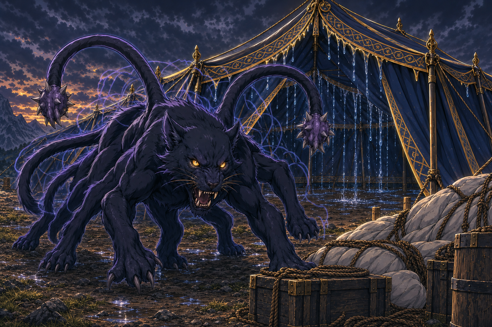

# Displacer Beasts - Storm Camp

## One-Line Summary
Displacer beasts attacking the party during the active encounter at the storm stop on the route to an unidentified tower.

## Status
- Table role: DM-controlled / NPC creatures.
- [Table-side] [Confirmed on 2026-10-03] The party is being attacked by displacer beasts; multiple attackers are reported, without an exact count.
- [Confirmed subsequent event] One beast enters Dain's Leaky Tent and attacks him twice. Both rolls are below his AC and miss; Dain remains at **28 HP**.
- [Derived custom effect] The entering beast becomes **Wet**, granting fire resistance and cold/lightning vulnerability until 10 minutes of drying or taking one of those damage types. The missed attacks do not end Wet.
- [To verify] Total count, other positions/targets/actions, exact attack totals, encounter outcome, motives, stat block and table-specific creature mechanics.
- [To verify] Whether their attack caused the long-rest interruption. The user has not explicitly connected these events.
- [Illustrative visual only] The scene uses a panther-like beast with six legs, shoulder tentacles and offset outlines. Its exterior position, pose and appearance interpret the creature name; they are not additional observed facts or a mechanical ruling.

## What Dain Knows
- [Derived awareness] A beast enters the tent and directly attacks Dain twice, alerting him to the immediate threat. He was unaware at battle onset.
- Recognition of the creature's name and knowledge of other attackers or the wider fight remain unreported.
- Both attacks miss. HP remains **28**; no Dain action, reaction or resource use is reported.

## Notable Events
- 2026-10-03: The user identifies displacer beasts as the party's attackers after the tent scene with Harry and her talking hammer. [Session](../../Adventures/2026-10-03.md)
- 2026-10-03: One beast enters Leaky Tent and misses Dain twice. [Derived] The attacks alert Dain, and entry makes the beast Wet. [Session](../../Adventures/2026-10-03.md)

*Strike depiction, poses and framing are illustrative; no Dain reaction, spell, injury or tent damage is established. [Prompt and references](../../Adventures/2026-10-03/displacer-beast-misses-image-notes.md).*

## Related Entries
- [Truthammer's Leaky Tent](../Powers/Truthammer%20Leaky%20Tent.md)
- [Dain Truthammer](./Dain%20Truthammer.md)
- [Hammerton Harry Drizddon](./Hammerton%20Harry%20Drizddon.md)
- [Current State](../../Character/Current%20State.md)
- [Open Threads](../Lore/Open%20Threads.md)
