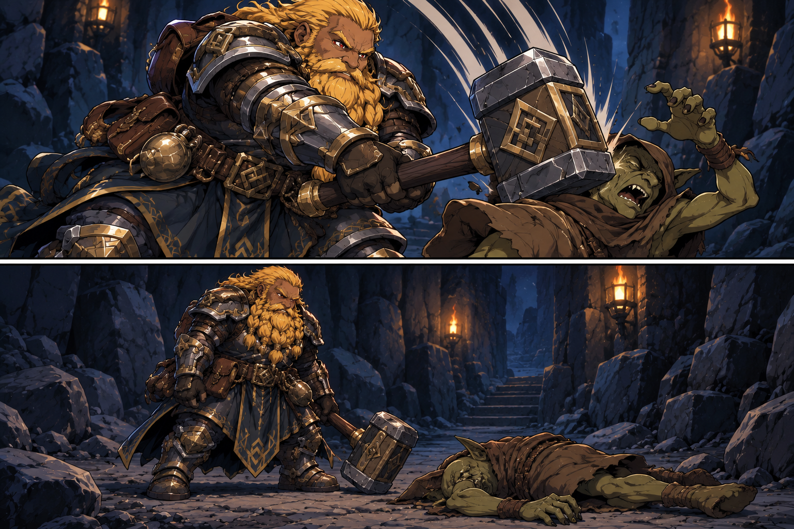

# Goblin Hit By Thunderclap - 2026-10-10

- Two panels illustrate the supplied movement and table-reported spell outcome. Positions, poses, pulse/terrain/light are illustrative; no measured radius, push, extra damage or general darkness-dispelling property is established. [Image notes](../../Adventures/2026-10-10/bottleneck-thunderclap-image-notes.md).

## One-Line Summary

The unidentified goblin that takes 6 damage from Dain's bottleneck Thunderclap, then is contextually the target of Harry's hammer hit and explicitly dies.

## Table Role

- **Unknown / To verify**: no individual identity or explicit control assignment is supplied.
- Descriptive recipient entry; not merged with the fallen javelin thrower, grenade/earlier javelin attacker, wall-crack/visible/flanking goblins, captives or Yuckie. No additional counted camp population is established.

## Status

- [Latest confirmed outcome, 2026-10-10] **Dead after Harry hits it with a hammer.** The immediate follow-up's “the goblin” is indexed here from the preceding Thunderclap beat. Numerical hammer damage, prior/final HP, precise impact and body/loot handling remain unreported. [Session](../../Adventures/2026-10-10.md).

- [Preceding damage] **Took 6 damage from Dain's Thunderclap.** Numeric HP, damage type, save/roll and exact position are unreported. The subsequent hammer hit/death is now recorded above.
- The encounter darkness is removed in the same supplied beat; source/cloud identity and mechanism are unknown. No push, fall, release of restraints, extra damage or attack by this goblin is supplied.

## Harry's Hammer Hit And Death - 2026-10-10

- **Harry hits the goblin with a hammer, and it dies.** Contextually the same recipient as the preceding Thunderclap damage; no identity link to another recorded goblin is supplied.
- Death is confirmed as the follow-up to the hammer hit. No raw roll, numeric hammer damage, HP total, specific death mechanic, gore or loot/XP outcome is assigned. [Session](../../Adventures/2026-10-10.md).

- Scene staging is illustrative; the hammer hit and death are confirmed. [Exact prompt and image notes](../../Adventures/2026-10-10/harry-hammer-goblin-death-image-notes.md).

## Notable Events

- 2026-10-10: Takes **6 damage** from Dain's bottleneck Thunderclap; Harry separately takes 6. [Session](../../Adventures/2026-10-10.md).

- 2026-10-10, after Thunderclap: Harry hits the goblin with a hammer; **it dies**. Attack roll, numerical hammer damage and final HP unreported. [Session](../../Adventures/2026-10-10.md).

## Related Entries

- [Thunderclap](../Powers/Thunderclap.md)
- [Dain](./Dain%20Truthammer.md)
- [Harry](./Hammerton%20Harry%20Drizddon.md)
- [Camp](../Places/Organised%20Goblin%20Camp%20-%202026-10-10.md#dain-thunderclaps-at-the-bottleneck---2026-10-10)
- [Session](../../Adventures/2026-10-10.md)
