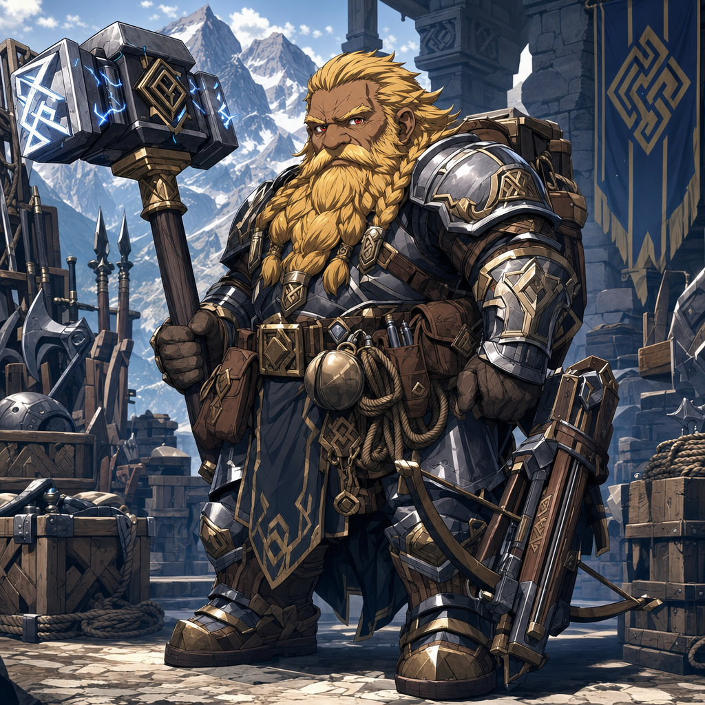

# Hammerton Harry Drizddon

## One-Line Summary
Norhan's Mountain Dwarf Fighter 3, a soldier-quartermaster and hammer-forward eldritch warrior who treats magic as one more disciplined toolset.

## Table Role
- Role: Player Character.
- Player: Norhan.
- DM: Tom.

## Source
- [Confirmed] Onboarded from [Hammerton Harry Drizddon.pdf](../../Assets/Hammerton%20Harry%20Drizddon.pdf) on 2026-05-03.
- [Retcon] The sheet confirms the character spelling as `Hammerton Harry Drizddon`; earlier repo notes used `Dresdon`.

## Status
- [Latest broader party action; Dain asleep, 2026-10-10] **Harry starts dragging the [Chest of Preserving](../Items/Chest%20of%20Preservation.md) back toward the [balloon](../Places/Party%20Skyship%20-%202026-08-29.md). An arrow from 150 feet in an unknown direction glances off her armour; she continues trying to drag it back.** Harry now handles the chest, but arrival/loading and contents/condition remain open. Shooter, bearing, attack roll, damage, HP/resource changes and transport mechanics are unreported. Dain remains innocent, asleep and unaware. [Session](../../Adventures/2026-10-10.md).
- [Latest broader party dialogue; Dain asleep] [Confirmed, 2026-10-10] **Harry says: “they shall be punished for their sins. They trying to feed their family? Punished.”** The words and speaker are confirmed; the [goblins'](./Goblin%20Intruders%20-%202026-10-10.md) actual motive or family circumstances are not. No prisoner response or additional punishment is supplied. Dain remains innocent, separately asleep and unaware. [Session](../../Adventures/2026-10-10.md).
- [Preceding broader party action; Dain asleep] [Confirmed, 2026-10-10] **Harry runs up to the cuffed [goblins](./Goblin%20Intruders%20-%202026-10-10.md) and smashes their fingers.** Their shared hand-and-foot bindings remain last confirmed. Exact implement, attack/damage rolls, damage, injury extent, waking and reaction afterward are unreported. The prisoners were last asleep before this strike; no continued sleep, resource expenditure, chest recovery or Dain awareness change is assigned. [Session](../../Adventures/2026-10-10.md).
- [Broader party encounter; Dain unaware] [Confirmed, 2026-10-10] Harry dashes/runs to the black cloud and casts [Thunderwave](../Powers/Thunderwave.md) at one [goblin](./Goblin%20Intruders%20-%202026-10-10.md). **The goblin is pushed out of the darkness; another patch of darkness disappears.** Damage, saves, push distance, casting level/source and remaining resources are unreported. The reported movement and cast do not establish Action Surge use or complete turn order. [Session](../../Adventures/2026-10-10.md).
- [Party] [Confirmed, 2026-10-10] At the [riverside camp](../Places/Riverside%20Camp%20-%202026-10-10.md), Harry asks Dain for a gold-sifting tool. Dain conjures [one for her](../Items/Conjured%20Gold%20Sifter%20-%202026-10-10.md) with a flick while frolicking; Harry begins searching for gold, then strikes the water and rocks with her hammer **to no effect**. Sifting yield and the hammer's exact identity are unreported. [Session](../../Adventures/2026-10-10.md).
- [Latest party yield] The party stays another five hours and Jiminy mines **six more gems**. The two breaks total ten hours. No new gem allocation to Harry or Dain is reported. [Mining ledger](../Items/Spell-Storing%20Crystals%20-%202026-10-03.md#mining-ledger).
- [Confirmed] Player: Norhan.
- [Confirmed] Character name: Hammerton Harry Drizddon.
- [Confirmed, 2026-10-03] Maitland confirms Norhan is still playing this character. Current tent narration uses she/her; historical source wording is retained.
- [Prior mining action] Harry puts a leash on [Jiminy](./Jiminy.md), who mines very proficiently during a **five-hour break**. The [crystals he finds](../Items/Spell-Storing%20Crystals%20-%202026-10-03.md) each can store **one 1st-level spell**; Harry gives **one to Dain**. Remaining yield, holders and use rules are unreported. [Session](../../Adventures/2026-10-03.md)
- [Earlier discovery] Harry finds a [special gem commonly associated with spell storing](../Items/Special%20Gem%20Found%20by%20Harry.md). Its relationship to the subsequently mined crystals remains to verify.
- [Earlier scene] Sought shelter inside [Leaky Tent](../Powers/Truthammer%20Leaky%20Tent.md) and immediately argued with her [talking hammer](../Items/Harrys%20Talking%20Hammer.md). [Derived] Harry and the hammer became Wet. The tent was subsequently dismissed; no Wet-ending event for Harry or the hammer is reported. [Session](../../Adventures/2026-10-03.md)
- [Confirmed] Ancestry/species: Mountain Dwarf.
- [Confirmed] Class/level: Fighter 3.
- [Confirmed] Sheet spellcasting class: `Eldritch Fighter`.
- [To verify] The class field says `3 - Fighter (Eldrich)` while the spellcasting field says `Eldritch Fighter`; use Fighter 3 / eldritch martial archetype until the table confirms exact subclass wording.
- [Confirmed] Background: Soldier - Quartermaster. Sheet spelling says `Solider - QuartMaster`.
- [Confirmed] Alignment: TN.
- [Confirmed] XP: 1775.
- [Party] [Confirmed] Present at the forest camp when [Brother Taleesh](./Brother%20Taleesh.md) arrives on 2026-05-03.
- [To verify] In-world introduction to [Dain Truthammer](./Dain%20Truthammer.md) and the party is only partly logged; his presence is established, but how he joined the mission is not.

## Latest Encounter Scene - 2026-10-10

- Her pull, arrow glance and continuing attempt follow the report. Pose, grip, contact point, arrow deflection angle and staging are illustrative; no firing direction, shooter, damage, armour breakage, arrival/loading or resource change is established. [Prompt and references](../../Adventures/2026-10-10/harry-chest-arrow-image-notes.md).

## Earlier Punishment Statement - 2026-10-10

- Harry's punishment statement is recorded above. Gesture, expression, pose and camp staging are illustrative; the image supplies no further attack, prisoner response, confirmed family motive, divine approval or Dain involvement. [Prompt and references](../../Adventures/2026-10-10/harry-punishment-statement-image-notes.md).

## Earlier Finger-Strike Scene - 2026-10-10

- The action follows the reported finger strike; pose, expression, motion marks and camp layout are illustrative. Any implement and the actual contact are obscured. No numerical damage, injury extent, waking/reaction, continued sleep, magical activation or Dain awareness change is established. [Prompt and references](../../Adventures/2026-10-10/harry-prisoner-strike-image-notes.md).

## Earlier Thunderwave Scene - 2026-10-10

- Two successive moments, with no new injury, damage/save roll or Dain awareness. The metal-deck staging, pose, spell visuals and cloud arrangement are illustrative, not a confirmed location or map. [Prompt and references](../../Adventures/2026-10-10/harry-thunderwave-image-notes.md).

## What Dain Knows
- [Party] Dain has interacted with Hammerton Harry Drizddon enough to delegate the trader cost-setting to him; the formal in-world introduction is still [To verify].
- [Party] Dain delegates the cost-setting for the southern traders' possible guidance or accompaniment to Hammerton / Norhan after persuading the traders to trust the party. [Confirmed on 2026-05-03]
- [Party] Called Dresden at the table during the trader negotiation after the [Coal Mine Puppet](../Items/Coal%20Mine%20Puppet.md) reveal. [To verify table shorthand vs character-name variant]
- [Party] Hammerton / Dresden asks for more from the [Southern Human Traders](../Factions/Southern%20Human%20Traders.md) because the original deal was negotiated before the party knew about the puppet. Dain defuses the escalation by keeping the original deal and adding five truthful answers due upon delivery. [Confirmed on 2026-05-03]
- [Party] On 2026-06-20, Harry / Hammerton asks Truthammer for [Dain's Seal](../Items/Dains%20Seal.md); Dain provides it in exchange for `100 gp` worth of silver, which Dain then bets in the dice game. [To verify whether the notebook's "Harry" is Hammerton, exact seal object, and whether the seal can be reclaimed]
- [Character-only] On 2026-07-11, Dain overhears his father say a sigil was used by someone for gold, identified table-side as Norhan, and that a repeat will require investigation. Since Norhan plays Hammerton, Hammerton/Harry is the likely in-world actor. [Inferred; To verify whether this is the 2026-06-20 seal exchange or a separate use]
- [To verify] Whether Dain knows Hammerton's quartermaster history, spellcasting, military rank, or relationship to the current mission.

## What The Party Knows
- [Broader party; Dain unaware] Harry is now dragging the chest toward the balloon. An arrow from 150 feet in an unknown direction glances off her armour, and she keeps trying to drag it back. The source does not identify a shooter or establish completed arrival.
- [To verify] How Hammerton joins, or has joined, the current mountain-road mission.
- [Party] Hammerton is holding up and inspecting a severed lizard head when Brother Taleesh arrives at the forest camp. [To verify source and significance]
- [Character-only] Dain sees Hammerton holding the severed lizard head, initially thinks it is the "lizard" Kagrenac announced, then realizes the mistake and challenges the actual arrival.
- [Party] After Dain's natural `20` Persuasion check with the [Southern Human Traders](../Factions/Southern%20Human%20Traders.md), Dain delegates to Hammerton / Norhan to determine the cost, with Dain requesting half paid upfront. [To verify final terms]
- [Party] Once the [Coal Mine Puppet](../Items/Coal%20Mine%20Puppet.md) proves more dangerous and mysterious than the party first knew, Hammerton / Dresden asks for more; Dain's compromise adds five truthful answers upon delivery instead of reopening the original material payment.
- [Party] During goblin camp breakfast diplomacy, Hammerton / Norhan goes around the outside of the tent and convinces goblins one by one to eat with the party. [Confirmed on 2026-05-03]
- [Party] As the party leaves the goblin camp, the moon elf and fighter dwarf steal a [Goblin Camp Chest](../Items/Goblin%20Camp%20Chest.md) while the goblins are under the influence of the styx / sytxweed potion. [Confirmed on 2026-05-03] [To verify whether "fighter dwarf" refers to Hammerton]
- [Party] The moon elf and Norhan open the [Goblin Camp Chest](../Items/Goblin%20Camp%20Chest.md) and find `500 gp` plus a [Mask of Changed Appearance](../Items/Mask%20of%20Changed%20Appearance.md). [Confirmed on 2026-05-03]
- [Party] During the smoky cave encounter, Hammerton / Norhan attacks the [Werebear at Smoky Cave](./Werebear%20at%20Smoky%20Cave.md) with a hammer, missing once and hitting once. [Confirmed on 2026-05-03] [To verify damage and exact hammer]
- [To verify] Whether the party knows about the sheet-listed `Slave collar`, what it means, and whether it is still present.

## Appearance
- Age: 132.
- Height: 4'9".
- Weight: 140 lb.
- Eyes: Red.
- Skin: Tan.
- Hair: Golden.
- Visual anchors: compact mountain dwarf soldier, heavy armor, hammer-first posture, quartermaster pouches, supply discipline, practical scrutiny, and restrained arcane force worked into the weapon rather than flashy wizardry.

## Personality And Roleplay Cues
- Personality trait: "I solve problems with hammer and sometimes even paper work."
- Ideal: "No one left is behind, unless it is a risk."
- Bond: "If you like my hammer you are a friend."
- Flaw: "I'm busy with my hammer or calculating supply and will miss whats going on."
- Table read: exacting, blunt, supply-minded, brave under pressure, and more comfortable with gear, stone, weapons, and logistics than emotional nuance. [Inferred]

## Backstory
Knowledge boundary: sheet-provided backstory for Hammerton; not established as known to Dain unless revealed in play.

- Raised in a mountain hold guarding a vital trade pass.
- Began as a quartermaster who counted weapons, maintained gear, and rejected flawed forge-work.
- Earned the nickname by testing steel by sound, striking each piece until he trusted it.
- During a convoy ambush, with officers dead and supplies at risk, Hammerton took control.
- He reorganized weapons, rationed bolts, used terrain as a choke point, and kept the unit alive until reinforcements arrived.
- That action earned him rank, respect, and authority.
- He turned to magic afterward as a matter of control, treating arcane study as another toolset for reinforcing steel and structure.
- Now he operates as a soldier-quartermaster and eldritch warrior, preparing others for the kind of chaos he survived.
- Sheet note: `4 campaigns` [To verify meaning].

## Mechanical Snapshot
- AC: 18.
- HP: 31/31.
- Initiative: +1.
- Speed: 35 ft.
- Proficiency Bonus: +2.
- Hit Dice: 3 total; sheet HP notation `10+9+6`.
- Ability Scores: STR 18 (+4), DEX 12 (+1), CON 14 (+2), INT 15 (+2), WIS 7 (-2), CHA 11 (+0).
- Saving Throws: STR +6, DEX +1, CON +4, INT +2, WIS -2, CHA +0.
- Passive Perception: 8.
- Strongest skill: Athletics +6.
- Other visible skills: Acrobatics +3, Animal Handling -2, Arcana +2, Deception +0, History +2, Insight -2, Intimidation +2, Investigation +2, Medicine -2, Nature +2, Perception -2, Performance +0, Persuasion +0, Religion +2, Sleight of Hand +1, Stealth +1, Survival +0.

## Combat And Features
- War hammer, two-handed notation: +6 to hit, `d8/10+4`.
- `[E]Dwarven Hammer`: +8 to hit, `2d6+8`. [To verify exact item name, enchantment, and ownership details]
- Heavy Crossbow: +3 to hit, `1d10+1`.
- Action Surge: extra action, short rest.
- Second Wind: bonus action, short rest, `1d10 + level`.
- Mobile feat: +10 speed; sheet shorthand notes movement/running benefit. [To verify exact table wording]
- Darkvision.
- Dwarven Resistance: advantage against poison and resistance to poison damage.
- Stonecunning: enhanced History checks related to stonework.
- Military Rank: can command respect, access supplies, and call in favors from allied military units.

## Spellcasting
- Spellcasting Ability: INT +2.
- Spell Save DC: 12.
- Spell Attack Bonus: +4.
- 1st-level slots: 2.
- Cantrips: `Booming Blade` (`1d8`, 5 ft.), `Sword Burst` (`1d6`, 5 ft.).
- 1st-level spells: `Magic Missile`, `Slivery Barbs`, `Thunderwave`.
- [To verify] Sheet says `Slivery Barbs`; likely `Silvery Barbs`, but preserve the sheet spelling until confirmed.
- Thunderwave sheet notation: `15ft cube-2d8 con sav+10ft push, Fail noP`.
- [Confirmed use, 2026-10-10] Harry casts [Thunderwave](../Powers/Thunderwave.md) at a goblin in darkness, pushing it out. The earlier sheet notation is not a reported save, damage roll, current push distance or resource total for this scene.

## Proficiencies And Gear
- Armor: all armor.
- Weapons: all martial weapons; sheet also lists Battle Axe, Hand Axe, Light Hammer, War Hammer, and Heavy Crossbows.
- Tools: Dice Set, Smith's Tools, vehicles (land).
- Languages: Common, Dwarven. Sheet spelling says `Drawrven`.
- Armor/clothing carried or listed: Plate Armour, Chain mail, Scale mail.
- Weapons listed: Dwarven Hammer (+2), War Hammer, Great Weapon, Daggers.
- Potions: Healing Potion `2d4+4`, Speed Potion, Fire Breath Potion - 30 ft. cone.
- Other sheet-listed gear: Slave collar, Explorer's Pack, Flask of Honey [To verify; sheet says `Flack of Honey`], Wax Ear Plug.
- Explorer's Pack contents: backpack, bedroll, mess kit, tinderbox, 10 torches, 10 days rations, waterskin, and 50 ft. rope.

## Treasure And Oddities
- [Confirmed on 2026-10-03] Jiminy's mined spell-storing crystals each can store **one 1st-level spell**; Harry gives **one to Dain**. The number Harry retains is unreported. [Crystal record](../Items/Spell-Storing%20Crystals%20-%202026-10-03.md).
- [Confirmed discovery on 2026-10-03] One [special gem commonly associated with spell storing](../Items/Special%20Gem%20Found%20by%20Harry.md). Harry is the finder; actual powers, value, retention/ownership and inclusion in the preceding 5,000 gp gem total remain unreported.
- Bomb, 60 ft.; `1d12`, Dexterity save for half damage; sheet value 150 gp.
- Snake head - Youati enemy head. [To verify spelling and context]
- Bunny ears shaped weathered rock, jade, about 50 gp or more to the right person.
- Bunny ears shaped weathered rock, yellow quartz, 80 gp.
- Nuggets of silver, 350 gp.
- Small ammonite, 5 gp.
- Ogre teeth set, no listed value; intended necklace as a victory token.
- Ogre loin cloth for lizard warmth.
- Ogre meat for lizard food.

## Allies And Organizations
- Agnland Olorran - Commander, Dwarven Mountains. [To verify spelling; may connect to [Commander Agland](./Commander%20Agland.md)]

## Relationship Hooks
- Another dwarf in the player roster may complicate [Brother Taleesh](./Brother%20Taleesh.md)'s distrust of dwarves.
- Dain may be curious about Hammerton's arcane martial practice, especially if it is expressed through runes, thunder, and practical weapon reinforcement.
- Hammerton's quartermaster instincts may pair well with Dain's strange-magic curiosity when supplies, repairs, or improvised plans matter.
- The sheet-listed `Slave collar` needs care before becoming in-world canon for the party; confirm whether it is a present item, history marker, joke note, or unresolved condition.

## Notable Events
- 2026-05-03: Added to the Codex from the user-provided player roster.
- 2026-05-03: Corrected spelling and expanded from the uploaded character sheet PDF.
- 2026-05-03: Present at the forest camp holding up and inspecting a severed lizard head when Brother Taleesh arrives by camel. [Session 2026-05-03](../../Adventures/2026-05-03.md)
- 2026-05-03: Dain exits the leaky tent, sees Hammerton holding the severed lizard head, initially mistakes it for the lizard Kagrenac announced, then realizes the mistake and booms "Who goes there?" with `Prestidigitation`. [Session 2026-05-03](../../Adventures/2026-05-03.md)
- 2026-05-03: Dain delegates cost-setting to Hammerton / Norhan after persuading the southern human traders to trust the party and come with them; Dain requests half paid upfront. [Session 2026-05-03](../../Adventures/2026-05-03.md)
- 2026-05-03: After the puppet reveal, Hammerton / Dresden asks for more because the original negotiation did not account for the puppet; Dain defuses the escalation by keeping the original deal and adding five truthful answers due upon delivery. [Session 2026-05-03](../../Adventures/2026-05-03.md)
- 2026-05-03: During goblin camp breakfast diplomacy, Hammerton / Norhan goes around the outside of the tent and convinces goblins one by one to eat with the party. [Session 2026-05-03](../../Adventures/2026-05-03.md)
- 2026-05-03: As the party leaves the goblin camp, the moon elf and fighter dwarf steal a [Goblin Camp Chest](../Items/Goblin%20Camp%20Chest.md) while the goblins are under the influence of the styx / sytxweed potion. [Session 2026-05-03](../../Adventures/2026-05-03.md) [To verify whether "fighter dwarf" refers to Hammerton]
- 2026-05-03: The moon elf and Norhan open the [Goblin Camp Chest](../Items/Goblin%20Camp%20Chest.md) and find `500 gp` plus a [Mask of Changed Appearance](../Items/Mask%20of%20Changed%20Appearance.md). [Session 2026-05-03](../../Adventures/2026-05-03.md)
- 2026-05-03: At the [Smoky Scratch-Marked Cave](../Places/Smoky%20Scratch-Marked%20Cave.md), Hammerton attacks the [Werebear at Smoky Cave](./Werebear%20at%20Smoky%20Cave.md) with a hammer, missing once and hitting once. [Session 2026-05-03](../../Adventures/2026-05-03.md) [To verify damage and exact hammer]
- 2026-06-20: Harry / Hammerton asks Truthammer for [Dain's Seal](../Items/Dains%20Seal.md); Dain provides it in exchange for `100 gp` worth of silver, then bets that silver in the tavern dice game. [Session 2026-06-20](../../Adventures/2026-06-20.md) [To verify exact object and current holder]
- 2026-07-11: Dain overhears his father tell the gnomes that he is disappointed a sigil was used for gold by someone identified table-side as Norhan and that another use will require investigation. [Session 2026-07-11](../../Adventures/2026-07-11.md) [Inferred Hammerton connection; To verify]

- 2026-10-03: Seeks shelter inside Dain's Leaky Tent and immediately starts arguing with her talking hammer. Words, cause and outcome are unreported. Maitland confirms Norhan is still playing Harry; this is not a newly introduced character. [Session](../../Adventures/2026-10-03.md)
- 2026-10-03: Finds a special gem described as commonly associated with spell storing. The narration names Norhan; the established roster places the find with Harry. Identity, confirmed powers, value and retention remain unreported. [Gem](../Items/Special%20Gem%20Found%20by%20Harry.md); [Session](../../Adventures/2026-10-03.md)

- 2026-10-03: Puts a leash on Jiminy for proficient mining during a five-hour break and gives Dain one of the resulting crystals. Each can store one 1st-level spell. [Jiminy](./Jiminy.md); [Crystals](../Items/Spell-Storing%20Crystals%20-%202026-10-03.md); [Session](../../Adventures/2026-10-03.md).

*The gift is confirmed; visual details do not establish a loaded spell or use rules. [Prompt and references](../../Adventures/2026-10-03/spell-storing-crystal-image-notes.md).*

*Portrait and cave continuity are preserved. Gem appearance, pose and handling illustrate the find without establishing active magic, a stored spell, identification or ownership. [Prompt and references](../../Adventures/2026-10-03/harry-special-gem-image-notes.md).*

- 2026-10-10: Harry starts dragging the Chest of Preserving back toward the balloon, has an arrow from 150 feet in an unknown direction glance off her armour, and continues trying to drag it back. No damage or completed return is supplied. [Session](../../Adventures/2026-10-10.md).

## River Prospecting - 2026-10-10

- Harry requests and uses a conjured gold-sifting tool, then strikes the water and rocks with a hammer. Only the hammer attempt is explicitly reported as having no effect; no gold-sifting yield is supplied.
- Hammer shape follows the existing portrait for illustration continuity, without identifying this as the talking hammer or the sheet's +2 weapon. Tool shape, golden rim, sparks and staging are illustrative. [Prompt and references](../../Adventures/2026-10-10/harry-river-prospecting-image-notes.md).

## Related Entries
- [Conjured Gold Sifter](../Items/Conjured%20Gold%20Sifter%20-%202026-10-10.md)
- [Riverside Camp](../Places/Riverside%20Camp%20-%202026-10-10.md)
- [River Gold Search](../Lore/Open%20Threads.md#harrys-river-gold-search)
- [Jiminy](./Jiminy.md)
- [Spell-Storing Crystals](../Items/Spell-Storing%20Crystals%20-%202026-10-03.md)
- [Special Gem Found by Harry](../Items/Special%20Gem%20Found%20by%20Harry.md)
- [Harry's Talking Hammer](../Items/Harrys%20Talking%20Hammer.md)
- [Table Roster](../Lore/Table%20Roster.md)
- [Open Threads](../Lore/Open%20Threads.md)
- [Relationships](../../Character/Relationships.md)
- [Dain Truthammer](./Dain%20Truthammer.md)
- [Brother Taleesh](./Brother%20Taleesh.md)
- [Commander Agland](./Commander%20Agland.md)
- [Southern Human Traders](../Factions/Southern%20Human%20Traders.md)
- [Coal Mine Puppet](../Items/Coal%20Mine%20Puppet.md)
- [Dain's Seal](../Items/Dains%20Seal.md)
