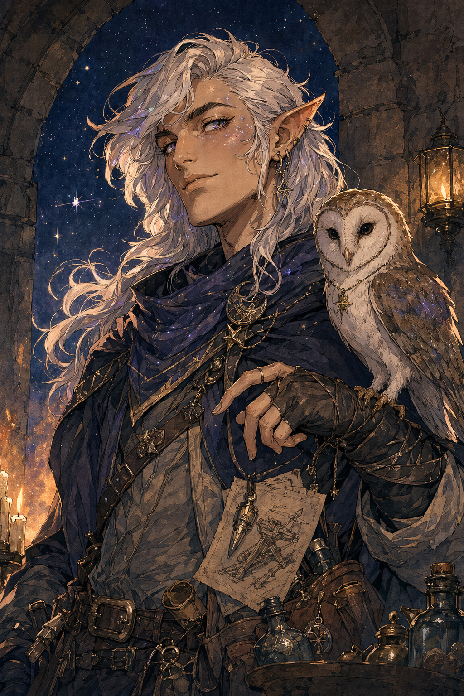

# Kagrenac

## One-Line Summary
Matt's Astral Elf party member whose boldness, owl, and questionable ballista judgment have earned Dain's increased respect.

## Table Role
- Role: Player Character.
- Player: Matt / Matthew.
- Character aliases: Kagrenac; The Astral Elf.
- Table shorthand: **Moon elf**, confirmed by Maitland on 2026-10-10 as Matt's identity at the table. The established roster maps Matt to Kagrenac; this clarification reports no new ancestry mechanics.
- DM: Tom.

## Status

- [Confirmed latest intention, 2026-10-10] **Kagrenac wants to fly the blimp and “blow them up” with [guano in the Bag of Holding](../Items/Guano%20in%20the%20Bag%20of%20Holding%20-%202026-10-10.md).** Matt resolves through the roster to Kagrenac. Target, piloting, takeoff, guano handling, ignition, explosion and outcomes are unreported. Dain separately wants captive leverage to learn why the snake people organise goblins; no choice or relationship change is supplied. Guano storage is confirmed, with amount/source/bag identity unknown. [Session](../../Adventures/2026-10-10.md).

- [Broader party discovery; Confirmed, 2026-10-10] **[Kagrenac's owl](./Kagrenacs%20Owl.md) finds [an organised goblin camp](../Places/Organised%20Goblin%20Camp%20-%202026-10-10.md).** Matt resolves through the roster to Kagrenac. No camp location, population, leader, prisoner affiliation, scouting roll, communication/return, new Kagrenac spell/action or resource cost is supplied. Effects on the earlier snake pursuit remain open. [Session](../../Adventures/2026-10-10.md).
- [Broader encounter] [Confirmed latest spell attempt, 2026-10-10] **Kagrenac casts [Fire Bolt](../Powers/Fire%20Bolt.md) at the snakes in the distance and fails.** No attack roll, exact failure cause, particular individual target, hit, damage, spell source/class or resource cost is supplied. The owl's response to his earlier direction remains open. [Snakes](./Flying%20Snakes%20-%202026-10-10.md); [session](../../Adventures/2026-10-10.md).
- [Broader encounter] [Confirmed latest command, 2026-10-10] **Kagrenac commands [his established owl](./Kagrenacs%20Owl.md) toward the three airborne snakes flying toward the retreating party.** The owl's response and any effect are unreported. No flight, attack, Help action, summon, roll, spell or resource use is assigned. The target group is separate from the one snake remaining at Stu and the two confirmed deaths. [Snakes](./Flying%20Snakes%20-%202026-10-10.md); [session](../../Adventures/2026-10-10.md).
- [Broader party encounter; Dain unaware then] [Confirmed preceding action, 2026-10-10] After Stu pursues the goblins in brown-bear form, **Kagrenac puts both goblins to sleep**. They fall dramatically to the ground, with the chest causing a dramatic slide through the dirt. Exact sleep method/spell, rolls, level, duration and resources are unreported; the wording does not confirm the named Sleep spell. No damage, waking, chest recovery or Dain awareness change is supplied by that beat. [Session](../../Adventures/2026-10-10.md); [goblins](./Goblin%20Intruders%20-%202026-10-10.md).
- [Party] [Confirmed, 2026-10-10] Matt's moon elf / Kagrenac is aboard the balloon carriage with [Stu](./Stu.md), who is working on a white-wolf cloak in brown-bear form, and [Christina](./Christina.md). [Session](../../Adventures/2026-10-10.md).
- [Confirmed, 2026-10-03; established roster attribution] Matt / Kagrenac loads **Cure Wounds into one of Dain's two spell-storing stones**. Dain will choose the other spell later. Exact loading method, action cost and spell-slot expenditure are unreported. [Stone contents](../Items/Spell-Storing%20Crystals%20-%202026-10-03.md#current-holdings); [Session](../../Adventures/2026-10-03.md).
- [Party] [Confirmed] Name: Kagrenac. User confirmation recorded 2026-05-03.
- [Party] [Confirmed] Player: Matt. User confirmation recorded 2026-05-03.
- [Party] [Confirmed] Kagrenac is an Astral Elf traveling with the party.
- [Party] [Confirmed] Kagrenac has an owl that spotted the ogres before they fully reached camp.
- [Character-only] [Confirmed] Dain recorded `+4` respect for Kagrenac after hearing that he tried to fire Yuckie from a ballista.
- [Party] [Confirmed] Kagrenac did not receive or wear the `Ghostly Form Tattoo`; Dain received that reward instead. [Retcon] User correction recorded 2026-05-03.
- [Party] [Confirmed on 2026-07-11] Kagrenac declares that he no longer trusts Dain and accuses Dain of murdering a dwarf connected to the hidden tunnel history.
- [To verify] Class, pronouns, motives, and relationship to Yuckie.

## Proposed Blimp And Guano Attack - 2026-10-10

- The blimp and closed satchel occur only inside Kagrenac's thought bubble; this shows intention, with no flight, guano handling, target or explosion. Poses, clothes, light, carriage crop and fine cuffs are illustrative. No captive reply, injury recovery or agreed plan is established. [Image notes](../../Adventures/2026-10-10/dain-and-kagrenac-goblin-plans-image-notes.md).

- [Confirmed intention] Fly the blimp and use stored guano to “blow them up”. The referent of “them” remains [To verify]. No flight, attack, guano consumption or explosive rule is established.
- [Current holding] Guano is in the Bag of Holding; quantity, source, owner/carrier and specific bag identity are unreported. No earlier harvest, recipe or spell preparation is inferred.
- [Other stated aim] Dain wants captive leverage to learn why the snake people organise goblins. No agreement, argument, chosen approach or changed respect score is reported. [Session](../../Adventures/2026-10-10.md).

## Failed Fire Bolt Attempt - 2026-10-10

- The small fire cue represents the named casting attempt illustratively; it does not establish a roll, precise failure cause, range, successful hit or snake response. The owl is outside the frame, with its next action still unreported. [Image notes](../../Adventures/2026-10-10/kagrenac-fire-bolt-image-notes.md).

## Owl Command - 2026-10-10

- The directing gesture and perched owl stage the command without illustrating a completed owl action. Posture, perch, head orientation and spacing are illustrative; no flight, interception, attack or Help effect is established. [Image notes](../../Adventures/2026-10-10/kagrenac-owl-command-image-notes.md).

## Goblins Put To Sleep - 2026-10-10

- The effect is confirmed; the hand gesture and golden glimmer are illustrative, without assigning a named spell, components, roll, duration or resource cost. No new Dain awareness is established. [Image notes](../../Adventures/2026-10-10/bear-chase-and-sleep-image-notes.md).

## What Dain Knows
- [Character-only] Kagrenac is audacious enough to try launching Yuckie from a ballista.
- [Character-only] Dain respects this more than he probably should.
- [Character-only] Dain has promised to help Kagrenac make the mountain ascent safely.
- [Character-only] Dain suggests Kagrenac may be interested in Taleesh's goji leaves after refusing them himself. [To verify whether Kagrenac is actually interested]
- [Character-only] The 2026-07-11 notebook records `+13` respect connected to Kagrenac. [To verify direction, triggering beat, and resulting total]

## What The Party Knows

- [Broader discovery record; Confirmed] Kagrenac's owl finds an organised goblin camp. Exact information relay and who receives which details are unreported. [Camp](../Places/Organised%20Goblin%20Camp%20-%202026-10-10.md); [session](../../Adventures/2026-10-10.md).
- [Broader encounter] Kagrenac's named Fire Bolt attempt at the distant snakes fails on 2026-10-10. The particular target, roll, failure cause and spell source remain unreported. [Session](../../Adventures/2026-10-10.md).
- [Broader encounter] Kagrenac directs his owl toward the three airborne snakes pursuing the retreating party on 2026-10-10. The command's result remains unreported. [Session](../../Adventures/2026-10-10.md).
- [Party] Kagrenac's owl warned the party about the approaching ogres at the creek-fork camp.
- [Party] Kagrenac killed Dain's suggested enemy before the party could exploit the enchantment further after the harpy fight.
- [Party] Kagrenac cast `Thaumaturgy` on himself and addressed Brother Taleesh in Draconic when Taleesh arrived at the forest camp.
- [Party] Kagrenac then told the party in Common that "a lizard has arrived," referring to Brother Taleesh.
- [Party] Dain refers to Kagrenac as "the young elf" and suggests he may be interested in Taleesh's goji leaves. [To verify Kagrenac's response]
- [Party] At the start of the new day after the forest long rest, Kagrenac warns the party that the cold winds will get worse today. [To verify source or method]
- [Character-only] Kagrenac tells Dain in Draconic that the [Southern Human Traders](../Factions/Southern%20Human%20Traders.md) and other newcomers are glowing in magic. [To verify detection source]
- [Party] During goblin camp breakfast diplomacy, Kagrenac / Matt poisons the shared food with [Sytxweed Plant](../Items/Sytxweed%20Plant.md); the goblins eat it and forget about the party, while the leader remains charmed and happy the party is there for now. [Confirmed on 2026-05-03] [To verify plant spelling, source, quantity, and mechanics]
- [Party] As the party leaves the goblin camp, the moon elf and fighter dwarf steal a [Goblin Camp Chest](../Items/Goblin%20Camp%20Chest.md) while the goblins are under the influence of the styx / sytxweed potion. [Confirmed on 2026-05-03] [Identity clarified by Maitland on 2026-10-10]
- [Party] The moon elf and Norhan open the [Goblin Camp Chest](../Items/Goblin%20Camp%20Chest.md) and find `500 gp` plus a [Mask of Changed Appearance](../Items/Mask%20of%20Changed%20Appearance.md). [Confirmed on 2026-05-03] [Identity clarified by Maitland on 2026-10-10]
- [Party] About 30 minutes after leaving the goblin camp, Kagrenac's owl spots the [Smoky Scratch-Marked Cave](../Places/Smoky%20Scratch-Marked%20Cave.md): a cave/nest with fur on rocks, smoke coming out, and very large four-claw scratch marks on nearby trees. [Confirmed on 2026-05-03]
- [Party] During the werebear fight at the smoky cave, the moon elf summons a weasel from a [Bag of Tricks](../Items/Bag%20of%20Tricks.md); the werebear tries to hit and swing at it but completely misses. [Confirmed on 2026-05-03] [Identity clarified by Maitland on 2026-10-10]
- [Party] Matt casts `Inflict Wounds` on the [Werebear at Smoky Cave](./Werebear%20at%20Smoky%20Cave.md), delivering the killing blow. [Confirmed on 2026-05-03] [To verify whether this was Kagrenac's action and exact spell source/resource]
- [Party] After the 2026-07-11 long rest, Kagrenac states that he no longer trusts Dain and accuses him of murder. The DM later clarifies that the armor Kagrenac uses as evidence would not realistically belong to Dain's missing friend; it more likely belonged to a separate dwarf who searched for the friend. [Inferred owner; To verify identity]
- [Party] On the approach to the Truthhammer gates, the character described as the moon elf notices airships and decides to head to the mountains first, changing his immediate priority from Agland's letter to delivering armor to Dain's father. [Moon-elf identity clarified on 2026-10-10; To verify which armor, carrier, and reason]

## What Is Uncertain
- [To verify] The Fire Bolt attempt's spell source, individual target, attack roll and precise failure cause. No named class, multiple targets, area effect or new Dain spell is established.
- [To verify] The owl's response to the current snake direction, any later movement/action, and the command's mechanical method or cost.
- [To verify] Whether Kagrenac understood Dain's plan for the suggested enemy.
- [To verify] Whether the owl is familiar, companion, trained scout, or another magical feature.
- [To verify] Whether Draconic is one of Kagrenac's known languages or was enabled by another feature.
- [To verify] Whether Kagrenac's worsening-wind warning comes from magic, survival knowledge, travel experience, or another feature.
- [To verify] Whether Kagrenac's perception of magical glow comes from a spell, feature, item, innate sense, or inference.
- [To verify] Whether Kagrenac owns or used the Bag of Tricks, and which Bag of Tricks type produced the weasel.
- [To verify] Whether Kagrenac has `Inflict Wounds`, gained it through an item/feature, or whether Matt was acting through a different character or effect.

## Description
- Astral Elf.
- [Inferred] Reads as bold, impulsive, and tactically useful.

## Notable Events
- 2026-04-18: Yuckie tells Dain that Kagrenac tried to launch him from a ballista; Dain gains `+4` respect. [Session 2026-04-18](../../Adventures/2026-04-18.md)
- 2026-04-18: Kagrenac's owl spots two ogres crossing the creek toward camp and alerts the party. [Session 2026-04-18](../../Adventures/2026-04-18.md)
- 2026-04-18: After the harpy battle, Kagrenac kills Dain's suggested target before the party can do anything more with it. [Session 2026-04-18](../../Adventures/2026-04-18.md)
- 2026-05-03: User correction clarified that the `Ghostly Form Tattoo` reward belongs to Dain, not Kagrenac.
- 2026-05-03: User confirmed the Astral Elf's name as Kagrenac and player as Matt.
- 2026-05-03: Kagrenac cast `Thaumaturgy` on himself and addressed Brother Taleesh in Draconic during Taleesh's arrival at the forest camp. [Session 2026-05-03](../../Adventures/2026-05-03.md)
- 2026-05-03: Kagrenac told the party in Common that "a lizard has arrived," prompting Dain to initially mistake Hammerton's severed lizard head for the announced arrival, then realize the mistake and boom "Who goes there?" with `Prestidigitation`. [Session 2026-05-03](../../Adventures/2026-05-03.md)
- 2026-05-03: After refusing Taleesh's goji leaves, Dain suggests Kagrenac may be interested in them. [Session 2026-05-03](../../Adventures/2026-05-03.md)
- 2026-05-03: At the start of the next in-world day, Kagrenac tells the party that the cold winds will get worse today. [Session 2026-05-03](../../Adventures/2026-05-03.md)
- 2026-05-03: Kagrenac tells Dain in Draconic that the newcomers are glowing in magic shortly before a human trader produces the [Coal Mine Puppet](../Items/Coal%20Mine%20Puppet.md). [Session 2026-05-03](../../Adventures/2026-05-03.md)
- 2026-05-03: During goblin camp breakfast diplomacy, Kagrenac poisons the shared food with [Sytxweed Plant](../Items/Sytxweed%20Plant.md), causing the goblins who eat it to forget about the party while the leader remains charmed and happy the party is present. [Session 2026-05-03](../../Adventures/2026-05-03.md)
- 2026-05-03: As the party walks out of the goblin camp, the moon elf and fighter dwarf steal a [Goblin Camp Chest](../Items/Goblin%20Camp%20Chest.md) while the goblins are under the influence of the styx / sytxweed potion. [Session 2026-05-03](../../Adventures/2026-05-03.md) [Identity clarified by Maitland on 2026-10-10]
- 2026-05-03: The moon elf and Norhan open the [Goblin Camp Chest](../Items/Goblin%20Camp%20Chest.md) and find `500 gp` plus a [Mask of Changed Appearance](../Items/Mask%20of%20Changed%20Appearance.md). [Session 2026-05-03](../../Adventures/2026-05-03.md) [Identity clarified by Maitland on 2026-10-10]
- 2026-05-03: About 30 minutes after leaving the goblin camp, Kagrenac's owl spots the [Smoky Scratch-Marked Cave](../Places/Smoky%20Scratch-Marked%20Cave.md): scratch-marked trees, fur on rocks, smoke, and very large four-claw marks. [Session 2026-05-03](../../Adventures/2026-05-03.md)
- 2026-05-03: During the werebear fight, the moon elf summons a weasel from a [Bag of Tricks](../Items/Bag%20of%20Tricks.md); the werebear tries to hit and swing at it but completely misses. [Session 2026-05-03](../../Adventures/2026-05-03.md) [Identity clarified by Maitland on 2026-10-10]
- 2026-05-03: Matt casts `Inflict Wounds` on the [Werebear at Smoky Cave](./Werebear%20at%20Smoky%20Cave.md), delivering the killing blow. [Session 2026-05-03](../../Adventures/2026-05-03.md) [To verify whether this was Kagrenac's action]
- 2026-07-11: Kagrenac declares he no longer trusts Dain and accuses him of murdering a dwarf connected to the hidden tunnel history. [Kagrenac's Murder Accusation](../Events/Kagrenac%27s%20Murder%20Accusation.md)
- 2026-07-11: After another one or two hours of walking, the moon elf notices airships near the Truthhammer gates and makes reaching the mountains to deliver armor to Dain's father the immediate priority ahead of the sealed letter. [Session 2026-07-11](../../Adventures/2026-07-11.md) [Moon-elf identity clarified on 2026-10-10]

- 2026-10-03: Matt puts Cure Wounds into one of Dain's spell-storing stones. The established roster attributes the action to Kagrenac; no release or healing is reported. [Session](../../Adventures/2026-10-03.md).

- 2026-10-10: Kagrenac commands his established owl toward the three airborne snakes flying toward the retreating party. The owl's response and any effect remain unreported. [Session](../../Adventures/2026-10-10.md).

- 2026-10-10: Kagrenac casts Fire Bolt at the snakes in the distance and fails. No roll, failure cause, hit, damage or owl response is supplied. [Session](../../Adventures/2026-10-10.md).

- 2026-10-10: Kagrenac's owl finds an organised goblin camp; location, strength, leader, prisoner connection and information relay remain unreported. [Camp](../Places/Organised%20Goblin%20Camp%20-%202026-10-10.md); [session](../../Adventures/2026-10-10.md).

- 2026-10-10: Kagrenac wants to fly the blimp and use guano from the Bag of Holding to “blow them up”, while Dain wants captive leverage to learn why the snake people organise goblins. Target, party choice and execution are unreported. [Session](../../Adventures/2026-10-10.md).

## Related Entries
- [Fire Bolt](../Powers/Fire%20Bolt.md)
- [Kagrenac's Owl](./Kagrenacs%20Owl.md)
- [Flying Snakes - 2026-10-10](./Flying%20Snakes%20-%202026-10-10.md)
- [Stu](./Stu.md)
- [Christina](./Christina.md)
- [Session 2026-10-10](../../Adventures/2026-10-10.md)
- [Spell-Storing Crystals / Stones](../Items/Spell-Storing%20Crystals%20-%202026-10-03.md)
- [Dain Truthammer](./Dain%20Truthammer.md)
- [Yuckie the Goblin](./Yuckie%20the%20Goblin.md)
- [Brother Taleesh](./Brother%20Taleesh.md)
- [Kagrenac's Murder Accusation](../Events/Kagrenac%27s%20Murder%20Accusation.md)
- [Taleesh's Herbal Stash](../Items/Taleeshs%20Herbal%20Stash.md)
- [Sytxweed Plant](../Items/Sytxweed%20Plant.md)
- [Goblin Camp Chest](../Items/Goblin%20Camp%20Chest.md)
- [Mask of Changed Appearance](../Items/Mask%20of%20Changed%20Appearance.md)
- [Bag of Tricks](../Items/Bag%20of%20Tricks.md)
- [Smoky Scratch-Marked Cave](../Places/Smoky%20Scratch-Marked%20Cave.md)
- [Werebear at Smoky Cave](./Werebear%20at%20Smoky%20Cave.md)
- [Southern Human Traders](../Factions/Southern%20Human%20Traders.md)
- [Coal Mine Puppet](../Items/Coal%20Mine%20Puppet.md)
- [Ola Dung Lot](../Places/Ola%20Dung%20Lot.md)
- [Relationships](../../Character/Relationships.md)
- [Creek-Fork Ogre Ambush](../Events/Creek-Fork%20Ogre%20Ambush.md)
- [Harpy Nest Battle](../Events/Harpy%20Nest%20Battle.md)
