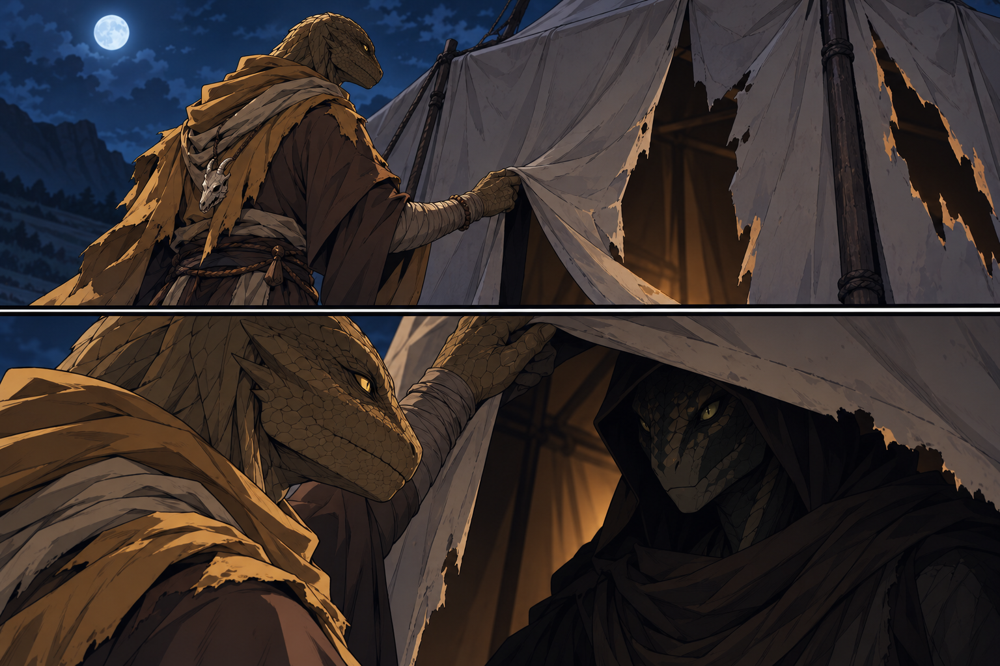
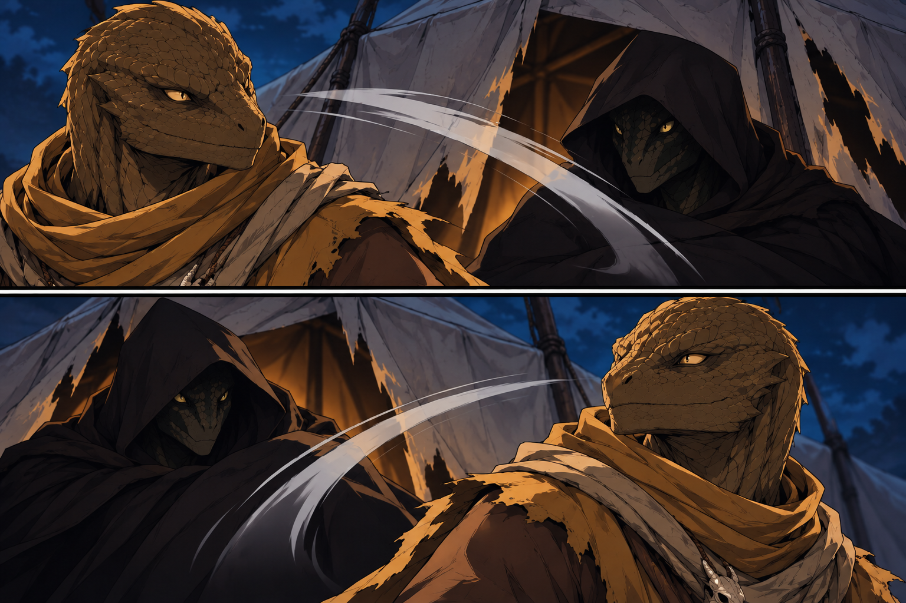

# Yuan-ti in the Main Tent - 2026-10-10

- The encounter is supplied; canvas, holes, poses, scenery and the yuan-ti's appearance are illustrative. Identity, subtype and response remain open. [Image notes](../../Adventures/2026-10-10/main-tent-yuan-ti-image-notes.md).

## One-Line Summary

The unidentified yuan-ti Taleesh encounters at the damaged main tent, contextually read as the “snake thingy” that now attacks him twice and misses both times.

## Table Role

- **Unknown / To verify**: encountered creature; no player identity or explicit control assignment is supplied. This page creates no new party member.

## Status

- [Latest attacks; contextual attacker reference, 2026-10-10] **The “snake thingy” facing [Brother Taleesh](./Brother%20Taleesh.md) makes two attacks at him; both miss.** Indexed here from the preceding face-to-face encounter. Exact attacks/rolls and individual subtype/role remain unreported. [Session](../../Adventures/2026-10-10.md).

- [Confirmed, 2026-10-10] **Taleesh goes around to the main tent Dain blasted through, lifts its canvas and comes face to face with the yuan-ti.**
- Current presence is confirmed. Name, individual identity, subtype, appearance, camp role and dialogue remain unreported; the later contextual attack report is recorded above.
- The two contextual attacks and misses are recorded above. Rolls, HP/damage, conditions, movement and a new round remain unreported. Current presence establishes no earlier Orb hit/injury or survival mechanic.

## Two Attacks At Taleesh Miss - 2026-10-10

- **The snake creature makes two attacks at Taleesh; both miss.** “Snake thingy” is contextually indexed to this yuan-ti, without assigning a new subtype or individual name.
- Attack types/weapons, rolls and range/reach are unknown. This two-attack report does not define a universal Multiattack/stat block, added fumble, injury or extra attack.
- No Taleesh reaction/Dodge/counterattack, ki, astral arms, HP/resource change, displacement or Wet ending is supplied. No commander/faction explanation, Dain warning or spell/concentration outcome is established. [Session](../../Adventures/2026-10-10.md).

- One missed attack per panel; weapons/types and rolls are unreported. Appearance, poses, motion arcs and canvas/light are illustrative, without assigning defensive actions or new damage. [Image notes](../../Adventures/2026-10-10/yuan-ti-two-misses-image-notes.md).

## Knowledge Boundary

- [Confirmed; Taleesh observes] Taleesh directly encounters the yuan-ti.
- Dain's/others' awareness, warning or communication are unreported.
- A yuan-ti at the camp does not itself identify the organising “snake people,” establish this individual as commander, answer their purpose or link it to the older captive-recovery assignment.
- No merger with a goblin, captive, Yuckie, earlier spy or Taleesh's preceding dagger target is established.

## Appearance And Rules

- [To verify] Appearance, body form, subtype, size, gender, clothing, equipment, statistics and abilities.
- The table photo is unkeyed; miniature appearance supplies no canonical weapon, subtype, size or identity.
- A scene illustration supports this encounter but does not define the yuan-ti's canonical appearance.

## Notable Events

- 2026-10-10: Main-tent face-to-face encounter after Taleesh lifts the canvas; no subsequent action or response is supplied. [Session](../../Adventures/2026-10-10.md).

- 2026-10-10: Contextually the snake creature that targets Taleesh with **two attacks, both misses**. Types, weapons and rolls unreported. [Session](../../Adventures/2026-10-10.md).

## Related Entries

- [Brother Taleesh](./Brother%20Taleesh.md#main-tent-and-yuan-ti-reveal---2026-10-10)
- [Dain Truthammer](./Dain%20Truthammer.md)
- [Camp](../Places/Organised%20Goblin%20Camp%20-%202026-10-10.md#taleesh-reveals-the-yuan-ti-at-the-main-tent---2026-10-10)
- [Chromatic Orb](../Powers/Chromatic%20Orb.md)
- [Snake People](../Factions/Snake%20People.md)
- [Camp follow-up](../Lore/Open%20Threads.md#organised-goblin-camp-and-dains-question)
- [Session](../../Adventures/2026-10-10.md)
