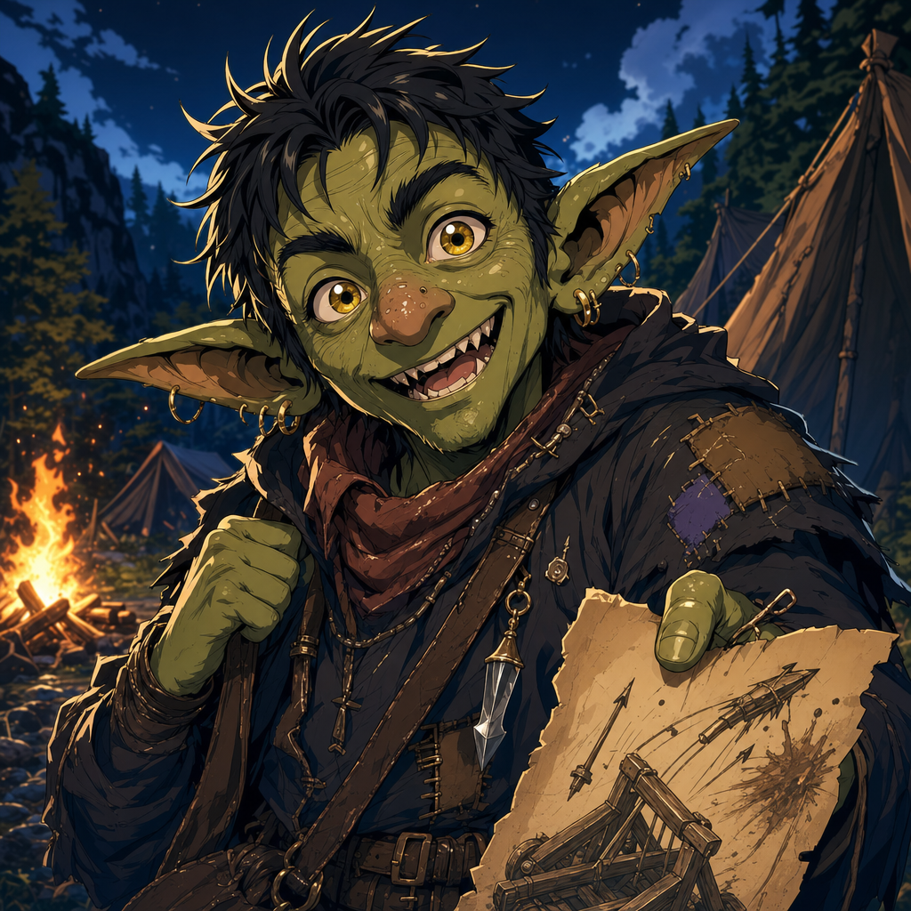

# Yuckie the Goblin

- Kagrenac's Polymorph makes Tina the giant eagle; Dain casts Minor Illusion and delivers the booming call for discussion, guaranteeing no violence. Camp response remains unreported. Poses, sound rings, plumage, camp shelters/banners/decorative devices, lights and aerial spacing are illustrative; no discovered faction emblem, tactical layout, accepted guarantee, resource ruling or attack is established. [Image notes](../../Adventures/2026-10-10/bear-eagle-camp-entrance-image-notes.md).

## One-Line Summary
Emily's goblin player character, previously played by Lachlan Pratt, who tells Dain absurd but useful stories. After his preceding prisoner haul, both captives are now awake at the balloon; no new individual Yuckie action is reported.

## Table Role
- Role: Player Character.
- Current player: Emily, confirmed on 2026-10-10.
- Former player: Lachlan Pratt, confirmed by the earlier roster.
- DM: Tom.

- Ground-group travel, Dain's bear ride and successful Suggestion follow the supplied beat. Harry's warning is reported; her roll/outcome and captive response remain open. Magic geometry, poses, fine cuffs, terrain, blimp height/design and lighting are illustrative. The staged captive placement establishes no transport arrangement, camp arrival, confession, unlimited-obedience mechanic or new damage/recovery. [Image notes](../../Adventures/2026-10-10/ground-route-suggestion-image-notes.md).

## Status

- [Latest confirmed camp entry, 2026-10-10] **Yuckie enters the goblin camp on foot with Harry, beside Dain riding bear-form Stu, backed by Tina as a giant eagle after Kagrenac's Polymorph.** Dain casts Minor Illusion and booms a call for discussion with a no-violence guarantee. Yuckie remains a separate, uncuffed party goblin; no new hauling assignment, individual dialogue, attack, roll/resource use or captive arrival is supplied. The older travel/hauling entries below describe preceding beats. [Session](../../Adventures/2026-10-10.md).

- [Preceding confirmed personal travel, 2026-10-10] **Yuckie goes on foot with Harry, Dain and Stu; Dain rides Stu in bear form. The others go by blimp.** Yuckie remains the separate, uncuffed party goblin. No new prisoner-hauling assignment, release, boarding, destination/arrival or individual spell/action is supplied for Yuckie. The older hauling and waiting entries below are chronological history. [Session](../../Adventures/2026-10-10.md).

- [Preceding broader transport outcome, 2026-10-10] The two [captives](./Goblin%20Intruders%20-%202026-10-10.md) are now **awake at the balloon**, woken by the party, after Yuckie's preceding haul. Dain asks them about organisation in rhyme. No new individual movement, waking action or dialogue is assigned to Yuckie; exact boarding/handling and the prisoners' reply remain unreported. [Session](../../Adventures/2026-10-10.md).
- [Latest confirmed continued action, 2026-10-10] **Yuckie continues pulling the same two [goblin prisoners](./Goblin%20Intruders%20-%202026-10-10.md) toward the [balloon](../Places/Party%20Skyship%20-%202026-08-29.md).** Their shared hand-and-foot cuffs remain last confirmed. No distance, check, arrival/boarding, waking/reaction, further injury or release is supplied. Dain is now awake and in battle; his specific observations/actions remain unreported. [Session](../../Adventures/2026-10-10.md).
- [Confirmed preceding drag start, 2026-10-10; Dain asleep then] **Yuckie starts dragging the two [goblin prisoners](./Goblin%20Intruders%20-%202026-10-10.md) back toward the [balloon cabin](../Places/Party%20Skyship%20-%202026-08-29.md).** Both remain cuffed together at hands and feet. Arrival/boarding and prisoner waking/reaction were unreported; Yuckie is a separate party goblin, not one of the captives. Dain was innocent, separately asleep and unaware at that point. [Session](../../Adventures/2026-10-10.md).
- [Confirmed current player and presence, 2026-10-10] Maitland identifies Emily as playing Lachlan's original goblin character, resolved through the existing roster to **Yuckie**. Yuckie finishes running up to the [two sleeping goblin intruders](./Goblin%20Intruders%20-%202026-10-10.md), then the party surrounds them and waits for them to wake. Dain remains asleep elsewhere and unaware. [Session](../../Adventures/2026-10-10.md).
- [Scene quote] **“Nightmare nightmare nightmare”** accompanies the waiting scene. Its individual speaker and any effect on the prisoners are unreported; no intimidation roll, spell or awakening is assigned.
- [Character-only] [Confirmed] Yuckie told Dain that Kagrenac tried to fire him from a ballista during camp.
- [Confirmed] User roster identifies Yuckie as Lachlan Pratt's player character on 2026-05-03.
- [Inferred] [To verify] The 2026-05-30 shared session says Lachlan's old character was captured by a gargantuan vulture-type creature; because the roster previously listed Lachlan as Yuckie's player, this may refer to Yuckie.
- [To verify] Yuckie's detailed in-world party role, long-term loyalty, how long Dain has known him, and the intervening history behind his confirmed presence after the earlier possible capture report. No rescue or escape is invented.

## What Dain Knows
- [Character-only] Yuckie is willing to bring Dain odd, actionable social information.
- [Character-only] Dain treats Yuckie's nonsense as potentially meaningful rather than disposable.

## What The Party Knows
- [Current broader scene record] Both captives are now awake at the balloon, following Yuckie's preceding haul. Their shared hand/foot cuffs remain last confirmed. Dain questions them in rhyme; no reply, exact boarding or new individual Yuckie action is supplied. [Session](../../Adventures/2026-10-10.md).
- [To verify] Whether the whole party knows Yuckie gave Dain the ballista story.

## What Is Uncertain
- Exact grip, route, transport checks/speed, distance and cabin boarding remain unreported. Both captives' current waking and location at the balloon are established; the individual waking actor/method and reply remain unknown.
- [To verify] Whether Yuckie is in-world treated as a full party member, follower, local contact, prisoner, scout, or recurring camp presence.
- [To verify] Whether the ballista incident was dangerous, comedic, consensual, or some mixture best not inspected too closely.
- [To verify] Whether Yuckie was the character captured by the gargantuan vulture-type creature before Ollyander arrived.

## Continued Pull Toward The Balloon - 2026-10-10

- The three-goblin count and shared hand/foot bindings support the continuing action. Posture, grip, chain details, dirt movement and ship placement are illustrative; no measured progress, arrival, boarding, prisoner response or further injury is established. [Image notes](../../Adventures/2026-10-10/yuckie-continued-pull-image-notes.md).

## Return Toward The Balloon Cabin - 2026-10-10

- Yuckie begins the return; the prisoners remain linked at hands and feet. His grip, pose, fine cuff design and destination placement are illustrative. Their downturned, partly concealed faces do not settle sleep/waking; no reaction, new injury, arrival, boarding or chest recovery is established. [Image notes](../../Adventures/2026-10-10/yuckie-dragging-goblins-image-notes.md).

## Waiting Around The Sleeping Goblins - 2026-10-10

- Yuckie is a distinct party character, separate from both intruders. Positions, expressions, quote presentation and sleep pose are illustrative; no spell, intimidation result, waking, rescue history or Dain enemy awareness is established. [Image notes](../../Adventures/2026-10-10/nightmare-circle-image-notes.md).

## Description
- Goblin.
- [Inferred] Likely expressive, resilient, and accustomed to camp chaos.

## Notable Events
- 2026-04-18: Yuckie tells Dain that Kagrenac tried to fire him from a ballista while the party was in camp. [Session 2026-04-18](../../Adventures/2026-04-18.md)
- 2026-05-30: Lachlan's previous character was reported captured by a gargantuan vulture-type creature when [Ollyander](./Ollyander.md) arrived. This may refer to Yuckie, but the identity is [To verify]. [Session 2026-05-30](../../Adventures/2026-05-30.md)

- 2026-10-10: Emily is confirmed as Yuckie's current player. Yuckie finishes running up to the sleeping goblin intruders; the party surrounds them and waits for them to wake while Dain sleeps separately. No intervening rescue/escape history is supplied. [Session](../../Adventures/2026-10-10.md).

- 2026-10-10: Yuckie starts dragging both linked prisoners back toward the balloon cabin; arrival/boarding and their waking/reaction remain open. Dain remains separately asleep and innocent. [Session](../../Adventures/2026-10-10.md).

- 2026-10-10: Yuckie continues pulling both linked goblin prisoners toward the balloon. Arrival/boarding and their waking/reaction remain open; Dain is now awake and in battle. [Session](../../Adventures/2026-10-10.md).

- 2026-10-10: Joins the ground group with Harry, Dain and bear-form Stu; Dain is riding Stu. The others travel by blimp. No captive transport arrangement or camp arrival is reported. [Session](../../Adventures/2026-10-10.md).

- 2026-10-10: Enters the goblin camp with Harry and Dain riding bear-form Stu, backed by giant-eagle Tina. Dain makes the public call for peaceful discussion; Yuckie's separate actions and the camp's response remain unreported. [Session](../../Adventures/2026-10-10.md).

## Related Entries
- [Party Skyship](../Places/Party%20Skyship%20-%202026-08-29.md)
- [Table Roster](../Lore/Table%20Roster.md)
- [Goblin intruders](./Goblin%20Intruders%20-%202026-10-10.md)
- [Session 2026-10-10](../../Adventures/2026-10-10.md)
- [Dain Truthammer](./Dain%20Truthammer.md)
- [Kagrenac](./The%20Astral%20Elf.md)
- [Ollyander](./Ollyander.md)
- [Relationships](../../Character/Relationships.md)
- [Session 2026-04-18](../../Adventures/2026-04-18.md)
