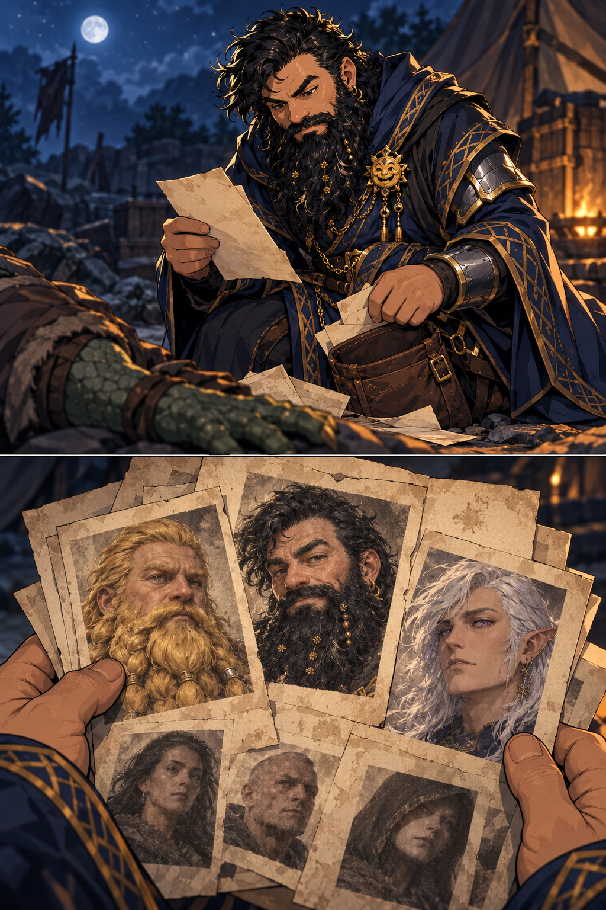

# Kill Orders With Photorealistic Portraits - 2026-10-10

## One-Line Summary

Papers Dain finds on a lizard-man corpse after victory: orders to kill bearing the party's faces and additional unfamiliar faces in high-quality photorealistic pictures, with no provenance information.

## Discovery And Custody

- [Character-only; Confirmed observation, 2026-10-10] **Dain searches the [lizard-man corpse](../Characters/Lizard-Man%20Corpse%20-%202026-10-10.md) and finds these papers.**
- [To verify] Whether he retains them, who currently holds them, storage and whether he shows or describes them to the party. Found evidence is not automatically recorded as carried loot.

## Confirmed Contents

- **The party's faces appear on the papers, with orders to kill.** Exact full wording, named targets, sheet count and individual portrait list are unreported.
- **More pictures depict people Dain does not recognise.** Their identities, number, affiliations, whereabouts and precise relationship to the orders are unknown.
- **The pictures are photorealistic and look very good.** No specific printing/photographic device, magic, maker, material beyond papers, image source or production method is established.
- **No information on provenance.** The found information supplies no issuer, author, origin, date, sender/recipient, signature, faction or payment. This does not prove those details could never be learned later.

- The supplied discovery is confirmed; pictured-face selection/count, corpse details, paper design and camp staging are illustrative. [Exact prompt and image notes](../../Adventures/2026-10-10/corpse-search-kill-orders-image-notes.md).

## Knowledge And Investigation

- Dain's discovery is confirmed. Wider party knowledge is [To verify].
- Papers on a corpse do not prove the dead individual created/commissioned them or identify the party's pursuer. No faction/commander, older mission link, pictured-person identity or explanation of goblin organisation is inferred.
- [Investigation thread](../Lore/Open%20Threads.md#kill-orders-and-unfamiliar-portraits) remains open; record actual clues and supplied table rolls without inventing them.

## Related Entries

- [Dain Truthammer](../Characters/Dain%20Truthammer.md#victory-and-kill-order-discovery---2026-10-10)
- [Camp](../Places/Organised%20Goblin%20Camp%20-%202026-10-10.md#victory-and-kill-order-discovery---2026-10-10)
- [Inventory evidence entry](../../Character/Inventory.md#quest-items)
- [Session](../../Adventures/2026-10-10.md)
