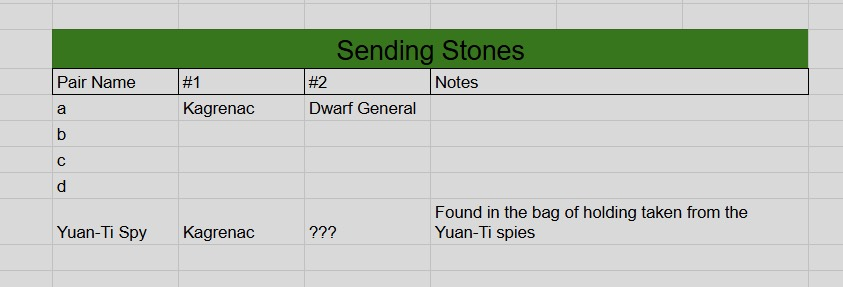

# Party Sending Stones

## One-Line Summary

The party's tracked sending-stone connections: [Kagrenac](../Characters/The%20Astral%20Elf.md) to the Dwarf General, plus a stone recovered from Yuan-Ti spies with an unidentified partner.

## Status

- [Party] [Confirmed] Transcribed from Photo 3 in the [party tracker supplied on 2026-09-12](../../Adventures/2026-09-12-party-tracker.md#photo-3---sending-stones). Acquisition and last-use dates are not supplied.

| Pair name | Holder #1 | Holder #2 | Source notes |
| --- | --- | --- | --- |
| a | Kagrenac | Dwarf General | Blank |
| Yuan-Ti Spy | Kagrenac | ??? | Found in the bag of holding taken from the Yuan-Ti spies |

- Rows `b`, `c` and `d` have no holder information. They are blank template rows, not evidence of three more owned pairs.

## What The Party Knows

- The tracker records the Dwarf General as the other holder of pair `a`.
- The spy-linked stone is assigned to Kagrenac; its partner's holder is unknown.
- The source explicitly describes a Bag of Holding taken from Yuan-Ti spies. It does not identify those spies by name or equate them with the earlier southern traders.

## What Is Uncertain

- The Dwarf General's name and whether this is the commander who issued the rescue mission, Commander Agland, or another dwarf. Do not merge those identities without evidence.
- Whether these use standard Sending Stones rules, current charges/use status, activation, message limits and whether either link has been tested.
- Identity, location and intentions of the unknown partner; what any past messages revealed.
- Whether the spy Bag of Holding is the same bag that survived the southern traders' destruction. No extra bag is added to the inventory until reconciled.

## Notable Events

- 2026-09-12: Maitland supplies the current sending-stone register for ingestion. This records existing tracked state, not a new in-world acquisition. [Session](../../Adventures/2026-09-12.md)

## Related Entries

- [Party Loot](../../Character/Party%20Loot.md)
- [Party Skyship](../Places/Party%20Skyship%20-%202026-08-29.md)
- [Open Threads](../Lore/Open%20Threads.md)
