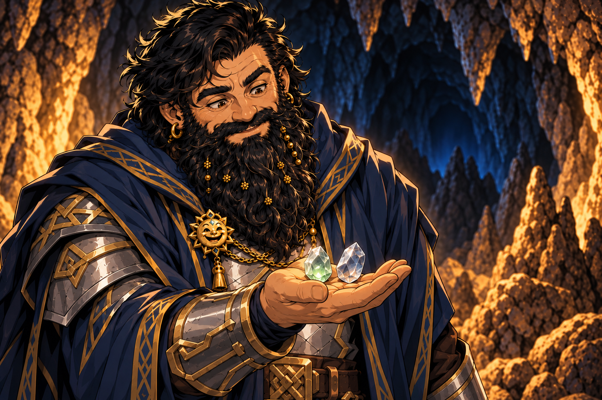

# Spell-Storing Crystals - 2026-10-03

## One-Line Summary
Spell-storing crystals/stones, two now held by Dain: one contains Cure Wounds loaded by Matt / Kagrenac, while Dain will choose the other spell later.

## Confirmed Properties
- **Capacity: one 1st-level spell per crystal**, confirmed by Maitland.
- These are mined/found by [Jiminy](../Characters/Jiminy.md), who is leashed by Norhan's [Harry](../Characters/Hammerton%20Harry%20Drizddon.md).
- Exact material, official item name and value are unreported. This page uses an archive label rather than identifying a published D&D item.

## Current Holdings
- **Dain: two spell-storing stones**, confirmed on 2026-10-03. The first was given by Harry; the second stone's giver/source is unreported. [Inventory](../../Character/Inventory.md#magic-items).

| Contents label | Current spell state | Recorded loading |
| --- | --- | --- |
| Stone A | **Cure Wounds stored** | Matt / Kagrenac |
| Stone B | **Dain will decide the spell later** | No selection or loading reported |

- Labels distinguish contents for the ledger; which physical stone was acquired first is unreported.
- Loading Cure Wounds is confirmed. No release or healing is reported; no Cure Wounds knowledge is added to Dain's spellbook.
- Total mined yield and other holders remain unreported. Six additional gems were mined during the second break; the second stone is not explicitly assigned to that batch, so no remaining-batch count is calculated.

## Mining Ledger

| Stretch | Reported time | Yield | Distribution |
| --- | --- | --- | --- |
| Initial mining | 5 hours | Quantity unreported | Harry gives Dain one crystal |
| Additional mining | Another 5 hours | **6 additional gems** | Unreported |

- [Derived arithmetic] **Ten hours** across the two breaks. The initial quantity is unknown, so no exact combined yield is assigned.
- [Inferred continuity] The new gems are tracked with the same mining operation. No new gem type or different capacity is reported; the earlier crystals' one-1st-level-spell capacity is confirmed.

## Use To Verify
- Exact loading method and resource cost. Matt / Kagrenac has demonstrated loading Cure Wounds; this does not establish every eligible caster, spell or loading rule.
- How a stored spell is released, action cost, eligible user, spell save DC/attack bonus and components.
- Attunement, duration, reuse/recharging and whether the crystal is consumed.
- Value and any inclusion in the earlier **5,000 gp** treasure total. No new gold value or personal coin share is assigned.
- Relationship to [Harry's initially found special gem](./Special%20Gem%20Found%20by%20Harry.md): identification of that individual stone as one of the mined crystals is unreported.

## Notable Events
- 2026-10-03: Jiminy mines during a five-hour break. Truthammer praises his proficiency; Harry gives Dain one of the crystals. [Session](../../Adventures/2026-10-03.md).
- 2026-10-03: The party stays another five hours, and Jiminy mines six additional gems. Distribution and value remain unreported. [Session](../../Adventures/2026-10-03.md).
- 2026-10-03: Dain receives another spell-storing stone, bringing his count to two. Matt loads Cure Wounds into one; Dain defers the other spell choice. The established roster attributes Matt's action to Kagrenac. [Session](../../Adventures/2026-10-03.md).

## Image Boundary

The green tint symbolizes the stored healing spell; it establishes no active healing, release or attunement effect. Pose and appearance are illustrative. [Prompt and references](../../Adventures/2026-10-03/cure-wounds-stone-image-notes.md).

The new panel depicts six stones for this batch only; appearance and placement are illustrative. [Prompt and references](../../Adventures/2026-10-03/jiminy-six-gems-image-notes.md).

Dain and Harry's portraits supply continuity. Crystal appearance, pose, handling, expressions and cave lighting illustrate the gift; no stored spell, active magic or new function is depicted. [Built-in imagegen prompt and references](../../Adventures/2026-10-03/spell-storing-crystal-image-notes.md).
