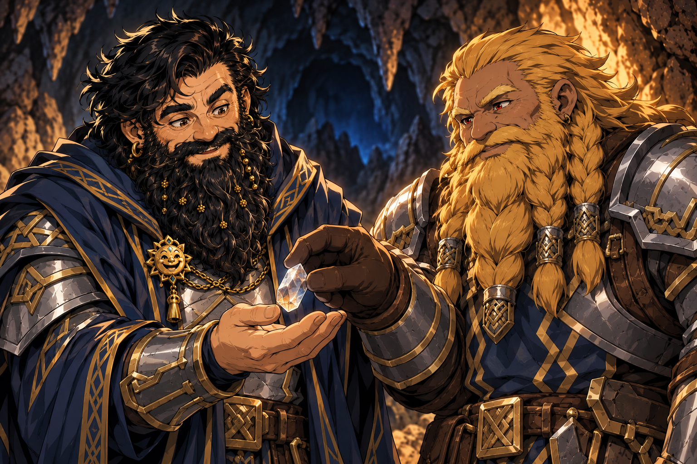

# Spell-Storing Crystals - 2026-10-03

## One-Line Summary
Crystals found through Jiminy's proficient mining during a five-hour break; each can store one 1st-level spell, and Dain receives one from Harry.

## Confirmed Properties
- **Capacity: one 1st-level spell per crystal**, confirmed by Maitland.
- These are mined/found by [Jiminy](../Characters/Jiminy.md), who is leashed by Norhan's [Harry](../Characters/Hammerton%20Harry%20Drizddon.md).
- Exact material, official item name and value are unreported. This page uses an archive label rather than identifying a published D&D item.

## Current Holdings
- **Dain: one crystal**, given by Harry on 2026-10-03. [Inventory](../../Character/Inventory.md#magic-items).
- Total mined yield and holders of the remaining crystals are unreported.
- **Stored spell: unreported.** No loading, casting or release is reported; the crystal's contents are unknown.

## Use To Verify
- How a spell is stored, whose spell it can be and whether this consumes a spell slot.
- How a stored spell is released, action cost, eligible user, spell save DC/attack bonus and components.
- Attunement, duration, reuse/recharging and whether the crystal is consumed.
- Value and any inclusion in the earlier **5,000 gp** treasure total. No new gold value or personal coin share is assigned.
- Relationship to [Harry's initially found special gem](./Special%20Gem%20Found%20by%20Harry.md): identification of that individual stone as one of the mined crystals is unreported.

## Notable Events
- 2026-10-03: Jiminy mines during a five-hour break. Truthammer praises his proficiency; Harry gives Dain one of the crystals. [Session](../../Adventures/2026-10-03.md).

## Image Boundary
Dain and Harry's portraits supply continuity. Crystal appearance, pose, handling, expressions and cave lighting illustrate the gift; no stored spell, active magic or new function is depicted. [Built-in imagegen prompt and references](../../Adventures/2026-10-03/spell-storing-crystal-image-notes.md).
