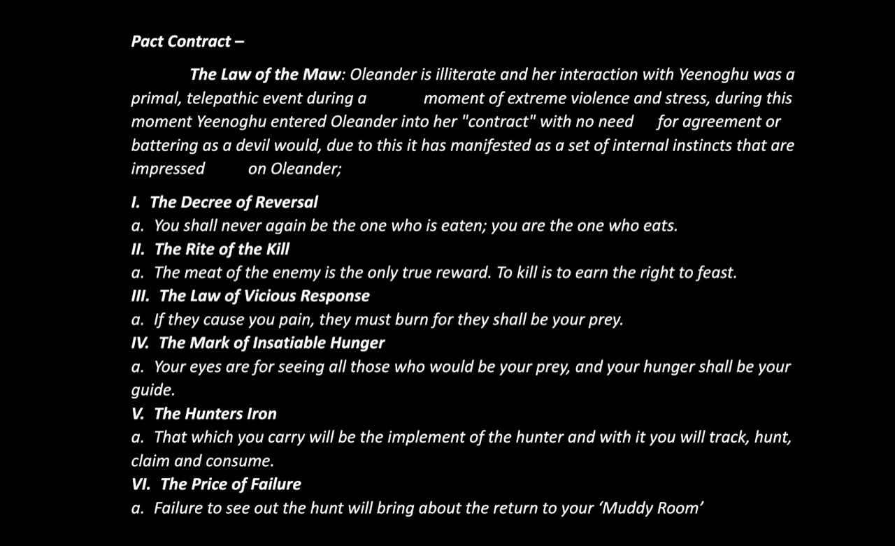

# Ollyander's Pact - The Law of the Maw

## One-Line Summary
During travel, Ollyander speaks the Law of the Maw to a rat she loves; Dain finds it interesting and writes it down.

## Status And Knowledge Boundary
- [Confirmed scene on 2026-09-12] Ollyander says the supplied material to her beloved rat as the party travels toward its next destination. Dain hears her and records it.
- [Character-only] Dain now has the reported pact account and six laws in his notes. This establishes what he heard, not independent verification of the pact's origin, enforcement or supernatural consequences.
- [Reported account] The text describes Ollyander as illiterate and her encounter with Yeenoghu as primal and telepathic, during extreme violence and stress. It describes the pact as imposed without agreement and manifested as internal instincts.
- [To verify] What the rest of the party heard, whether the rat understands or answers, the rat's wider identity/history, and the next destination. No response or action by the rat is recorded.
- [Source spelling] The image says `Oleander`; the user says `Ollyander`. Keep the existing character page under Ollyander and preserve the source spelling below. The user refers to her with she/her.
- [Continuity boundary] Do not identify this rat with the Coal Mine Puppet, the falling-rat spell inspiration, or the earlier three rats mentioned in dice-game accounting without evidence. No new class, ability, alignment or hostile act is established here.

- [Confirmed later on 2026-09-12] Oleander learns the rat's name: [Goarsqueek](../Characters/Goarsqueek.md). How she learns it and whether Dain also learns the name remain unrecorded. The user uses `Oleander` in this update.

## Source Transcription

Line wrapping and spacing are normalized; wording, names and unusual wording such as `battering` are retained from the supplied image.

> Pact Contract –
>
> The Law of the Maw: Oleander is illiterate and her interaction with Yeenoghu was a primal, telepathic event during a moment of extreme violence and stress, during this moment Yeenoghu entered Oleander into her "contract" with no need for agreement or battering as a devil would, due to this it has manifested as a set of internal instincts that are impressed on Oleander;
>
> I. The Decree of Reversal
>
> a. You shall never again be the one who is eaten; you are the one who eats.
>
> II. The Rite of the Kill
>
> a. The meat of the enemy is the only true reward. To kill is to earn the right to feast.
>
> III. The Law of Vicious Response
>
> a. If they cause you pain, they must burn for they shall be your prey.
>
> IV. The Mark of Insatiable Hunger
>
> a. Your eyes are for seeing all those who would be your prey, and your hunger shall be your guide.
>
> V. The Hunters Iron
>
> a. That which you carry will be the implement of the hunter and with it you will track, hunt, claim and consume.
>
> VI. The Price of Failure
>
> a. Failure to see out the hunt will bring about the return to your ‘Muddy Room’

## Dain's Observation
- [Character-only] [Confirmed] Dain finds what Ollyander says interesting and writes it down.
- [Inferred reading of the account, not a new statement by Dain] The contrast is between Ollyander's affection for the rat and the account's demands for predation, retaliation and consumption. The described absence of agreement may matter when considering her agency.
- [To verify] The meaning of `Muddy Room`, what counts as completing or failing a hunt, whether the `Hunters Iron` refers to her known large knife or something else, and whether these instincts can be resisted.

## Notable Events
- 2026-09-12: Ollyander addresses her beloved rat during travel. Dain listens and records the account. [Session](../../Adventures/2026-09-12.md)

## Scene Reference

Illustration of the reported scene; visual staging does not add facts about the rat, pact or destination.

## Related Entries
- [Ollyander](../Characters/Ollyander.md)
- [Dain Truthammer](../Characters/Dain%20Truthammer.md)
- [Relationships](../../Character/Relationships.md)
- [Open Threads](./Open%20Threads.md)
- [Session 2026-09-12](../../Adventures/2026-09-12.md)
