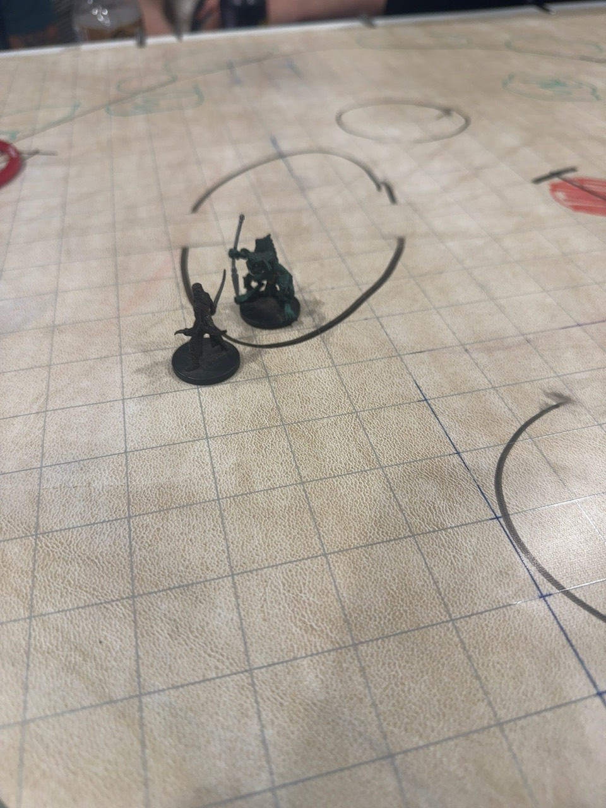
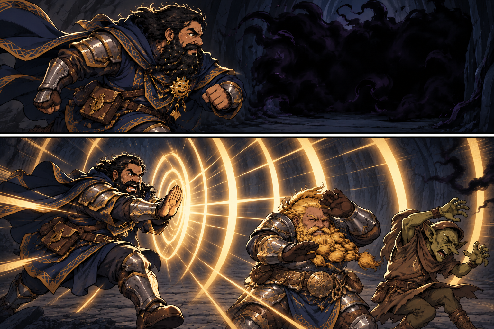
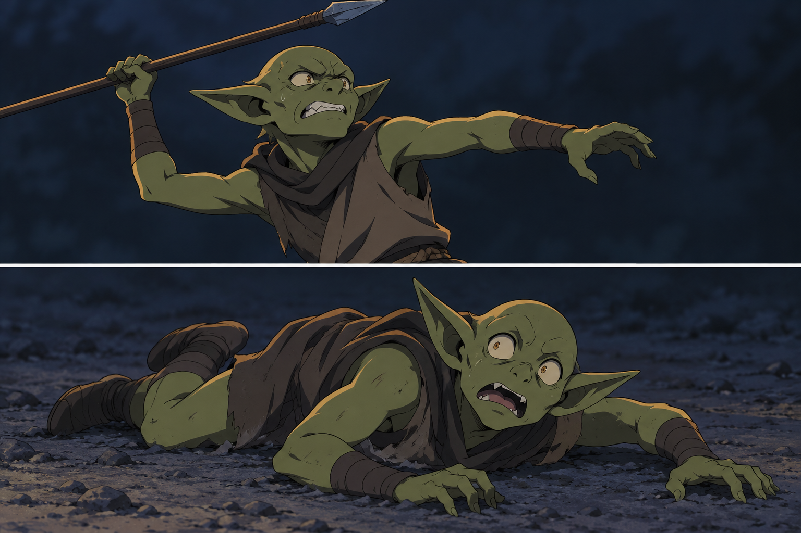
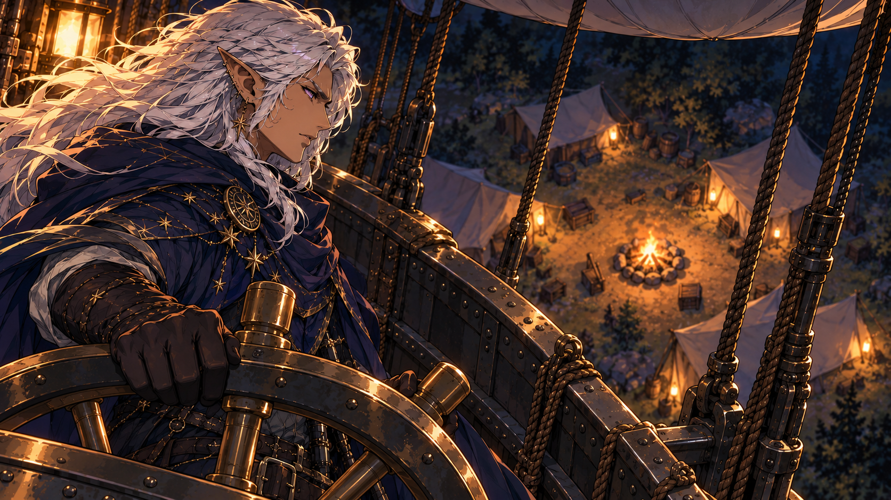
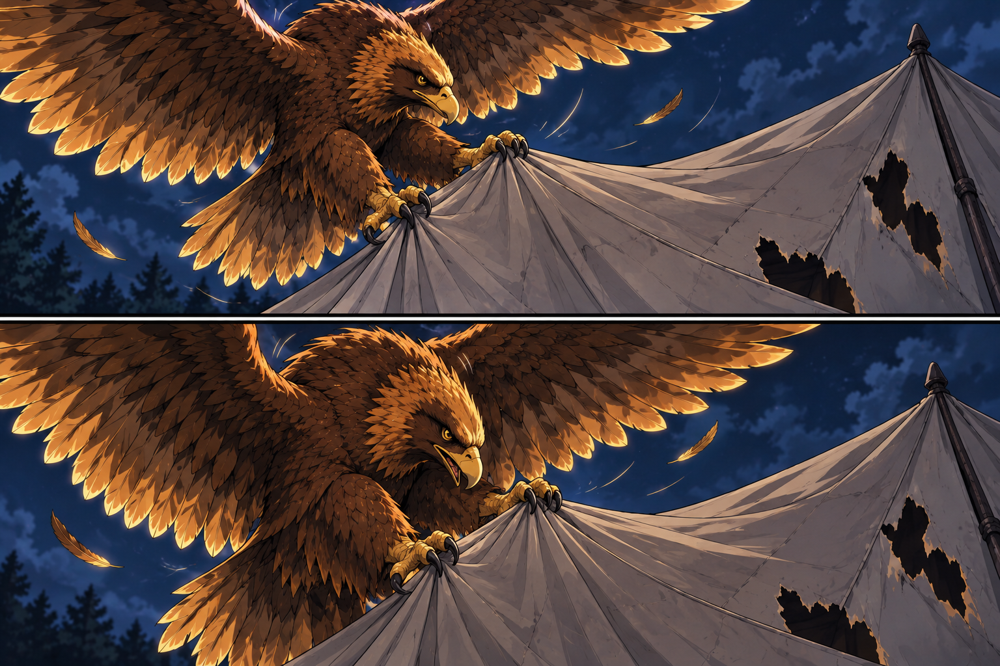
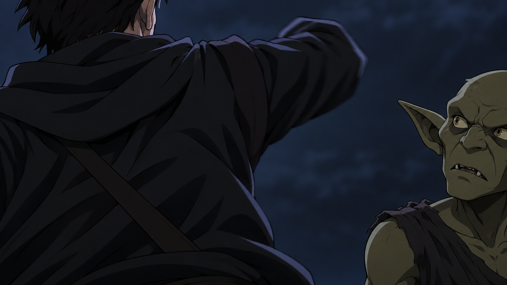

# Organised Goblin Camp - 2026-10-10

- Camp layout and scene staging are illustrative. The two locations are shown in separate panels, without a route or confirmed adjacency. The captives are awake; their answer and camp affiliation remain unreported. No exact boarding, injury recovery or owl information relay is established. [Image notes](../../Adventures/2026-10-10/owl-camp-and-rhyming-question-image-notes.md).

- Kagrenac's Polymorph makes Tina the giant eagle; Dain casts Minor Illusion and delivers the booming call for discussion, guaranteeing no violence. Camp response remains unreported. Poses, sound rings, plumage, camp shelters/banners/decorative devices, lights and aerial spacing are illustrative; no discovered faction emblem, tactical layout, accepted guarantee, resource ruling or attack is established. [Image notes](../../Adventures/2026-10-10/bear-eagle-camp-entrance-image-notes.md).

- Sequential staging supports the reported loss of view behind the tent. Goblin appearance/clothes, motion marks, shelter shapes/count, light and scenery are illustrative, without a stat block, player identity, map layout, stealth result, magical vanishing, motive or later destination established. [Image notes](../../Adventures/2026-10-10/goblin-behind-tent-image-notes.md).

- Three consecutive panels show Dain's countdown, bird-form Tona lifting the flanking goblin, and release outside the pit before impact. Eagle appearance is an illustrative continuity choice; Tona's possible Tina alias remains unconfirmed. Drop height, poses, goblin expression/clothes, unlit pit, camp arrangement, banners/marks, braziers, light and scenery are illustrative. No damage, injury/death/survival, intimidation outcome, accepted negotiations, actual hellfire or discovered faction emblem is established. [Image notes](../../Adventures/2026-10-10/countdown-bird-form-warning-image-notes.md).

- Two consecutive panels show the same dropped goblin hitting a rock, then goop wrapping around and into its crevices. Colour/composition, impact pose/contact point, clothing fate, rock shape, flow, camp layout/banners/lights and exact absorption process are illustrative. No death/survival, damage number, complete disappearance, named spell/creature type or camp/party reaction is established. [Image notes](../../Adventures/2026-10-10/flanking-goblin-rock-goop-image-notes.md).

- Kagrenac pilots the metal blimp and gives the owl its order, with camp tents ahead. Owl perch, gestures, helm/ship crop, speed/altitude, camp arrangement/count, lanterns, unlit pit and scenery are illustrative. No centre arrival, actual owl flank/flight, target, Help/advantage, attack, spell, population count or camp reaction is established. [Image notes](../../Adventures/2026-10-10/kagrenac-blimp-owl-order-image-notes.md).

- Sequential panels show one anonymous goblin's grenade throw and Dain taking the reported 11 damage, still mounted on Stu. Attacker appearance, weapon design, fuse/detonation, blast size/fragments/light, Dain's recoil/hand pose, crop and camp scenery are illustrative. No damage type, save, other party damage, shield spell, dismount, injury detail, casualty, retaliation or current HP is established. [Image notes](../../Adventures/2026-10-10/goblin-grenade-dain-damage-image-notes.md).

- Two sequential panels show the same goblin throwing one javelin and the established small brown-and-white owl killed by the strike. Attacker appearance, javelin design, owl flight/pose, impact placement, feathers and night/tent scenery are illustrative. Death and attacker continuity are supplied; range, numerical damage, exact location/body landing, familiar identity, magical disappearance and Kagrenac's reaction are unreported. [Image notes](../../Adventures/2026-10-10/goblin-javelin-owl-death-image-notes.md).

- Dain's shot through the fire pit and the main tent's front/back holes are supplied outcomes. His pose on Stu, prismatic color, curved trail, pit shape/unlit ash, tent construction, hole dimensions, cloth scraps and night scenery are illustrative. The view establishes no chosen damage type, general projectile rule, tent fire/collapse, occupant/contents count, creature damage or camp reaction. [Image notes](../../Adventures/2026-10-10/chromatic-orb-main-tent-image-notes.md).

- Dain remains in his last supplied bear-mounted posture while the concentration change is shown through symbolic fading geometry and a self-directed wrist glyph. Pose, expression, magic colors/shape, clothes and night background are illustrative. The cast and Suggestion ending are supplied; no actual Dash, movement/dismount, bear buff, captive position/reaction or physical release is established. [Image notes](../../Adventures/2026-10-10/expeditious-retreat-concentration-image-notes.md).

## One-Line Summary

The organised goblin camp where Dain runs toward the approach bottleneck and casts Thunderclap, removing the reported darkness and dealing 6 damage each to Harry and an unidentified goblin.

## Confirmed Discovery

- [Latest casting/concentration change, 2026-10-10] **Dain casts [Expeditious Retreat](../Powers/Expeditious%20Retreat.md) and explicitly drops [Suggestion](../Powers/Suggestion.md) on the smarter captive, ending it.** [Derived standard 2014 effect] Concentration is now Expeditious Retreat. Actual movement, camp/captive response and physical release are unreported. [Official spell](https://www.dndbeyond.com/spells/2088-expeditious-retreat); [Session](../../Adventures/2026-10-10.md).

- [Latest confirmed tent damage, 2026-10-10] **Dain shoots [Chromatic Orb](../Powers/Chromatic%20Orb.md) through the fire pit into the main tent, blasting a hole through its front and back.** The main tent and both holes are confirmed. Type/roll/damage, casting resource, occupants and further effects remain unreported. [Session](../../Adventures/2026-10-10.md).

- [Latest confirmed death, 2026-10-10] **The same [grenade thrower](../Characters/Grenade-Throwing%20Goblin%20-%202026-10-10.md) throws a javelin at [Kagrenac's owl](../Characters/Kagrenacs%20Owl.md) and kills it.** Owl death and continuity of this attacker are confirmed; roll/damage, precise location, body disposition and Kagrenac's reaction remain unreported. [Session](../../Adventures/2026-10-10.md).

- [Latest confirmed attack, 2026-10-10] **One [goblin](../Characters/Grenade-Throwing%20Goblin%20-%202026-10-10.md) comes and throws a [fragmentation grenade](../Items/Fragmentation%20Grenade%20-%202026-10-10.md) at the ground group. Dain takes 11 damage.** Current HP/type/save, other ground-group effects and attacker identity remain unknown. This is the reported attack, without a total population, faction motive or universal camp response. [Session](../../Adventures/2026-10-10.md).

- [Preceding blimp movement and owl command, 2026-10-10] **[Kagrenac](../Characters/The%20Astral%20Elf.md) drives the [blimp](./Party%20Skyship%20-%202026-08-29.md) toward the camp's middle and commands [his owl](../Characters/Kagrenacs%20Owl.md) to flank.** Pilot is now confirmed; centre arrival, owl response/target, exact position/altitude and attack remain unreported. The [new table photo](../../Adventures/2026-10-10/goblin-camp-blimp-approach-table-photo.jpg) is archived unchanged, without a supplied key/scale. [Session](../../Adventures/2026-10-10.md).

- [Preceding confirmed rock/goop outcome, 2026-10-10] **The [flanking goblin](../Characters/Flanking%20Goblin%20at%20the%20Camp%20-%202026-10-10.md) falls, hits a rock and turns into goop, wrapping into the rock.** The rock is now a reported contact landmark after Tona's drop in front of the fire pit. Cause, death/survival, full absorption, numerical damage and camp response remain unreported. [Session](../../Adventures/2026-10-10.md).

- [Preceding countdown and bird-form warning, 2026-10-10] **Dain begins a countdown and threatens hellfire unless the goblins reveal themselves for negotiations. It reaches 0; [Tona](../Characters/Tona.md), in bird form, picks up the [goblin flanking the party](../Characters/Flanking%20Goblin%20at%20the%20Camp%20-%202026-10-10.md) and drops it in front of the goblins' fire pit as a warning.** The fire pit is now a supplied landmark. Its fire state/position, drop height, goblin condition, Tona's identity and camp reply remain unreported. This follows Dain's no-violence guarantee without rewriting it. No actual hellfire or guano attack is supplied. [Session](../../Adventures/2026-10-10.md).

- [Preceding visible-goblin movement, 2026-10-10] **The visible [goblin](../Characters/Visible%20Goblin%20at%20the%20Camp%20-%202026-10-10.md) suddenly dashes behind a tent and disappears from view.** A goblin and tent landmark are now explicitly reported; exact identity, role, route/destination and motive remain open. No total population, map coordinate, magical disappearance, alarm or spoken reply to Dain is supplied. Older no-response snapshots below record the preceding entrance/discovery context. [Session](../../Adventures/2026-10-10.md).

- [Latest confirmed ground entry, 2026-10-10] **Dain riding bear-form Stu, Harry and Yuckie now enter the camp, backed by Tina as a giant eagle following Kagrenac's Polymorph. Dain casts Minor Illusion and makes a booming announcement calling the goblins out for discussion and guaranteeing no violence. “The truth needs liberation.”** Exact entry/positions, aerial movements, camp inhabitants' response and negotiations remain unreported. The entries below record earlier discoveries and their then-unresolved arrival details. [Session](../../Adventures/2026-10-10.md).

- [Latest confirmed discovery, 2026-10-10] **Brother Taleesh stumbles upon the goblin camp, the next map.** The [supplied table photo](../../Adventures/2026-10-10/goblin-camp-next-map-table-photo.jpg) is saved unchanged. Route, precise position/entry, actual observations, detection and communication to the party remain unreported. No whole-party arrival, raid or explanation from the organisers is supplied. [Session](../../Adventures/2026-10-10.md).

- [Broader party record; Confirmed] Kagrenac's owl finds **an organised goblin camp**. The supplied description establishes organisation without identifying what makes it organised. [Session](../../Adventures/2026-10-10.md).
- In the same narration, the party wakes its two [captured goblins](../Characters/Goblin%20Intruders%20-%202026-10-10.md) **at the balloon**, and [Dain Truthammer](../Characters/Dain%20Truthammer.md) asks in rhyme, **“why are you organised, little goblins”**.
- No answer or captive reaction is reported. The question does not establish that the captives belong to, lead, supply or speak for this camp.
- [Preceding owl/question context] The captives are at the balloon; that report supplied no camp visit, attack, departure, all-party arrival or owl return. Taleesh's later camp discovery is recorded above; no other party arrival or owl return is supplied.

- [Confirmed user-supplied mission context, 2026-10-10] Maitland describes **[snake people](../Factions/Snake%20People.md) organising goblins**, with finding out why as the main mission. This supplies the group label, without a named leader, explanation, captive testimony or confirmed camp/captive chain of command.
- [Confirmed intentions] Dain wants the captives as leverage to learn why; Kagrenac wants to fly the blimp and use [guano in the Bag of Holding](../Items/Guano%20in%20the%20Bag%20of%20Holding%20-%202026-10-10.md) to “blow them up”. Target remains unspecified; these intentions supply no camp raid, attack, party choice, launch or visit. Taleesh's later discovery is a separate narrated action. [Session](../../Adventures/2026-10-10.md).

## Next Table Map - 2026-10-10

- [Table-side source] Copied unchanged; the gridded mat contains black oval/curving and hatched marks, a red mark, green loops and miniatures.
- Meaning, identities, scale, distances, orientation and exact position remain unreported. No oval is assigned as a building, red mark as a fire, green loop as a tree, hatched mark as a bridge/fence, or miniature as a counted enemy.
- “Next map” describes table play, without an in-world parchment item or new inventory. The photo is not included in imagegen references or the Discord upload.

- Taleesh's discovery is confirmed; posture, gaze, vegetation, lighting and obscured shelter glimpses are illustrative. No map key, creature count, tactical layout, arrow-source clue, stealth/check result or further action is established. [Image notes](../../Adventures/2026-10-10/taleesh-goblin-camp-image-notes.md).

### Later Blimp Movement Table Photo

- This later attachment accompanies Kagrenac driving toward the middle and ordering his owl to flank. It is a table reference, without a keyed layout, identified miniatures, grid scale, altitude or confirmed centre arrival/response.
- Saved unchanged as `goblin-camp-blimp-approach-table-photo.jpg`; 295544 bytes; SHA-256 `7a2e63c849f0171f83054db23336d2674cbc2ae33d2dc323a23b7d8bdc3b8f82`. Source original remains in the remote-attachments folder. Local archive only, not posted to Discord.

### Chromatic Orb And Main Tent Table Photo

- Supplied photo copied unchanged. The drawing, pointed area, miniatures and grid remain unkeyed: no scale, exact spell geometry, tent dimensions or individual identity is inferred. The main tent and front/back holes are confirmed by the narration. [Session](../../Adventures/2026-10-10.md).

### Bottleneck And Wall Crack Table Photo

- Archived unchanged. The grid, marks, miniatures and die have no supplied key, scale, north, identities or roll; this photo establishes no precise wall/crack/bottleneck geometry.

### Main Tent Yuan-ti Reveal Table Photo

- Archived unchanged. No miniature identity, yuan-ti subtype/weapon, scale, north or measured range is inferred.

## Dain Thunderclaps At The Bottleneck - 2026-10-10

- **[Dain](../Characters/Dain%20Truthammer.md) runs toward the bottleneck and casts [Thunderclap](../Powers/Thunderclap.md), removing the reported darkness and dealing 6 damage each to [Harry](../Characters/Hammerton%20Harry%20Drizddon.md) and an [unidentified goblin](../Characters/Goblin%20Hit%20By%20Thunderclap%20-%202026-10-10.md).**
- Removal is the reported table outcome; source/cloud identity, extent and mechanism remain unknown. It does not establish that all other darkness is removed, a named spell/caster, automatic concentration failure or a general Thunderclap dispelling rule.
- Exact movement/arrival/Dash, damage type/saves/radius, goblin identity and recipient current HP are unreported. No forced movement, fall, kill, new Dain damage, condition/resource use or round is assigned. Prior ship/roof/Taleesh/yuan-ti states receive no new outcome. [Session](../../Adventures/2026-10-10.md).

- Two panels illustrate the supplied movement and table-reported spell outcome. Positions, poses, pulse/terrain/light are illustrative; no measured radius, push, extra damage or general darkness-dispelling property is established. [Image notes](../../Adventures/2026-10-10/bottleneck-thunderclap-image-notes.md).

## Snake Creature's Two Attacks Miss Taleesh - 2026-10-10

- **The snake creature facing [Brother Taleesh](../Characters/Brother%20Taleesh.md) makes two attacks at him; both miss.** Jack resolves to Taleesh; “to attacks” is read as two, supported by “both.”
- [Contextual referent] Indexed to the [yuan-ti](../Characters/Yuan-ti%20in%20the%20Main%20Tent%20-%202026-10-10.md) from the preceding main-tent encounter. No new subtype, commander/faction identity or organiser explanation is assigned.
- Attack types/weapons, rolls and reach/range are unreported. No new HP/resource change, defensive action, counterattack, displacement, Wet ending or round is supplied; ship height, roof state, javelin-fall goblin and other actors receive no new outcome. [Session](../../Adventures/2026-10-10.md).

- One missed attack per panel; weapons/types and rolls are unreported. Appearance, poses, motion arcs and canvas/light are illustrative, without assigning defensive actions or new damage. [Image notes](../../Adventures/2026-10-10/yuan-ti-two-misses-image-notes.md).

## Goblin Javelin Failure And Fall - 2026-10-10

- **[Unidentified goblin](../Characters/Goblin%20With%20The%20Failed%20Javelin%20Throw%20-%202026-10-10.md) tries to throw a javelin, critically fails and falls to the ground.** The narration omits the intended target; clarification is pending.
- No raw natural 1, modified total, formal Prone condition, fall cause/distance, injury/damage, death or weapon release/destination is supplied. No additional fumble is invented.
- Goblin identity and starting location/height remain unreported. Do not merge it with the prior grenade/javelin thrower, wall-crack/visible/flanking goblins, captives or Yuckie, or assign the blimp's 75-foot height as a fall distance.
- No new ship/party movement, attack hit, Dain damage/resource use, owl return, concentration outcome or round is reported. [Session](../../Adventures/2026-10-10.md).

- Two panels illustrate the supplied critical failure and fall. Appearance, weapon design, poses and ground/light are illustrative; target, raw roll, fall height/damage, formal condition and weapon outcome remain unreported. [Image notes](../../Adventures/2026-10-10/goblin-javelin-fall-image-notes.md).

## Kagrenac Positions The Blimp Beside The Fire - 2026-10-10

- **[Kagrenac](../Characters/The%20Astral%20Elf.md) navigates the [blimp](./Party%20Skyship%20-%202026-08-29.md) into the centre of the camp, adjacent to the fire. He lowers it 25 feet, so it is now 75 feet in the air.** Centre arrival is now confirmed.
- Exact bearing/horizontal gap, speed, thrust provider, piloting cost and next movement are unreported. This vertical movement adds no landing, attack, guano release, collision, damage, resource use or new round.
- Earlier roof attempts, yuan-ti/Taleesh encounter, ground positions, captive states and owl death remain recorded without new responses or relocation. [Session](../../Adventures/2026-10-10.md).

- Current centre arrival, 25-foot descent and 75-foot aerial height are supplied; pose, helm/metal fittings, fire-pit shape, camp objects/layout and perspective are illustrative. No attack, owl return, landing or new resource outcome is established. [Image notes](../../Adventures/2026-10-10/kagrenac-blimp-centre-image-notes.md).

## Tina's Two Main-Tent Roof Attempts - 2026-10-10

- **Tina, in eagle form, picks up/grips the main tent's roof and tries to pull it away. It does not come completely free, and the pull gets tugged back.**
- **Her second attack rolls natural 1; she cannot tug it again.** The roof remains attached. No extra fumble, full removal, further tearing, collapse, crash, injury, dropped creature/object or third attack is supplied.
- The main tent retains Dain's prior front/back Orb holes; those are preceding damage. Attachment/cause, exact movement, force/DC, first roll, modified total and new damage are unreported.
- Eagle form remains confirmed through both attempts. No Polymorph recast/resource use/ending, yuan-ti/Taleesh response, Dain change or new round is supplied. [Tina](../Characters/Tina.md#two-main-tent-roof-attempts---2026-10-10); [session](../../Adventures/2026-10-10.md).

- Two panels illustrate the attached roof through both attempts. Poses, grip, cloth, prior hole staging and backdrop are illustrative; no additional damage, fumble or transformation ending is supplied. [Image notes](../../Adventures/2026-10-10/tina-main-tent-roof-image-notes.md).

## Stu's Human-Form Reaction At The Former Captive Target - 2026-10-10

- The miss is a wording interpretation pending clarification. Cropped human appearance, goblin features, pose and positions are illustrative; weapon/trigger and human HP are unreported. [Image notes](../../Adventures/2026-10-10/stu-human-reaction-image-notes.md).

- [Confirmed form/target] **Stu is now in human form and takes a reaction against the smarter captive formerly targeted by Dain's Suggestion.**
- [Interpreted wording; to confirm] **“mist” is read as “missed”: a miss.** Reaction trigger/type/weapon, roll, human appearance/HP and exact Stu/captive positions remain unreported; no main-tent or yuan-ti proximity is supplied.
- Suggestion had already ended. No new attack beyond the reaction, damage, literal mist transformation, death, captive escape/release, form-change cost/recovery or new round is supplied. [Stu](../Characters/Stu.md); [captives](../Characters/Goblin%20Intruders%20-%202026-10-10.md); [session](../../Adventures/2026-10-10.md).

## Taleesh Reveals The Yuan-ti At The Main Tent - 2026-10-10

- The encounter is supplied; canvas, holes, poses, scenery and the yuan-ti's appearance are illustrative. Identity, subtype and response remain open. [Image notes](../../Adventures/2026-10-10/main-tent-yuan-ti-image-notes.md).

- [Confirmed] **Brother Taleesh goes around to the main tent Dain blasted through, lifts its canvas and comes face to face with the [yuan-ti](../Characters/Yuan-ti%20in%20the%20Main%20Tent%20-%202026-10-10.md).** The tent is explicitly the main tent with front/back holes from Chromatic Orb.
- The yuan-ti's presence is directly observed by Taleesh. Name, subtype, appearance, camp role/leadership, dialogue, response and connection to the organising “snake people” remain unreported.
- Earlier Orb occupancy/hit/damage is unreported. The preceding stabbed goblin and under-exit tent remain unidentified; no merger is supplied.
- Exact placement, other observers and any warning remain open. No new attack, spell, roll, damage/resource change or round is reported. [Taleesh](../Characters/Brother%20Taleesh.md); [session](../../Adventures/2026-10-10.md).

## Taleesh's Tent Exit And Two Dagger Strikes - 2026-10-10

- Supplied actions are shown with illustrative staging; the goblin/tent remain unidentified and the green puddle defines no magical transformation. [Image notes](../../Adventures/2026-10-10/taleesh-tent-exit-image-notes.md).

- [Confirmed] **Brother Taleesh sneaks out beneath a tent, stabs one goblin twice with daggers and “jellyfies” it.** This follows Dain's bottleneck run and flanking discovery; it supplies no warning from Dain, connection to the wall-crack goblins or whole-party awareness.
- **−19** is the reported goblin HP/result, with previous HP, timing, rolls and per-stab damage unreported. No damage arithmetic or formal negative-HP/death rule is assigned.
- Tent and target identities are unreported. No automatic link to the main damaged tent, dismissed Leaky Tent, grenade/javelin thrower, captive, Yuckie or earlier rock/goop goblin is established.
- “Jellyfies” stays the supplied outcome; no named spell, ooze, enchanted dagger, poison or shared transformation cause is established. No extra attacks, stealth/Hide roll, surprise/advantage, ki/astral arms, loot, body handling or new round are supplied. [Taleesh](../Characters/Brother%20Taleesh.md); [session](../../Adventures/2026-10-10.md).

## Bottleneck And Wall Crack Flank - 2026-10-10

- Running and the discovery are confirmed; visible silhouette count, walls, torches, fissure shape and geometry are illustrative. [Image notes](../../Adventures/2026-10-10/bottleneck-wall-crack-image-notes.md).

- [Confirmed movement] **Dain runs back toward the bottleneck on the route the party came from.** Running supersedes his preceding riding posture; transition off Stu, distance, formal Dash, arrival/escape and Stu's own next movement/location are unreported.
- [Confirmed; Dain observes] **Goblins are emerging from a crack in a wall and flanking the gang. Dain realises they have tricked the group.** Count and identities are unreported; none is automatically equated with an earlier goblin. The detailed plan, tunnel contents, commander and other party awareness are unknown.
- **“Smart little gobbies”** is supplied table commentary, without invented dialogue. Narrated flanking supplies no automatic advantage ruling or new attack/roll.
- Bottleneck width, wall/crack dimensions or material, exact positions and connection to the earlier gorge/cliffs are unreported. The table photo has no supplied key, scale, die result or reliable geometric labels.
- Expeditious Retreat remains the last confirmed concentration; Suggestion is ended. No new damage, resource cost, condition, round or other actor's action is reported. [Session](../../Adventures/2026-10-10.md).

## Expeditious Retreat And Suggestion Ending - 2026-10-10

- **Dain casts Expeditious Retreat and drops Suggestion concentration on the smarter captive. Suggestion ends now.** This follows the Orb through the main tent.
- [Derived standard 2014 effect] Concentration is now on Expeditious Retreat. The cast supplies no actual Dash, route, distance, dismount, camp response or goblin escape/physical release. Shared hand/foot cuffs remain last confirmed. Casting level/source/expenditure and later ending are unreported. [Official spell](https://www.dndbeyond.com/spells/2088-expeditious-retreat); [Session](../../Adventures/2026-10-10.md).

## Chromatic Orb Through The Main Tent - 2026-10-10

- **Dain shoots Chromatic Orb through the fire pit into the main tent and blasts a hole through its front and back.** The fire pit lies along this shot's supplied route, without a keyed position or dimensions.
- Both holes are confirmed; tent shape/size, occupants/contents, creature hits, ignition, collapse and reactions remain unreported. Fire-pit burning state and numerical damage/type/roll are not supplied.
- Casting level/resource and any ongoing-effect outcome remain unknown. This follows the owl's death; motive and retaliation are not assigned. [Session](../../Adventures/2026-10-10.md).

## Javelin Kills Kagrenac's Owl - 2026-10-10

- **The same goblin that threw the fragmentation grenade throws a javelin at Kagrenac's established owl and kills it.**
- Death is explicit. The previous flank order has no reported execution before the strike; the bird is now dead. It is distinct from Tina's giant-eagle form.
- Attack roll/damage, range, exact owl position/body disposition, familiar identity and Kagrenac's response are unreported. No magical disappearance, resummoning or change to piloting/ongoing effects is supplied. [Session](../../Adventures/2026-10-10.md).

## Goblin Fragmentation-Grenade Attack - 2026-10-10

- **One goblin comes and throws a fragmentation grenade at the ground group; Dain takes 11 damage.**
- Exact attacker identity/position, relation to the camp/other goblins, range/radius, type/save/roll, current HP and other party effects are unreported. No camp population, faction weapon supply or casualty count is derived.
- This follows the earlier warning, rock/goop outcome and Kagrenac's movement/order. No motive, dialogue, collective camp policy, retaliation, guano use or negotiation outcome is supplied. [Session](../../Adventures/2026-10-10.md).

## Blimp Approach And Owl Flanking Order - 2026-10-10

- **Kagrenac drives the blimp toward the middle of the camp and commands his owl to flank.** Piloting/movement and the order are confirmed.
- Centre arrival, exact route/height/speed, owl target/side/flight/response, advantage or attack remain unreported. No new guano handling, explosion or hellfire is supplied.
- The [attached tabletop photo](../../Adventures/2026-10-10/goblin-camp-blimp-approach-table-photo.jpg) supports the archive as an unkeyed table reference; the raised platform and miniature positions do not independently establish creature identities, altitude or a completed manoeuvre. [Session](../../Adventures/2026-10-10.md).

## Goblin Turns Into Goop At A Rock - 2026-10-10

- **The dropped flanking goblin falls, hits a rock and turns into goop, wrapping into the rock.** Impact/change is confirmed as supplied after the preceding drop in front of the fire pit.
- The rock is a contact landmark; exact position/shape, goop composition/colour, change process, duration and completed absorption are unreported.
- No death/survival, numerical damage, spell, creature type, rock animation, party/camp reaction or negotiation outcome is established. The goblin is not identified with the tent goblin, either captive or Yuckie. [Session](../../Adventures/2026-10-10.md).

## Countdown And Bird-Form Warning - 2026-10-10

- **Dain says, “if you don’t reveal for negotiations we will rain hellfire down upon you”, and his countdown reaches 0.** Starting number, elapsed time and any actual fire spell/bombing are unreported.
- **Tona in bird form picks up one goblin that was flanking the party, then drops it in front of the goblins' fire pit as a warning.** Both actions are confirmed. The pit is a landmark, not a confirmed damage source; falling into it or touching fire is unreported.
- Tona's possible link to giant-eagle [Tina](../Characters/Tina.md) remains unconfirmed. The goblin's name, affiliations, connection to the tent goblin/captives, drop height, HP, damage, injury/survival and further action remain unknown. Supplied “flanking” does not assign advantage or a formal combat ruling.
- Dain's earlier guarantee of no violence remains recorded alongside the later threat and physical warning. The camp's reaction, acceptance of negotiations, intimidation effect and any consequence of that promise remain unreported. [Session](../../Adventures/2026-10-10.md).

## Goblin Disappears Behind A Tent - 2026-10-10

- The one reported visible goblin **suddenly dashes behind a tent and disappears from view**.
- This is the latest reported camp movement after Dain's announcement. A motive or causal reaction to the announcement is not supplied.
- Behind the tent is the last reported visibility landmark, without an exact coordinate, route, tent entrance, later destination, reappearance or observer.
- Name, affiliation/role, relation to Yuckie or the two captives, population, movement speed/distance, Dash-action/stealth ruling, alarm, trap, reinforcements and attacks remain unreported.
- Dain's guarantee and request for discussion remain recorded; actual words in response, acceptance/negotiations and why the snake people organise the goblins remain open. [Goblin record](../Characters/Visible%20Goblin%20at%20the%20Camp%20-%202026-10-10.md); [session](../../Adventures/2026-10-10.md).

## Ground Entrance And Peaceful Declaration - 2026-10-10

- Ground group: **Dain riding Stu in bear form, Harry and Yuckie**. Their entrance is now reported; exact route, entry point, positions and movement distances remain unreported.
- Air support: **Tina as a giant eagle**, transformed by **Kagrenac's Polymorph**. The caster's precise location and eagle mechanics/path, plus the blimp group's camp arrival or flight manoeuvres, remain unreported.
- Dain casts **Minor Illusion** and uses a **booming voice**, announcing entry, calling the camp's goblins out and requesting discussion. He **guarantees no violence**.
- Exact supplied line: **“The truth needs liberation.”** The rest is paraphrased narration, with no invented extended speech.
- The “epic America firepower” comparison supplies cinematic emphasis, not modern weapons, a literal nation, faction/national insignia, attack or explosion.
- No goblin emergence, audience response, accepted peaceful agreement, negotiation outcome, organiser's explanation or new harm is reported. Dain's guarantee establishes his stated terms; party acceptance and whether the terms are kept remain to be recorded.
- The two earlier captives' transport/camp arrival and the guano proposal's target/execution remain open. This section supersedes earlier no-ground-arrival statements without moving all characters or cargo here. [Minor Illusion](../Powers/Minor%20Illusion.md); [Polymorph](../Powers/Polymorph.md); [Tina](../Characters/Tina.md); [session](../../Adventures/2026-10-10.md).

## Ground And Blimp Travel And Captive Commands - 2026-10-10

- After Taleesh's discovery, Yuckie, Harry, Dain and Stu take the ground route, with Dain riding bear-form Stu; the others travel by blimp. This report supplies no exact route/destination, whole-party camp arrival, named flight roster/pilot, map key or additional camp observations.
- Dain successfully casts [Suggestion](../Powers/Suggestion.md) on the smarter captive: **“you must do as I say and be silent”.** Harry intimidates the other captive with **“ That brother, brothers fam, you better listen to them very carefully.”** Her roll/outcome and that captive's response are unreported.
- Neither interaction provides an answer about why the snake people organise goblins, establishes captive membership of the camp, or reports a confession, release, guano handling or attack. Captive transport/position after the preceding balloon location remains unknown. [Session](../../Adventures/2026-10-10.md).

## What Is Uncertain

- Latest Thunderclap: goblin identity and both recipient current HP, exact movement/arrival/Dash, damage type/saves/radius and darkness source/extent/removal mechanism. Darkness removal and 6 damage each to Harry and the goblin are confirmed.

- Latest two misses at Taleesh: exact attacker identity if the contextual yuan-ti reading differs, attack types/weapons, raw/modified rolls, reach/range and next actions. No defensive action, personal damage/resource use or organiser explanation is supplied.

- Latest failed javelin attempt: intended target, goblin identity, raw roll/total, starting position/height, fall distance/cause, any formal condition/damage and weapon release/destination. Critical failure and fall to the ground are confirmed; no extra fumble is assigned.

- Latest blimp position: centre arrival, adjacency to the fire, 25-foot descent and current 75-foot aerial height are confirmed. Exact bearing/horizontal gap, speed, thrust/piloting costs, named passenger positions and next movement/action remain unreported.

- Latest Tina roof attempts: exact attachment/cause/grip, movement and force/DC, first roll and modified natural-1 total, any supplied new damage and next response. Roof remains attached; the reported second failure adds no collapse, injury or form ending.

- Latest Stu reaction: whether “mist” means “missed” as currently interpreted, exact reaction type/trigger/weapon/roll, human appearance/current HP, form-change mechanics and Stu/captive positions. Suggestion stays ended; no new captive behaviour, damage or release is supplied.

- Latest main-tent reveal: yuan-ti identity, subtype, appearance, camp role, dialogue/response, connection to the organisers or older captive-recovery mission, earlier Orb exposure and communication to Dain/others. Current presence is confirmed; command responsibility and the reason for goblin organisation remain open.

- Latest Taleesh attack: target/tent identities, earlier goblin HP and exact timing of −19, attack/stealth rolls and per-hit damage, what “jellyfies” physically means, any relation to the earlier rock/goop event, observers and the next response. No new goblin population total, spell/creature identity, loot or shared cause is supplied.

- Latest flank discovery: emerging goblin count/identities, detailed deception plan, passage beyond the wall crack, exact terrain/route geometry, Dain's movement total/formal Dash/arrival, transition off Stu, any warning and the actual party/goblin response. The wall is not silently identified with the gorge/cliffs. Stu's own next action/location and a later Expeditious Retreat ending remain unreported.

- Aerial follow-up: Blimp centre arrival, geometry/altitude/speed, other passengers and thrust provider remain unknown. Kagrenac's owl is now confirmed dead from the grenade thrower's javelin. Earlier flank target/execution, pre-hit position, body disposition and Kagrenac's response remain unreported.

- Latest impact/change: cause and process of the goblin turning into goop and wrapping into the rock, death/survival, numerical damage, completed absorption, next movement and camp/party reaction. A named power, creature type and magical/animated rock are unconfirmed.

- Latest countdown and drop: camp reply/negotiations, starting count/time, Tona's possible Tina identity, flanking goblin identity/condition/damage, height/flight path, fire pit exact position/fire state and handling of the earlier no-violence guarantee. No actual hellfire, bombing, fear/compliance or mechanical flanking ruling is supplied.

- Latest goblin movement: identity, role, affiliation, motive, route/exact position after going behind the tent, reappearance and observer-specific visibility. Ordinary loss of view is reported; no invisibility, teleportation, stealth result, alarm or negotiated answer is supplied.

- Latest entrance: camp occupants' emergence/reaction, acceptance of Dain's no-violence terms, actual dialogue/negotiations and whether his guarantee is kept. Ground entry is confirmed; exact ground/eagle/blimp positions, captive transport, Polymorph resources/duration/ending and the organisers' explanation remain open.

- Camp name, precise location, distance, direction, route, size, structures, numbers, defences, individual leader, proper faction identity, supplies and reason for its organisation. “Snake people” is now the user-supplied organising-group label for the mission; the exact camp/captive chain of command remains unreported.
- Owl scouting roll/action, observation detail, communication method and whether the owl returns. No familiar, telepathy or new summoning is inferred.
- Captive affiliation, motives, answers, and connections to the gorge, cliffs, unknown archer, flying snakes, northern dark forest or older goblin/hobgoblin camps.
- This is a separately indexed new discovery. It is not identified with an older camp or the [Goblin Camp Chest](../Items/Goblin%20Camp%20Chest.md).

- Main tent after the orb: exact geometry, hole sizes, occupants/contents, creature effects, fire/collapse, discoveries and actual response. The new table photo is unkeyed and supplies no exact coordinates, range, scale or damage type.

## Related Entries
- [Kagrenac](../Characters/The%20Astral%20Elf.md)
- [Kagrenac's Owl](../Characters/Kagrenacs%20Owl.md)
- [Captured Goblin Intruders](../Characters/Goblin%20Intruders%20-%202026-10-10.md)
- [Dain Truthammer](../Characters/Dain%20Truthammer.md)
- [Party Balloon](./Party%20Skyship%20-%202026-08-29.md)
- [Camp and question follow-up](../Lore/Open%20Threads.md#organised-goblin-camp-and-dains-question)
- [Session 2026-10-10](../../Adventures/2026-10-10.md)

- [Snake People](../Factions/Snake%20People.md)
- [Guano In The Bag Of Holding](../Items/Guano%20in%20the%20Bag%20of%20Holding%20-%202026-10-10.md)

- [Brother Taleesh](../Characters/Brother%20Taleesh.md)

- [Tona's supplied bird-form action](../Characters/Tona.md)
- [Flanking goblin dropped in front of the fire pit](../Characters/Flanking%20Goblin%20at%20the%20Camp%20-%202026-10-10.md)

- [Grenade-throwing goblin](../Characters/Grenade-Throwing%20Goblin%20-%202026-10-10.md)
- [Fragmentation grenade](../Items/Fragmentation%20Grenade%20-%202026-10-10.md)

- [Chromatic Orb](../Powers/Chromatic%20Orb.md)

- [Expeditious Retreat](../Powers/Expeditious%20Retreat.md)

- [Yuan-ti at the main tent](../Characters/Yuan-ti%20in%20the%20Main%20Tent%20-%202026-10-10.md)
