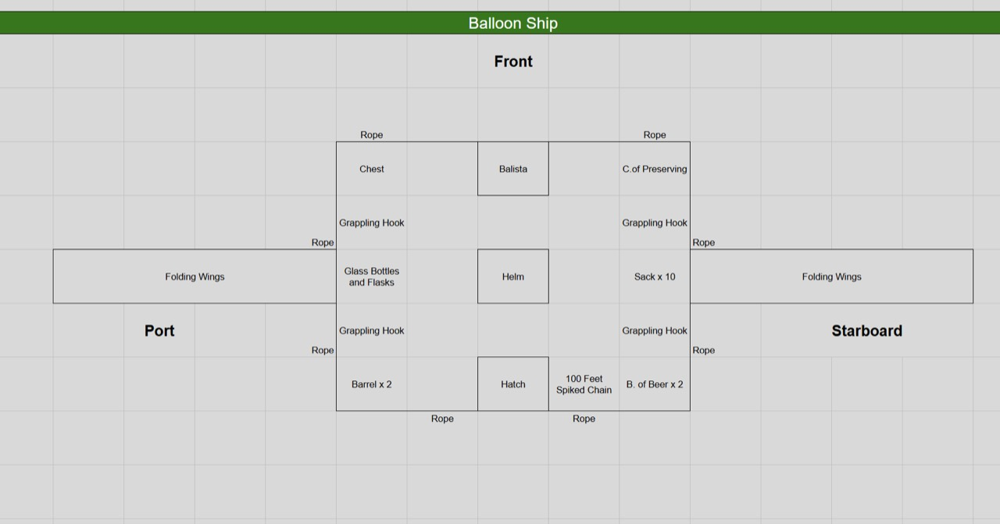
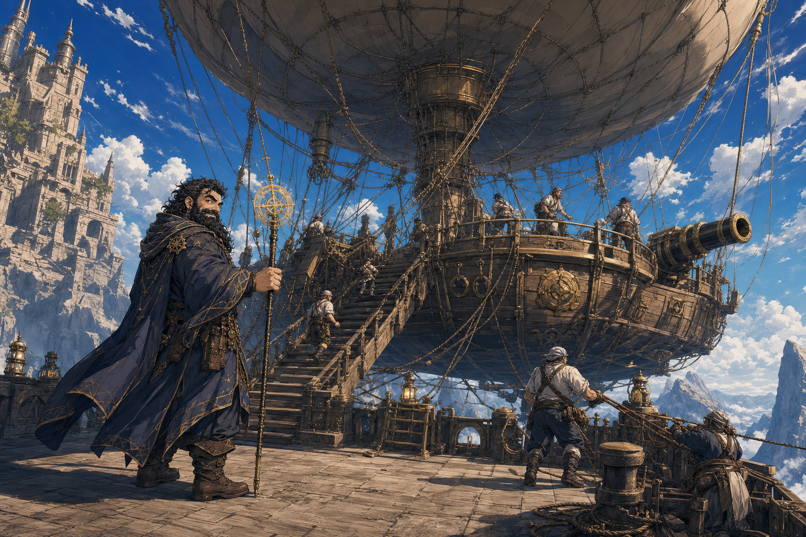
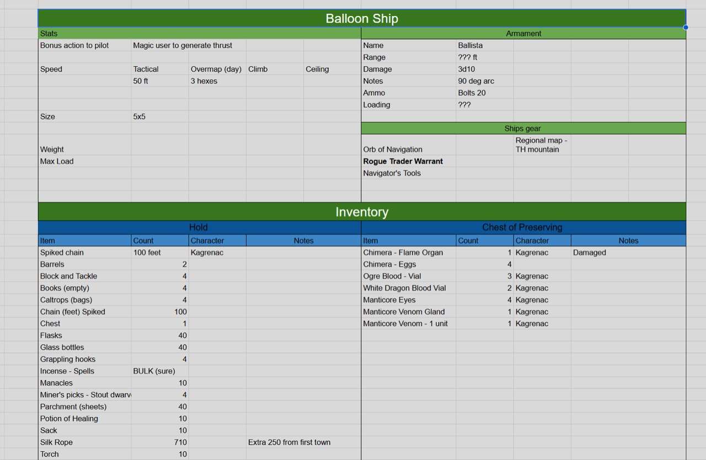

# Party Skyship - 2026-08-29

Earlier scene illustration (predates the tracker clarification of armament and the later metal-construction description; its wooden hull is illustrative and superseded by that description):

## One-Line Summary
The party's assigned sky transport from [Ola Dung Lot](./Ola%20Dung%20Lot.md), in the [Samryn Torsten](../Lore/Samryn%20Torsten.md) area: a metal, hot-air-balloon-like airship with a forward ballista, folding wings, a helm and stocked hold. The party has now begun burying it at the night storm stop.

## Status
- [Party] [Confirmed on 2026-10-03] The party describes the transport as a **metal airship** and begins burying it after surviving into night. Rain has stopped; wind, thunder and lightning remain. [Inferred identification] This is the established skyship being packed down at the same storm stop. Exact method, extent/completion, cargo access, damage and retrieval plan remain unreported. [Session](../../Adventures/2026-10-03.md)
- [Material clarification] The latest **metal** wording overrides wooden-hull depictions in older artwork. No new refit or change to the recorded balloon-like design, folding wings or ballista is reported.
- [Party] [Confirmed travel update on 2026-09-12] The party travels toward an unidentified tower, then stops to pack down the transport before forecast heavy winds overnight. [Inferred identification] The transport is read as this established balloon ship; exact packing method and completion are unrecorded. [Session](../../Adventures/2026-09-12.md)
- [Party] [Confirmed on 2026-08-29] The party has boarded this skyship, departed [Ola Dung Lot](./Ola%20Dung%20Lot.md) and is travelling south. Two [crymeria](../Characters/Crymeria%20Attackers%20-%202026-08-29.md) attacked after takeoff and were destroyed by the party. Whether `crymeria` means standard chimeras is [To verify].
- [Party] [Confirmed] Its overall design is more like a very large hot-air balloon than a conventional sailing ship.
- [Party] [Confirmed on 2026-09-12] The current tracker identifies the armament as a ballista and lists `20` bolts. Earlier narration called the weapon a cannon; whether that was shorthand, a replacement or an additional weapon remains [To verify]. Use the ballista as the current documented weapon without inventing an extra cannon.
- [To verify] Formal name, builder, Gondian affiliation, owner, commander, crew, assigned pilot, route, destination, range, lift details, fuel, balloon material, defenses, cargo capacity and whether the party owns the vessel or merely has mission use of it.
- [To verify] Whether this is the same Gondian airship previously used to reach Ola Dung Lot or a different vessel of a similar design.

## What Dain Knows
- The vessel is large enough to read visually as a gigantic hot-air balloon carrying a ship-like structure beneath it.
- The current tracker records a ballista with `20` bolts; the original cannon description is preserved as unresolved terminology.
- Earlier travel was airborne and southbound; it later stopped on the tower-bound route, and the party now begins burying the metal airship at night. No completed burial or departure on foot is established.
- Two airborne `crymeria` attacked it and were destroyed. The current hold records chimera material, but its provenance is not explicitly linked to that encounter; exact creature identity, approach and ship damage remain unresolved.

## Night Burial - 2026-10-03

- [Party] [Confirmed] Burial begins at night after rain stops, with wind, thunder and lightning remaining. Completion, depth, protection achieved, damage and cargo accessibility remain unreported.
- [Illustrative] Cropped hands, tools, hull fittings, bundled gear, trench arrangement and lightning placement do not establish a named digger, specific packing method or successful protection. [Prompt and reference](../../Adventures/2026-10-03/metal-airship-burial-image-notes.md)

## Current Ship Tracker - Imported 2026-09-12

Source: Photos 2 and 4 of the [current party tracker](../../Adventures/2026-09-12-party-tracker.md), supplied by Maitland. Values describe the tracker, not a new ship modification or resource refresh.

### Operation And Movement

| Field | Recorded value |
| --- | --- |
| Piloting | Bonus action to pilot |
| Thrust | Magic user to generate thrust |
| Tactical speed | 50 ft |
| Overmap (day) | 3 hexes |
| Size | 5x5; units not supplied |
| Climb | Blank / [To verify] |
| Ceiling | Blank / [To verify] |
| Weight | Blank / [To verify] |
| Max load | Blank / [To verify] |

- [To verify] Whether pilot and thrust provider must be the same person; any resource cost; overmap hex scale; size units. Do not infer dimensions from the drawing's spreadsheet grid.

### Armament

| Field | Recorded value |
| --- | --- |
| Name | Ballista |
| Range | ??? ft |
| Damage | 3d10; damage type not listed |
| Notes | 90 deg arc |
| Ammo | Bolts 20 |
| Loading | ??? |

- [To verify] Attack bonus, firing action, loading procedure, crew requirement and range. The deck shows one forward ballista; no second weapon is documented by these images.

### Ship Gear

- Orb of Navigation — note: `Regional map - TH mountain`. Exact function and expansion of `TH` [To verify].
- Rogue Trader Warrant — scope, issuer, beneficiaries and legal authority [To verify]; it is not automatically the previously sought introduction letter.
- Navigator's Tools.
- Hold and Chest of Preserving contents: [current Party Loot tables](../../Character/Party%20Loot.md#ship-hold).
- Communications: [Party Sending Stones](../Items/Party%20Sending%20Stones.md).

### Deck Layout

- Orientation: front at the top; port left, starboard right. Folding wings extend from both sides at midship.
- Forward: chest to port, ballista centrally, Chest of Preserving to starboard.
- Midship: glass bottles and flasks to port, central helm, sacks x10 to starboard.
- Aft: barrels x2 to port, central hatch, `100 Feet Spiked Chain` and `B. of Beer x 2` toward starboard.
- Four grappling-hook positions are shown, two on each side. Rope labels appear around the deck perimeter; they are placement labels, not extra quantities to add to the inventory.
- [To verify] Whether the two beer barrels are separate from the two generic barrels; whether the two chain rows in the inventory represent this one depicted 100-foot chain.

## Immediate Questions
- How is the metal airship being buried, how far does the work progress, and how will the party access its cargo and retrieve it?
- Who commands and pilots it?
- Where exactly is it taking the party first?
- What keeps the balloon aloft, and what happens if the envelope is damaged?
- What are the ballista's range, attack bonus, loading and firing requirements, and who operates it?
- Where are Dain's **three remaining [`Magic Mouth` scrolls](../Items/Magic%20Mouth%20Scrolls.md)**, the [Coal Mine Puppet](../Items/Coal%20Mine%20Puppet.md) and the party's Bag of Holding secured as the ship is buried? The three scrolls are last confirmed with Dain; no transfer into the ship is assumed.
- Does the ship already have magical fittings from Ben, or are further installations still possible?

## Notable Events
- 2026-08-29: The party prepares to board the balloon-like skyship in Ola Dung Lot. The user confirms that it resembles a very large hot-air balloon and carries some sort of cannon. [Session 2026-08-29](../../Adventures/2026-08-29.md)
- 2026-08-29: The skyship takes off toward the south and is attacked by two creatures called `crymeria`. [Session 2026-08-29](../../Adventures/2026-08-29.md)
- 2026-08-29: Taleesh descends rapidly on rope toward one attacker, and the party destroys both creatures. Dain then acquires a [Flying Broom](../Items/Flying%20Broom.md). [Session 2026-08-29](../../Adventures/2026-08-29.md)

- 2026-09-12: Maitland supplies current ship stats, inventory and deck layout. The tracker establishes a ballista, 20 bolts, movement figures and ship gear; the import does not establish acquisition or refit dates. [Tracker sources](../../Adventures/2026-09-12-party-tracker.md)
- 2026-10-03: The party survives into night and begins burying the **metal airship**. Rain has stopped, but wind, thunder and lightning remain; no completed burial, damage, rest or subsequent departure is reported. [Session](../../Adventures/2026-10-03.md)

## Related Entries
- [Ola Dung Lot](./Ola%20Dung%20Lot.md)
- [Samryn Torsten](../Lore/Samryn%20Torsten.md)
- [Dain Truthammer](../Characters/Dain%20Truthammer.md)
- [Session 2026-08-29](../../Adventures/2026-08-29.md)
- [Open Threads](../Lore/Open%20Threads.md)
