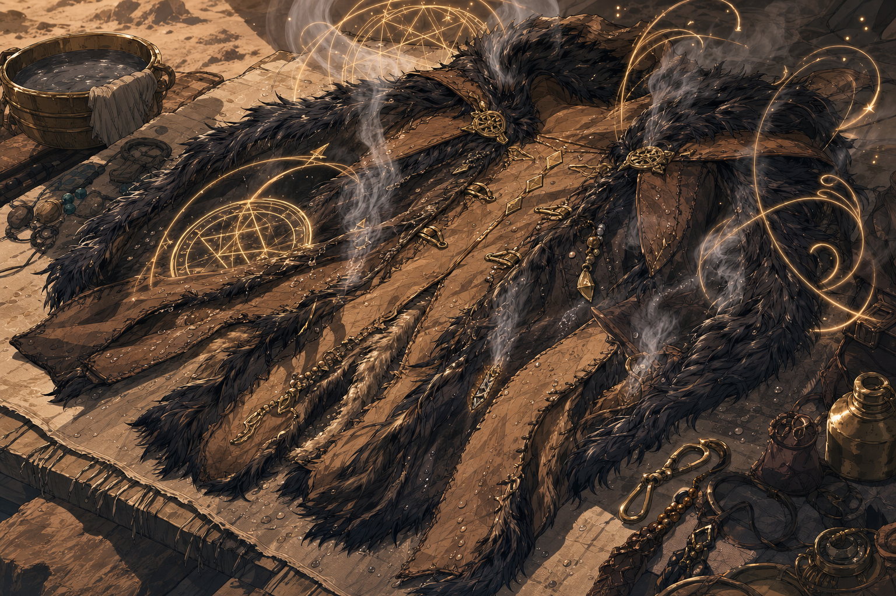

# Truthhammer’s Yellow Snow Coat

*Reused visual reference from the related [Sauna Pelt](../Items/Sauna%20Pelt.md), showing damp fur and heated condensation. This does not establish that the physical pelt and conjured jacket are the same object.*

## One-Line Summary
A conjured fur-lined jacket that protects against extreme cold while surrounding its wearer with warmth, dampness and socially disastrous winter wolf urine.

## Status
- [Confirmed user-supplied mechanics on 2026-09-12] The spell text below is preserved as supplied, including the `Truthhammer` spelling in the title.
- [Character-only] Recorded with Dain's custom magic. This supplies a spell description; it does not establish an in-world casting, consumed components, current active jacket or acquisition date.
- [To verify] Whether this is the finalized spell derived from the Sauna Pelt project, and when Dain learned it. Keep the existing physical item's ownership and retrieval history intact until that relationship is clarified.
- This is separate from the two confirmed Wizard 5 selections, Major Image and Stinking Cloud.

## Supplied Spell Text

1st-level conjuration (ritual)

Casting Time: 1 action
Range: Touch
Components: V, S, M (one flask of winter wolf urine per jacket, consumed)
Duration: 8 hours

You conjure a thick, fur-lined jacket on yourself or a willing creature you touch. It is warm, humid, and moist—never dry—slick with heated condensation and reeking of winter wolf urine. It fits over light armor and doesn’t hinder movement.

While worn, the jacket grants:

Immunity to extreme cold.

Resistance to nonmagical cold damage.

Disadvantage on Charisma checks interacting with humanoids.

Ordinary townspeople are automatically unfriendly and may refuse service, demand you leave, or summon the guard.

Creatures with Keen Smell can detect the wearer up to 1 mile away.

The jacket vanishes if doffed, if the wearer dies, or if you dismiss it as an action. You can dismiss one or all jackets as an action.

At Higher Levels. Cast using a 2nd-level slot or higher to conjure one additional jacket per slot level above 1st. Each jacket requires its own flask of winter wolf urine.

Classes: Artificer, Druid, Ranger, Wizard

## Table Reference
- At Dain's current spell-slot levels: 1st = one jacket / one flask; 2nd = two jackets / two flasks; 3rd = three jackets / three flasks.
- Protection distinguishes immunity to extreme cold from resistance to nonmagical cold damage; magical cold damage resistance is not granted by this text.
- The text specifies fitting over light armor. Compatibility with Dain's medium armor remains unspecified.
- Moisture does not explicitly apply the formal Wet condition from [Truthammer's Leaky Tent](./Truthammer%20Leaky%20Tent.md).
- Current winter wolf urine supply and any active jackets are unrecorded; no inventory expenditure is inferred.

## Notable Records
- 2026-09-12: Maitland supplies the complete spell description during session preparation. This records mechanics without inventing a creation scene or cast. [Session 2026-09-12](../../Adventures/2026-09-12.md)

## Related Entries
- [Dain Truthammer](../Characters/Dain%20Truthammer.md)
- [Spellbook](../../Character/Spellbook.md)
- [Sauna Pelt / Sauna Jacket](../Items/Sauna%20Pelt.md)
- [Always-Cold Robes](../Items/Always-Cold%20Robes.md)
- [Truthammer's Leaky Tent](./Truthammer%20Leaky%20Tent.md)
- [Open Threads](../Lore/Open%20Threads.md)
- [Session 2026-09-12](../../Adventures/2026-09-12.md)
